# RustEmuDroid

[English](README.md) · [Português brasileiro](README.pt-BR.md) · [Descargas para Windows y Linux](https://github.com/felipemarques/RustEmuDroid/releases/latest) · [Evolución del rendimiento frente a Kemu y BlueStacks (en inglés)](docs/performance-history.md)

RustEmuDroid ejecuta juegos y aplicaciones Android en una ventana de escritorio en Windows y Linux x86-64. El cliente en Rust arranca la máquina virtual, presenta los fotogramas de Android y envía las entradas de teclado, ratón y mando. Dentro de Android, la pantalla de inicio abre la biblioteca de juegos. Tanto el cliente como la biblioteca están libres de anuncios.

El idioma inicial es el portugués de Brasil. Abre los ajustes con el engranaje, elige **Español (España)** y guarda el cambio para aplicarlo al cliente y a la biblioteca. El inglés de Estados Unidos también está disponible. Cada juego instalado gestiona su propio idioma.


Los juegos de la captura se instalaron en el perfil de prueba. Un perfil nuevo contiene las aplicaciones incluidas en su imagen de Android.

## Ejecutar una versión compilada

1. Abre la [última versión en GitHub](https://github.com/felipemarques/RustEmuDroid/releases/latest) y busca **Assets**.
2. En Windows, extrae `RustEmuDroid-vX.Y.Z-windows-x86_64.zip` en un directorio con permisos de escritura. En Linux, extrae `RustEmuDroid-vX.Y.Z-linux-x86_64.tar.gz` con `tar -xzf` para conservar el permiso de ejecución. El nombre del archivo incluye la versión en lugar de `X.Y.Z`. En la versión actual, la v0.24.1, los archivos son `RustEmuDroid-v0.24.1-windows-x86_64.zip` y `RustEmuDroid-v0.24.1-linux-x86_64.tar.gz`.
3. En Windows, abre `rustemudroid.exe`. En Linux, ejecuta `./rustemudroid` desde la carpeta extraída. En un equipo sin entorno Android, selecciona **Instalar entorno o imagen de Android**.

| Tarea | Windows PowerShell | Linux |
|---|---|---|
| Comprobar el entorno y la virtualización | `.\rustemudroid.exe --lang es-es doctor` | `./rustemudroid --lang es-es doctor` |
| Abrir el emulador en español | `.\rustemudroid.exe --lang es-es ui` | `./rustemudroid --lang es-es ui` |

Para descargar una compilación de desarrollo, inicia sesión en GitHub, abre una [ejecución correcta de Desktop builds](https://github.com/felipemarques/RustEmuDroid/actions/workflows/build.yml) y descarga el paquete en **Artifacts**.

El ejecutable incluye el APK de la pantalla de inicio de RustEmuDroid. El ejecutable para Linux incluye además la pequeña biblioteca que protege la memoria de vídeo en las gráficas AMD (v0.24.1). El motor y la imagen Android se suministran por separado. Los motores experimentales para Windows, el de caché Vulkan y el de rendimiento, se compilan aparte y no forman parte de la descarga. Para compilar el proyecto también hacen falta Rust y Cargo.

## Preparar el entorno Android

| Requisito | Windows x86-64 | Linux x86-64 |
|---|---|---|
| Virtualización | Activa Intel VT-x o AMD-V en la BIOS/UEFI y la **Plataforma del hipervisor de Windows** en las características de Windows. | Activa la virtualización de CPU y comprueba los permisos de lectura y escritura con `test -r /dev/kvm && test -w /dev/kvm`. |
| Gráficos y escritorio | Instala el controlador de la GPU del equipo. | Utiliza una sesión X11 o Wayland con OpenGL. El selector de APK usa el portal de archivos del escritorio. Con una gráfica AMD, elige **GPU del equipo**: RustEmuDroid prepara por sí mismo la memoria de vídeo del emulador. [Gráficas AMD en Linux, en inglés](docs/linux-runtime.md#amd-graphics-on-bare-metal-linux) |
| Entorno Android | Utiliza el asistente, una instalación de Kemu o un SDK compatible. | Utiliza el asistente o un entorno x86-64 compatible. |

### Primera instalación desde RustEmuDroid

1. Elige **Original** para Android 15 AOSP o **Google Play** para Android 17 con Play Store. Pulsa **Revisar descarga** para ver la carpeta de destino, el tamaño máximo y las condiciones de Google.
2. Si aceptas las condiciones, marca la casilla y pulsa **Descargar e instalar**. RustEmuDroid descarga el emulador, ADB y la imagen directamente de Google y verifica el tamaño y la suma de comprobación de cada archivo. Reserva espacio adicional para la extracción.
3. Pulsa **Usar e iniciar este perfil**. Para añadir la otra imagen más adelante, abre el mismo asistente en Ajustes. El instalador reutiliza los componentes que ya ha instalado. Cada perfil tiene sus propios datos de aplicaciones.

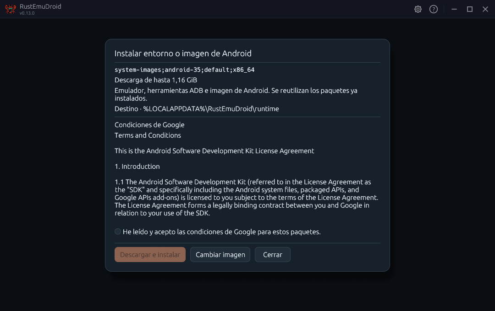

El asistente funciona sin una instalación previa de Android SDK, Android Studio, Java ni `sdkmanager`. En Windows se instala en `%LOCALAPPDATA%\RustEmuDroid\runtime`. En Linux utiliza `$XDG_DATA_HOME/RustEmuDroid/runtime` o, de forma predeterminada, `~/.local/share/RustEmuDroid/runtime`.

Desde el terminal, ejecuta el programa con `runtime-setup --image original` o `runtime-setup --image google-play` para consultar las condiciones y el tamaño. Tras leerlas, repite el comando con `--accept-license` para descargar. Si ya aceptaste exactamente las mismas condiciones, usa `--licenses-from <carpeta-de-licencias>`. Para instalar en otra carpeta, añade `--destination <carpeta>` al comando de instalación y abre el programa con `--sdk <carpeta> ui`. RustEmuDroid reconoce el emulador y el ADB instalados allí.

**Windows con Kemu.** Con Kemu en la ubicación predeterminada, ejecuta `.\rustemudroid.exe ui` para abrir el perfil Original. Para una instalación en otra carpeta, indica su ruta en `RUSTEMUDROID_KEMU_ROOT`. Este modo utiliza el ADB, la imagen y el motor de Kemu con la GPU del equipo o la selección automática.

**Entorno portátil en Windows o Linux.** Junto al ejecutable, crea una carpeta `runtime/`. Coloca en ella los paquetes completos `emulator/` y `platform-tools/` de tu sistema y el árbol `system-images/` con la imagen Android. Ejecuta `ui` desde la carpeta extraída. El cliente reconoce este entorno incluso sin Android Studio ni variables del SDK. Conserva las bibliotecas y todos los archivos de la imagen. Puedes seleccionar otra instalación mediante `--sdk`.

**Instalación mediante el SDK.**

Con `sdkmanager` en el PATH, instala el entorno y la imagen opcional de Google Play. Acepta las licencias del SDK cuando se soliciten.

```sh
sdkmanager --install "emulator" "platform-tools" "system-images;android-37.0;google_apis_playstore;x86_64"
```

Otra imagen compatible es `system-images;android-35;google_apis;x86_64`. Consulta los paquetes con `sdkmanager --list`. El cliente también localiza el SDK mediante `ANDROID_HOME`, `ANDROID_SDK_ROOT` y la carpeta predeterminada del sistema. [SDK Manager](https://developer.android.com/tools/sdkmanager) · [Aceleración del emulador](https://developer.android.com/studio/run/emulator-acceleration)

En Ubuntu 24.04 con WSL2, la versión v0.7.0 para Linux arrancó Android 17 con Google Play mediante KVM. En WSLg, BombSquad presentó 60 fotogramas/s en una ronda de Death Match con OpenGL ES nativo en la Radeon 780M mediante Mesa D3D12. Vulkan utilizó la CPU en ese equipo. [Configuración, selección del controlador y mediciones, en inglés](docs/linux-runtime.md)

## Elegir un perfil

En la barra de título, abre el engranaje. Cada perfil tiene su propio disco de datos, aplicaciones, cuentas y partidas guardadas. **Original** es el perfil predeterminado de ese directorio de trabajo. Su versión de Android depende de la imagen elegida.

| Perfil | Motor y primera ejecución |
|---|---|
| Original con Kemu | En Windows, una instalación de Kemu puede proporcionar su imagen Android 16 / API 36 y el motor QEMU/gfxstream correspondiente, con la GPU del equipo o la selección automática. La configuración probada utiliza ANGLE/Vulkan. Utiliza `RUSTEMUDROID_KEMU_ROOT` para otras ubicaciones. |
| Original con el SDK o un entorno portátil | En el primer arranque se buscan, por orden, Google Play API 37.0, Google APIs 36, Google APIs 35 y la imagen AOSP `default` x86-64 más reciente disponible. Para elegir otra imagen, usa `init --image`. |
| Android 17 con Google Play | Instala la imagen Google Play API 37.0, selecciona **Android 17** en Ajustes y guarda. Esta imagen del SDK incluye Play Store y los servicios de Google Play. La tarjeta indica cuándo falta la imagen. |

Los perfiles de juego solicitan cuatro vCPU, 8 GiB de RAM y 1600 × 900 a 60 Hz. El perfil genérico del SDK solicita cuatro vCPU, 3 GiB y 1080 × 1920. En Windows, el disco de datos del motor de Kemu está en `gaming/`.

Para probar una pantalla de alta frecuencia, abre **Ajustes → Gráficos → Frecuencia de actualización de Android**, elige un valor igual o inferior a la frecuencia actual de tu monitor y guarda los cambios. Android se reinicia. En la línea de comandos, usa `boot --refresh-rate 90`. **Usar la frecuencia del perfil** recupera la frecuencia original del perfil. En versiones compatibles de Android, elegir más de 60 Hz también solicita esa frecuencia para los juegos durante la sesión. Cada juego puede imponer un límite inferior. [Mediciones de SuperTuxKart](docs/game-testing.md#managed-windows-runtime-and-android-refresh-rate)

Para jugar en una ventana pequeña, activa **Ajustes → Gráficos → Ajustar el vídeo al tamaño de la ventana** y guarda los cambios. El reproductor nativo puede transferir menos píxeles por fotograma mientras el juego se renderiza a la resolución configurada en Android. La pantalla completa usa la resolución original. PNG y MP4 la conservan. El GIF y el JPEG XL animado toman los fotogramas originales y ajustan la salida a un máximo de 720 × 720. La opción viene desactivada y se puede cambiar durante la sesión. [Resultados de SuperTuxKart en ventana](benchmarks/stk-1.5/vulkan-end-scene.md#matching-the-screenshot-stream-to-the-windows-panel)

En Windows, abre **Ajustes → Entorno, imagen y perfil → Caché de memoria Vulkan (experimental)** para probar un motor SDK preparado. Usa **Elegir carpeta del motor…** para seleccionar su carpeta `sdk` o la carpeta que la contiene. Después, guarda y reinicia Android. El motor utiliza la imagen de Android y los datos de aplicaciones del perfil seleccionado. Para recuperar el motor habitual, pulsa **Volver al motor predeterminado** y guarda. [Preparar el motor con caché, instrucciones de compilación en inglés](experiments/whpx-clock/README.md#2-create-the-private-runtime).

<details>
<summary>Ver el ajuste de caché Vulkan</summary>

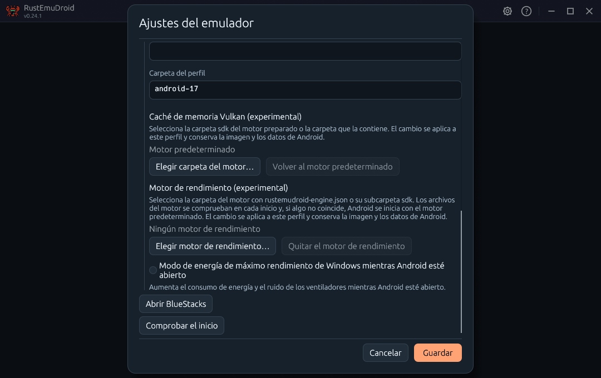

</details>

**Ajustes → Entorno, imagen y perfil → Motor de rendimiento (experimental)** selecciona para el perfil un motor de Windows compilado aparte. Usa **Elegir motor de rendimiento…** para seleccionar la carpeta que contiene `rustemudroid-engine.json` y `sdk`, activa las opciones que ofrece el motor, guarda y reinicia Android. En cada inicio, RustEmuDroid comprueba los SHA-256 del motor. Si falta un archivo o ha cambiado, o si el perfil no usa una imagen del SDK con **GPU del equipo** o **Automática**, indica el motivo e inicia Android con el motor predeterminado. **Quitar el motor de rendimiento** vuelve al motor habitual, y el siguiente inicio restaura el `config.ini` del perfil. Cada perfil usa este motor o la caché de memoria Vulkan, no ambos. Antes de volver a la v0.22.0 o a una anterior, quita el motor, guarda e inicia Android una vez. [Preparar el motor, instrucciones en inglés](experiments/whpx-clock/README.md#4-build-the-performance-engine)

Ajustes muestra una opción solo para los ajustes que el motor incluye. Tras el arranque, la **Salida del iniciador**, en Ajustes, indica qué ajustes ha confirmado el motor.

| Opción | Valor inicial | Qué hace |
|---|---|---|
| **Ajustes de virtualización del procesador** | Activada | Reloj sincronizado, acceso rápido al APIC y fin de interrupción paravirtualizado. En los motores que incluyen `whpx_apic_hv` (v0.24.0), el propio Windows emula el controlador de interrupciones, lo que sustituye a los dos últimos. Si el equipo no lo permite, el motor los mantiene y Android se inicia con normalidad. |
| **Memoria Vulkan con caché** | Activada | Los juegos escriben en la memoria gráfica por una ruta con caché. |
| **Comandos gráficos por memoria compartida** | Activada | Los comandos gráficos pasan por un anillo de memoria compartida, lo que ocupa aproximadamente un núcleo adicional del procesador mientras se ejecuta un juego. Escribe `hw.gltransport=asg` en el `config.ini` del perfil. |
| **Componer la pantalla con Vulkan** | Activada | El equipo compone la pantalla de Android con Vulkan y Android usa ANGLE para OpenGL ES. |
| **Núcleos dedicados para Android** | Activada | Cada procesador virtual recibe su propio núcleo físico, nunca el núcleo 0. Disponible cuando el PC tiene más núcleos físicos que los procesadores virtuales del perfil más dos. |
| **Reducir las protecciones del kernel de Android** | Desactivada | Desactiva las mitigaciones de vulnerabilidades del procesador y la limpieza de memoria dentro de Android. Úsala solo en un perfil dedicado a juegos. |

En el mismo grupo, **Modo de energía de máximo rendimiento de Windows mientras Android esté abierto** activa el modo de energía Máximo rendimiento de Windows mientras Android está abierto y restaura el anterior al cerrarlo. Funciona con cualquier motor, viene desactivada y no se usa con batería. [Medición más reciente con este motor](#benchmark-más-reciente) · [Series anteriores y límites, en inglés](docs/performance-history.md#performance-engine-in-uncapped-mailbox)


## Utilizar los controles de escritorio

| Tarea | Cómo hacerlo |
|---|---|
| Buscar e instalar | Busca en las pestañas de juegos o aplicaciones. Mantén pulsada una tarjeta para cambiarla de categoría. El botón de instalación de la barra lateral acepta un APK y actualiza la biblioteca. |
| Desplazarse por la biblioteca de Android | Sitúa el puntero sobre las tarjetas de **Juegos** o **Aplicaciones** y usa la rueda del ratón o desliza dos dedos en vertical sobre el panel táctil. |
| Navegar | El icono de cuatro cuadrados muestra las aplicaciones. La barra de título incluye **Atrás**, **Inicio** y **Aplicaciones recientes**. Inicio vuelve a los juegos. Haz clic para tocar y arrastra para deslizar. |
| Asignar el teclado o el mando | Abre un juego y pulsa el icono del teclado. Elige **Botón**, haz clic en el punto táctil y pulsa la tecla o el botón físico. Para usar WASD o la palanca izquierda, elige **Control direccional**, haz clic en el centro de la palanca virtual y ajusta su radio. Haz clic derecho en una marca para eliminarla. **Guardar** almacena las coordenadas relativas para ese paquete Android. En Windows, los mandos usan XInput. |
| Ajustar el sonido | Usa los controles de volumen y silencio de la barra lateral. Mantén pulsado un botón de volumen para cambiar varios niveles. La rotación también se controla desde esta barra. |
| Usar una cámara web | Elige cámara frontal o trasera del equipo en Ajustes. El índice 0 corresponde a la primera cámara. Guarda y reinicia Android para aplicar el cambio. Concede permiso a la aplicación Android cuando lo pida. También hay una cámara frontal simulada. |
| Pantalla completa y versión | Pulsa **F11**. Acerca el puntero al borde superior o derecho para mostrar los controles. La barra de título y el diálogo **?** indican la versión. |

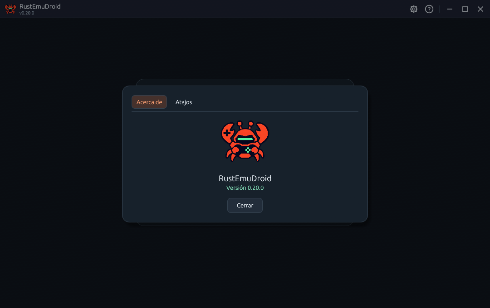

**Apagar Android** cierra la VM y vuelve al panel de sesión. Al cerrar la ventana con **X**, RustEmuDroid muestra el progreso del apagado y cierra la ventana al terminar la VM. Esto también funciona durante el arranque. Si el panel está inactivo, se cierra de inmediato.

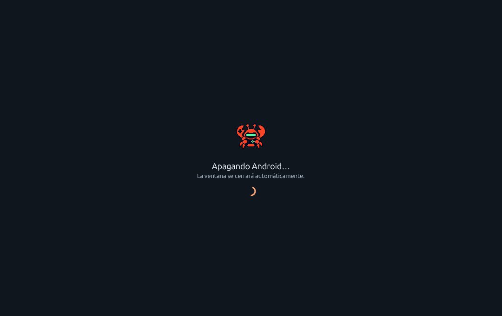

Después de apagar Android, el panel de sesión permite iniciar de nuevo el mismo perfil.

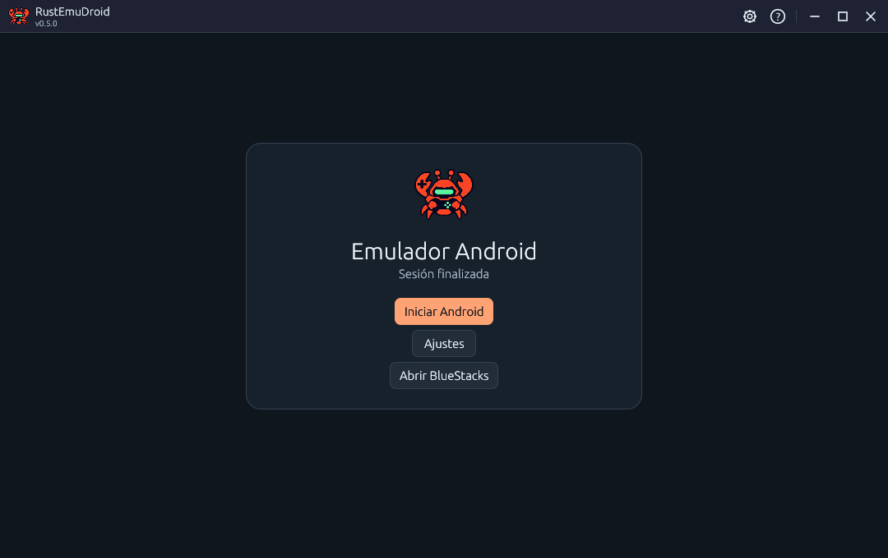

## Abrir una instancia instalada de BlueStacks en Windows

En Windows, selecciona **Abrir BlueStacks → Usar esta ventana** para ver la instancia instalada y sus juegos en RustEmuDroid. Mantén restaurada la ventana original del reproductor. Windows compone la imagen de Android dentro de la ventana Rust. Al desconectar, la instancia y el juego siguen abiertos. Si el Android de RustEmuDroid está en ejecución, se cierra antes de la conexión. Si cierras el reproductor de BlueStacks con la vista previa abierta, RustEmuDroid vuelve al lanzador. Para volver a conectarte, selecciona la instancia de nuevo.

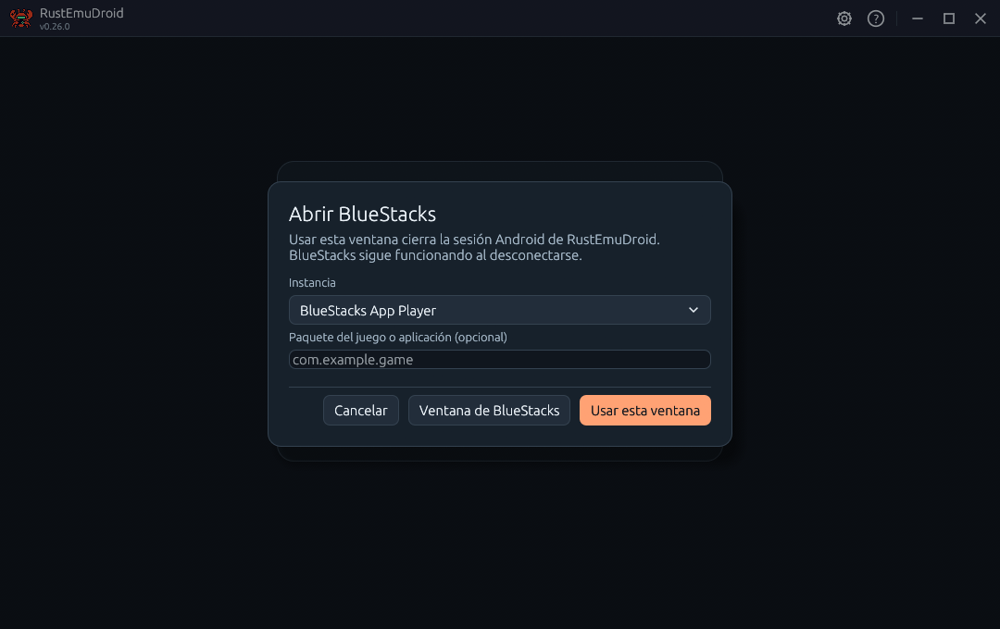

Para usar toques, arrastre, desplazamiento, teclado y los botones de navegación Android, activa **Android Debug Bridge (ADB)** en los ajustes avanzados de BlueStacks y vuelve a conectarte. Pulsa **Girar pantalla** en la barra de la vista previa para cambiar entre vertical y horizontal en las aplicaciones que admiten rotación. RustEmuDroid usa un cliente ADB moderno del entorno administrado o de Android Platform Tools. Con ADB desactivado, el modo solo permite visualizar. Para ver los fotogramas en la vista previa, selecciona **Ajustes → Contador de FPS → Superficie del juego en Android**. La sesión Android nativa también ofrece grabación y el contador del panel Rust.

Para instalar un juego desde tu PC, pulsa **Instalar APK** en la barra situada sobre la vista previa de BlueStacks, entre los iconos de cámara y carpeta. Elige el archivo `.apk` y espera la confirmación. Android instala el juego en la instancia de BlueStacks que has abierto. El botón usa la misma conexión ADB que los controles táctiles. Si Android rechaza el archivo, pasa el puntero sobre el mensaje de error para ver el motivo. [Confirmación en la barra](docs/screenshots/es-es/bluestacks-apk-installed.png)


Pulsa el icono de cámara o **Ctrl+Mayús+S** en la vista previa de BlueStacks para guardar la pantalla de Android a su resolución nativa. La captura PNG requiere una conexión ADB activa. El botón de carpeta abre `captures/` junto a `launcher.json`.

Para desplazarte por Android, coloca el puntero sobre la imagen y usa la rueda. Haz clic en la imagen para activar el esquema del juego. A partir de ese momento, cada dirección de la rueda que hayas asignado activa el control correspondiente.

En la vista previa de BlueStacks, abre un juego y pulsa el icono de teclado y elige **Editor de controles**, o pulsa **Ctrl+Mayús+A**. Coloca los controles sobre la captura. Android sigue ejecutando el juego mientras editas. Guarda para volver a la vista en directo. **Ctrl+Mayús+P** alterna entre los perfiles guardados para ese juego y esa instancia de BlueStacks. Mantén pulsados una dirección y un botón de acción a la vez para enviar dos toques. El editor muestra las marcas de las teclas. En la sesión Android nativa también puedes verlas mientras juegas y asignar el sensor de inclinación.

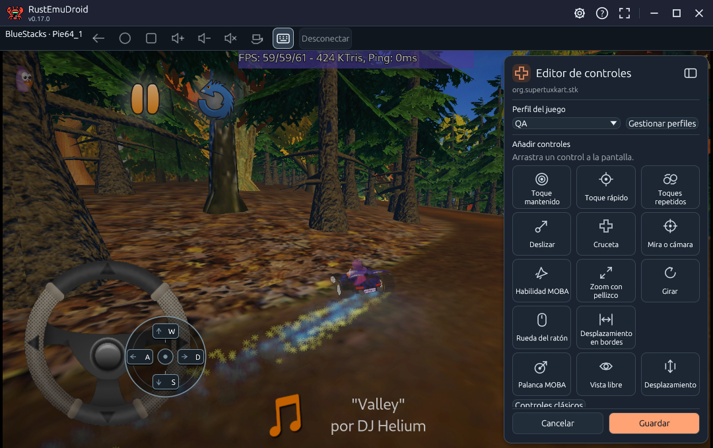

[Menú rápido de controles](docs/screenshots/es-es/bluestacks-quick.png)

**¿Puedo usar los juegos de mi copia de seguridad de BlueStacks?** En el PC de pruebas restauramos una copia del disco de datos en otra instancia Pie64 de la misma versión de BlueStacks. Arrancó Android 9 y mostró los cuatro juegos que comprobamos. Selecciona la instancia restaurada en **Abrir BlueStacks → Usar esta ventana**. [Prueba de restauración, en inglés](docs/bluestacks-lab.md#booting-an-archived-data-disk-with-the-installed-bluestacks-engine)

**¿Puedo arrancar la copia de la imagen sin instalar BlueStacks?** El híbrido experimental Pie64 llegó al servicio de sistema de Android (`system_server`) y se detuvo antes del inicio. El arranque de 29,5 segundos se midió con la imagen de referencia de Android 9. [Resultados de Pie64, en inglés](docs/bluestacks-lab.md#r2-fstab-compatibility-test)

**Si descargaste el ZIP de la versión publicada**, elige **Extraer todo** y abre en el Explorador de archivos la carpeta que contiene `rustemudroid.exe`. Haz clic en la barra de direcciones, escribe `powershell` y pulsa **Intro**. Indica en esa ventana la ruta del ejecutable.

```powershell
$emu = '.\rustemudroid.exe'
```

**Si clonaste el repositorio**, abre en el Explorador la carpeta que contiene `Cargo.toml` y escribe `powershell` en la barra de direcciones. El lanzador `Abrir RustEmuDroid.cmd` compila el ejecutable en esta ruta.

```powershell
$emu = '.\target\integrado\release\rustemudroid.exe'
```

Si es la primera compilación, ejecuta `cargo build --locked --release --features ui --target-dir target/integrado` en esa carpeta. Si ya utilizaste el directorio de compilación predeterminado de Cargo, usa `$emu = '.\target\release\rustemudroid.exe'`.

**Comprueba la ruta y enumera tus instancias.** Continúa en la misma ventana de PowerShell. `Test-Path` debe devolver `True`. Si devuelve `False` o PowerShell indica que no reconoce el comando, comprueba la carpeta y la ruta del ejecutable elegida arriba. El prefijo `.\` parte de la carpeta actual.

```powershell
Test-Path -LiteralPath $emu -PathType Leaf
& $emu bluestacks list
```

Ejemplo de salida de `list` en el equipo de prueba

```text
Pie64    BlueStacks App Player
```

La primera columna es el ID de la instancia. Para abrir la pantalla de inicio de BlueStacks, sustituye `Pie64` por el ID que aparezca en tu lista.

```powershell
& $emu bluestacks open --instance Pie64
```

Para abrir SuperTuxKart directamente, utiliza el siguiente comando si el juego está instalado en esa instancia. `--package` recibe el identificador del paquete Android del juego.

```powershell
& $emu bluestacks open --instance Pie64 --package org.supertuxkart.stk
```

Para ver el juego en RustEmuDroid, ejecuta

```powershell
& $emu bluestacks mirror --instance Pie64 --package org.supertuxkart.stk
```

Si la lista está vacía o aparece un error de instalación, abre el administrador de instancias de BlueStacks 5, confirma que hay una instancia instalada y vuelve a ejecutar `list`. En la interfaz de RustEmuDroid también puedes elegir **Abrir BlueStacks** en la pantalla de sesión o en los ajustes.

A partir de la v0.5.0, ambos paquetes incluyen una comprobación de almacenamiento de solo lectura en `tools/`. Apaga la instancia BlueStacks Pie64 y guarda copias de `fastboot.vdi` y `Data_orig.vhdx` en una carpeta `Pie64` junto a `tools/`. Ejecuta los comandos desde la carpeta extraída o desde la raíz del código fuente. Elige una carpeta nueva para los resultados en cada ejecución.

En Windows con Ubuntu 24.04 en WSL, ejecuta

```powershell
powershell -ExecutionPolicy Bypass -File .\tools\Test-BlueStacksData.ps1 -Images .\Pie64 -Output .\data-check
Get-Content .\data-check\result.json
```

En Linux o WSL, ejecuta

```sh
python3 -B tools/bluestacks_data_probe.py --images ./Pie64 --output ./data-check
cat ./data-check/result.json
```

La comprobación solo acepta el par exacto de imágenes Pie64 validado y verifica automáticamente los dos hashes SHA-256. Si las copias ya tienen un `manifest.json`, añade `-VerifyHashes` al comando de comprobación de Windows para verificar también los hashes de ese manifiesto.

El valor `true` en `factory_ext4_mounted_read_only` dentro de `result.json` indica que el entorno de diagnóstico montó el sistema de archivos ext4 de datos de fábrica en modo de solo lectura. El archivo `tools/README.md` del paquete enumera los requisitos.

En una prueba aparte con `-SystemMount` desde el código fuente, se montó la copia del sistema Android y el inicio de BlueStacks se detuvo en `android_id is empty`. Para jugar en esa instancia, usa **Abrir BlueStacks**. [Notas sobre el montaje del sistema, en inglés](docs/bluestacks-lab.md#opt-in-system-mount)

El cangrejo se mueve durante el arranque y el apagado, en la ventana de información y cuando la búsqueda de la pantalla de inicio queda vacía. La animación se detiene durante la partida.

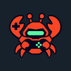

Pulsa **? → Atajos** en la barra de título para consultar las teclas disponibles, su función y cuándo usarlas.


## Capturar una partida

| Acción | Atajo | Archivo |
|---|---|---|
| Tomar una captura | **Ctrl+Mayús+S** | PNG a la resolución de la pantalla de Android |
| Iniciar o detener el vídeo | **Ctrl+Mayús+R** | MP4 H.264 sin sonido con un objetivo de 30 FPS |
| Grabar un momento | **Ctrl+Mayús+J** | Los tres segundos siguientes en JPEG XL animado a 10 FPS |
| Guardar una jugada reciente | **Ctrl+Mayús+H** | Los tres segundos anteriores en JPEG XL animado a 10 FPS, con la repetición instantánea activada |
| Grabar un GIF | Botón GIF de la barra lateral | Los tres segundos siguientes en un GIF en bucle a 10 FPS |

Para guardar un gol o un adelantamiento que acabas de ver, abre el reloj de la barra lateral y activa la repetición instantánea **antes** de jugar. Cuando esté lista, pulsa **Ctrl+Mayús+H** después de la jugada o guárdala desde el menú. La repetición empieza desactivada en cada sesión de Android. Al desactivarla se descarta el fragmento que quedaba en la memoria.

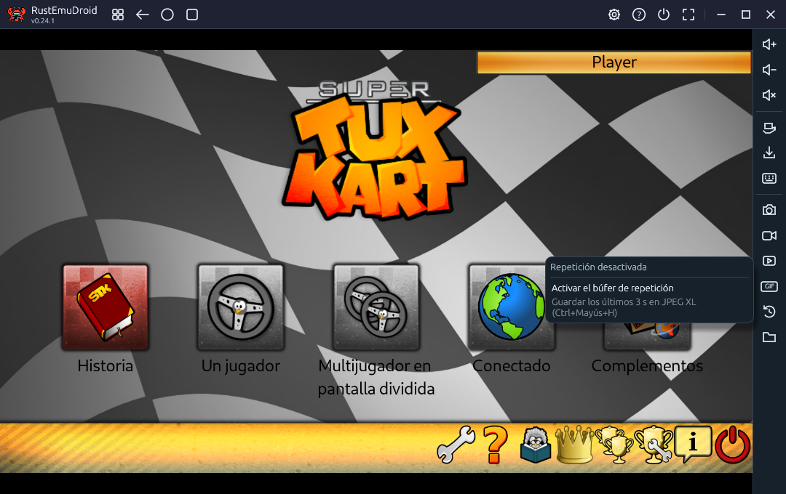

El botón de carpeta abre `captures/` junto a `launcher.json`. Rust guarda los PNG directamente. Para MP4, instala FFmpeg con `libx264`. Para JPEG XL animado, utiliza una compilación con `libjxl_anim`. Si FFmpeg no está en el PATH, configura `RUSTEMUDROID_FFMPEG` con la ruta del ejecutable. Las animaciones caben en 720 × 720 y conservan sus proporciones. Al cerrar la ventana, el cliente espera a que terminen las exportaciones en curso.

## Crear un esquema de controles

Abre el juego y pulsa el icono del teclado de la barra lateral para abrir **Controles del juego**. Elige teclado y ratón o mando para mostrar las indicaciones de ese dispositivo. Ambos siguen funcionando. En este menú también puedes ajustar la opacidad de las indicaciones y cambiar de esquema. En **Sensibilidad del ratón**, X ajusta el movimiento horizontal e Y el vertical al apuntar o usar la vista libre con el ratón. El esquema activo del juego guarda los dos valores. Utiliza 1,00 para recuperar la velocidad original de un eje.

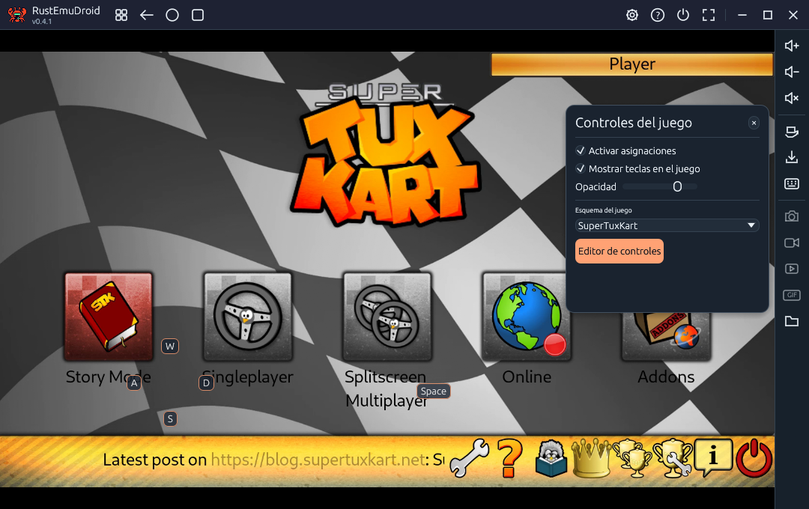

**Usa varios perfiles de controles en un mismo juego.** Pulsa **Gestionar perfiles** en el menú del teclado. Elige **Nuevo perfil** para empezar de cero o **Duplicar** para copiar las posiciones y asignaciones actuales. Ponle un nombre, por ejemplo *Conducción*, y pulsa **Aplicar**. En **Editar controles**, arrastra los controles sobre los botones del juego y pulsa **Guardar**. Para cambiar de perfil durante la partida, selecciónalo en **Perfil del juego** en el menú del teclado. Cada juego recuerda el último perfil que usaste, incluso después de cerrar el emulador. También puedes renombrar, eliminar, importar o exportar un perfil en **Gestionar perfiles**.

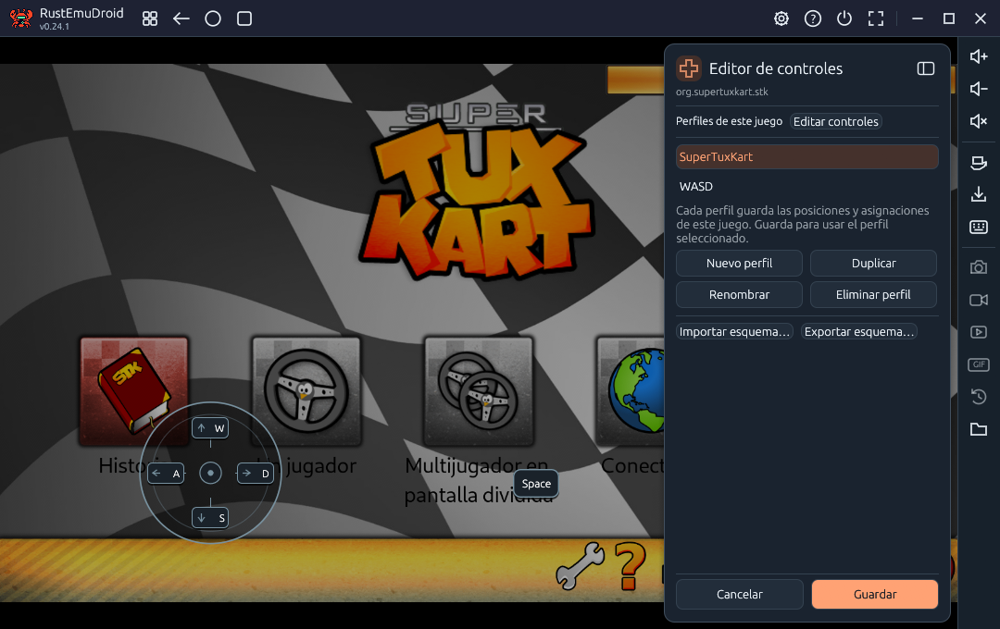

Durante la partida, pulsa **Ctrl+Mayús+P** para activar el siguiente perfil guardado del juego. Después del último vuelves al primero. El nombre aparece en pantalla para confirmar el cambio.

Elige **Editor de controles** en el menú o pulsa **Ctrl+Mayús+A**. Arrastra un control de la paleta a la pantalla del juego y selecciónalo para asignarle una entrada y ajustar sus propiedades. Para el movimiento, suelta una **Cruceta** sobre la palanca virtual del juego. En **Ajustes del control**, asigna **Arriba**, **Abajo**, **Izquierda** y **Derecha** por separado. Haz clic en el centro de la cruceta para seleccionarla y arrastra el tirador de la esquina inferior derecha para adaptar el radio al tamaño de la palanca. El tirador y el panel ajustan el mismo radio. En **Palanca**, elige **Izquierda** o **Derecha** para usarla junto con las teclas de dirección. Elige **Desactivada** para usar solo las direcciones asignadas. Pulsa **Guardar** para aplicar el esquema.

En mapas que se mueven al arrastrar, suelta **Desplazamiento en bordes** en una zona libre del mapa y guarda. Lleva el puntero a un borde de la pantalla del juego para mover la cámara en esa dirección. Ajusta el margen y la velocidad de cada eje en **Ajustes del control**. Aleja el puntero del borde para detener el movimiento.

En juegos que responden a los sensores de movimiento, añade **Inclinar**, asigna una tecla o un botón y elige el eje X, Y o Z y un ángulo de −45° a +45° en **Ajustes del control**. Mantén pulsada la tecla o el botón para inclinar el dispositivo virtual desde su orientación actual. Suelta el control para recuperar la orientación original. El control requiere compatibilidad con los sensores virtuales.

En juegos con movimiento por clic, suelta **Palanca MOBA** sobre la palanca virtual y usa **Situar al héroe** para marcar la posición del personaje en pantalla. Haz clic derecho en el destino para mover la palanca en esa dirección. Ajusta el radio y la velocidad del héroe según el juego. Asigna **Detener movimiento** si quieres interrumpir un desplazamiento. Usa **Habilidad MOBA** para apuntar una habilidad desde su botón en el juego.

Coloca **Vista libre** sobre el control de cámara del juego. Asigna cada dirección o activa **Mirar con el ratón** y mantén pulsada la tecla asignada mientras mueves el ratón. En una aplicación o un mapa que se desplaza al arrastrar, suelta **Desplazamiento** en esa zona y usa la rueda sobre la pantalla del juego. Ajusta la velocidad y la amplitud y elige si este control sustituye otras acciones asignadas a la rueda.

Para conducir con un volante en pantalla, coloca **Girar** en el centro del volante y activa **Volante de un toque**. Ajusta el ángulo inicial del toque, el radio y el ángulo de giro. Con un ángulo de giro positivo, la tecla principal gira en sentido horario y **Giro inverso** gira en sentido antihorario. Cada dirección mantiene un toque hasta que sueltas la tecla. Por defecto, **Girar** usa dos dedos.

La paleta tiene 15 opciones para 14 tipos de control. **Rueda del ratón** ofrece un control **Deslizar** ya configurado para una dirección de la rueda.


*El idioma de SuperTuxKart se puede cambiar en los ajustes del propio juego.*

## Compilar desde el código fuente

Instala Rust estable y Cargo. En Windows, instala las herramientas de desarrollo de escritorio C++ de Visual Studio y el SDK de Windows. En Ubuntu 24.04, instala las dependencias nativas:

```sh
sudo apt-get update
sudo apt-get install -y build-essential pkg-config libudev-dev libwayland-dev libxkbcommon-dev libx11-dev libxi-dev libxrandr-dev libxcursor-dev libgl1-mesa-dev
git clone https://github.com/felipemarques/RustEmuDroid.git
cd RustEmuDroid
cargo build --locked --release --features ui
cargo run --locked --release --features ui -- --lang es-es ui
```

En Windows, [Abrir RustEmuDroid.cmd](Abrir%20RustEmuDroid.cmd) compila el cliente y abre o enfoca su ventana. Para compilar solo la línea de comandos, omite `--features ui`. En Linux, la compilación también genera una pequeña biblioteca en C con `cc` (incluido en `build-essential`), que el cliente carga en el motor con gráficas AMD.

## Línea de comandos y almacenamiento

```sh
cargo run --locked -- --lang es-es doctor
cargo run --locked -- init --image "system-images;android-35;google_apis;x86_64"
cargo run --locked -- boot --headless --check --gpu auto
cargo run --locked -- --lang es-es boot --help
```

Para usar la imagen instalada de Kemu en Windows con un directorio independiente:

```powershell
cargo run --locked -- --state-dir .rustemudroid/kemu init --system-dir "C:/Program Files/Kemu/system-img"
cargo run --locked --release --features ui -- --state-dir .rustemudroid/kemu ui
```

Usa el mismo `--state-dir` para inicializar, arrancar y abrir la interfaz. El directorio predeterminado es `.rustemudroid/windows/` o `.rustemudroid/linux/`, relativo al directorio de trabajo. `launcher.json` conserva las preferencias. En el perfil activo encontrarás el AVD y `boot-*.log`. El comando `boot --check` espera a `sys.boot_completed=1` y detiene esa VM. `--timeout` establece el límite en segundos y `--engine sdk` selecciona el motor del SDK. El cliente elige puertos libres y comprueba la ruta del AVD antes de apagarlo.

En Windows, `boot --vulkan-cache-runtime <carpeta>` inicia el perfil con un motor de caché Vulkan preparado, y `boot --performance-engine <carpeta>` lo inicia con un motor de rendimiento y sus opciones predeterminadas, sin la opción del kernel. No se pueden combinar. El motor de rendimiento escribe `hw.gltransport` en el `config.ini` del perfil y guarda las líneas originales en `rustemudroid-performance.json`, junto a él. El siguiente inicio sin el motor las restaura.

```powershell
.\rustemudroid.exe --state-dir 'D:\Android\MyProfile' boot --gpu host --performance-engine 'D:\Android\PerformanceEngine'
```

En Linux con una gráfica AMD, define `RUSTEMUDROID_AMD_LINUX` antes de abrir el cliente para diagnosticar la gestión de la memoria de vídeo: `off` inicia el motor como antes de la v0.24.1, y `stock`, `full-size` o `all-types` fuerza ese modo de memoria.

## Rendimiento y diagnóstico

### Benchmark más reciente

**SuperTuxKart 1.5 con Vulkan sin límite en la RTX 5070 Ti · 26 de noviembre de 2026 · cliente RustEmuDroid v0.22.0.** BlueStacks quedó por delante en los dos modos de energía de Windows.

| Modo de energía de Windows | RustEmuDroid, motor de rendimiento | BlueStacks 5 Pie64 | Ventaja de BlueStacks |
|---|---:|---:|---:|
| Equilibrado | 392,9 FPS (2 vueltas) | **402,5 FPS** (4 vueltas) | 2,4 % |
| Máximo rendimiento | 393,6 FPS (8 vueltas) | **419,3 FPS** (4 vueltas) | 6,5 % |

Los dos ejecutaron la repetición integrada Black Forest del juego en calidad alta, con Vulkan y el VSync del juego desactivado (Mailbox, sin límite), a 1600 × 900 y 90 Hz en Android, en el PC de pruebas con Windows (Ryzen 9 8945HS, GeForce RTX 5070 Ti). Los FPS proceden del informe de fotogramas del propio juego. Los dos emuladores se alternaron en una sola sesión, entre las 16:06 y las 16:47, con otros programas usando 0,54–0,68 núcleos del equipo durante las vueltas de RustEmuDroid. RustEmuDroid ejecutó la imagen oficial Android 17 Google Play en el motor de rendimiento compilado aparte, con los ajustes de las seis opciones, incluida **Reducir las protecciones del kernel de Android**, y con el controlador de interrupciones emulado por Windows, en un panel de 800 × 450. BlueStacks ejecutó Android 9 en su propio reproductor.

La ventana Rust era el cliente **v0.22.0**, y un operador de pruebas aplicó los ajustes del motor alrededor de él. Es una comparación histórica con un cliente antiguo. Las versiones v0.23.0 y v0.24.0 añadieron la forma propia del cliente de aplicar esos ajustes, y la v0.24.1 solo cambió el comportamiento en Linux; ninguna de ellas se midió aquí. El motor de rendimiento se compila a partir del kit de fuentes publicado y no forma parte de la descarga. El motor predeterminado y Kemu no se midieron en esta serie. El valor de RustEmuDroid en Equilibrado procede de un solo arranque, porque una ejecución se rechazó al empezar y un segundo arranque se perdió cuando adb no respondió a tiempo. [Registro completo, en inglés: valores por vuelta, identidades y qué falló](benchmarks/stk-1.5/windows-rtx-mailbox-hypervisor-apic-bluestacks.md)

### Mediciones anteriores

Las cifras siguientes se midieron en versiones anteriores y se conservan aquí como historial. Cuando el informe indica la versión del cliente, aparece en el texto. [Evolución del rendimiento desde el primer prototipo, en inglés](docs/performance-history.md)

Las pruebas en Windows comparan las transiciones de menú y el campo de entrenamiento de PUBG, además de la repetición de SuperTuxKart, en las GPU dedicada e integrada. Cada resultado indica la escena, el contador de fotogramas y los ajustes gráficos. [Tabla comparativa de FPS](docs/game-testing.md#fps-comparisons-on-the-windows-test-pc)

Para comparar PUBG en tu PC, mide la misma escena en RustEmuDroid y BlueStacks. La herramienta indica cuántos fotogramas nuevos presentó Android por segundo y cuánto duró la pausa más larga entre ellos. [Comandos y método de medición, en inglés](docs/game-testing.md#record-a-game-scene-on-your-own-pc)

El [benchmark de la Radeon 780M, en inglés](benchmarks/stk-1.5/radeon-780m/README.md), compara la gráfica integrada en RustEmuDroid, Kemu y BlueStacks. Incluye las mediciones de cada carrera y la verificación de la GPU del equipo.

Para comparar las tarjetas gráficas en Windows, abre **FPS WW2 URP → Start Game → Level 1**. Activa **Settings → Display FPS** para ver el contador del juego. Para probar otra escena con Vulkan, abre **andar → Continue → Begin → Skip** y mira hacia la verja bajo la lluvia. Medimos las dos escenas en la Radeon 780M y la RTX 5070 Ti. [Resultados de FPS WW2 URP](docs/game-testing.md#radeon-780m-vulkan-compatibility) · [Resultados y descarga de ANDAR](docs/game-testing.md#andar) · [Todas las pruebas, en inglés](docs/game-testing.md)

**PUBG y SuperTuxKart en Windows, v0.18.0 y v0.21.1.** A 1600 × 900 con la RTX 5070 Ti, el recorrido entre el vestíbulo y el inventario de PUBG en Balanced/High registró una media de 25,20 FPS en RustEmuDroid 0.18.0 y 29,58 en BlueStacks Pie64, medidos en Android. Al cerrar el inventario por primera vez, la pausa fue de 1,60–1,68 s en Android 17 y de 0,17 s en Pie64. A 90 Hz en la RTX, la misma versión x86-64 de SuperTuxKart registró 85,62 FPS en RustEmuDroid 0.21.1, 90,02 en Kemu 0.7.1 y 89,99 en BlueStacks. Se hicieron dos carreras por emulador en calidad alta con Vulkan FIFO. En la Radeon 780M integrada, en una serie anterior cuyo informe no indica la versión del cliente, SuperTuxKart en calidad alta, con un límite de 60 FPS, registró 59,71 FPS en el perfil Android 17 con Vulkan, 59,87 en Kemu y 59,99 en BlueStacks. Los dos últimos usaron OpenGL ES. [Tiempos por fotograma de PUBG](docs/game-testing.md#pubg-inventory-retest-with-rustemudroid-v0180) · [Ajustes y resultados de SuperTuxKart](benchmarks/stk-1.5/radeon-780m/README.md) · [Carreras a 90 Hz con la v0.21.1](benchmarks/stk-1.5/windows-current-three-players.md)

### Diagnóstico

- **FPS.** En **Ajustes → Contador de FPS**, elige **Panel Rust** (predeterminado) para contar los fotogramas procesados por el panel o **Superficie del juego en Android** para contar los fotogramas que Android presenta para el juego en primer plano. Pulsa **Guardar** para aplicar el cambio al instante. La segunda opción también funciona en la vista previa de BlueStacks con ADB conectado. Un guion indica que la medición está comenzando o que Android no ha identificado la superficie del juego. Una escena estática puede marcar cero. El contador interno de cada juego mide su propia tasa de renderizado.
- **Pantalla en negro o gráficos lentos.** Ejecuta `doctor`, comprueba el adaptador Vulkan y prueba el modo de GPU del equipo o automático. En Linux, la opción **Automática** termina por ahora en el renderizador por software del emulador; elige **GPU del equipo** para usar la tarjeta gráfica. El modo por software (Software/SwiftShader) permite aislar fallos del controlador. En Linux, el motor del SDK usa una ruta de compatibilidad GLES con la imagen de Kemu.
- **Probar la gráfica integrada en un PC Windows con dos GPU.** Elige la integrada en **Tarjeta gráfica Vulkan**. El compositor de pantalla de Android puede seguir usando la otra GPU para OpenGL. Para usar la integrada en ambos casos, localiza el `qemu-system-x86_64.exe` en ejecución en el Administrador de tareas, añade ese ejecutable en **Configuración → Sistema → Pantalla → Gráficos** y selecciona la opción con el nombre de la GPU integrada. Reinicia Android. La preferencia de Windows también se aplica a otras instancias que usen el mismo ejecutable. [Cómo verificamos ambos renderizadores](docs/game-testing.md#inventory-on-the-radeon-780m)
- **Fallos de asignación de memoria Vulkan en la Radeon 780M.** En Windows, selecciona el perfil **Android 17 Google Play**, elige **GPU del equipo** o **Automática** y selecciona explícitamente **AMD Radeon 780M Graphics**. Activa **Memoria Vulkan compartida (Radeon 780M)** en **Gráficos**, guarda y reinicia Android. Esta opción experimental está desactivada de forma predeterminada, se aplica por perfil y se verificó con Android Emulator SDK 37.3.10.
- **Los juegos se cierran o congelan Android en Linux con una gráfica AMD.** Elige **GPU del equipo**: en Linux, la opción **Automática** termina por ahora en el renderizador por software del emulador, porque el cliente inicia el motor con `-no-window`. Desde la v0.24.1 el cliente prepara una protección de la memoria de vídeo para el motor y, con la GPU del equipo, muestra a Android toda la memoria de vídeo de la tarjeta, en lugar de la ventana pequeña que alcanza el procesador. Los **Detalles técnicos** muestran la línea `Gráfica AMD en Linux: …`. Si aun así el controlador pierde el dispositivo, el fallo aparece ahora como `El controlador gráfico ha perdido el dispositivo y el motor se ha cerrado (…)`, con la ruta del registro. Si Android se detiene con un mensaje sobre la virtualización del procesador y la memoria gráfica, activar **Above 4G Decoding** y **Resizable BAR** en el firmware o usar Linux 6.13 o posterior debería evitarlo; ninguna de las dos opciones se ha medido. `doctor` muestra el mismo consejo cuando corresponde. Todo esto se midió en un solo PC, con una Radeon RX 580 y Linux 6.8. [Mediciones y límites, en inglés](docs/linux-runtime.md#amd-graphics-on-bare-metal-linux)
- **Varios dispositivos ADB.** Usa `adb devices -l` y dirige cada comando al dispositivo correcto con `adb -s <serial>`. La salida del iniciador indica el identificador de la sesión.
- **PUBG MOBILE se cierra al iniciar en Android 17 Google Play.** Desde la v0.2.1, el lanzador selecciona el controlador ANGLE integrado para `com.tencent.ig` en esta imagen x86-64 con Vulkan y renderizado automático o mediante la GPU del equipo. Se respeta una preferencia previa para el juego. En Linux, desde la v0.13.3 el lanzador omite la selección automática de ANGLE cuando el registro confirma que Vulkan seleccionó un dispositivo de CPU. En una RTX 5070 Ti, esto solucionó el fallo del controlador EGL al presentar un fotograma. [Selección de controlador por aplicación en Android](https://developer.android.com/games/develop/vulkan/overview)
- **PUBG se queda en los logotipos iniciales en Android 16 de Kemu.** Abre **Ajustes → Compatibilidad de juegos**, activa **Traducción ARM ligera para PUBG** y guarda el cambio. Si Android está en marcha, selecciona **Guardar y reiniciar Android**. En el perfil Original de RustEmuDroid, la compilación 21718 mostró el aviso de actualización a los 56 segundos y después la pantalla de bienvenida. En un perfil nuevo de Kemu Qt 0.7.1, la misma compilación se cerró antes de llegar al vestíbulo con ambos modos de traducción. El ajuste se aplica a todas las aplicaciones ARM durante ese arranque. [Prueba en el perfil Original](docs/game-testing.md#pubg-startup-on-kemu-android-16) · [Prueba en Kemu Qt](benchmarks/pubg-mobile/windows-kemu-qt-21718.md)
- **Faltan juegos después de cambiar de perfil.** Vuelve al perfil donde se instalaron. Una copia recién clonada del repositorio no contiene juegos instalados ni cuentas.

## Arquitectura y verificación

| Componente | Función |
|---|---|
| [Cliente de escritorio](src/ui.rs) | Rust con eframe/egui y Glow. Gestiona la ventana nativa, los controles, los ajustes y la pantalla de apagado. |
| [Prototipo con GPUI](experiments/README.md) | Una ventana independiente de Rust muestra Android en directo. Al reproducir la misma grabación del kart con ambos visores publicados en la Radeon 780M, Windows registró 71,18 presentaciones/s con GPUI y 82,50 con Glow, el renderizador actual. [Mediciones](experiments/results/windows-viewers-stk-presentmon.md#published-gpui-lab-v011) · [Ver la interfaz](experiments/screenshots/gpui-es-ES.png) |
| [Ciclo de vida de la VM](src/android.rs) | Descubre el SDK y las imágenes, crea los AVD, inicia el motor elegido y espera a que termine. En Windows también comprueba e inicia el motor de caché o de rendimiento elegido para el perfil. En Linux prepara la protección de la memoria de vídeo en gráficas AMD y lee el registro del motor para detectar la pérdida del dispositivo gráfico o una VM congelada. |
| [Protección de la memoria de vídeo AMD](native/linux/userptr_guard.c) | Pequeña biblioteca en C para Linux, compilada con el cliente y cargada en el motor cuando el equipo tiene una gráfica AMD. |
| [Vídeo y entrada](src/display.rs) | Recibe fotogramas mediante gRPC local autenticado desde `EmulatorController.streamScreenshot`, conserva el fotograma RGBA pendiente más reciente y reenvía los eventos táctiles y de teclado. |
| [Pantalla de inicio](android/home) | Actividad nativa de Android que consulta el PackageManager y muestra las imágenes de portada o los iconos de las aplicaciones. El cliente instala mediante ADB el APK de desarrollo incluido. |

Ejecuta `cargo test --locked --features ui` para las pruebas sin conexión. En Linux también compilan y ejecutan la prueba propia de la biblioteca de protección AMD, lo que requiere un compilador de C. [GitHub Actions](.github/workflows/build.yml) prueba y compila los ejecutables de versión para Windows y Ubuntu x86-64 en cada push, pull request y ejecución manual. Las pruebas con Android real necesitan un AVD local. Para repetir la prueba de cierre de la ventana nativa en Windows, configura `RUSTEMUDROID_TEST_STATE` con la ruta absoluta de un perfil inactivo y ejecuta `cargo test --locked --features ui real_window_paints_until_android_exits -- --ignored --nocapture`.

Para reconstruir la pantalla de inicio necesitas un JDK, el `android.jar` de una plataforma y las herramientas de compilación de Android. Ejecuta `python android/home/build.py <android.jar> <build-tools-dir>`. El script usa `~/.android/debug.keystore` de forma predeterminada y admite `--keystore` y `--alias`. Para actualizar instalaciones existentes, conserva la identidad de firma y actualiza el código de versión en el manifiesto y en la [comprobación de instalación](src/controls.rs).
