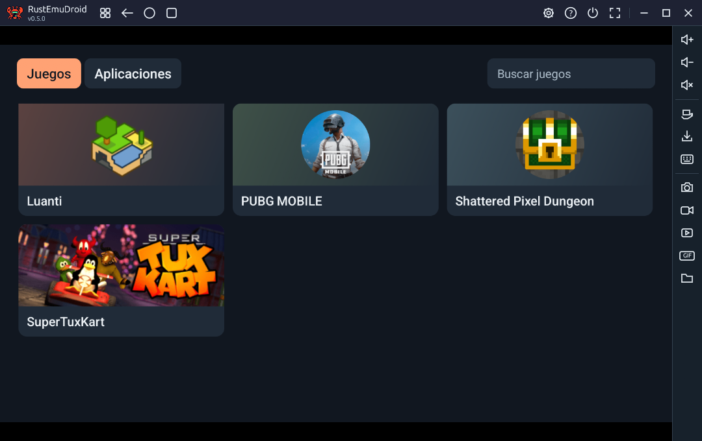
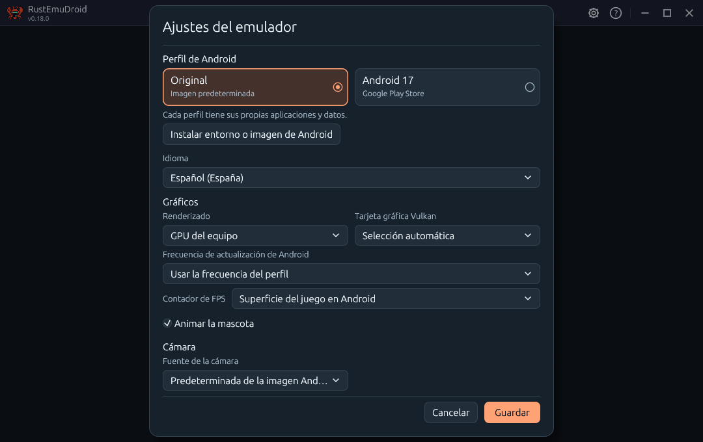
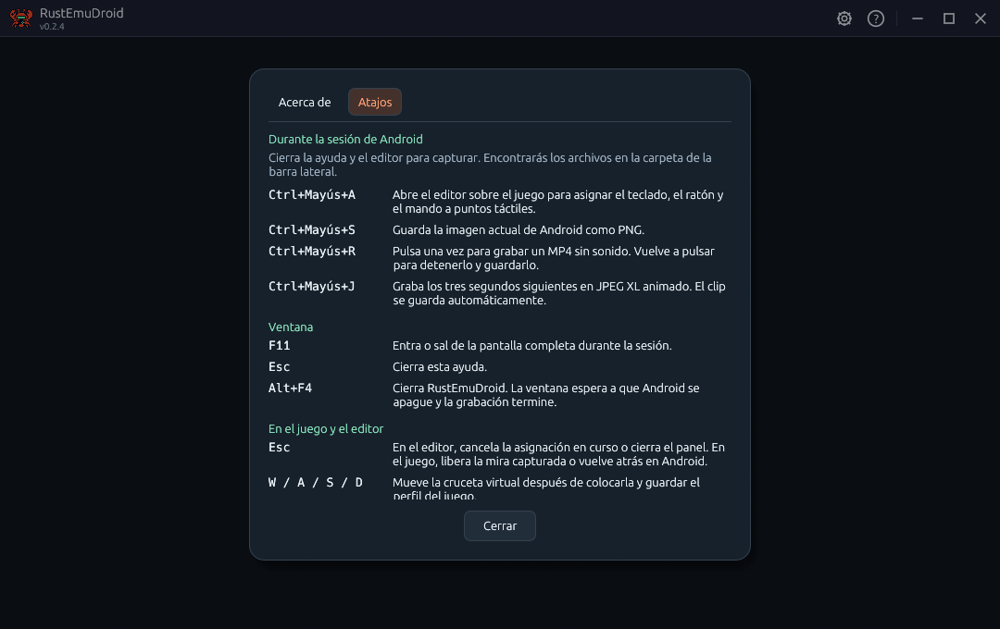
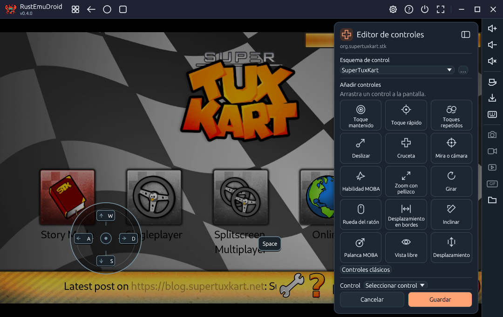

# RustEmuDroid

[English](README.md) · [Português brasileiro](README.pt-BR.md) · [Descargas para Windows y Linux](https://github.com/felipemarques/RustEmuDroid/releases/latest) · [Pruebas de rendimiento](benchmarks/stk-1.5/README.md)

RustEmuDroid ejecuta juegos y aplicaciones Android en una ventana de escritorio en Windows y Linux x86-64. El cliente en Rust arranca la máquina virtual, presenta los fotogramas de Android y envía las entradas de teclado, ratón y mando. Dentro de Android, la pantalla de inicio abre la biblioteca de juegos. Tanto el cliente como la biblioteca están libres de anuncios.

El idioma inicial es el portugués de Brasil. Abre los ajustes con el engranaje, elige **Español (España)** y guarda el cambio para aplicarlo al cliente y a la biblioteca. El inglés de Estados Unidos también está disponible. Cada juego instalado gestiona su propio idioma.



Los juegos de la captura se instalaron en el perfil de prueba. Un perfil nuevo contiene las aplicaciones incluidas en su imagen de Android.

## Ejecutar una versión compilada

1. Abre la [última versión en GitHub](https://github.com/felipemarques/RustEmuDroid/releases/latest) y busca **Assets**.
2. En Windows, extrae `RustEmuDroid-vX.Y.Z-windows-x86_64.zip` en un directorio con permisos de escritura. En Linux, extrae `RustEmuDroid-vX.Y.Z-linux-x86_64.tar.gz` con `tar -xzf` para conservar el permiso de ejecución. El nombre del archivo incluye la versión en lugar de `X.Y.Z`.
3. Instala el entorno Android indicado a continuación. Desde el directorio del ejecutable, utiliza los comandos de tu sistema.

| Tarea | Windows PowerShell | Linux |
|---|---|---|
| Comprobar el SDK y la virtualización | `.\rustemudroid.exe --lang es-es doctor` | `./rustemudroid --lang es-es doctor` |
| Abrir el emulador en español | `.\rustemudroid.exe --lang es-es ui` | `./rustemudroid --lang es-es ui` |

Para descargar una compilación de desarrollo, inicia sesión en GitHub, abre una [ejecución correcta de Desktop builds](https://github.com/felipemarques/RustEmuDroid/actions/workflows/build.yml) y descarga el paquete en **Artifacts**.

El ejecutable incluye el APK de la pantalla de inicio de RustEmuDroid. Instala el SDK, las imágenes y los juegos por separado. Solo se necesita Rust para compilar el proyecto.

## Preparar el entorno Android

| Requisito | Windows x86-64 | Linux x86-64 |
|---|---|---|
| Virtualización | Activa Intel VT-x o AMD-V en la BIOS/UEFI y la **Plataforma del hipervisor de Windows** en las características de Windows. | Activa la virtualización de CPU y comprueba los permisos de lectura y escritura con `test -r /dev/kvm && test -w /dev/kvm`. |
| Gráficos y escritorio | Instala el controlador de la GPU del equipo. | Utiliza una sesión X11 o Wayland con OpenGL. El selector de APK usa el portal de archivos del escritorio. |
| Herramientas | En SDK Manager instala Android Emulator, Platform-Tools y una imagen x86-64. | Instala las versiones para Linux, también si utilizas WSL2. |

Con `sdkmanager` en el PATH, instala el entorno y la imagen opcional de Google Play. Acepta las licencias del SDK cuando se soliciten.

```sh
sdkmanager --install "emulator" "platform-tools" "system-images;android-37.0;google_apis_playstore;x86_64"
```

Otra imagen compatible es `system-images;android-35;google_apis;x86_64`. Consulta los paquetes disponibles con `sdkmanager --list`. El cliente busca el SDK mediante `--sdk`, `ANDROID_HOME`, `ANDROID_SDK_ROOT` y, por último, `%LOCALAPPDATA%\Android\Sdk` o `~/Android/Sdk`. [SDK Manager](https://developer.android.com/tools/sdkmanager) · [Aceleración del emulador](https://developer.android.com/studio/run/emulator-acceleration)

En Ubuntu 24.04 con WSL2, la versión de Linux arrancó Android 17 con Google Play mediante KVM y SwiftShader. [Resultados y comandos de la prueba, en inglés](docs/linux-runtime.md)

## Elegir un perfil

En la barra de título, abre el engranaje. Cada perfil tiene su propio disco de datos, aplicaciones, cuentas y partidas guardadas.

| Perfil | Primera ejecución |
|---|---|
| Original con Kemu | En Windows, Kemu puede proporcionar una imagen Android 16 / API 36 con su motor QEMU/gfxstream. La configuración probada utiliza ANGLE/Vulkan con la GPU del equipo. Utiliza `RUSTEMUDROID_KEMU_ROOT` para otras ubicaciones. |
| Original con el SDK | En el primer arranque se buscan, por orden, Google Play API 37.0, Google APIs 36 y Google APIs 35. Para elegir otra imagen, usa `init --image`. |
| Android 17 con Google Play | Instala la imagen Google Play API 37.0, selecciónala en los ajustes y guarda. Incluye Play Store y los servicios de Google Play. |

Los perfiles de juego solicitan cuatro vCPU, 8 GiB de RAM y 1600 × 900 a 60 Hz. El perfil genérico del SDK solicita cuatro vCPU, 3 GiB y 1080 × 1920. En Windows, el disco de datos del motor de Kemu está en `gaming/`.



## Utilizar los controles de escritorio

| Tarea | Cómo hacerlo |
|---|---|
| Buscar e instalar | Busca en las pestañas de juegos o aplicaciones. Mantén pulsada una tarjeta para cambiarla de categoría. El botón de instalación de la barra lateral acepta un APK y actualiza la biblioteca. |
| Navegar | El icono de cuatro cuadrados muestra las aplicaciones. La barra de título incluye **Atrás**, **Inicio** y **Aplicaciones recientes**. Inicio vuelve a los juegos. Haz clic para tocar y arrastra para deslizar. |
| Configurar los controles | Dentro de un juego, pulsa el icono del teclado. Coloca el punto de contacto o el centro del mando virtual sobre el juego. Asigna la tecla o el botón físico y guarda el esquema. Las coordenadas se guardan en relación con la pantalla de Android. |
| Ajustar el sonido | Usa los controles de volumen y silencio de la barra lateral. Mantén pulsado un botón de volumen para cambiar varios niveles. La rotación también se controla desde esta barra. |
| Usar una cámara web | Elige cámara frontal o trasera del equipo en los ajustes. El índice 0 corresponde a la primera cámara. Guarda y reinicia Android para aplicar el cambio. Concede permiso a la aplicación Android cuando lo pida. |
| Pantalla completa y versión | Pulsa **F11**. Acerca el puntero al borde superior o derecho para mostrar los controles. La barra de título y el diálogo **?** indican la versión. |


**Apagar Android** cierra la VM y vuelve al panel de sesión. Al cerrar la ventana con **X**, RustEmuDroid muestra el progreso del apagado y cierra la ventana al terminar la VM. Esto también funciona durante el arranque. Si el panel está inactivo, se cierra de inmediato.


## Abrir una instancia instalada de BlueStacks en Windows

Para abrir un juego instalado necesitas BlueStacks 5 con al menos una instancia configurada en Windows. La instancia se abre en la ventana de BlueStacks con sus juegos y partidas guardadas. Estos comandos de PowerShell para Windows funcionan sin el SDK de Android.

La pantalla integrada, la asignación de controles y el contador de FPS de RustEmuDroid están disponibles al jugar en su propio entorno Android.

**Si descargaste el ZIP de la versión publicada**, elige **Extraer todo** y abre en el Explorador de archivos la carpeta que contiene `rustemudroid.exe`. Haz clic en la barra de direcciones, escribe `powershell` y pulsa **Intro**. Indica en esa ventana la ruta del ejecutable.

```powershell
$emu = '.\rustemudroid.exe'
```

**Si clonaste el repositorio**, abre en el Explorador la carpeta que contiene `Cargo.toml` y escribe `powershell` en la barra de direcciones. El lanzador `Abrir RustEmuDroid.cmd` compila el ejecutable en esta ruta.

```powershell
$emu = '.\target\integrado\release\rustemudroid.exe'
```

Si es la primera compilación, ejecuta `cargo build --locked --release --features ui --target-dir target/integrado` en esa carpeta. Si ya utilizaste el directorio de compilación predeterminado de Cargo, usa `$emu = '.\target\release\rustemudroid.exe'`.

**Comprueba la ruta y enumera tus instancias.** Continúa en la misma ventana de PowerShell. `Test-Path` debe devolver `True`. Si devuelve `False` o PowerShell indica que no reconoce el comando, comprueba la carpeta y la ruta del ejecutable elegida arriba. El prefijo `.\` parte de la carpeta actual.

```powershell
Test-Path -LiteralPath $emu -PathType Leaf
& $emu bluestacks list
```

Ejemplo de salida de `list` en el equipo de prueba

```text
Pie64    BlueStacks App Player
```

La primera columna es el ID de la instancia. Para abrir la pantalla de inicio de BlueStacks, sustituye `Pie64` por el ID que aparezca en tu lista.

```powershell
& $emu bluestacks open --instance Pie64
```

Para abrir SuperTuxKart directamente, utiliza el siguiente comando si el juego está instalado en esa instancia. `--package` recibe el identificador del paquete Android del juego.

```powershell
& $emu bluestacks open --instance Pie64 --package org.supertuxkart.stk
```

Si la lista está vacía o aparece un error de instalación, abre el administrador de instancias de BlueStacks 5, confirma que hay una instancia instalada y vuelve a ejecutar `list`. En la interfaz de RustEmuDroid también puedes elegir **Abrir BlueStacks** en la pantalla de sesión o en los ajustes.

A partir de la v0.5.0, ambos paquetes incluyen una comprobación de almacenamiento de solo lectura en `tools/`. Apaga la instancia BlueStacks Pie64 y guarda copias de `fastboot.vdi` y `Data_orig.vhdx` en una carpeta `Pie64` junto a `tools/`. Ejecuta los comandos desde la carpeta extraída o desde la raíz del código fuente. Elige una carpeta nueva para los resultados en cada ejecución.

En Windows con Ubuntu 24.04 en WSL, ejecuta

```powershell
powershell -ExecutionPolicy Bypass -File .\tools\Test-BlueStacksData.ps1 -Images .\Pie64 -Output .\data-check
Get-Content .\data-check\result.json
```

En Linux o WSL, ejecuta

```sh
python3 -B tools/bluestacks_data_probe.py --images ./Pie64 --output ./data-check
cat ./data-check/result.json
```

La comprobación solo acepta el par exacto de imágenes Pie64 validado y verifica automáticamente los dos hashes SHA-256. Si las copias ya tienen un `manifest.json`, añade `-VerifyHashes` al comando de comprobación de Windows para verificar también los hashes de ese manifiesto.

El valor `true` en `factory_ext4_mounted_read_only` dentro de `result.json` indica que el entorno de diagnóstico montó el sistema de archivos ext4 de datos de fábrica en modo de solo lectura. El archivo `tools/README.md` del paquete enumera los requisitos.

En una prueba aparte con `-SystemMount` desde el código fuente, se montó la copia del sistema Android y el inicio de BlueStacks se detuvo en `android_id is empty`. Para jugar en esa instancia, usa **Abrir BlueStacks**. [Notas sobre el montaje del sistema, en inglés](docs/bluestacks-lab.md#opt-in-system-mount)

El cangrejo se mueve durante el arranque y el apagado, en la ventana de información y cuando la búsqueda de la pantalla de inicio queda vacía. La animación se detiene durante la partida.


Pulsa **? → Atajos** en la barra de título para consultar las teclas disponibles, su función y cuándo usarlas.



## Capturar una partida

| Acción | Atajo | Archivo |
|---|---|---|
| Tomar una captura | **Ctrl+Mayús+S** | PNG a la resolución de la pantalla de Android |
| Iniciar o detener el vídeo | **Ctrl+Mayús+R** | MP4 H.264 sin sonido con un objetivo de 30 FPS |
| Grabar un momento | **Ctrl+Mayús+J** | Los tres segundos siguientes en JPEG XL animado a 10 FPS |
| Grabar un GIF | Botón GIF de la barra lateral | Los tres segundos siguientes en un GIF en bucle a 10 FPS |

El botón de carpeta abre `captures/` junto a `launcher.json`. Rust guarda los PNG directamente. Para MP4, instala FFmpeg con `libx264`. Para JPEG XL animado, utiliza una compilación con `libjxl_anim`. Si FFmpeg no está en el PATH, configura `RUSTEMUDROID_FFMPEG` con la ruta del ejecutable. Las animaciones caben en 720 × 720 y conservan su proporción. La grabación comienza al pulsar el atajo. Al cerrar la ventana, el cliente espera a que se termine de escribir el archivo.

## Crear un esquema de controles

Abre el juego y pulsa el icono del teclado de la barra lateral para abrir **Controles del juego**. Elige teclado y ratón o mando para mostrar las indicaciones de ese dispositivo. Ambos siguen funcionando. En este menú también puedes ajustar la opacidad de las indicaciones y cambiar de esquema. En **Sensibilidad del ratón**, X ajusta el movimiento horizontal e Y el vertical al apuntar o usar la vista libre con el ratón. El esquema activo del juego guarda los dos valores. Utiliza 1,00 para recuperar la velocidad original de un eje.


Elige **Editor de controles** en el menú o pulsa **Ctrl+Mayús+A**. Arrastra un control de la paleta a la pantalla del juego y selecciónalo para asignarle una entrada y ajustar sus propiedades. Para el movimiento, suelta una **Cruceta** sobre la palanca virtual del juego. En **Ajustes del control**, asigna **Arriba**, **Abajo**, **Izquierda** y **Derecha** por separado y adapta el radio al tamaño de la palanca. En **Palanca**, elige **Izquierda** o **Derecha** para usarla junto con las teclas de dirección. Elige **Desactivada** para usar solo las direcciones asignadas. Pulsa **Guardar** para aplicar el esquema.

En mapas que se mueven al arrastrar, suelta **Desplazamiento en bordes** en una zona libre del mapa y guarda. Lleva el puntero a un borde de la pantalla del juego para mover la cámara en esa dirección. Ajusta el margen y la velocidad de cada eje en **Ajustes del control**. Aleja el puntero del borde para detener el movimiento.

En juegos que responden a los sensores de movimiento, añade **Inclinar**, asigna una tecla o un botón y elige el eje X, Y o Z y un ángulo de −45° a +45° en **Ajustes del control**. Mantén pulsada la tecla o el botón para inclinar el dispositivo virtual desde su orientación actual. Suelta el control para recuperar la orientación original. El control requiere compatibilidad con los sensores virtuales.

En juegos con movimiento por clic, suelta **Palanca MOBA** sobre la palanca virtual y usa **Situar al héroe** para marcar la posición del personaje en pantalla. Haz clic derecho en el destino para mover la palanca en esa dirección. Ajusta el radio y la velocidad del héroe según el juego. Asigna **Detener movimiento** si quieres interrumpir un desplazamiento. Usa **Habilidad MOBA** para apuntar una habilidad desde su botón en el juego.

Coloca **Vista libre** sobre el control de cámara del juego. Asigna cada dirección o activa **Mirar con el ratón** y mantén pulsada la tecla asignada mientras mueves el ratón. En una aplicación o un mapa que se desplaza al arrastrar, suelta **Desplazamiento** en esa zona y usa la rueda sobre la pantalla del juego. Ajusta la velocidad y la amplitud y elige si este control sustituye otras acciones asignadas a la rueda.

Para conducir con un volante en pantalla, coloca **Girar** en el centro del volante y activa **Volante de un toque**. Ajusta el ángulo inicial del toque, el radio y el ángulo de giro. Con un ángulo de giro positivo, la tecla principal gira en sentido horario y **Giro inverso** gira en sentido antihorario. Cada dirección mantiene un toque hasta que sueltas la tecla. Por defecto, **Girar** usa dos dedos.

La paleta tiene 15 opciones para 14 tipos de control. **Rueda del ratón** ofrece un control **Deslizar** ya configurado para una dirección de la rueda. Usa las opciones del esquema para crear o duplicar un perfil e importarlo o exportarlo en JSON.



*SuperTuxKart aparece en inglés. El juego tiene su propio ajuste de idioma.*

## Compilar desde el código fuente

Instala Rust estable y Cargo. En Windows, instala las herramientas de desarrollo de escritorio C++ de Visual Studio y el SDK de Windows. En Ubuntu 24.04, instala las dependencias nativas:

```sh
sudo apt-get update
sudo apt-get install -y build-essential pkg-config libudev-dev libwayland-dev libxkbcommon-dev libx11-dev libxi-dev libxrandr-dev libxcursor-dev libgl1-mesa-dev
git clone https://github.com/felipemarques/RustEmuDroid.git
cd RustEmuDroid
cargo build --locked --release --features ui
cargo run --locked --release --features ui -- --lang es-es ui
```

En Windows, [Abrir RustEmuDroid.cmd](Abrir%20RustEmuDroid.cmd) compila el cliente y abre o enfoca su ventana. Para compilar solo la línea de comandos, omite `--features ui`.

## Línea de comandos y almacenamiento

```sh
cargo run --locked -- --lang es-es doctor
cargo run --locked -- init --image "system-images;android-35;google_apis;x86_64"
cargo run --locked -- boot --headless --check --gpu auto
cargo run --locked -- --lang es-es boot --help
```

Para usar la imagen instalada de Kemu en Windows con un directorio independiente:

```powershell
cargo run --locked -- --state-dir .rustemudroid/kemu init --system-dir "C:/Program Files/Kemu/system-img"
cargo run --locked --release --features ui -- --state-dir .rustemudroid/kemu ui
```

Usa el mismo `--state-dir` para inicializar, arrancar y abrir la interfaz. El directorio predeterminado es `.rustemudroid/windows/` o `.rustemudroid/linux/`, relativo al directorio de trabajo. `launcher.json` conserva las preferencias. En el perfil activo encontrarás el AVD y `boot-*.log`. El comando `boot --check` espera a `sys.boot_completed=1` y detiene esa VM. `--timeout` establece el límite en segundos y `--engine sdk` selecciona el motor del SDK. El cliente elige puertos libres y comprueba la ruta del AVD antes de apagarlo.

## Rendimiento y diagnóstico

Para comparar las tarjetas gráficas en Windows, abre **FPS WW2 URP → Start Game → Level 1**. Activa **Settings → Display FPS** para ver el contador del juego. Para probar otra escena con Vulkan, abre **andar → Continue → Begin → Skip** y mira hacia la verja bajo la lluvia. Medimos las dos escenas en la Radeon 780M y la RTX 5070 Ti. [Resultados de FPS WW2 URP](docs/game-testing.md#radeon-780m-vulkan-compatibility) · [Resultados y descarga de ANDAR](docs/game-testing.md#andar) · [Todas las pruebas, en inglés](docs/game-testing.md)

- **FPS.** El contador del panel mide los fotogramas nuevos enviados al escritorio. En un menú estático puede indicar pocos FPS. Para comparar juegos, consulta el contador interno o el informe de fotogramas del juego.
- **Mediciones.** En SuperTuxKart 1.5, repetición Black Forest, RustEmuDroid registró 59,93 FPS con los ajustes originales y 28,90 FPS en calidad alta en el equipo Windows con RTX 5070 Ti, Android 16 y OpenGL ES. Los informes comparan también Kemu y BlueStacks. [Mediciones con GPU integrada Radeon 780M](benchmarks/stk-1.5/radeon-780m/README.md) · [Pruebas y datos originales](benchmarks/stk-1.5/README.md)
- **Pantalla en negro.** Ejecuta `doctor`, comprueba el adaptador Vulkan y prueba el modo de GPU del equipo o automático. El modo por software permite aislar fallos del controlador.
- **Fallos de asignación de memoria Vulkan en la Radeon 780M.** En Windows, selecciona el perfil **Android 17 Google Play**, elige **GPU del equipo** o **Automática** y selecciona explícitamente **AMD Radeon 780M Graphics**. Activa **Memoria Vulkan compartida (Radeon 780M)** en **Gráficos**, guarda y reinicia Android. Esta opción experimental está desactivada de forma predeterminada, se aplica por perfil y se verificó con Android Emulator SDK 37.3.10.
- **Varios dispositivos ADB.** Usa `adb devices -l` y dirige cada comando al dispositivo correcto con `adb -s <serial>`. El panel de diagnóstico indica el identificador de la sesión.
- **PUBG MOBILE se cierra al iniciar en Android 17 Google Play.** Desde la v0.2.1, el lanzador selecciona el controlador ANGLE integrado para `com.tencent.ig` en esta imagen x86-64 con Vulkan y renderizado automático o mediante la GPU del equipo. Se respeta una preferencia previa para el juego. En una RTX 5070 Ti, esto solucionó el fallo del controlador EGL al presentar un fotograma. [Selección de controlador por aplicación en Android](https://developer.android.com/games/develop/vulkan/overview)
- **PUBG se queda en el arranque en Kemu Android 16.** En la sección de compatibilidad, activa la traducción ARM ligera para PUBG y guarda. En la prueba local se llegó a la pantalla de acceso. Esta opción puede afectar al rendimiento de otras aplicaciones ARM del perfil.
- **Faltan juegos.** Vuelve al perfil donde se instalaron.

## Arquitectura y verificación

| Componente | Función |
|---|---|
| [Cliente de escritorio](src/ui.rs) | Rust con eframe/egui y Glow. Gestiona la ventana, ajustes, controles y apagado. |
| [Ciclo de vida](src/android.rs) | Descubre SDK e imágenes, prepara AVD, inicia el motor y espera a que salga. |
| [Vídeo y entrada](src/display.rs) | Recibe fotogramas RGBA mediante gRPC local autenticado y reenvía los eventos táctiles y de teclado. |
| [Pantalla de inicio](android/home) | Actividad Android que consulta las aplicaciones instaladas y muestra sus iconos o imágenes de portada. Se instala mediante ADB. |

Ejecuta `cargo test --locked --features ui` para las pruebas locales. [GitHub Actions](.github/workflows/build.yml) prueba y compila versiones para Windows y Ubuntu x86-64. Para probar la ventana real en Windows, configura `RUSTEMUDROID_TEST_STATE` con la ruta absoluta de un perfil inactivo y ejecuta `cargo test --locked --features ui real_window_paints_until_android_exits -- --ignored --nocapture`.

Para reconstruir la pantalla de inicio necesitas un JDK, `android.jar` y las herramientas de compilación de Android. Ejecuta `python android/home/build.py <android.jar> <build-tools-dir>`. Se admite `--keystore` y `--alias`. Para actualizar instalaciones existentes, conserva la identidad de firma y actualiza el código de versión en el manifiesto y en la [comprobación de instalación](src/controls.rs).
