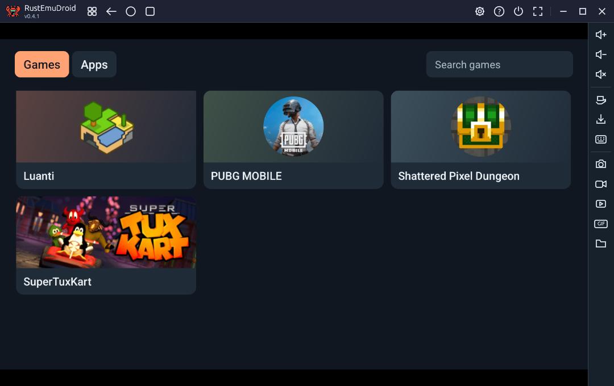
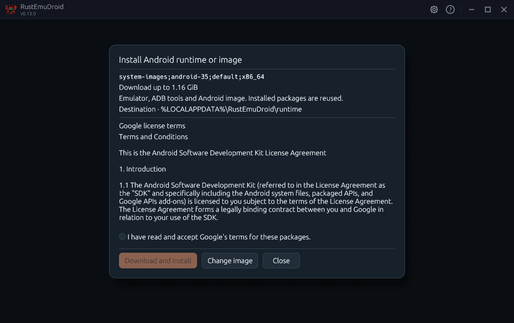
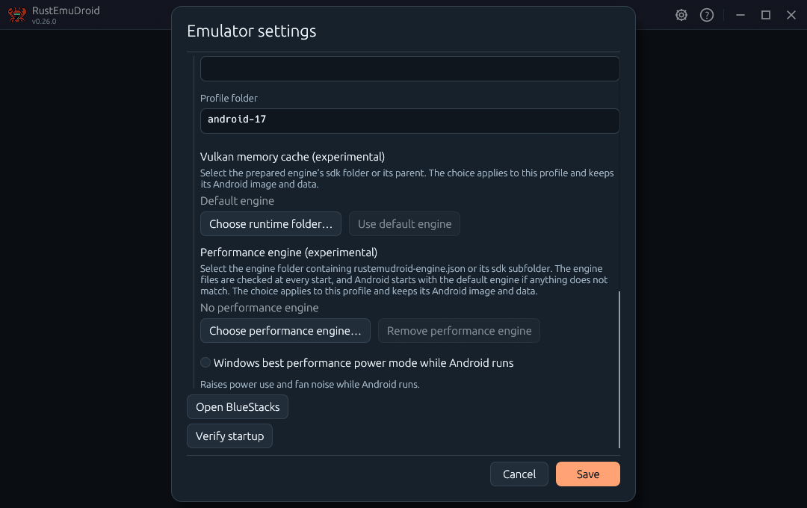
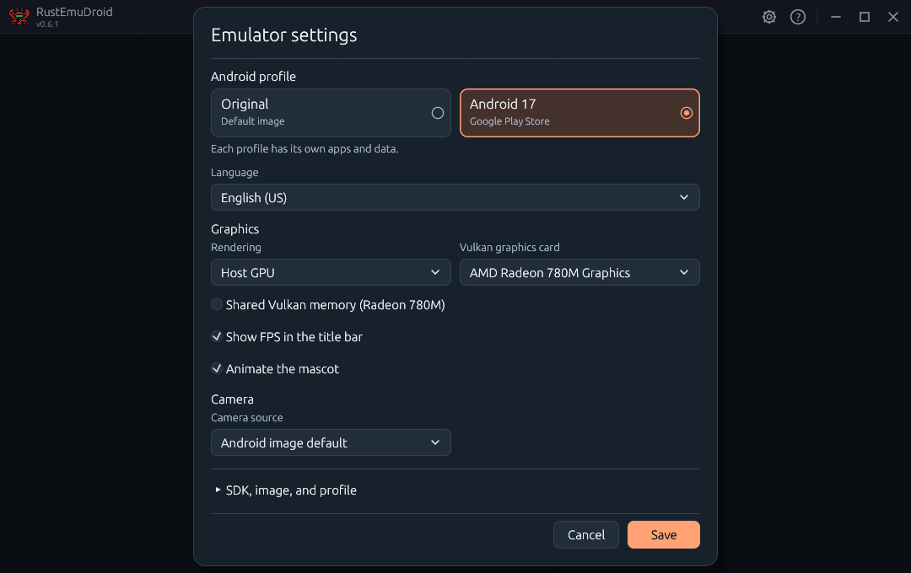
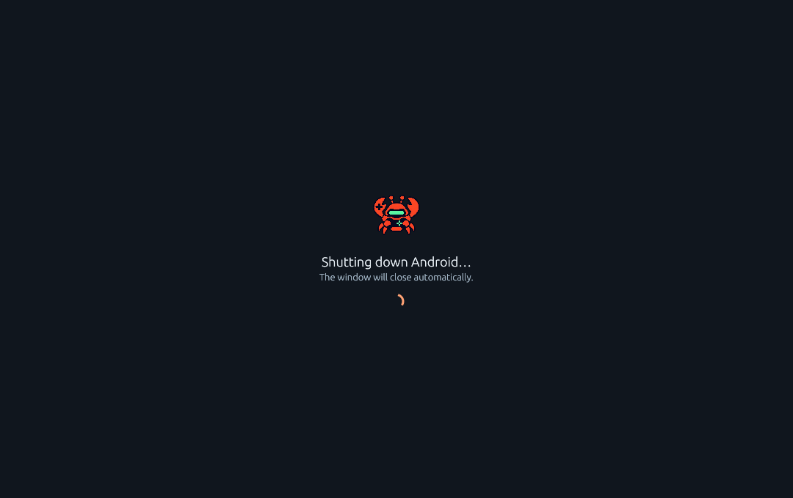
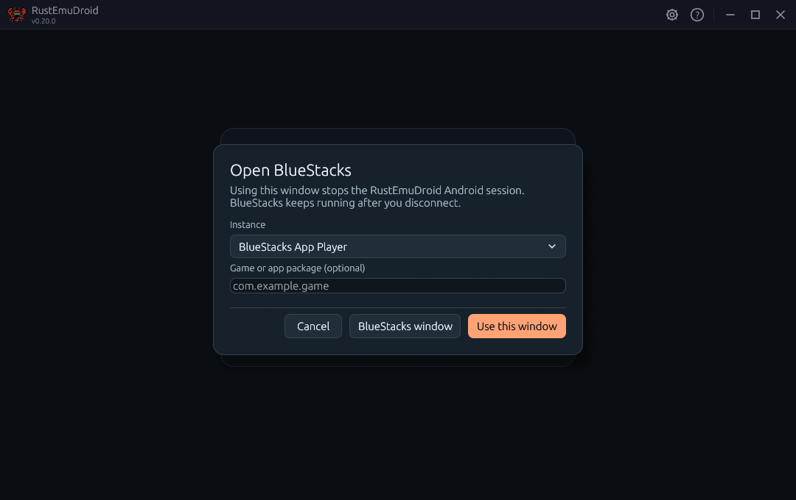
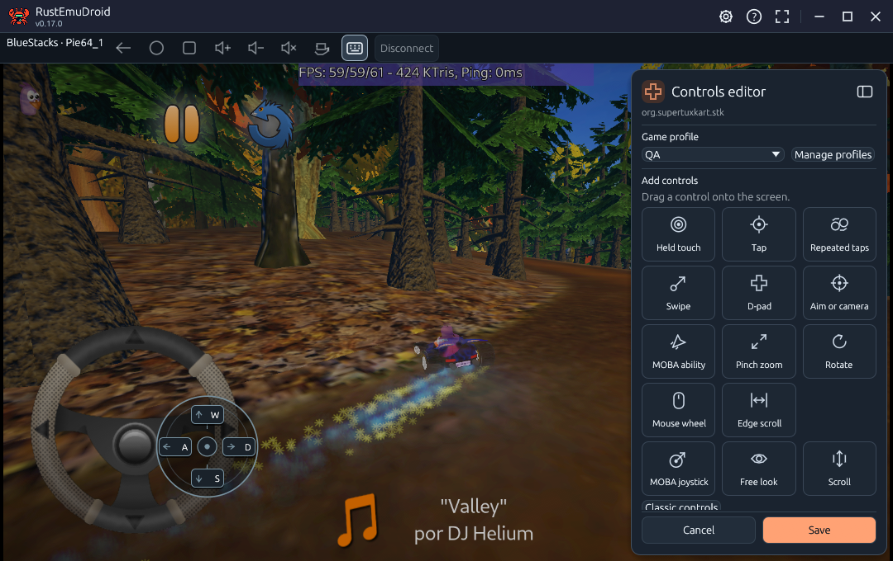
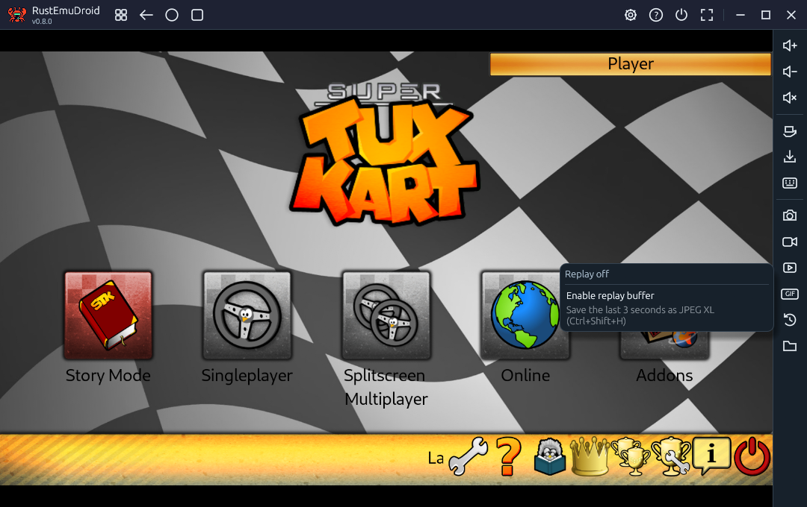
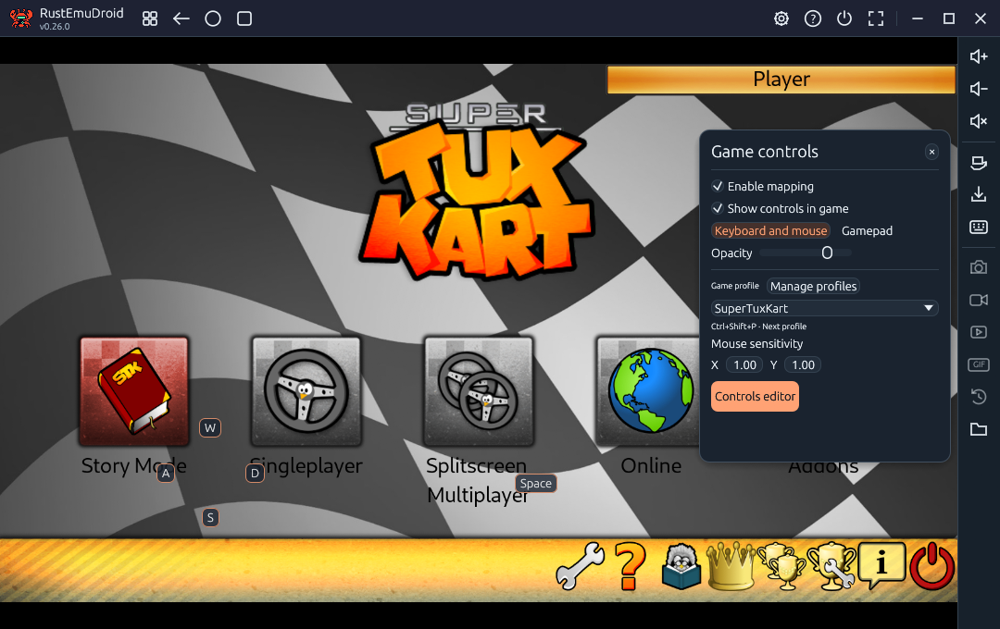
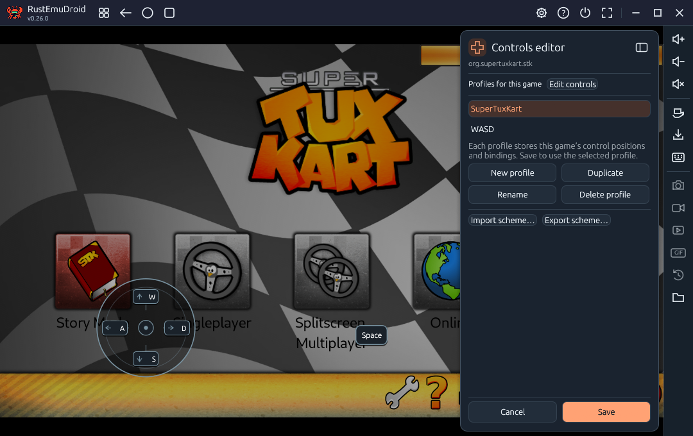

# RustEmuDroid

[Português brasileiro](README.pt-BR.md) · [Español](README.es-ES.md) · [Windows and Linux downloads](https://github.com/felipemarques/RustEmuDroid/releases/latest) · [Performance history vs Kemu and BlueStacks](docs/performance-history.md)

RustEmuDroid runs Android games and apps in one desktop window on x86-64 Windows and Linux. The Rust client starts the virtual machine, displays Android and handles input and window management. Inside the VM, the bundled Android Home opens to your installed games. The desktop client and Home are ad-free. Brazilian Portuguese is the default. Choose English (US) or Spanish (Spain) in Settings and save to change the desktop controls and Android Home together. Installed games and apps keep their own language settings.



*The games in this screenshot were installed on the test profile. A new profile starts with the apps supplied by its Android image.*

## Run a prebuilt version

1. Open the [latest GitHub Release](https://github.com/felipemarques/RustEmuDroid/releases/latest) and find **Assets**.
2. On Windows, extract `RustEmuDroid-vX.Y.Z-windows-x86_64.zip` into a writable directory. On Linux, extract `RustEmuDroid-vX.Y.Z-linux-x86_64.tar.gz` with `tar -xzf` to keep the execute permission. The filename includes the release version in place of `X.Y.Z`. For the current release, v0.26.1, the files are `RustEmuDroid-v0.26.1-windows-x86_64.zip` and `RustEmuDroid-v0.26.1-linux-x86_64.tar.gz`.
3. On Windows, open `rustemudroid.exe`. On Linux, run `./rustemudroid` in the extracted directory. On a PC without a runtime, choose **Install Android runtime or image**.

| Task | Windows PowerShell | Linux shell |
|---|---|---|
| Check the runtime and virtualization | `.\rustemudroid.exe doctor` | `./rustemudroid doctor` |
| Open the desktop client | `.\rustemudroid.exe ui` | `./rustemudroid ui` |

For a development build, sign in to GitHub, open a successful [Desktop builds run](https://github.com/felipemarques/RustEmuDroid/actions/workflows/build.yml) and download the package under **Artifacts**.

The executable includes the RustEmuDroid Home APK. The Linux executable also carries the small library that protects the video memory on AMD graphics cards (v0.24.1). The runtime and Android image are supplied separately. The experimental Vulkan cache and performance engines for Windows are built separately and are not part of the download. A source build also requires Rust and Cargo.

## Prepare the Android runtime

| Requirement | Windows x86-64 | Linux x86-64 |
|---|---|---|
| Hardware virtualization | Enable Intel VT-x or AMD-V in firmware and **Windows Hypervisor Platform** in Windows Features. | Enable CPU virtualization and give your user read/write access to `/dev/kvm`. Check with `test -r /dev/kvm && test -w /dev/kvm`. |
| Desktop and graphics | Install the host GPU driver. | Use an X11 or Wayland session with working OpenGL. The APK picker uses the desktop file portal. With an AMD card, choose the **Host GPU** mode: RustEmuDroid then prepares the emulator's video memory by itself. [AMD graphics on Linux](docs/linux-runtime.md#amd-graphics-on-bare-metal-linux) |
| Android runtime | Use first-time setup, an existing Kemu installation or a compatible SDK. | Use first-time setup or a compatible x86-64 runtime. |

### First-time setup in RustEmuDroid

1. Choose **Original** for Android 15 AOSP or **Google Play** for Android 17 with the Play Store. Select **Review download** to see the destination, maximum download size and Google's terms.
2. If you accept the terms, select the checkbox and **Download and install**. RustEmuDroid downloads the emulator, ADB and the image directly from Google and verifies each archive's size and checksum. Allow extra disk space for extraction.
3. Select **Use and start this profile**. To add the other image later, open the same installer in Settings. The installer reuses existing managed components. Each profile has its own app data.



Setup works without a preinstalled Android SDK, Android Studio, Java or `sdkmanager`. It installs to `%LOCALAPPDATA%\RustEmuDroid\runtime` on Windows or `$XDG_DATA_HOME/RustEmuDroid/runtime` on Linux, which defaults to `~/.local/share/RustEmuDroid/runtime`.

From a terminal, run the executable with `runtime-setup --image original` or `runtime-setup --image google-play` to review the terms and size. After review, repeat with `--accept-license` to download. Use `--licenses-from <licenses-directory>` to reuse an existing acceptance of the exact terms. For a custom installation directory, add `--destination <folder>` to the setup command, then launch with `--sdk <folder> ui`. RustEmuDroid recognizes its installed emulator and ADB there.

**Windows with Kemu.** With Kemu in its default location, run `.\rustemudroid.exe ui` to boot the Original profile. For a custom installation, set `RUSTEMUDROID_KEMU_ROOT` to its directory. The standalone Kemu path uses its bundled ADB, Android image and engine with the Host or Auto GPU setting.

**Portable runtime on Windows or Linux.** Place the complete platform-specific `emulator/` and `platform-tools/` packages and your `system-images/` tree in a folder named `runtime/` beside the RustEmuDroid executable. Start `ui` from the extracted release directory. The launcher can discover this layout even with Android Studio and the SDK environment variables absent. Keep the Android image and libraries intact. A separate SDK installation can still be selected with `--sdk`.

**SDK installation.**

With `sdkmanager` on your PATH, install the runtime and the optional Google Play image with the following command. Accept the SDK licenses when prompted.

```sh
sdkmanager --install "emulator" "platform-tools" "system-images;android-37.0;google_apis_playstore;x86_64"
```

For a Google APIs image, another supported package is `system-images;android-35;google_apis;x86_64`. `sdkmanager --list` shows the available packages. Existing SDK installations can be located through `ANDROID_HOME`, `ANDROID_SDK_ROOT` or the default SDK location. [SDK Manager](https://developer.android.com/tools/sdkmanager) · [Emulator acceleration](https://developer.android.com/studio/run/emulator-acceleration)

On Ubuntu 24.04 under WSL2, the v0.7.0 Linux release booted Android 17 Google Play with KVM. In WSLg, BombSquad presented 60 frames/s in a Death Match using native OpenGL ES on the Radeon 780M through Mesa D3D12. Guest Vulkan used a CPU renderer on this machine. [Setup, driver selection and game measurements](docs/linux-runtime.md)

## Choose a profile

Open the gear in the title bar. Each profile has its own writable disk, installed apps, accounts and saves. **Original** is the default profile for that working directory. Its Android version depends on the chosen image.

| Configuration | Runtime and first use |
|---|---|
| Original with Kemu | On Windows, an installed Kemu can supply its Android 16 / API 36 image and matching QEMU/gfxstream engine with Host or Auto GPU. The tested setup uses ANGLE/Vulkan. Set `RUSTEMUDROID_KEMU_ROOT` for nonstandard installations. |
| Original with the SDK or portable runtime | On first use, the image search checks Google Play API 37.0, Google APIs 36, Google APIs 35, then the newest installed x86-64 AOSP `default` image. Use `init --image` to select a specific package. |
| Android 17 with Google Play | Install the API 37.0 Google Play image, select **Android 17** in Settings and save. This SDK image includes the Play Store and Google Play services. The card indicates when the image is missing. |

Gaming profiles request four vCPUs, 8 GiB of guest RAM and 1600 × 900 at 60 Hz. A generic SDK profile requests four vCPUs, 3 GiB and 1080 × 1920. The Windows Kemu engine keeps a separate writable disk under `gaming/`.

To try a high-refresh display, open **Settings → Graphics → Android refresh rate**, choose a rate at or below the monitor's current refresh rate and save. Android restarts. The CLI equivalent is `boot --refresh-rate 90`. **Use profile refresh rate** returns to the profile's own display timing. On supported Android releases, a selection above 60 Hz also requests the higher rate for games during the session. Games can impose a lower limit. [SuperTuxKart measurements](docs/game-testing.md#managed-windows-runtime-and-android-refresh-rate)

In a smaller window, enable **Settings → Graphics → Fit video frames to the window** and save. The native player can then transfer fewer pixels per frame while the game renders at its configured Android resolution. Fullscreen uses the native resolution. PNG and MP4 preserve it. GIF and animated JPEG XL use native frames as input and fit the output within 720 × 720. The option is off by default and takes effect during the session. On Windows it applies while the panel copies the frames. [Windowed SuperTuxKart results](benchmarks/stk-1.5/vulkan-end-scene.md#matching-the-screenshot-stream-to-the-windows-panel)

From v0.26.0, on Windows the panel shows the engine's own picture: the client takes the engine's render surface into its window and the engine presents each frame straight to the screen there, so no frame is copied. Control markers, notices, menus, dialogs and the controls editor stay on top of the live picture, and screenshots, recordings, clips, GIFs and instant replay still work. **Settings → Graphics → Android picture in the panel** chooses **Automatic (the engine draws straight into the window)**, the default, or **Always copy the frames**; changing it restarts Android. When the engine's surface does not appear within 30 seconds, stops being usable, its picture stands still while Android's keeps changing, or the engine's window stops answering for 3 seconds, the panel goes back to copying the frames by itself and says why in **Settings → Launcher output**. With Kemu's engine, and on Linux, the panel copies the frames as before. [If the picture looks wrong](#troubleshooting) · [Release notes](docs/releases/v0.26.0.md)

When the panel copies the frames, on Windows it reads Android's screen from a memory region it shares with the engine (from v0.25.0), instead of receiving the pixels of every frame inside the gRPC messages. Nothing has to be turned on and no temporary file is used. This was verified on the Windows test PC with the separately built performance engine, and not yet with the other engines. When the engine refuses the region, does not write into it, shows no picture through it or a read fails, the client goes back to the frames inside the messages by itself and says why in **Settings → Launcher output**. On Linux this path has never run against a real engine, so it stays off unless you ask for it. [The variable that chooses the path](#cli-and-storage) · [If the picture looks wrong](#troubleshooting) · [Release notes](docs/releases/v0.25.0.md)

On Windows, open **Settings → Runtime, image, and profile → Vulkan memory cache (experimental)** to try a prepared SDK engine. Select its `sdk` folder or the folder containing it with **Choose runtime folder…**, then save and restart Android. The engine uses the selected profile’s Android image and app data. To restore the regular engine, choose **Use default engine** and save. [Prepare the cache engine](experiments/whpx-clock/README.md#2-create-the-private-runtime).

<details>
<summary>Show the Vulkan cache setting</summary>



</details>

**Settings → Runtime, image, and profile → Performance engine (experimental)** selects a separately built Windows engine for the profile. Choose the folder that holds `rustemudroid-engine.json` and `sdk` with **Choose performance engine…**, turn on the options the engine offers, then save and restart Android. The desktop checks the engine's SHA-256 digests at every start. If a file is missing or changed, or the profile does not use an SDK image with the **Host GPU** or **Automatic** mode, it says why and starts Android with the default engine. **Remove performance engine** switches back; the next start restores the profile's `config.ini`. A profile uses either this engine or the Vulkan memory cache. Before going back to v0.22.0 or older, remove the engine, save and start Android once. [Build the engine](experiments/whpx-clock/README.md#4-build-the-performance-engine)

Settings shows a switch only for the options the engine lists. After startup, **Launcher output** in Settings names the options the engine confirmed.

| Switch | Default | What it does |
|---|---|---|
| **CPU virtualization tuning** | On | Synchronized clock, fast APIC access and paravirtualized end of interrupt. With engines that list `whpx_apic_hv` (v0.24.0), Windows itself emulates the interrupt controller, which replaces the last two. If the computer does not allow that, the engine keeps them and Android starts normally. |
| **Cached Vulkan memory** | On | Games write graphics memory through a cached path. |
| **Graphics commands through shared memory** | On | Graphics commands go through a shared-memory ring, which keeps about one extra processor core busy while a game runs. Writes `hw.gltransport=asg` to the profile's `config.ini`. |
| **Compose the screen with Vulkan** | On | The computer composes Android's screen with Vulkan, and Android uses ANGLE for OpenGL ES. |
| **Dedicated cores for Android** | On | Each virtual processor gets its own physical core, never core 0. Available when the PC has more physical cores than the profile's virtual processors plus two. |
| **Reduce Android kernel protections** | Off | Turns off processor vulnerability mitigations and memory clearing inside Android. Use it only on a profile dedicated to games. |

In the same group, **Windows best performance power mode while Android runs** turns on the Windows Best performance power mode while Android is open and restores the previous mode when it closes. It works with any engine, is off by default and is not used on battery power. [Latest measurement with this engine](#latest-benchmark) · [Earlier series and limits](docs/performance-history.md#performance-engine-in-uncapped-mailbox)



## Use the desktop controls

| Task | How to do it |
|---|---|
| Find and install apps | Search under **Games** or **Apps**. Long-press a card to change its category. The install button on the right accepts a single APK and refreshes the library. |
| Scroll the Android library | With the pointer over the cards in **Games** or **Apps**, use the mouse wheel or a vertical two-finger scroll on a touchpad. |
| Navigate Android | The four-square button opens Apps. The title bar also contains **Back**, **Home** and **Recent apps**. Home returns to Games. Click to tap and drag to swipe. |
| Map a keyboard or controller | Open a game and click the keyboard icon. Choose **Button**, click a touch target, then press the physical key or controller button. For WASD or the left stick, choose **Directional control**, click the center of the virtual stick and adjust its radius. Right-click a marker to remove it. **Save** stores relative coordinates for that Android package. Windows gamepads use XInput. |
| Adjust media | The right toolbar controls Android media volume, mute and screen rotation. Hold a volume button to change several levels. |
| Use a webcam | In Settings, select a front or rear host webcam, starting with index 0. Save and restart Android to apply hardware changes. Grant camera access inside the Android app when needed. A simulated front camera is also available. |
| Fullscreen and version | Press **F11**. Move the pointer to the top or right edge to reveal controls in fullscreen. The title bar and **?** dialog show the version. |


**Stop Android** stops the VM and returns to the panel. Closing the window with **X** or the system close shortcut shows the shutdown screen. The native window keeps responding until the VM exits, then closes automatically. This also works during boot. Closing an idle panel takes effect immediately.



After stopping Android, the session screen lets you start the same profile again.


## Open an installed BlueStacks instance on Windows

On Windows, choose **Open BlueStacks → Use this window** to display an installed instance and its games in RustEmuDroid. Keep the original player window restored. Windows composites its live Android surface into the Rust window. Disconnecting leaves the instance and game running. Choosing this mode first shuts down the RustEmuDroid Android VM if it is running. If you close the BlueStacks player while its preview is open, RustEmuDroid returns to its launcher. Select the instance again when you want to reconnect.



For touch, drag, scroll, keyboard input and the Android navigation buttons, enable **Android Debug Bridge (ADB)** in BlueStacks advanced settings and reconnect. Click **Rotate screen** on the preview toolbar to switch between portrait and landscape in apps that allow rotation. RustEmuDroid uses a modern local ADB client from the managed runtime or Android Platform Tools. With ADB disabled the picture is view-only. To see frame delivery in the preview, choose **Settings → FPS counter → Android game surface**. The native Android session also offers recording and the Rust panel counter.

To install a game from your PC, click **Install APK** in the toolbar above the BlueStacks preview, between the camera and folder buttons. Choose the `.apk` file and wait for the confirmation. Android installs it in the BlueStacks instance you opened. This action requires the same ADB connection as touch input. If Android rejects the file, hover over the failure message to read its reason. [Confirmation shown in the toolbar](docs/screenshots/en-us/bluestacks-apk-installed.png)


Use the camera button or **Ctrl+Shift+S** in the BlueStacks preview to save the Android screen at its native resolution. PNG capture requires an active ADB connection. The folder button opens `captures/` beside `launcher.json`.

Point at the Android picture to scroll with the wheel. Click inside the picture to activate the control scheme for the current game. A wheel direction assigned in that scheme then triggers its action.

In the BlueStacks preview, open a game and click the keyboard icon and choose **Controls editor**, or press **Ctrl+Shift+A**. Place the controls on the captured game image. Android keeps running while the editor is open. Save to return to the live view. **Ctrl+Shift+P** switches between the schemes saved for that game and BlueStacks instance. Hold a D-pad direction and an action button together to send two touches. The editor displays the binding markers. Live game hints and sensor tilt are available in the native Android session.



[Quick controls menu](docs/screenshots/en-us/bluestacks-quick.png)

**Can I use my backed-up BlueStacks games?** On the test PC we restored a copy of the data disk to a separate Pie64 instance on the same BlueStacks build. It booted Android 9 and listed all four tested games. Select the restored instance under **Open BlueStacks → Use this window**. [Restore test](docs/bluestacks-lab.md#booting-an-archived-data-disk-with-the-installed-bluestacks-engine)

**Can I boot the copied image independently of BlueStacks?** The experimental Pie64 hybrid reached Android’s system service (`system_server`) and stopped before Home. The working 29.5-second boot was measured on a stock Android 9 reference image. [Pie64 boot results](docs/bluestacks-lab.md#r2-fstab-compatibility-test)

**If you downloaded the release ZIP**, choose **Extract All** and open the folder containing `rustemudroid.exe` in File Explorer. Click the address bar, type `powershell` and press **Enter**. In that window, set the executable path.

```powershell
$emu = '.\rustemudroid.exe'
```

**If you cloned the repository**, open the folder containing `Cargo.toml` in File Explorer and type `powershell` in its address bar. The `Abrir RustEmuDroid.cmd` launcher builds the executable at this path.

```powershell
$emu = '.\target\integrado\release\rustemudroid.exe'
```

For a first build, run `cargo build --locked --release --features ui --target-dir target/integrado` in this folder. If you already used Cargo’s default release build directory, set `$emu = '.\target\release\rustemudroid.exe'`.

**Check the path and list your instances.** Stay in the same PowerShell window. `Test-Path` should return `True`. If it returns `False` or PowerShell says the command is unrecognized, check the folder and the executable path you selected above. The `.\` prefix starts at the current folder.

```powershell
Test-Path -LiteralPath $emu -PathType Leaf
& $emu bluestacks list
```

Example output from `list` on the test PC

```text
Pie64    BlueStacks App Player
```

The first column is the instance ID. To open the BlueStacks home screen, replace `Pie64` with the ID from your list.

```powershell
& $emu bluestacks open --instance Pie64
```

To open SuperTuxKart directly, use the following command if the game is installed in that instance. `--package` takes the game’s Android package ID.

```powershell
& $emu bluestacks open --instance Pie64 --package org.supertuxkart.stk
```

To show the game in RustEmuDroid, run

```powershell
& $emu bluestacks mirror --instance Pie64 --package org.supertuxkart.stk
```

If the list is empty or an installation error appears, open the BlueStacks 5 Multi-instance Manager, confirm that an instance is installed and run `list` again. In the RustEmuDroid UI you can also choose **Open BlueStacks** from the session screen or Settings.

Starting with v0.5.0, both desktop archives include a read-only storage check in `tools/`. Shut down the BlueStacks Pie64 instance and put copies of `fastboot.vdi` and `Data_orig.vhdx` in a `Pie64` folder beside `tools/`. Run from the extracted folder or the source checkout root. Choose a new output directory for each run.

On Windows with Ubuntu 24.04 under WSL, run

```powershell
powershell -ExecutionPolicy Bypass -File .\tools\Test-BlueStacksData.ps1 -Images .\Pie64 -Output .\data-check
Get-Content .\data-check\result.json
```

On Linux or WSL, run

```sh
python3 -B tools/bluestacks_data_probe.py --images ./Pie64 --output ./data-check
cat ./data-check/result.json
```

The probe accepts only the exact validated Pie64 image pair and checks its two SHA-256 hashes automatically. If the copies already have a `manifest.json`, you can add `-VerifyHashes` to the Windows probe command to check the hashes against that manifest too.

A value of `true` for `factory_ext4_mounted_read_only` in `result.json` means the diagnostic guest mounted the factory ext4 data filesystem read-only. The packaged `tools/README.md` lists the requirements.

In the separate source-checkout `-SystemMount` test, the copied Android system mounted and BlueStacks initialization stopped at `android_id is empty`. For a playable session with that instance, use **Open BlueStacks**. [System-mount notes](docs/bluestacks-lab.md#opt-in-system-mount)

The crab moves during startup and shutdown, in About, and when Android Home has no matching items. The game view keeps the mascot off the rendering path.


Click **? → Shortcuts** in the title bar to see the available keys, what each one does and when it works.


## Capture gameplay

| Action | Shortcut | Output |
|---|---|---|
| Screenshot | **Ctrl+Shift+S** | Full-resolution PNG of the guest display |
| Start or stop video | **Ctrl+Shift+R** | Silent H.264 MP4 with a 30 FPS target |
| Record a moment | **Ctrl+Shift+J** | The next three seconds as an animated JPEG XL at 10 FPS |
| Save a recent highlight | **Ctrl+Shift+H** | The previous three seconds as an animated JPEG XL at 10 FPS, with instant replay enabled |
| Record a GIF | GIF tool in the sidebar | The next three seconds as a looping GIF at 10 FPS |

To keep a goal or an overtake you just saw, open the clock on the sidebar and enable instant replay **before** playing. Once the buffer is ready, press **Ctrl+Shift+H** after the highlight, or save it from that menu. The buffer is off at the start of each Android session. Turning it off discards its unsaved footage.



Open the folder button on the sidebar to find your files in `captures/` beside `launcher.json`. PNG works directly in Rust. Install FFmpeg with `libx264` for MP4 and `libjxl_anim` for animated JPEG XL. Set `RUSTEMUDROID_FFMPEG` to an executable path if FFmpeg is outside PATH. Animations fit within 720 × 720 and keep their aspect ratio. The window waits for pending exports when you close it.

## Create a control scheme

Open a game and click the keyboard icon in the sidebar to open **Game controls**. Choose keyboard/mouse or gamepad to show that device's button hints. Both devices can still send input. Adjust the hints' opacity or switch schemes here. Under **Mouse sensitivity**, change X for horizontal movement and Y for vertical movement while aiming or using mouse free look. The active game scheme saves both values. Set either axis to 1.00 for its original speed.



**Keep several layouts for one game.** Click **Manage profiles** in the keyboard menu. Choose **New profile** for an empty layout or **Duplicate** to copy the current positions and bindings. Enter a name, such as *Driving*, and click **Apply**. Choose **Edit controls**, drag the controls onto the game's buttons and click **Save**. To switch while playing, select a saved layout under **Game profile** in the keyboard menu. Each game remembers its last selection when you reopen it. You can also rename, delete, import or export profiles in **Manage profiles**.



During gameplay, press **Ctrl+Shift+P** to switch to the next saved profile for the current game. After the last, the shortcut returns to the first. The name on screen confirms the selection.

Choose **Controls editor** from the menu or press **Ctrl+Shift+A**. Drag a control from the palette onto the game, then select it to bind an input and adjust its properties. For movement, drop a **D-pad** over the game's virtual joystick. Assign **Up**, **Down**, **Left**, and **Right** individually in **Control settings**. Click the center of the D-pad to select it and drag the lower-right handle to match the game's joystick. The handle and panel adjust the same radius. Under **Controller stick**, choose **Left** or **Right** to steer with that stick alongside the direction keys. Choose **Off** to use only the assigned directions. Click **Save** to apply the scheme.

For maps that pan when dragged, drop **Edge scroll** on a clear spot in the map and save. Move the pointer to an edge of the game display to pan toward it. Adjust the horizontal and vertical margins and speeds in **Control settings**. Move the pointer away from the edge to stop.

For games that respond to motion sensors, add **Tilt**, bind a key or button, and choose the X, Y, or Z axis and an angle from −45° to +45° in **Control settings**. Hold the binding to tilt the virtual device relative to its current orientation. Release it to restore the original orientation. This control requires virtual sensor support.

For click-to-move games, drop **MOBA joystick** over the virtual stick and use **Place hero** to mark the hero's on-screen position. Right-click a destination to move the stick in that direction. Adjust the stick radius and hero speed for the game. Assign **Stop movement** if you want to interrupt a move. Use **MOBA ability** to aim a skill from its own in-game control.

Place **Free look** over the game's camera control. Bind the four directions individually, or enable **Look with the mouse** and hold its assigned key while moving the mouse. For an app or map that scrolls when dragged, drop **Scroll** on the surface and use the wheel over the game display. Adjust the speed and amplitude, and choose whether Scroll overrides other wheel mappings.

For an on-screen steering wheel, place **Rotate** at its center and enable **Single-touch wheel**. Set the starting contact angle, radius and turn angle. With a positive turn angle, the main binding turns clockwise and **Reverse turn** turns counterclockwise. Each direction holds one contact until you release its binding. **Rotate** uses two fingers by default.

The palette has 15 tiles for 14 control types. **Mouse wheel** is a ready-made **Swipe** binding for one wheel direction.


*SuperTuxKart's language can be changed in the game's own settings.*

## Build from source

Install current stable Rust with Cargo. Windows also needs the Visual Studio C++ Desktop build tools and Windows SDK. On Ubuntu 24.04, install the native dependencies:

```sh
sudo apt-get update
sudo apt-get install -y build-essential pkg-config libudev-dev libwayland-dev libxkbcommon-dev libx11-dev libxi-dev libxrandr-dev libxcursor-dev libgl1-mesa-dev
```

```sh
git clone https://github.com/felipemarques/RustEmuDroid.git
cd RustEmuDroid
cargo build --locked --release --features ui
cargo run --locked --release --features ui -- ui
```

On Windows, [Abrir RustEmuDroid.cmd](Abrir%20RustEmuDroid.cmd) builds the release client and opens it, or focuses its existing window. Omitting `--features ui` builds the CLI. On Linux the build also compiles a small C library with `cc` (part of `build-essential`), which the client loads into the engine on AMD graphics.

## CLI and storage

```sh
cargo run --locked -- doctor
cargo run --locked -- init --image "system-images;android-35;google_apis;x86_64"
cargo run --locked -- boot --headless --check --gpu auto
cargo run --locked -- boot --help
```

To use an installed Kemu image with a separate data directory on Windows:

```powershell
cargo run --locked -- --state-dir .rustemudroid/kemu init --system-dir "C:/Program Files/Kemu/system-img"
cargo run --locked --release --features ui -- --state-dir .rustemudroid/kemu ui
```

Use the same `--state-dir` for initialization, boot and UI. The default is `.rustemudroid/windows/` or `.rustemudroid/linux/` relative to the working directory. `launcher.json` holds preferences. The active profile contains the AVD and `boot-*.log`. `boot --check` waits for `sys.boot_completed=1` and stops that VM. `--timeout` sets the boot deadline in seconds and `--engine sdk` explicitly selects the SDK engine. The client selects free ports and verifies the AVD path before sending shutdown commands.

On Windows, `boot --vulkan-cache-runtime <folder>` starts the profile with a prepared Vulkan cache engine, and `boot --performance-engine <folder>` starts it with a performance engine and its default options, without the kernel option. The two cannot be combined. The performance engine writes `hw.gltransport` to the profile's `config.ini` and records the original lines in `rustemudroid-performance.json` beside it. The next start without the engine restores them.

```powershell
.\rustemudroid.exe --state-dir 'D:\Android\MyProfile' boot --gpu host --performance-engine 'D:\Android\PerformanceEngine'
```

On Linux with an AMD card, set `RUSTEMUDROID_AMD_LINUX` before starting the client to diagnose the video memory handling: `off` starts the engine as before v0.24.1, and `stock`, `full-size` or `all-types` forces that memory mode.

Set `RUSTEMUDROID_VIDEO_TRANSPORT` before starting the client to choose how the panel gets its picture (v0.25.0). `inline` keeps every frame inside its gRPC message, the path of v0.24, on Windows and on Linux. `shared` asks for shared memory, which is what turns it on on Linux, where it uses a file in `/dev/shm` and has never run against a real engine. Without the variable, Windows uses shared memory and Linux does not.

```powershell
$env:RUSTEMUDROID_VIDEO_TRANSPORT = 'inline'; .\rustemudroid.exe ui
```

On Windows, `RUSTEMUDROID_PANEL` overrides **Settings → Graphics → Android picture in the panel** for tests (v0.26.0): `engine-child` shows the engine's render surface and `frames` copies the frames. `RUSTEMUDROID_VIDEO_TRANSPORT` then chooses how the copied frames travel.

## Performance and troubleshooting

### Latest benchmark

**SuperTuxKart 1.5 in uncapped Vulkan on the RTX 5070 Ti · November 28, 2026 · the v0.26.0 release candidate, built from the release branch before publication.** In one session that alternated the players, RustEmuDroid measured more than BlueStacks, Kemu and LDPlayer 14 in this replay on this PC, both at a 1600 × 900 panel and with the window maximised.

| Player | Window not maximised | Window maximised |
|---|---:|---:|
| **RustEmuDroid v0.26.0 candidate**, the engine's surface in the panel | **443.7 FPS** (3 boots, 6 laps) | **432.1 FPS** (3 boots, 6 laps) |
| BlueStacks 5 Pie64 · Android 9 | 364.9 FPS (1 boot) | 330.0 FPS (1 boot) |
| Kemu 0.7.1 · Android 16 | 331.1 FPS (1 boot) | not maximised: 329.6 FPS in a second boot at its usual window |
| LDPlayer 14 · Android 14 | 302.1 FPS (2 boots) | not run |
| RustEmuDroid, frames copied (the path of v0.25.0) | 305.1 FPS (2 boots) | not run |

All players ran the game's built-in Black Forest replay at High with Vulkan and game VSync off (Mailbox, uncapped), at 1600 × 900 in Android (90 Hz; LDPlayer sets 240 Hz), on the Windows test PC (Ryzen 9 8945HS; GeForce RTX 5070 Ti, connected as an external GPU over Thunderbolt 3), with the Windows Best performance power mode. FPS comes from the game's own frame report. The players took turns in one session between 07:15 and 08:37, with two timed laps per boot after a warm-up lap and no other test work running. The owner's LDPlayer 14 instance stayed open in the background for every step, and other programs used 0.95–1.38 host core during the sampled laps. RustEmuDroid ran the official Android 17 Google Play image on the separately built performance engine, with its panel showing the engine's own render surface in a child window, the Windows default of v0.26.0. BlueStacks, Kemu and LDPlayer ran in their own players.

At 1600 × 900 RustEmuDroid measured 21.6% more than BlueStacks, 34.0% more than Kemu and 46.9% more than LDPlayer 14, and maximised 30.9% more than BlueStacks. Its slowest lap (391.4) was above the fastest lap of any other player (384.4), and it measured 45.4% more than the frames-copied path of v0.25.0 in the same session. **The limits:** one game and one replay on one PC. BlueStacks and Kemu have one boot per condition here: in the third cycle the owner's everyday Android VM, which their operators close and reopen, did not finish booting in time, so those operators refused to run. Kemu's window was never maximised, so its second figure is a second boot at its usual size. An earlier session the same night, with a pre-release build of the same feature, points the same way with smaller margins and overlapping laps: 417.9 against BlueStacks' 392.0 at 1600 × 900 and 422.4 against 348.5 maximised.

The Rust window was the v0.26.0 candidate executable (SHA-256 `26559c35…6f48`), built from the release branch; the published download is built separately by the release workflow and was not timed. A lab harness started it on a disposable Android 17 Google Play profile and set the engine's environment. The v0.25.0 arm is a build made before that release with its display code, not the published executable. The performance engine is built from the published source kit and is not part of the download; the default engine was not measured in this series. BlueStacks ran the debuggable variant of the game package, the others the same base package. The two BlueStacks steps completed their laps and then ended with exit status 1 while closing the player, as in the earlier series. [Full record: per-lap values, window sizes, host load, identities and what failed](benchmarks/stk-1.5/windows-rtx-child-window-panel-peers.md)

### Earlier measurements

The figures below were measured on earlier releases and stay here as history. Where a report names the client version, it is given. [Performance history from the first prototype](docs/performance-history.md)

**November 27, 2026 · SuperTuxKart 1.5 in uncapped Vulkan on the RTX 5070 Ti · a pre-release build of the v0.25.0 client, not the published executable.** One session compared the panel's shared memory path with the path of v0.24 and with BlueStacks. It did not establish a lead over BlueStacks.

| Arm | Game FPS | Laps |
|---|---:|---:|
| BlueStacks 5 Pie64 | 361.0 | 6 |
| RustEmuDroid, panel through shared memory, 800 × 450 panel | 397.6 | 4 |
| RustEmuDroid, panel through shared memory, default 1040 × 585 panel | 401.0 | 4 |
| RustEmuDroid, frames inside the messages (the v0.24 path), 800 × 450 panel | 372.4 | 4 |

The workload, PC and power mode were as above, with the arms alternated between 10:23 and 11:07 and other programs using 0.74–1.09 host core during the timed laps, and **Fit video frames to the window** on. BlueStacks measured 361.0 there against 419.3 on November 26, about 14% lower, with the cause unknown, so that session did not establish a lead. The Rust window was a build of commit `a7efd99`, the first two feature commits of v0.25.0 on the v0.24.0 source, started by a lab harness; Kemu and the default engine were not measured. [Full record: per-lap values, host load, identities and what failed](benchmarks/stk-1.5/windows-rtx-mailbox-shared-memory-panel-bluestacks.md)

**November 26, 2026 · SuperTuxKart 1.5 in uncapped Vulkan on the RTX 5070 Ti · RustEmuDroid client v0.22.0.** In the alternated series of that day BlueStacks was ahead in both Windows power modes.

| Windows power mode | RustEmuDroid, performance engine | BlueStacks 5 Pie64 | BlueStacks ahead by |
|---|---:|---:|---:|
| Balanced | 392.9 FPS (2 laps) | **402.5 FPS** (4 laps) | 2.4% |
| Best performance | 393.6 FPS (8 laps) | **419.3 FPS** (4 laps) | 6.5% |

Both players ran the game's built-in Black Forest replay at High with Vulkan and game VSync off (Mailbox, uncapped), at 1600 × 900 and 90 Hz in Android, on the Windows test PC (Ryzen 9 8945HS, GeForce RTX 5070 Ti). FPS comes from the game's own frame report. The players took turns in one session between 16:06 and 16:47, with other programs using 0.54–0.68 host core during RustEmuDroid's laps. RustEmuDroid ran the official Android 17 Google Play image on the separately built performance engine, with the settings of all six switches, including **Reduce Android kernel protections**, and with the interrupt controller emulated by Windows, in an 800 × 450 panel. BlueStacks ran Android 9 in its own player.

The Rust window was the **v0.22.0** client, and a test operator applied the engine settings around it. This is a historical comparison on an older client. Releases v0.23.0 and v0.24.0 added the client's own way of applying these settings, and v0.24.1 changed Linux behaviour only; none of them was timed here. The performance engine is built from the published source kit and is not part of the download. The default engine and Kemu were not measured in this series. RustEmuDroid's Balanced figure comes from one boot, because one run was refused at start and a second boot was lost to an adb timeout. [Full record: per-lap values, identities and what failed](benchmarks/stk-1.5/windows-rtx-mailbox-hypervisor-apic-bluestacks.md)

The Windows benchmarks compare PUBG menu transitions and Training Grounds with the SuperTuxKart replay on the dedicated and integrated GPUs. Each result identifies the scene, frame counter and graphics settings. [FPS comparison table](docs/game-testing.md#fps-comparisons-on-the-windows-test-pc)

To compare PUBG on your own PC, record the same scene in RustEmuDroid and BlueStacks. The collector reports how often Android presented a new game frame and how long the longest pause lasted. [Commands and measurement method](docs/game-testing.md#record-a-game-scene-on-your-own-pc)

The [Radeon 780M benchmark](benchmarks/stk-1.5/radeon-780m/README.md) compares integrated graphics across RustEmuDroid, Kemu and BlueStacks. It includes per-run measurements and host GPU verification.

For a repeatable graphics test on Windows, try **FPS WW2 URP → Start Game → Level 1**. Enable **Settings → Display FPS** to see the game's counter. For a second Vulkan workload, open **andar → Continue → Begin → Skip** and face the gate in the rain. Both scenes have measurements on the Radeon 780M and RTX 5070 Ti. [FPS WW2 URP results](docs/game-testing.md#radeon-780m-vulkan-compatibility) · [ANDAR results and download](docs/game-testing.md#andar) · [All game tests](docs/game-testing.md)

**PUBG and SuperTuxKart on Windows, v0.18.0 and v0.21.1.** At 1600 × 900 on the RTX 5070 Ti, PUBG's Lobby and Inventory route at Balanced/High averaged 25.20 Android presentations/s on RustEmuDroid 0.18.0 and 29.58 on BlueStacks Pie64. The first Inventory close took 1.60–1.68 s on Android 17 and 0.17 s on Pie64. At 90 Hz on the RTX, the same x86-64 build of SuperTuxKart averaged 85.62 game FPS on RustEmuDroid 0.21.1, 90.02 on Kemu 0.7.1 and 89.99 on BlueStacks in two High/Vulkan FIFO replays per player. On the integrated Radeon 780M, in an earlier series whose report does not name the client version, SuperTuxKart High averaged 59.71 game FPS on the Android 17 Vulkan profile, 59.87 on Kemu and 59.99 on BlueStacks, both using OpenGL ES, with a 60 FPS cap. [PUBG results and frame times](docs/game-testing.md#pubg-inventory-retest-with-rustemudroid-v0180) · [SuperTuxKart graphics settings and results](benchmarks/stk-1.5/radeon-780m/README.md) · [90 Hz replays on v0.21.1](benchmarks/stk-1.5/windows-current-three-players.md)

### Troubleshooting

- **FPS.** In **Settings → FPS counter**, choose **Rust panel** (the default) to count frames processed for drawing, or **Android game surface** to count new presentations of the foreground game. Click **Save** to apply immediately. The Android counter also works in a connected BlueStacks preview with ADB enabled. A dash means the counter is warming up or Android has no identifiable game surface. A stationary surface can show zero. On Windows, while the panel shows the engine's own surface (v0.26.0), it processes no frames, so **Rust panel** shows Android's count as well. The game’s own profiler measures its internal render rate.
- **Black screen or slow graphics.** Run `doctor`, check the selected Vulkan adapter and try Host or Auto. On Linux, **Automatic** currently ends in the emulator's software renderer, so choose **Host GPU** to use the graphics card. Software/SwiftShader can help isolate driver issues. The SDK engine uses a GLES compatibility path with the Kemu image on Linux.
- **The picture in the panel looks wrong: torn, or two frames mixed.** When the panel on Windows copies the frames (**Always copy the frames**, Kemu's engine or after a fallback), from v0.25.0 it copies each frame from memory it shares with the engine, and the engine does not synchronise its writes with the reader, so a frame can now and then be drawn torn until the next one replaces it. **Settings → Launcher output**, and **Technical details** on the session screen, name the path in use: `Panel video: memory shared with the engine.`, or `Panel video: frames inside the control channel; shared memory was not used because …` with the reason. The client goes back to the frames inside the messages by itself when the engine refuses the memory region, does not write into it, shows no picture through it or a read fails. The new path was verified with the separately built performance engine only. To rule it out, close the client, set `RUSTEMUDROID_VIDEO_TRANSPORT=inline` and start it again; the line then says that the variable turned shared memory off. On Linux shared memory is off unless `RUSTEMUDROID_VIDEO_TRANSPORT=shared` is set, and it has never run against a real engine there. [The variable](#cli-and-storage) · [How it works and its limits](docs/releases/v0.25.0.md)
- **The panel copies frames although Automatic is chosen, or the engine's picture looks wrong.** From v0.26.0, **Settings → Launcher output** and **Technical details** name the panel's path: `Panel: the engine's render surface, inside the client's window; …`, or `Panel: frames copied from the engine; the engine's surface was not used because …` with the reason: the surface did not appear within 30 seconds, it stopped being usable, Windows refused a call, its picture stood still while Android's kept changing (tried again 60 seconds later, three times at most) or the engine's window stopped responding for 3 seconds. A small engine window shows for about 0.2 seconds at boot; that is known and needs an engine change. At 150% display scaling this path was only partly checked. With a gamepad connected the client repaints 60 times a second, which costs game FPS while control markers are shown. To rule the path out, choose **Settings → Graphics → Android picture in the panel → Always copy the frames** and save; Android restarts with the path of v0.25.0. [How it works and its limits](docs/releases/v0.26.0.md)
- **Testing integrated graphics on a Windows PC with two GPUs.** Select the integrated adapter under **Vulkan graphics card**. Android's display compositor can still use the other GPU for OpenGL. To match both, locate the running `qemu-system-x86_64.exe` in Task Manager, add that specific executable in **Settings → System → Display → Graphics**, and choose the option that names the integrated GPU. Restart Android. This Windows preference applies to other instances using the same executable. [How we verified both renderers](docs/game-testing.md#inventory-on-the-radeon-780m)
- **Vulkan memory allocation crashes on the Radeon 780M.** On Windows, select the **Android 17 Google Play** profile, choose **Host GPU** or **Automatic**, and explicitly select **AMD Radeon 780M Graphics**. Turn on **Shared Vulkan memory (Radeon 780M)** under **Graphics**, then save and restart Android. This experimental setting is off by default, applies per profile, and was verified with Android Emulator SDK 37.3.10.
- **Games close or freeze Android on Linux with an AMD card.** Choose the **Host GPU** mode: on Linux, **Automatic** currently ends in the emulator's software renderer, because the client starts the engine with `-no-window`. From v0.24.1 the client prepares a video memory protection for the engine and, with the host GPU, shows Android the card's whole video memory instead of the small window the processor reaches. **Technical details** shows the line `AMD graphics on Linux: …`. If the driver still loses the device, the failure now reads `The graphics driver lost the device and the engine exited (…)` with the log path. If Android stops with a message about processor virtualization and graphics memory, enabling **Above 4G Decoding** and **Resizable BAR** in the firmware or using Linux 6.13 or newer should avoid it; neither was measured. `doctor` prints the same advice when it applies. All of this was measured on one PC with a Radeon RX 580 and Linux 6.8. [Measurements and limits](docs/linux-runtime.md#amd-graphics-on-bare-metal-linux)
- **`Engine exited (exit code: 0xc0000094)` when a game opens.** The engine stopped on a division by zero inside the graphics card's driver. This happens with some games that use a compressed texture format the graphics card does not support, with both panel paths, so **Always copy the frames** and the other settings do not avoid it. From v0.26.1 the failure says so in the three languages and names the app that was open. Start Android again and keep that game closed. [Release notes](docs/releases/v0.26.1.md)
- **Several ADB devices.** Run `adb devices -l` and use `adb -s <serial>` to target the correct instance. Look up the session serial in the launcher output.
- **PUBG MOBILE closes during startup on Android 17 Google Play.** Starting with v0.2.1, the launcher selects the built-in ANGLE driver for `com.tencent.ig` when using host or automatic GPU rendering on this x86-64 image with Vulkan support. Existing per-app preferences take precedence. On Linux, v0.13.3 skips adding the preference when the session confirms that Vulkan selected a CPU device. On a GeForce RTX 5070 Ti this fixed the native EGL crash when the game presented a frame. [Android per-app graphics drivers](https://developer.android.com/games/develop/vulkan/overview)
- **PUBG stays on the studio logos on Kemu Android 16.** Open **Settings → Game compatibility**, enable **Lightweight ARM translation for PUBG** and save. If Android is running, choose **Save and restart Android**. In RustEmuDroid’s Original profile, build 21718 reached the update prompt in 56 seconds and then the welcome screen. In a fresh Kemu Qt 0.7.1 profile, the same build crashed before the Lobby with both translation settings. This setting applies to all ARM apps during that boot. [Original profile test](docs/game-testing.md#pubg-startup-on-kemu-android-16) · [Fresh Kemu Qt test](benchmarks/pubg-mobile/windows-kemu-qt-21718.md)
- **Missing games after switching.** Return to the profile where you installed them. A fresh clone contains neither installed games nor accounts.

## Architecture and verification

| Component | Role |
|---|---|
| [Desktop UI](src/ui.rs) | Rust, eframe/egui and Glow. Owns the native window, controls, settings and shutdown screen. |
| [Experimental GPUI viewer](experiments/README.md) | A separate Rust window can display live Android video. Playing the same recorded kart clip with the published viewers on the Radeon 780M, Windows recorded 71.18 presentation events/s for GPUI and 82.50 for the current Glow renderer. [Measurements](experiments/results/windows-viewers-stk-presentmon.md#published-gpui-lab-v011) · [Screenshot](experiments/screenshots/gpui-en-US.png) |
| [VM lifecycle](src/android.rs) | Discovers the SDK and images, creates AVDs, launches the selected emulator and waits for its exit. On Windows it also checks and starts the cache or performance engine chosen for the profile. On Linux it prepares the AMD video memory protection and reads the engine log for a lost graphics device or a frozen VM. |
| [AMD video memory protection](native/linux/userptr_guard.c) | Small C library for Linux, built with the client and loaded into the engine when the computer has an AMD graphics card. |
| [Display and input](src/display.rs) | Subscribes to `EmulatorController.streamScreenshot` over authenticated local gRPC, retains the latest pending RGBA frame and forwards touch and key input. On Windows the panel by default holds the engine's render surface as a child window, so the engine presents straight into the client's window, and the client draws its overlays above it in a layered window, watches that the engine answers and that the picture lives, and falls back to copied frames by itself (v0.26.0). When frames are copied, on Windows the engine writes each frame into a named memory region the client creates, and the messages only announce it (v0.25.0, verified with the performance engine). On Linux, and whenever the engine refuses the region, does not write into it, shows no picture through it or a read fails, the pixels travel inside the messages. [Engine surface](src/display/engine_window.rs) · [Shared region](src/display/shared_frames.rs) · [When it is used and when the client falls back](src/display/adaptive_video/shared.rs) |
| [Android Home](android/home) | Native Android activity. Reads launcher entries through PackageManager and uses app banners or icons. The desktop client installs the embedded development APK through ADB. |

Run `cargo test --locked --features ui` for the offline tests. On Linux they also build and run the AMD protection library's own test, which needs a C compiler. [GitHub Actions](.github/workflows/build.yml) tests and builds release binaries for Windows and Ubuntu x86-64 on pushes, pull requests and manual runs. Guest tests require a local AVD. To repeat the native Windows close test, set `RUSTEMUDROID_TEST_STATE` to the absolute directory of an idle launcher profile, then run `cargo test --locked --features ui real_window_paints_until_android_exits -- --ignored --nocapture`.

To rebuild Android Home, install a JDK, a platform `android.jar` and Android Build-Tools. Run `python android/home/build.py <android.jar> <build-tools-dir>`. The script uses `~/.android/debug.keystore` by default and supports `--keystore` and `--alias`. To upgrade existing installations, retain the signing identity and update the version code in the manifest and [installation check](src/controls.rs).
