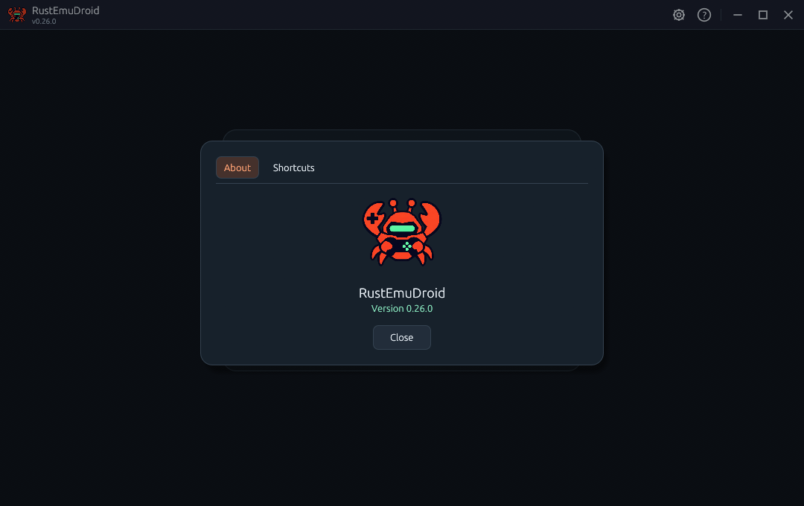
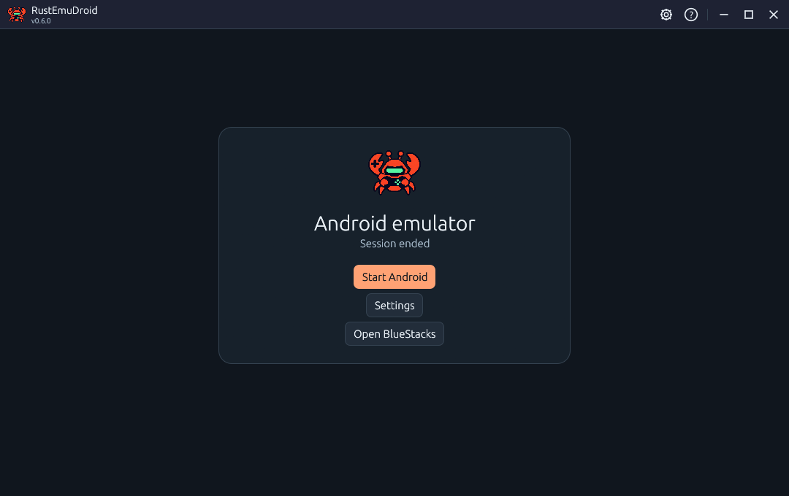
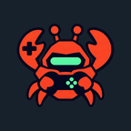
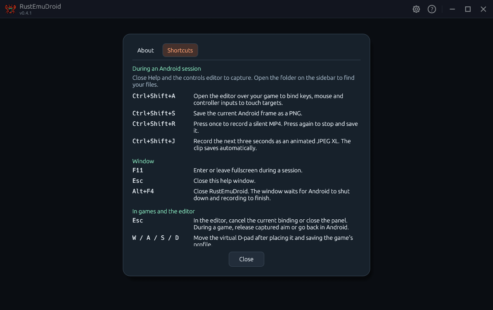
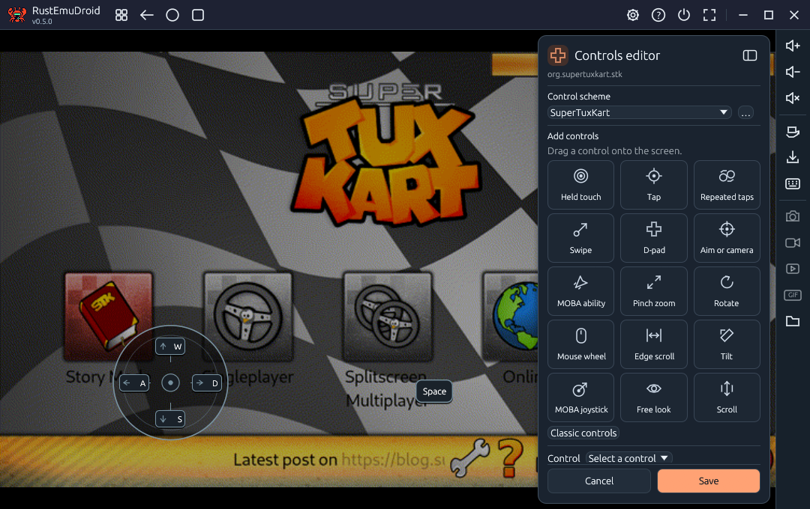

# RustEmuDroid

[Português brasileiro](README.pt-BR.md) · [Español](README.es-ES.md) · [Windows and Linux downloads](https://github.com/felipemarques/RustEmuDroid/releases/latest) · [Benchmarks](benchmarks/stk-1.5/README.md)

RustEmuDroid runs Android games and apps in one desktop window on x86-64 Windows and Linux. The Rust client starts the virtual machine, displays Android and handles input and window management. Inside the VM, the bundled Android Home opens to your installed games. The desktop client and Home are ad-free. Brazilian Portuguese is the default. Choose English (US) or Spanish (Spain) in Settings and save to change the desktop controls and Android Home together. Installed games and apps keep their own language settings.


*The games in this screenshot were installed on the test profile. A new profile starts with the apps supplied by its Android image.*

## Run a prebuilt version

1. Open the [latest GitHub Release](https://github.com/felipemarques/RustEmuDroid/releases/latest) and find **Assets**.
2. On Windows, extract `RustEmuDroid-vX.Y.Z-windows-x86_64.zip` into a writable directory. On Linux, extract `RustEmuDroid-vX.Y.Z-linux-x86_64.tar.gz` with `tar -xzf` to keep the execute permission. The filename includes the release version in place of `X.Y.Z`.
3. Install the Android runtime described below. From the directory containing the executable, run the commands for your platform.

| Task | Windows PowerShell | Linux shell |
|---|---|---|
| Check SDK and virtualization | `.\rustemudroid.exe doctor` | `./rustemudroid doctor` |
| Open the desktop client | `.\rustemudroid.exe ui` | `./rustemudroid ui` |

For a development build, sign in to GitHub, open a successful [Desktop builds run](https://github.com/felipemarques/RustEmuDroid/actions/workflows/build.yml) and download the package under **Artifacts**.

The executable embeds the RustEmuDroid Home APK. The Android SDK, system images, games and user data are separate. Rust and Cargo are only required for source builds.

## Prepare the Android runtime

| Requirement | Windows x86-64 | Linux x86-64 |
|---|---|---|
| Hardware virtualization | Enable Intel VT-x or AMD-V in firmware and **Windows Hypervisor Platform** in Windows Features. | Enable CPU virtualization and give your user read/write access to `/dev/kvm`. Check with `test -r /dev/kvm && test -w /dev/kvm`. |
| Desktop and graphics | Install the host GPU driver. | Use an X11 or Wayland session with working OpenGL. The APK picker uses the desktop file portal. |
| Android tools | Install Android Emulator, Platform-Tools and an x86-64 system image through Android Studio’s SDK Manager or the Android command-line tools. | Install the Linux versions of the same components, including under WSL2. |

For an existing installation, `--sdk` can point to a directory containing the `emulator` and `platform-tools` packages plus your image under `system-images`. Android Studio, Gradle, the NDK and the SDK build tools are optional for running the published client. Version 0.8.1 also checks for the SDK emulator and ADB when selecting Kemu's engine on Windows.

With `sdkmanager` on your PATH, install the runtime and the optional Google Play image with the following command. Accept the SDK licenses when prompted.

```sh
sdkmanager --install "emulator" "platform-tools" "system-images;android-37.0;google_apis_playstore;x86_64"
```

For a Google APIs image, another supported package is `system-images;android-35;google_apis;x86_64`. Use `sdkmanager --list` to see available packages. SDK discovery checks `--sdk`, `ANDROID_HOME`, `ANDROID_SDK_ROOT` and finally `%LOCALAPPDATA%\Android\Sdk` on Windows or `~/Android/Sdk` on Linux. [SDK Manager](https://developer.android.com/tools/sdkmanager) · [Emulator acceleration](https://developer.android.com/studio/run/emulator-acceleration)

On Ubuntu 24.04 under WSL2, the Linux release booted Android 17 Google Play with KVM. In WSLg, BombSquad presented 60 frames/s in a Death Match using native OpenGL ES on the Radeon 780M through Mesa D3D12. Guest Vulkan used a CPU renderer on this machine. [Setup, driver selection and game measurements](docs/linux-runtime.md)

## Choose a profile

Open the gear in the title bar. Each profile has its own writable disk, installed apps, accounts and saves. **Original** is the default profile for that working directory. Its Android version depends on the chosen image.

| Configuration | Runtime and first use |
|---|---|
| Original with Kemu | On Windows, an installed Kemu can supply its Android 16 / API 36 image and matching QEMU/gfxstream engine with Host or Auto GPU. The tested setup uses ANGLE/Vulkan. Set `RUSTEMUDROID_KEMU_ROOT` for nonstandard installations. |
| Original with the SDK | On first use, the client looks for installed Google Play API 37.0, Google APIs 36 and Google APIs 35 images, in that order. Use `init --image` to select a specific package. |
| Android 17 with Google Play | Install the API 37.0 Google Play image, select **Android 17** in Settings and save. This SDK image includes the Play Store and Google Play services. The card indicates when the image is missing. |

Gaming profiles request four vCPUs, 8 GiB of guest RAM and 1600 × 900 at 60 Hz. A generic SDK profile requests four vCPUs, 3 GiB and 1080 × 1920. The Windows Kemu engine keeps a separate writable disk under `gaming/`.


## Use the desktop controls

| Task | How to do it |
|---|---|
| Find and install apps | Search under **Games** or **Apps**. Long-press a card to change its category. The install button on the right accepts a single APK and refreshes the library. |
| Navigate Android | The four-square button opens Apps. The title bar also contains **Back**, **Home** and **Recent apps**. Home returns to Games. Click to tap and drag to swipe. |
| Map a keyboard or controller | Open a game and click the keyboard icon. Choose **Button**, click a touch target, then press the physical key or controller button. For WASD or the left stick, choose **Directional control**, click the center of the virtual stick and adjust its radius. Right-click a marker to remove it. **Save** stores relative coordinates for that Android package. Windows gamepads use XInput. |
| Adjust media | The right toolbar controls Android media volume, mute and screen rotation. Hold a volume button to change several levels. |
| Use a webcam | In Settings, select a front or rear host webcam, starting with index 0. Save and restart Android to apply hardware changes. Grant camera access inside the Android app when needed. A simulated front camera is also available. |
| Fullscreen and version | Press **F11**. Move the pointer to the top or right edge to reveal controls in fullscreen. The title bar and **?** dialog show the version. |



**Stop Android** stops the VM and returns to the panel. Closing the window with **X** or the system close shortcut shows the shutdown screen. The native window keeps responding until the VM exits, then closes automatically. This also works during boot. Closing an idle panel takes effect immediately.


After stopping Android, the session screen lets you start the same profile again.



## Open an installed BlueStacks instance on Windows

To open an installed game, you need BlueStacks 5 with at least one instance configured on Windows. The instance opens in the BlueStacks player with its own games and saves. These Windows PowerShell commands work without the Android SDK.

RustEmuDroid’s embedded display, input mapping and FPS counter are available when playing in its native Android runtime.

**If you downloaded the release ZIP**, choose **Extract All** and open the folder containing `rustemudroid.exe` in File Explorer. Click the address bar, type `powershell` and press **Enter**. In that window, set the executable path.

```powershell
$emu = '.\rustemudroid.exe'
```

**If you cloned the repository**, open the folder containing `Cargo.toml` in File Explorer and type `powershell` in its address bar. The `Abrir RustEmuDroid.cmd` launcher builds the executable at this path.

```powershell
$emu = '.\target\integrado\release\rustemudroid.exe'
```

For a first build, run `cargo build --locked --release --features ui --target-dir target/integrado` in this folder. If you already used Cargo’s default release build directory, set `$emu = '.\target\release\rustemudroid.exe'`.

**Check the path and list your instances.** Stay in the same PowerShell window. `Test-Path` should return `True`. If it returns `False` or PowerShell says the command is unrecognized, check the folder and the executable path you selected above. The `.\` prefix starts at the current folder.

```powershell
Test-Path -LiteralPath $emu -PathType Leaf
& $emu bluestacks list
```

Example output from `list` on the test PC

```text
Pie64    BlueStacks App Player
```

The first column is the instance ID. To open the BlueStacks home screen, replace `Pie64` with the ID from your list.

```powershell
& $emu bluestacks open --instance Pie64
```

To open SuperTuxKart directly, use the following command if the game is installed in that instance. `--package` takes the game’s Android package ID.

```powershell
& $emu bluestacks open --instance Pie64 --package org.supertuxkart.stk
```

If the list is empty or an installation error appears, open the BlueStacks 5 Multi-instance Manager, confirm that an instance is installed and run `list` again. In the RustEmuDroid UI you can also choose **Open BlueStacks** from the session screen or Settings.

Starting with v0.5.0, both desktop archives include a read-only storage check in `tools/`. Shut down the BlueStacks Pie64 instance and put copies of `fastboot.vdi` and `Data_orig.vhdx` in a `Pie64` folder beside `tools/`. Run from the extracted folder or the source checkout root. Choose a new output directory for each run.

On Windows with Ubuntu 24.04 under WSL, run

```powershell
powershell -ExecutionPolicy Bypass -File .\tools\Test-BlueStacksData.ps1 -Images .\Pie64 -Output .\data-check
Get-Content .\data-check\result.json
```

On Linux or WSL, run

```sh
python3 -B tools/bluestacks_data_probe.py --images ./Pie64 --output ./data-check
cat ./data-check/result.json
```

The probe accepts only the exact validated Pie64 image pair and checks its two SHA-256 hashes automatically. If the copies already have a `manifest.json`, you can add `-VerifyHashes` to the Windows probe command to check the hashes against that manifest too.

A value of `true` for `factory_ext4_mounted_read_only` in `result.json` means the diagnostic guest mounted the factory ext4 data filesystem read-only. The packaged `tools/README.md` lists the requirements.

In the separate source-checkout `-SystemMount` test, the copied Android system mounted and BlueStacks initialization stopped at `android_id is empty`. For a playable session with that instance, use **Open BlueStacks**. [System-mount notes](docs/bluestacks-lab.md#opt-in-system-mount)

The crab moves during startup and shutdown, in About, and when Android Home has no matching items. The game view keeps the mascot off the rendering path.



Click **? → Shortcuts** in the title bar to see the available keys, what each one does and when it works.



## Capture gameplay

| Action | Shortcut | Output |
|---|---|---|
| Screenshot | **Ctrl+Shift+S** | Full-resolution PNG of the guest display |
| Start or stop video | **Ctrl+Shift+R** | Silent H.264 MP4 with a 30 FPS target |
| Record a moment | **Ctrl+Shift+J** | The next three seconds as an animated JPEG XL at 10 FPS |
| Save a recent highlight | **Ctrl+Shift+H** | The previous three seconds as an animated JPEG XL at 10 FPS, with instant replay enabled |
| Record a GIF | GIF tool in the sidebar | The next three seconds as a looping GIF at 10 FPS |

To keep a goal or an overtake you just saw, open the clock on the sidebar and enable instant replay **before** playing. Once the buffer is ready, press **Ctrl+Shift+H** after the highlight, or save it from that menu. The buffer is off at the start of each Android session. Turning it off discards its unsaved footage.


Open the folder button on the sidebar to find your files in `captures/` beside `launcher.json`. PNG works directly in Rust. Install FFmpeg with `libx264` for MP4 and `libjxl_anim` for animated JPEG XL. Set `RUSTEMUDROID_FFMPEG` to an executable path if FFmpeg is outside PATH. Animations fit within 720 × 720 and keep their aspect ratio. The window waits for pending exports when you close it.

## Create a control scheme

Open a game and click the keyboard icon in the sidebar to open **Game controls**. Choose keyboard/mouse or gamepad to show that device's button hints. Both devices can still send input. Adjust the hints' opacity or switch schemes here. Under **Mouse sensitivity**, change X for horizontal movement and Y for vertical movement while aiming or using mouse free look. The active game scheme saves both values. Set either axis to 1.00 for its original speed.


Choose **Controls editor** from the menu or press **Ctrl+Shift+A**. Drag a control from the palette onto the game, then select it to bind an input and adjust its properties. For movement, drop a **D-pad** over the game's virtual joystick. Assign **Up**, **Down**, **Left**, and **Right** individually in **Control settings**. Click the center of the D-pad to select it and drag the lower-right handle to match the game's joystick. The handle and panel adjust the same radius. Under **Controller stick**, choose **Left** or **Right** to steer with that stick alongside the direction keys. Choose **Off** to use only the assigned directions. Click **Save** to apply the scheme.

For maps that pan when dragged, drop **Edge scroll** on a clear spot in the map and save. Move the pointer to an edge of the game display to pan toward it. Adjust the horizontal and vertical margins and speeds in **Control settings**. Move the pointer away from the edge to stop.

For games that respond to motion sensors, add **Tilt**, bind a key or button, and choose the X, Y, or Z axis and an angle from −45° to +45° in **Control settings**. Hold the binding to tilt the virtual device relative to its current orientation. Release it to restore the original orientation. This control requires virtual sensor support.

For click-to-move games, drop **MOBA joystick** over the virtual stick and use **Place hero** to mark the hero's on-screen position. Right-click a destination to move the stick in that direction. Adjust the stick radius and hero speed for the game. Assign **Stop movement** if you want to interrupt a move. Use **MOBA ability** to aim a skill from its own in-game control.

Place **Free look** over the game's camera control. Bind the four directions individually, or enable **Look with the mouse** and hold its assigned key while moving the mouse. For an app or map that scrolls when dragged, drop **Scroll** on the surface and use the wheel over the game display. Adjust the speed and amplitude, and choose whether Scroll overrides other wheel mappings.

For an on-screen steering wheel, place **Rotate** at its center and enable **Single-touch wheel**. Set the starting contact angle, radius and turn angle. With a positive turn angle, the main binding turns clockwise and **Reverse turn** turns counterclockwise. Each direction holds one contact until you release its binding. **Rotate** uses two fingers by default.

The palette has 15 tiles for 14 control types. **Mouse wheel** is a ready-made **Swipe** binding for one wheel direction. Use the scheme options to create or duplicate a layout and import or export it as JSON.



*SuperTuxKart's language can be changed in the game's own settings.*

## Build from source

Install current stable Rust with Cargo. Windows also needs the Visual Studio C++ Desktop build tools and Windows SDK. On Ubuntu 24.04, install the native dependencies:

```sh
sudo apt-get update
sudo apt-get install -y build-essential pkg-config libudev-dev libwayland-dev libxkbcommon-dev libx11-dev libxi-dev libxrandr-dev libxcursor-dev libgl1-mesa-dev
```

```sh
git clone https://github.com/felipemarques/RustEmuDroid.git
cd RustEmuDroid
cargo build --locked --release --features ui
cargo run --locked --release --features ui -- ui
```

On Windows, [Abrir RustEmuDroid.cmd](Abrir%20RustEmuDroid.cmd) builds the release client and opens it, or focuses its existing window. Omitting `--features ui` builds the CLI.

## CLI and storage

```sh
cargo run --locked -- doctor
cargo run --locked -- init --image "system-images;android-35;google_apis;x86_64"
cargo run --locked -- boot --headless --check --gpu auto
cargo run --locked -- boot --help
```

To use an installed Kemu image with a separate data directory on Windows:

```powershell
cargo run --locked -- --state-dir .rustemudroid/kemu init --system-dir "C:/Program Files/Kemu/system-img"
cargo run --locked --release --features ui -- --state-dir .rustemudroid/kemu ui
```

Use the same `--state-dir` for initialization, boot and UI. The default is `.rustemudroid/windows/` or `.rustemudroid/linux/` relative to the working directory. `launcher.json` holds preferences. The active profile contains the AVD and `boot-*.log`. `boot --check` waits for `sys.boot_completed=1` and stops that VM. `--timeout` sets the boot deadline in seconds and `--engine sdk` explicitly selects the SDK engine. The client selects free ports and verifies the AVD path before sending shutdown commands.

## Performance and troubleshooting

The [Radeon 780M benchmark](benchmarks/stk-1.5/radeon-780m/README.md) compares integrated graphics across RustEmuDroid, Kemu and BlueStacks. It includes per-run measurements and host GPU verification.

For a repeatable graphics test on Windows, try **FPS WW2 URP → Start Game → Level 1**. Enable **Settings → Display FPS** to see the game's counter. For a second Vulkan workload, open **andar → Continue → Begin → Skip** and face the gate in the rain. Both scenes have measurements on the Radeon 780M and RTX 5070 Ti. [FPS WW2 URP results](docs/game-testing.md#radeon-780m-vulkan-compatibility) · [ANDAR results and download](docs/game-testing.md#andar) · [All game tests](docs/game-testing.md)

- **FPS.** The title bar counts new frames sent for drawing by the desktop panel. A static Home can show a low value. Use the game’s own counter or frame report to compare game performance.
- **Measured example.** In the SuperTuxKart 1.5 Black Forest replay, RustEmuDroid averaged 59.93 FPS at the original preset and 28.90 FPS at high quality on the tested Windows RTX 5070 Ti / Android 16 OpenGL ES setup. The report lists the driver, ABI, presets, frame times and the Kemu and BlueStacks results. [Benchmark and raw measurements](benchmarks/stk-1.5/README.md)
- **Black screen or slow graphics.** Run `doctor`, check the selected Vulkan adapter and try Host or Auto. Software/SwiftShader can help isolate driver issues. The SDK engine uses a GLES compatibility path with the Kemu image on Linux.
- **Vulkan memory allocation crashes on the Radeon 780M.** On Windows, select the **Android 17 Google Play** profile, choose **Host GPU** or **Automatic**, and explicitly select **AMD Radeon 780M Graphics**. Turn on **Shared Vulkan memory (Radeon 780M)** under **Graphics**, then save and restart Android. This experimental setting is off by default, applies per profile, and was verified with Android Emulator SDK 37.3.10.
- **Several ADB devices.** Run `adb devices -l` and use `adb -s <serial>` to target the correct instance. Look up the session serial in the launcher output.
- **PUBG MOBILE closes during startup on Android 17 Google Play.** Starting with v0.2.1, the launcher selects the built-in ANGLE driver for `com.tencent.ig` when using host or automatic GPU rendering on this x86-64 image with Vulkan support. Existing per-app preferences take precedence. On a GeForce RTX 5070 Ti this fixed the native EGL crash when the game presented a frame. [Android per-app graphics drivers](https://developer.android.com/games/develop/vulkan/overview)
- **PUBG hangs during startup on Kemu Android 16.** In Settings, enable the lightweight ARM translation option for PUBG and save. This Berberis mode affects ARM apps in that profile during the boot and may change FPS. The local test reached sign-in. Game compatibility also depends on ABI support and publisher restrictions.
- **Missing games after switching.** Return to the profile where you installed them. A fresh clone contains neither installed games nor accounts.

## Architecture and verification

| Component | Role |
|---|---|
| [Desktop UI](src/ui.rs) | Rust, eframe/egui and Glow. Owns the native window, controls, settings and shutdown screen. |
| [VM lifecycle](src/android.rs) | Discovers the SDK and images, creates AVDs, launches the selected emulator and waits for its exit. |
| [Display and input](src/display.rs) | Receives authenticated local gRPC frames from `EmulatorController.streamScreenshot`, retains the latest pending RGBA frame and forwards touch and key input. |
| [Android Home](android/home) | Native Android activity. Reads launcher entries through PackageManager and uses app banners or icons. The desktop client installs the embedded development APK through ADB. |

Run `cargo test --locked --features ui` for the offline tests. [GitHub Actions](.github/workflows/build.yml) tests and builds release binaries for Windows and Ubuntu x86-64 on pushes, pull requests and manual runs. Guest tests require a local AVD. To repeat the native Windows close test, set `RUSTEMUDROID_TEST_STATE` to the absolute directory of an idle launcher profile, then run `cargo test --locked --features ui real_window_paints_until_android_exits -- --ignored --nocapture`.

To rebuild Android Home, install a JDK, a platform `android.jar` and Android Build-Tools. Run `python android/home/build.py <android.jar> <build-tools-dir>`. The script uses `~/.android/debug.keystore` by default and supports `--keystore` and `--alias`. To upgrade existing installations, retain the signing identity and update the version code in the manifest and [installation check](src/controls.rs).
