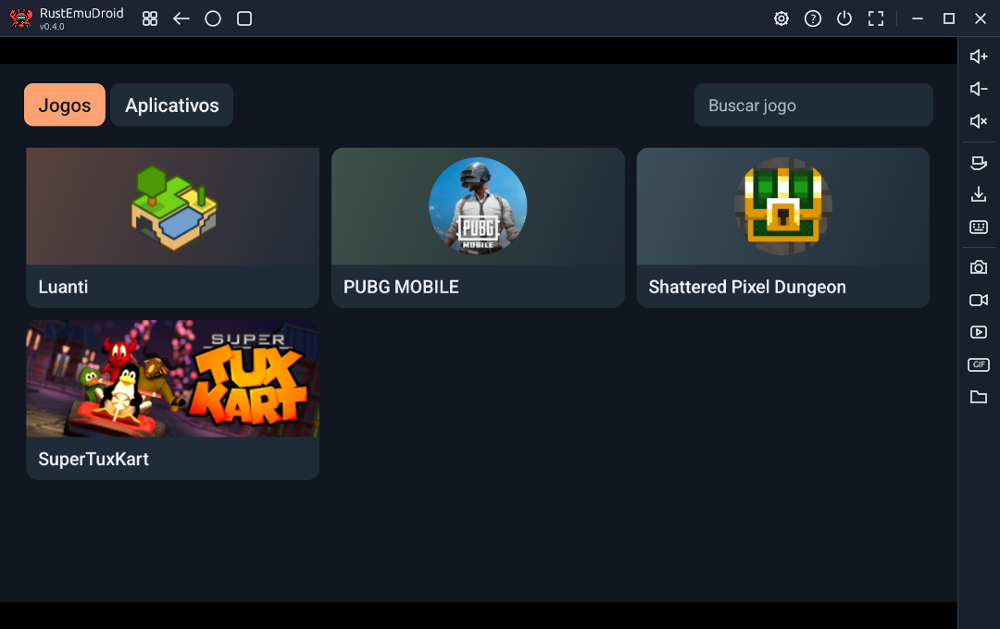
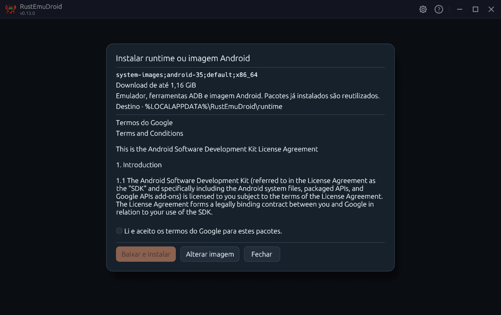
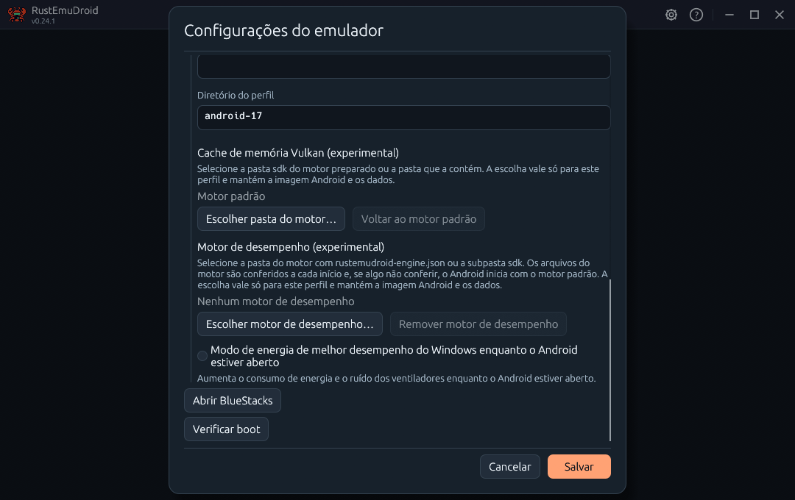
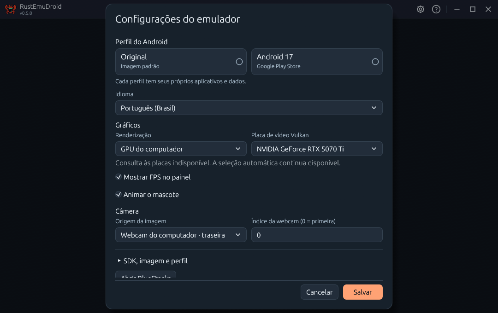
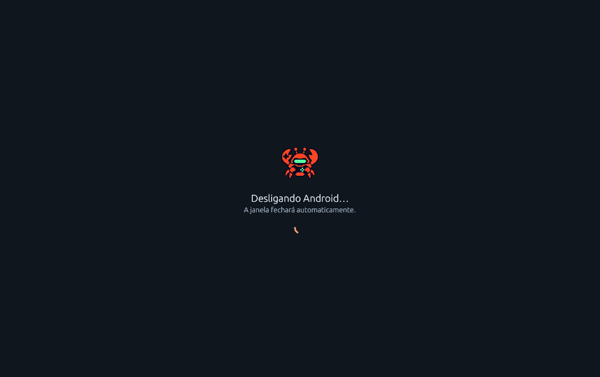
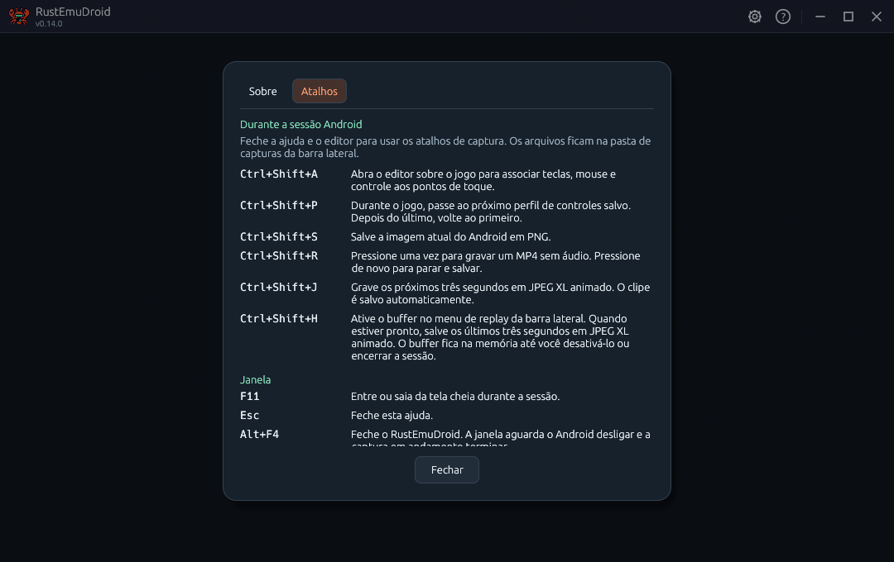
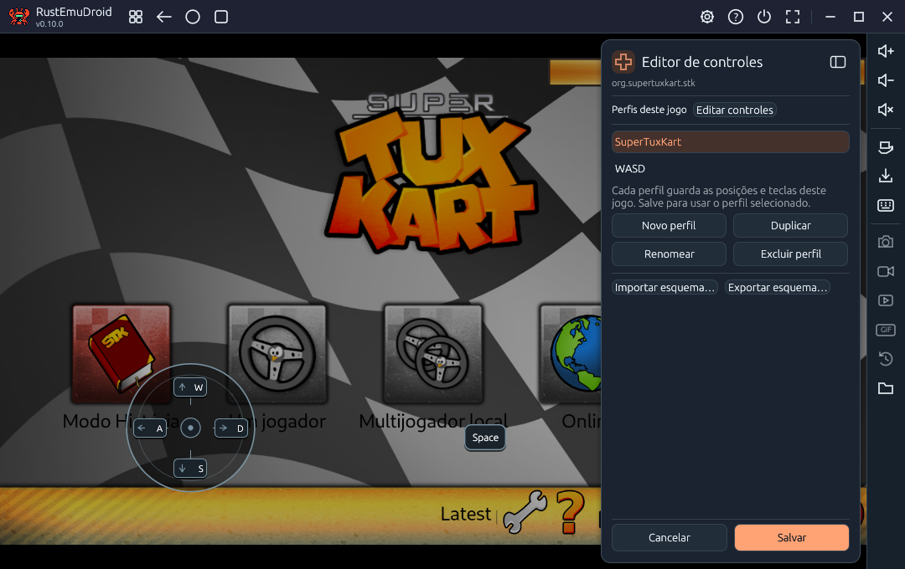
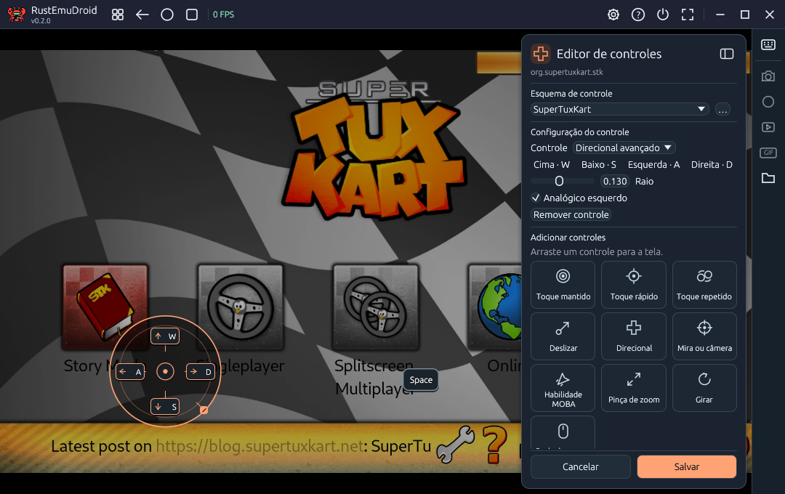

# RustEmuDroid

[English](README.md) · [Español](README.es-ES.md) · [Downloads para Windows e Linux](https://github.com/felipemarques/RustEmuDroid/releases/latest) · [Histórico de desempenho frente ao Kemu e ao BlueStacks](docs/performance-history.pt-BR.md)

O RustEmuDroid executa jogos e aplicativos Android em uma única janela no Windows e no Linux x86-64. O cliente em Rust inicia a máquina virtual, exibe a tela do Android e controla a entrada e a janela. Dentro da VM, a Home abre diretamente na biblioteca de jogos instalados. O painel e a Home são livres de anúncios. O idioma padrão é português brasileiro. Nas configurações, escolha inglês dos Estados Unidos ou espanhol da Espanha e salve para mudar o painel e a Home do Android juntos. Cada jogo ou aplicativo instalado controla o próprio idioma.



*Os jogos da captura foram instalados no perfil de teste. Um perfil novo começa com os aplicativos fornecidos pela imagem Android.*

## Executar uma versão compilada

1. Abra a [versão mais recente no GitHub](https://github.com/felipemarques/RustEmuDroid/releases/latest) e localize **Assets**.
2. No Windows, extraia `RustEmuDroid-vX.Y.Z-windows-x86_64.zip` em uma pasta com permissão de escrita. No Linux, extraia `RustEmuDroid-vX.Y.Z-linux-x86_64.tar.gz` com `tar -xzf` para preservar a permissão de execução. O nome do arquivo traz a versão no lugar de `X.Y.Z`. Na versão atual, a v0.26.0, os arquivos são `RustEmuDroid-v0.26.0-windows-x86_64.zip` e `RustEmuDroid-v0.26.0-linux-x86_64.tar.gz`.
3. No Windows, abra `rustemudroid.exe`. No Linux, execute `./rustemudroid` na pasta extraída. Em um PC sem runtime, selecione **Instalar runtime ou imagem Android**.

| Ação | Windows PowerShell | Terminal Linux |
|---|---|---|
| Verificar o motor e a virtualização | `.\rustemudroid.exe doctor` | `./rustemudroid doctor` |
| Abrir o painel | `.\rustemudroid.exe ui` | `./rustemudroid ui` |

Para baixar uma compilação de desenvolvimento, entre no GitHub, abra uma [execução bem-sucedida de Desktop builds](https://github.com/felipemarques/RustEmuDroid/actions/workflows/build.yml) e baixe o pacote em **Artifacts**.

O executável inclui o APK da Home do RustEmuDroid. O executável para Linux também traz a pequena biblioteca que protege a memória de vídeo em placas AMD (v0.24.1). O motor e a imagem Android são fornecidos separadamente. Os motores experimentais para Windows, o de cache Vulkan e o de desempenho, são compilados à parte e não fazem parte do download. Compilar o projeto também exige Rust e Cargo.

## Preparar o ambiente Android

| Requisito | Windows x86-64 | Linux x86-64 |
|---|---|---|
| Virtualização | Habilite Intel VT-x ou AMD-V no firmware e **Plataforma do Hipervisor do Windows** nos Recursos do Windows. | Habilite a virtualização e permita que seu usuário leia e escreva em `/dev/kvm`. Confira com `test -r /dev/kvm && test -w /dev/kvm`. |
| Vídeo e desktop | Instale o driver da placa de vídeo para usar aceleração da GPU. | Use uma sessão gráfica X11 ou Wayland com OpenGL. O seletor de APK depende do portal de arquivos do desktop. Com placa de vídeo AMD, escolha **GPU do computador**: o RustEmuDroid prepara sozinho a memória de vídeo do emulador. [Placas AMD no Linux, em inglês](docs/linux-runtime.md#amd-graphics-on-bare-metal-linux) |
| Ambiente Android | Use o assistente de instalação, o Kemu já instalado ou um SDK compatível. | Use o assistente de instalação ou um runtime x86-64 compatível. |

### Primeira instalação pelo RustEmuDroid

1. Escolha **Original** para Android 15 AOSP ou **Google Play** para Android 17 com Play Store. Clique em **Consultar download** para ver a pasta, o tamanho máximo e os termos do Google.
2. Se concordar com os termos, marque a caixa e clique em **Baixar e instalar**. O RustEmuDroid baixa o emulador, o ADB e a imagem diretamente do Google e confere o tamanho e o checksum de cada arquivo. Reserve espaço também para descompactá-los.
3. Clique em **Usar e iniciar este perfil**. Para adicionar a outra imagem depois, abra o mesmo assistente pela engrenagem. O instalador reutiliza os componentes gerenciados já presentes. Cada perfil tem seus próprios dados de aplicativos.



O assistente funciona sem uma instalação prévia do Android SDK, Android Studio, Java ou `sdkmanager`. No Windows, os componentes ficam em `%LOCALAPPDATA%\RustEmuDroid\runtime`. No Linux, ficam em `$XDG_DATA_HOME/RustEmuDroid/runtime` ou, por padrão, `~/.local/share/RustEmuDroid/runtime`.

No terminal, execute `runtime-setup --image original` ou `runtime-setup --image google-play` como argumento do executável para consultar os termos e o tamanho. Para iniciar o download após a leitura, repita o comando com `--accept-license`. Para reaproveitar um aceite anterior idêntico, use `--licenses-from <pasta-de-licenças>`. Para instalar em outra pasta, acrescente `--destination <pasta>` ao comando de instalação e abra o programa com `--sdk <pasta> ui`. O RustEmuDroid reconhece o emulador e o ADB instalados nessa pasta.

**Windows com Kemu.** Com o Kemu na pasta padrão, execute `.\rustemudroid.exe ui` para abrir o perfil Original. Para uma instalação em outra pasta, defina `RUSTEMUDROID_KEMU_ROOT` com esse caminho. Esse modo usa o ADB, a imagem e o motor fornecidos pelo Kemu. Selecione GPU do computador ou Automática.

**Runtime portátil no Windows ou Linux.** Dentro da pasta do executável, crie `runtime/`. Coloque nela os pacotes completos `emulator/` e `platform-tools/` do seu sistema e a árvore `system-images/` com a imagem Android. Execute `ui` a partir da pasta extraída. O launcher reconhece essa estrutura mesmo sem Android Studio ou variáveis do SDK. Preserve as bibliotecas e todos os arquivos da imagem. A opção `--sdk` continua disponível para selecionar outra instalação.

**Instalação pelo SDK.**

Com `sdkmanager` disponível no PATH, este comando instala as ferramentas e a imagem opcional do Google Play. Aceite as licenças do SDK quando forem apresentadas.

```sh
sdkmanager --install "emulator" "platform-tools" "system-images;android-37.0;google_apis_playstore;x86_64"
```

Outra imagem compatível é `system-images;android-35;google_apis;x86_64`. Consulte os pacotes com `sdkmanager --list`. Para localizar uma instalação do SDK, o cliente também aceita `ANDROID_HOME`, `ANDROID_SDK_ROOT` e a pasta padrão do sistema. [SDK Manager](https://developer.android.com/tools/sdkmanager) · [Aceleração do Android Emulator](https://developer.android.com/studio/run/emulator-acceleration)

No Ubuntu 24.04 com WSL2, a versão v0.7.0 para Linux iniciou o Android 17 com Google Play usando KVM. No WSLg, o BombSquad apresentou 60 quadros/s em uma rodada de Death Match com OpenGL ES nativo na Radeon 780M via Mesa D3D12. O Vulkan do Android usou a CPU nesse computador. [Configuração, seleção do driver e medições, em inglês](docs/linux-runtime.md)

## Escolher um perfil

Abra a engrenagem na barra de título. Cada perfil tem seu próprio disco gravável, aplicativos, contas e progresso salvo. **Original** é o perfil padrão daquele diretório de trabalho. A versão do Android depende da imagem escolhida.

| Configuração | Motor e primeiro uso |
|---|---|
| Original com Kemu | No Windows, o RustEmuDroid pode usar a imagem Android 16 / API 36 e o motor QEMU/gfxstream da instalação do Kemu nos modos GPU do computador e Automática. A configuração testada usa ANGLE/Vulkan. Configure `RUSTEMUDROID_KEMU_ROOT` para instalações fora da pasta padrão. |
| Original com SDK ou runtime portátil | No primeiro uso, a busca verifica Google Play API 37.0, Google APIs 36, Google APIs 35 e depois a imagem AOSP `default` x86-64 mais recente disponível. Use `init --image` para selecionar um pacote específico. |
| Android 17 com Google Play | Instale a imagem Google Play API 37.0, selecione **Android 17** na engrenagem e salve. A imagem do SDK fornece a Play Store e o Google Play Services. O cartão indica quando a imagem está ausente. |

A configuração de jogos solicita quatro vCPUs, 8 GiB de RAM para o Android e 1600 × 900 a 60 Hz. O perfil genérico do SDK solicita quatro vCPUs, 3 GiB e 1080 × 1920. O motor do Kemu no Windows usa um disco gravável separado na pasta `gaming/`.

Para testar uma tela de alta frequência, abra **Configurações → Gráficos → Taxa de atualização do Android**, escolha um valor até a taxa atual do monitor e salve. O Android reinicia. Pela linha de comando, use `boot --refresh-rate 90`. **Usar a taxa do perfil** volta à frequência original do perfil. Em versões compatíveis do Android, escolher mais de 60 Hz também solicita essa taxa para os jogos durante a sessão. Cada jogo pode ter um limite menor. [Medições do SuperTuxKart](docs/game-testing.md#managed-windows-runtime-and-android-refresh-rate)

Para jogar em uma janela menor, marque **Configurações → Gráficos → Ajustar o vídeo ao tamanho da janela** e salve. O player nativo passa a transferir menos pixels por quadro e o jogo continua renderizando na resolução configurada no Android. A tela cheia usa a resolução original. PNG e MP4 preservam essa resolução. O GIF e o JPEG XL animado usam os quadros originais como fonte e cabem em 720 × 720. A opção vem desativada e pode ser alterada durante a sessão. No Windows ela vale enquanto o painel copia os quadros. [Resultados do SuperTuxKart em janela](benchmarks/stk-1.5/vulkan-end-scene.md#matching-the-screenshot-stream-to-the-windows-panel)

A partir da v0.26.0, no Windows o painel mostra a imagem do próprio motor: o cliente coloca a superfície de imagem do motor dentro da sua janela, e o motor apresenta cada quadro direto na tela ali, sem cópia de quadros. Marcadores dos controles, avisos, menus, diálogos e o editor de controles continuam por cima da imagem ao vivo, e capturas de tela, gravações, clipes, GIFs e o replay instantâneo continuam funcionando. **Configurações → Gráficos → Imagem do Android no painel** escolhe entre **Automática (o motor desenha direto na janela)**, o padrão, e **Sempre copiar os quadros**; a mudança reinicia o Android. Quando a superfície do motor não aparece em 30 segundos, deixa de ser utilizável, a imagem dela fica parada enquanto a do Android muda ou a janela do motor para de responder por 3 segundos, o painel volta sozinho a copiar os quadros e explica o motivo em **Configurações → Saída do launcher**. Com o motor do Kemu, e no Linux, o painel copia os quadros como antes. [Se a imagem parecer errada](#solução-de-problemas) · [Notas da versão, em inglês](docs/releases/v0.26.0.md)

Quando o painel copia os quadros, no Windows ele lê a tela do Android de uma região de memória compartilhada com o motor (desde a v0.25.0), em vez de receber os pixels de cada quadro dentro das mensagens gRPC. Não é preciso ligar nada, e nenhum arquivo temporário é usado. Isso foi verificado no PC de testes com Windows e o motor de desempenho compilado à parte, e ainda não com os outros motores. Quando o motor recusa a região, não grava nela, não mostra imagem por ela ou uma leitura falha, o cliente volta sozinho aos quadros dentro das mensagens e explica o motivo em **Configurações → Saída do launcher**. No Linux esse caminho nunca rodou com um motor de verdade; por isso fica desligado, a menos que você peça. [A variável que escolhe o caminho](#linha-de-comando-dados-e-logs) · [Se a imagem parecer errada](#solução-de-problemas) · [Notas da versão, em inglês](docs/releases/v0.25.0.md)

No Windows, abra **Configurações → Runtime, imagem e perfil → Cache de memória Vulkan (experimental)** para testar um motor SDK preparado. Use **Escolher pasta do motor…** para selecionar a pasta `sdk` ou a pasta que a contém. Depois, salve e reinicie o Android. O motor usa a imagem Android e os dados de aplicativos do perfil selecionado. Para restaurar o motor habitual, clique em **Voltar ao motor padrão** e salve. [Preparar o motor com cache](experiments/whpx-clock/README.pt-BR.md#testar-o-cache-de-memória-vulkan).

<details>
<summary>Ver a configuração de cache Vulkan</summary>



</details>

**Configurações → Runtime, imagem e perfil → Motor de desempenho (experimental)** escolhe um motor Windows compilado à parte para o perfil. Use **Escolher motor de desempenho…** para selecionar a pasta com `rustemudroid-engine.json` e `sdk`, ligue as opções que o motor oferece, salve e reinicie o Android. A cada início, o RustEmuDroid confere os SHA-256 do motor. Se um arquivo estiver faltando ou tiver mudado, ou se o perfil não usar uma imagem do SDK com **GPU do computador** ou **Automática**, ele informa o motivo e inicia o Android com o motor padrão. **Remover motor de desempenho** volta ao motor habitual, e o início seguinte restaura o `config.ini` do perfil. Cada perfil usa este motor ou o cache de memória Vulkan, não os dois. Antes de voltar para a v0.22.0 ou anterior, remova o motor, salve e inicie o Android uma vez. [Preparar o motor](experiments/whpx-clock/README.pt-BR.md#motor-de-desempenho)

As Configurações mostram uma opção apenas para os ajustes que o motor lista. Depois do boot, a **Saída do launcher**, nas Configurações, informa quais ajustes o motor confirmou.

| Opção | Padrão | O que faz |
|---|---|---|
| **Ajustes de virtualização do processador** | Ligada | Relógio sincronizado, acesso rápido ao APIC e fim de interrupção paravirtualizado. Em motores que listam `whpx_apic_hv` (v0.24.0), o próprio Windows emula o controlador de interrupções, o que substitui os dois últimos. Se o computador não permitir, o motor mantém os dois e o Android inicia normalmente. |
| **Memória Vulkan com cache** | Ligada | Os jogos escrevem na memória gráfica por um caminho com cache. |
| **Comandos gráficos por memória compartilhada** | Ligada | Os comandos gráficos passam por um anel de memória compartilhada, o que ocupa cerca de um núcleo extra do processador enquanto um jogo roda. Grava `hw.gltransport=asg` no `config.ini` do perfil. |
| **Compor a tela com Vulkan** | Ligada | O computador compõe a tela do Android com Vulkan e o Android usa ANGLE para OpenGL ES. |
| **Núcleos dedicados para o Android** | Ligada | Cada processador virtual recebe um núcleo físico próprio, nunca o núcleo 0. Disponível quando o PC tem mais núcleos físicos que os processadores virtuais do perfil mais dois. |
| **Reduzir proteções do kernel do Android** | Desligada | Desliga as proteções contra falhas do processador e a limpeza de memória dentro do Android. Use só em um perfil dedicado a jogos. |

No mesmo grupo, **Modo de energia de melhor desempenho do Windows enquanto o Android estiver aberto** ativa o modo de energia Melhor desempenho do Windows enquanto o Android está aberto e restaura o anterior ao fechar. Funciona com qualquer motor, vem desligado e não é usado na bateria. [Medição mais recente com este motor](#benchmark-mais-recente) · [Séries anteriores e limites](docs/performance-history.pt-BR.md#motor-de-desempenho-em-mailbox-sem-limite)



## Usar os controles

| Ação | Como usar |
|---|---|
| Encontrar e instalar apps | Busque nas abas **Jogos** e **Aplicativos**. Pressione e segure um cartão para mudar sua categoria. O botão de instalação da barra direita aceita um APK e atualiza a biblioteca. |
| Rolar a biblioteca do Android | Com o ponteiro sobre os cartões em **Jogos** ou **Aplicativos**, gire a roda do mouse ou deslize dois dedos na vertical no touchpad. |
| Navegar no Android | O botão de quatro quadrados abre Aplicativos. A barra superior também traz **Voltar**, **Início** e **Aplicativos recentes**. Início retorna à aba Jogos. Clique para tocar e arraste para deslizar. |
| Mapear teclado ou controle | Abra o jogo e clique no ícone de teclado. Em **Botão**, clique no ponto de toque e pressione a tecla ou botão físico. Para usar WASD ou o analógico esquerdo, escolha **Direcional**, clique no centro do joystick virtual e ajuste o raio. Clique com o botão direito para remover uma marca. **Salvar** guarda as posições relativas para aquele pacote Android. No Windows, os controles usam XInput. |
| Ajustar mídia | A barra direita permite subir ou baixar o volume de mídia, silenciar, reativar e girar a tela. Segure um botão de volume para alterar vários níveis. |
| Usar uma webcam | Na engrenagem, selecione a webcam frontal ou traseira do computador. O índice 0 representa a primeira câmera. Salve e reinicie o Android para aplicar a mudança. Conceda a permissão dentro do aplicativo Android quando necessário. Também há uma câmera frontal simulada. |
| Tela cheia e versão | Pressione **F11**. Aproxime o ponteiro da borda superior ou direita para revelar os controles em tela cheia. A versão aparece na barra de título e na janela **?**. |


**Encerrar Android** desliga a VM e volta ao painel. Ao fechar a janela pelo **X** ou pelo atalho do sistema, o painel exibe **Desligando Android…**, continua respondendo e fecha automaticamente quando a VM termina. Isso também funciona durante a inicialização. Com o painel ocioso, a janela fecha imediatamente.



Ao encerrar o Android, a tela da sessão permite iniciar o mesmo perfil novamente.


## Abrir uma instância instalada do BlueStacks no Windows

No Windows, escolha **Abrir BlueStacks → Usar nesta janela** para ver a instância instalada e seus jogos no RustEmuDroid. Mantenha a janela original do player restaurada. O Windows compõe a imagem do Android dentro da janela Rust. Ao desconectar, a instância e o jogo continuam abertos. Se o Android do RustEmuDroid estiver em execução, ele será encerrado antes da conexão. Se você fechar o player do BlueStacks com a prévia aberta, o RustEmuDroid volta ao launcher. Para reconectar, selecione a instância novamente.


Para usar toque, arraste, rolagem, teclado e os botões de navegação Android, ative **Android Debug Bridge (ADB)** nas configurações avançadas do BlueStacks e reconecte. Clique em **Girar tela** na barra da prévia para alternar entre retrato e paisagem nos aplicativos que aceitam rotação. O RustEmuDroid usa um cliente ADB moderno do runtime gerenciado ou das Android Platform Tools. Com o ADB desativado, o modo permite apenas visualizar. Para acompanhar os quadros na prévia, escolha **Configurações → Contador de FPS → Superfície do jogo no Android**. A sessão Android nativa também oferece gravação e o contador do painel Rust.

Para instalar um jogo do PC, clique em **Instalar APK** na barra acima da prévia do BlueStacks, entre os ícones de câmera e pasta. Escolha o arquivo `.apk` e aguarde a confirmação. O Android instala o jogo na instância do BlueStacks que você abriu. O botão usa a mesma conexão ADB dos controles de toque. Se o Android recusar o arquivo, passe o mouse sobre a mensagem de falha para ver o motivo. [Confirmação exibida na barra](docs/screenshots/pt-br/bluestacks-apk-installed.png)


Use o ícone de câmera ou **Ctrl+Shift+S** na prévia do BlueStacks para salvar a tela do Android em resolução nativa. A captura PNG requer uma conexão ADB ativa. O botão de pasta abre `captures/`, ao lado de `launcher.json`.

Para rolar o Android, posicione o mouse sobre a imagem e use a roda. Clique dentro da imagem para ativar o perfil do jogo. A partir daí, cada direção da roda que você mapeou aciona o controle correspondente.

Na prévia do BlueStacks, abra um jogo e clique no ícone de teclado e escolha **Editor de controles**, ou pressione **Ctrl+Shift+A**. Posicione os controles sobre a captura do jogo. O Android continua rodando enquanto você edita. Salve para voltar à imagem ao vivo. **Ctrl+Shift+P** alterna entre os perfis salvos para aquele jogo e aquela instância do BlueStacks. Segure o direcional e um botão de ação ao mesmo tempo para enviar dois toques. O editor mostra as marcações das teclas. Na sessão Android nativa, também é possível ver as marcações durante o jogo e mapear o sensor de inclinação.


[Menu rápido de controles](docs/screenshots/pt-br/bluestacks-quick.png)

**Posso usar os jogos do meu backup do BlueStacks?** No PC de testes, restauramos uma cópia do disco de dados em outra instância Pie64 da mesma versão do BlueStacks. Ela iniciou o Android 9 e listou os quatro jogos verificados. Selecione a instância restaurada em **Abrir BlueStacks → Usar nesta janela**. [Teste de restauração, em inglês](docs/bluestacks-lab.md#booting-an-archived-data-disk-with-the-installed-bluestacks-engine)

**Posso iniciar a cópia da imagem sem instalar o BlueStacks?** O híbrido experimental do Pie64 chegou ao serviço de sistema do Android (`system_server`) e parou antes da tela inicial. O boot de 29,5 segundos foi medido com a imagem de referência do Android 9. [Resultados do Pie64, em inglês](docs/bluestacks-lab.md#r2-fstab-compatibility-test)

**Se você baixou o ZIP da release**, use **Extrair tudo** e abra no Explorador de Arquivos a pasta em que aparece `rustemudroid.exe`. Clique na barra de endereço, digite `powershell` e pressione **Enter**. Nessa janela, indique qual executável usar.

```powershell
$emu = '.\rustemudroid.exe'
```

**Se você clonou o repositório**, abra no Explorador a pasta que contém `Cargo.toml` e digite `powershell` na barra de endereço. O atalho `Abrir RustEmuDroid.cmd` compila o executável neste caminho.

```powershell
$emu = '.\target\integrado\release\rustemudroid.exe'
```

Se for a primeira compilação, execute `cargo build --locked --release --features ui --target-dir target/integrado` nessa pasta. Se você já compilou com o comando padrão do Cargo, use `$emu = '.\target\release\rustemudroid.exe'`.

**Confira o caminho e liste as instâncias.** Continue na mesma janela do PowerShell. `Test-Path` deve retornar `True`. Se retornar `False` ou o PowerShell disser que o comando não foi reconhecido, confira a pasta aberta e o caminho escolhido acima. O prefixo `.\` significa “a partir da pasta atual”.

```powershell
Test-Path -LiteralPath $emu -PathType Leaf
& $emu bluestacks list
```

Exemplo de saída de `list` neste computador

```text
Pie64    BlueStacks App Player
```

A primeira coluna é o ID da instância. Para abrir a tela inicial do BlueStacks, use o ID que apareceu na sua lista no lugar de `Pie64`.

```powershell
& $emu bluestacks open --instance Pie64
```

Para abrir diretamente o SuperTuxKart, use o comando abaixo se o jogo estiver instalado nessa instância. `--package` recebe o identificador Android do jogo.

```powershell
& $emu bluestacks open --instance Pie64 --package org.supertuxkart.stk
```

Para exibir o jogo dentro do RustEmuDroid, execute

```powershell
& $emu bluestacks mirror --instance Pie64 --package org.supertuxkart.stk
```

Se a lista estiver vazia ou aparecer um erro de instalação, abra o Gerenciador de Multi-instâncias do BlueStacks 5, confirme que há uma instância instalada e repita `list`. Pela interface do RustEmuDroid, você também pode escolher **Abrir BlueStacks** na tela de sessão ou nas configurações.

A partir da v0.5.0, os dois pacotes incluem um teste de armazenamento somente leitura em `tools/`. Desligue a instância BlueStacks Pie64 e coloque cópias de `fastboot.vdi` e `Data_orig.vhdx` em uma pasta `Pie64` ao lado de `tools/`. Execute a partir da pasta extraída ou da raiz do código-fonte. Escolha uma pasta nova para os resultados a cada execução.

No Windows com Ubuntu 24.04 no WSL, execute

```powershell
powershell -ExecutionPolicy Bypass -File .\tools\Test-BlueStacksData.ps1 -Images .\Pie64 -Output .\data-check
Get-Content .\data-check\result.json
```

No Linux ou WSL, execute

```sh
python3 -B tools/bluestacks_data_probe.py --images ./Pie64 --output ./data-check
cat ./data-check/result.json
```

O teste aceita apenas o par exato de imagens Pie64 validado e verifica automaticamente os dois hashes SHA-256. Se as cópias já tiverem um `manifest.json`, acrescente `-VerifyHashes` ao comando do teste no Windows para conferir também os hashes desse manifesto.

O valor `true` em `factory_ext4_mounted_read_only` no `result.json` indica que o ambiente de diagnóstico montou o sistema de arquivos ext4 de dados de fábrica em modo somente leitura. O arquivo `tools/README.md` do pacote lista os requisitos.

Em um teste separado com `-SystemMount` no código-fonte, a cópia do sistema Android foi montada e a inicialização do BlueStacks parou em `android_id is empty`. Para jogar nessa instância, use **Abrir BlueStacks**. [Notas sobre a montagem do sistema, em inglês](docs/bluestacks-lab.md#opt-in-system-mount)

O caranguejo se movimenta durante a inicialização e o desligamento, na tela Sobre e quando a busca da Home do Android não encontra itens. Durante a partida, a animação fica desativada.


Clique em **? → Atalhos** na barra de título para ver as teclas disponíveis, o que cada uma faz e quando usá-la.



## Capturar uma jogada

| Ação | Atalho | Arquivo |
|---|---|---|
| Tirar print | **Ctrl+Shift+S** | PNG na resolução da tela do Android |
| Iniciar ou parar o vídeo | **Ctrl+Shift+R** | MP4 H.264 sem áudio, com alvo de 30 FPS |
| Gravar um momento | **Ctrl+Shift+J** | Os próximos três segundos em JPEG XL animado a 10 FPS |
| Salvar um lance recente | **Ctrl+Shift+H** | Os três segundos anteriores em JPEG XL animado a 10 FPS, com o replay instantâneo ligado |
| Gravar um GIF | Botão GIF na barra lateral | Os próximos três segundos em GIF em loop a 10 FPS |

Para guardar um gol ou uma ultrapassagem que acabou de acontecer, abra o relógio na barra lateral e ative o replay instantâneo **antes** de jogar. Quando estiver pronto, aperte **Ctrl+Shift+H** depois do lance ou salve pelo próprio menu. O replay começa desligado a cada sessão do Android. Desligá-lo descarta o trecho que ainda estava na memória.


O botão de pasta na barra lateral abre `captures/`, ao lado de `launcher.json`. O Rust grava o PNG diretamente. Para MP4, instale FFmpeg com `libx264`. Para JPEG XL animado, use o codificador `libjxl_anim`. Se o FFmpeg estiver fora do PATH, informe o caminho do executável em `RUSTEMUDROID_FFMPEG`. As animações preservam a proporção da imagem e cabem em 720 × 720. Ao fechar a janela, o cliente aguarda as exportações em andamento.

## Criar um esquema de controle

Abra o jogo e clique no ícone de teclado da barra lateral para abrir **Controles do jogo**. Escolha teclado e mouse ou controle para mostrar as dicas daquele dispositivo. Os dois continuam funcionando. Nesse menu você também pode ajustar a opacidade das dicas e trocar de esquema. Em **Sensibilidade do mouse**, X ajusta o movimento horizontal e Y ajusta o vertical ao mirar ou usar o olhar livre com o mouse. O esquema ativo do jogo guarda os dois valores. Use 1,00 para voltar à velocidade original de um eixo.


**Use vários mapas de controles no mesmo jogo.** Clique em **Gerenciar perfis** no menu do teclado. Escolha **Novo perfil** para começar do zero ou **Duplicar** para copiar as posições e teclas atuais. Dê um nome, como *Veículo*, e clique em **Aplicar**. Em **Editar controles**, arraste os controles para os botões do jogo e clique em **Salvar**. Para trocar durante o jogo, selecione o mapa em **Perfil do jogo** no menu do teclado. Cada jogo lembra o último perfil usado, inclusive depois de fechar o emulador. Em **Gerenciar perfis** também é possível renomear, excluir, importar ou exportar um perfil.



Durante a partida, pressione **Ctrl+Shift+P** para ativar o próximo perfil salvo do jogo. Depois do último, o atalho volta ao primeiro. O nome aparece na tela para confirmar a troca.

Selecione **Editor de controles** no menu ou pressione **Ctrl+Shift+A**. Arraste um controle da paleta para a tela do jogo e selecione-o para associar uma entrada e ajustar suas propriedades. Para movimento, solte um **Direcional** sobre o joystick virtual do jogo. Em **Configuração do controle**, associe **Cima**, **Baixo**, **Esquerda** e **Direita** individualmente. Clique no centro do direcional para selecioná-lo e arraste a alça no canto inferior direito para ajustar o raio ao tamanho do joystick. A alça e o painel ajustam o mesmo raio. Em **Analógico**, escolha **Esquerdo** ou **Direito** para usá-lo junto com as teclas de direção. Escolha **Desativado** para usar apenas as direções atribuídas. Clique em **Salvar** para aplicar o esquema.

Para mapas que se movem ao arrastar, solte **Rolagem de borda** em uma área livre do mapa e salve. Mova o ponteiro até uma borda da tela do jogo para mover a câmera naquela direção. Em **Configuração do controle**, ajuste as margens e velocidades de cada eixo. Afaste o ponteiro da borda para parar.

Em jogos que respondem a sensores de movimento, adicione **Inclinar**, associe uma tecla ou botão e escolha o eixo X, Y ou Z e um ângulo de −45° a +45° em **Configuração do controle**. Mantenha a tecla ou o botão pressionado para inclinar o dispositivo virtual a partir da orientação atual. Solte para voltar à orientação original. O controle requer suporte a sensores virtuais.

Em jogos com movimento por clique, solte **Analógico MOBA** sobre o direcional virtual e use **Posicionar herói** para marcar a posição do personagem na tela. Clique com o botão direito no destino para mover o direcional naquela direção. Ajuste o raio e a velocidade do herói para o jogo. Atribua **Parar movimento** se quiser interromper um deslocamento. Use **Habilidade MOBA** para mirar uma habilidade a partir do botão dela no jogo.

Coloque **Olhar livre** sobre o controle de câmera do jogo. Atribua cada direção ou habilite **Olhar com o mouse** e segure a tecla atribuída enquanto move o mouse. Para um aplicativo ou mapa que rola ao arrastar, solte **Rolagem** sobre a área e use a roda do mouse sobre a tela do jogo. Ajuste a velocidade e a amplitude e escolha se a rolagem substitui outros mapeamentos da roda.

Para dirigir com um volante na tela, posicione **Girar** no centro do volante e marque **Volante de um toque**. Ajuste o ângulo inicial do toque, o raio e o ângulo de giro. Com ângulo de giro positivo, a tecla principal gira no sentido horário e **Giro inverso** gira no sentido anti-horário. Cada direção mantém um toque até você soltar a tecla. Por padrão, **Girar** usa dois dedos.

A paleta tem 15 opções para 14 tipos de controle. **Roda do mouse** é um **Deslizar** já configurado para uma direção da roda.



*O idioma do SuperTuxKart pode ser alterado nas configurações do próprio jogo.*

## Compilar o projeto

Instale o Rust estável atual com Cargo. No Windows, instale também as ferramentas de compilação de desktop C++ do Visual Studio e o Windows SDK. No Ubuntu 24.04, prepare as dependências nativas:

```sh
sudo apt-get update
sudo apt-get install -y build-essential pkg-config libudev-dev libwayland-dev libxkbcommon-dev libx11-dev libxi-dev libxrandr-dev libxcursor-dev libgl1-mesa-dev
```

```sh
git clone https://github.com/felipemarques/RustEmuDroid.git
cd RustEmuDroid
cargo build --locked --release --features ui
cargo run --locked --release --features ui -- ui
```

No Windows, [Abrir RustEmuDroid.cmd](Abrir%20RustEmuDroid.cmd) compila a versão de produção e abre a janela, ou traz a instância existente para frente. Para compilar apenas a ferramenta de linha de comando, omita `--features ui`. No Linux, a compilação também gera uma pequena biblioteca em C com o `cc` (parte do `build-essential`), que o cliente carrega no motor em placas AMD.

## Linha de comando, dados e logs

```sh
cargo run --locked -- doctor
cargo run --locked -- init --image "system-images;android-35;google_apis;x86_64"
cargo run --locked -- boot --headless --check --gpu auto
cargo run --locked -- boot --help
```

Para usar a imagem do Kemu com dados separados no Windows:

```powershell
cargo run --locked -- --state-dir .rustemudroid/kemu init --system-dir "C:/Program Files/Kemu/system-img"
cargo run --locked --release --features ui -- --state-dir .rustemudroid/kemu ui
```

Use o mesmo `--state-dir` em `init`, `boot` e `ui`. O padrão é `.rustemudroid/windows/` ou `.rustemudroid/linux/` a partir do diretório de trabalho. O `launcher.json` guarda preferências. O perfil ativo contém o AVD e os arquivos `boot-*.log`. O comando `boot --check` aguarda `sys.boot_completed=1` e desliga a VM testada. `--timeout` ajusta o limite de boot em segundos. `--engine sdk` seleciona explicitamente o motor do SDK. O RustEmuDroid escolhe portas livres e verifica o caminho do AVD antes de pedir o desligamento.

No Windows, `boot --vulkan-cache-runtime <pasta>` inicia o perfil com um motor de cache Vulkan preparado, e `boot --performance-engine <pasta>` inicia com um motor de desempenho e suas opções padrão, sem a opção do kernel. Os dois não podem ser combinados. O motor de desempenho grava `hw.gltransport` no `config.ini` do perfil e registra as linhas originais em `rustemudroid-performance.json`, ao lado dele. O próximo início sem o motor restaura essas linhas.

```powershell
.\rustemudroid.exe --state-dir 'D:\Android\MyProfile' boot --gpu host --performance-engine 'D:\Android\PerformanceEngine'
```

No Linux com placa AMD, defina `RUSTEMUDROID_AMD_LINUX` antes de abrir o cliente para diagnosticar o tratamento da memória de vídeo: `off` inicia o motor como antes da v0.24.1, e `stock`, `full-size` ou `all-types` força esse modo de memória.

Defina `RUSTEMUDROID_VIDEO_TRANSPORT` antes de abrir o cliente para escolher como o painel recebe a imagem (v0.25.0). `inline` mantém cada quadro dentro da sua mensagem gRPC, o caminho da v0.24, no Windows e no Linux. `shared` pede a memória compartilhada; é o que a liga no Linux, onde ela usa um arquivo em `/dev/shm` e nunca rodou com um motor de verdade. Sem a variável, o Windows usa a memória compartilhada e o Linux não.

```powershell
$env:RUSTEMUDROID_VIDEO_TRANSPORT = 'inline'; .\rustemudroid.exe ui
```

No Windows, `RUSTEMUDROID_PANEL` substitui **Configurações → Gráficos → Imagem do Android no painel** para testes (v0.26.0): `engine-child` mostra a superfície de imagem do motor e `frames` copia os quadros. `RUSTEMUDROID_VIDEO_TRANSPORT` escolhe então como os quadros copiados viajam.

## Desempenho e solução de problemas

### Benchmark mais recente

**SuperTuxKart 1.5 em Vulkan sem limite na RTX 5070 Ti · 27 de novembro de 2026 · uma compilação do cliente v0.25.0 feita antes da versão, não o executável publicado.** Uma sessão comparou o novo caminho do painel, por memória compartilhada, com o caminho da v0.24 e com o BlueStacks. Ela não estabelece uma vantagem sobre o BlueStacks; o motivo vem depois da tabela.

| Braço | FPS do jogo | Voltas |
|---|---:|---:|
| BlueStacks 5 Pie64 | 361,0 | 6 |
| RustEmuDroid, painel por memória compartilhada, painel de 800 × 450 | 397,6 | 4 |
| RustEmuDroid, painel por memória compartilhada, painel padrão de 1040 × 585 | 401,0 | 4 |
| RustEmuDroid, quadros dentro das mensagens (o caminho da v0.24), painel de 800 × 450 | 372,4 | 4 |

Todos os braços rodaram o replay automático Black Forest do jogo em qualidade alta, com Vulkan e o VSync do jogo desligado (Mailbox, sem limite), a 1600 × 900 e 90 Hz no Android, no PC de testes com Windows (Ryzen 9 8945HS, GeForce RTX 5070 Ti), apenas no modo de energia Melhor desempenho do Windows. O FPS vem do relatório de quadros do próprio jogo. Os braços se alternaram em uma única sessão, das 10h23 às 11h07, com duas voltas medidas por boot depois de uma volta de aquecimento e outros programas usando 0,74–1,09 núcleo do computador durante as voltas medidas. O RustEmuDroid rodou a imagem oficial Android 17 Google Play no motor de desempenho compilado à parte, com **Ajustar o vídeo ao tamanho da janela** ligado. O BlueStacks rodou o Android 9 no player dele.

Nesta sessão os três braços do RustEmuDroid marcaram mais do que o BlueStacks, e a memória compartilhada marcou 6,8% a mais do que os quadros dentro das mensagens no mesmo tamanho de painel. **Isso não estabelece uma vantagem sobre o BlueStacks.** O BlueStacks marcou 361,0 aqui contra 419,3 em 26 de novembro, no mesmo PC e com a mesma carga, cerca de 14% a menos, e a causa não é conhecida. A área de trabalho estava em uso, e cada etapa do BlueStacks começou 25 segundos depois de a VM Android de uso diário do dono do PC ter sido iniciada; o operador do BlueStacks fechou essa VM para o boot medido. O caminho da v0.24 no RustEmuDroid ficou 2–5% abaixo dos próprios números de 26 de novembro. Falta repetir com a área de trabalho ociosa, nos dois modos de energia e com o Kemu.

A janela Rust era uma compilação feita antes da versão, no commit `a7efd99`: os dois primeiros commits do recurso na v0.25.0, sobre o código da v0.24.0. Um roteiro de laboratório a iniciou em um perfil Android 17 Google Play descartável e definiu o ambiente do motor. O executável publicado da v0.25.0, os commits do recurso feitos depois dessa compilação e um cliente aplicando os ajustes do motor a partir das próprias preferências não foram medidos. O braço da v0.24 é a mesma compilação com `RUSTEMUDROID_VIDEO_TRANSPORT=inline`. O motor de desempenho é compilado a partir do kit de fontes publicado e não faz parte do download. O motor padrão e o Kemu não foram medidos nesta série. As três etapas do BlueStacks completaram as voltas e depois terminaram com código de saída 1 ao fechar o player, como na série anterior. [Registro completo, em inglês: valores por volta, carga do computador, identidades e o que falhou](benchmarks/stk-1.5/windows-rtx-mailbox-shared-memory-panel-bluestacks.md)

### Medições anteriores

Os números abaixo foram medidos em versões anteriores e ficam aqui como histórico. Quando o relatório informa a versão do cliente, ela aparece no texto. [Histórico de desempenho desde o primeiro protótipo](docs/performance-history.pt-BR.md)

**26 de novembro de 2026 · SuperTuxKart 1.5 em Vulkan sem limite na RTX 5070 Ti · cliente RustEmuDroid v0.22.0.** Na série alternada daquele dia, o BlueStacks ficou à frente nos dois modos de energia do Windows.

| Modo de energia do Windows | RustEmuDroid, motor de desempenho | BlueStacks 5 Pie64 | Vantagem do BlueStacks |
|---|---:|---:|---:|
| Equilibrado | 392,9 FPS (2 voltas) | **402,5 FPS** (4 voltas) | 2,4% |
| Melhor desempenho | 393,6 FPS (8 voltas) | **419,3 FPS** (4 voltas) | 6,5% |

Os dois rodaram o replay automático Black Forest do jogo em qualidade alta, com Vulkan e o VSync do jogo desligado (Mailbox, sem limite), a 1600 × 900 e 90 Hz no Android, no PC de testes com Windows (Ryzen 9 8945HS, GeForce RTX 5070 Ti). O FPS vem do relatório de quadros do próprio jogo. Os dois emuladores se alternaram em uma única sessão, das 16h06 às 16h47, com outros programas usando 0,54–0,68 núcleo do computador durante as voltas do RustEmuDroid. O RustEmuDroid rodou a imagem oficial Android 17 Google Play no motor de desempenho compilado à parte, com os ajustes das seis opções, inclusive **Reduzir proteções do kernel do Android**, e com o controlador de interrupções emulado pelo Windows, em um painel de 800 × 450. O BlueStacks rodou o Android 9 no player dele.

A janela Rust era o cliente **v0.22.0**, e um operador de testes aplicou os ajustes do motor em volta dele. Esta é uma comparação histórica em um cliente antigo. As versões v0.23.0 e v0.24.0 trouxeram a forma própria do cliente de aplicar esses ajustes, e a v0.24.1 mudou apenas o comportamento no Linux; nenhuma delas foi medida aqui. O motor de desempenho é compilado a partir do kit de fontes publicado e não faz parte do download. O motor padrão e o Kemu não foram medidos nesta série. O valor do RustEmuDroid em Equilibrado vem de um único boot, porque uma rodada foi recusada no início e um segundo boot foi perdido quando o adb não respondeu a tempo. [Registro completo, em inglês: valores por volta, identidades e o que falhou](benchmarks/stk-1.5/windows-rtx-mailbox-hypervisor-apic-bluestacks.md)

Os testes no Windows comparam as transições de menu e o campo de treino do PUBG, além do replay do SuperTuxKart, nas GPUs dedicada e integrada. Cada resultado identifica a cena, o contador de quadros e as opções gráficas. [Tabela comparativa de FPS](docs/game-testing.md#fps-comparisons-on-the-windows-test-pc)

Para comparar o PUBG no seu PC, meça a mesma cena no RustEmuDroid e no BlueStacks. O coletor informa quantos quadros novos o Android apresentou por segundo e quanto durou a maior pausa entre eles. [Comandos e método de medição, em inglês](docs/game-testing.md#record-a-game-scene-on-your-own-pc)

O [benchmark da Radeon 780M, em inglês](benchmarks/stk-1.5/radeon-780m/README.md), compara a GPU integrada no RustEmuDroid, Kemu e BlueStacks. O relatório inclui os dados de cada corrida e a confirmação da GPU física.

Para comparar as placas no Windows, abra **FPS WW2 URP → Start Game → Level 1**. Ative **Settings → Display FPS** para ver o contador do jogo. Para testar outra cena com Vulkan, abra **andar → Continue → Begin → Skip** e fique de frente para o portão na chuva. Medimos as duas cenas na Radeon 780M e na RTX 5070 Ti. [Resultados do FPS WW2 URP](docs/game-testing.md#radeon-780m-vulkan-compatibility) · [Resultados e download de ANDAR](docs/game-testing.md#andar) · [Todos os testes, em inglês](docs/game-testing.md)

**PUBG e SuperTuxKart no Windows, v0.18.0 e v0.21.1.** Em 1600 × 900 na RTX 5070 Ti, o percurso entre lobby e inventário do PUBG em Balanced/High teve média de 25,20 FPS no RustEmuDroid 0.18.0 e 29,58 no BlueStacks Pie64, medidos no Android. No primeiro fechamento do inventário, a pausa durou 1,60–1,68 s no Android 17 e 0,17 s no Pie64. A 90 Hz na RTX, a mesma versão x86-64 do SuperTuxKart registrou 85,62 FPS no RustEmuDroid 0.21.1, 90,02 no Kemu 0.7.1 e 89,99 no BlueStacks. Foram duas corridas por emulador, em qualidade alta com Vulkan FIFO. Na Radeon 780M integrada, em uma série anterior cujo relatório não informa a versão do cliente, o SuperTuxKart em qualidade alta, com limite de 60 FPS, registrou 59,71 FPS no perfil Android 17 com Vulkan, 59,87 no Kemu e 59,99 no BlueStacks. Os dois últimos usaram OpenGL ES. [Tempos por quadro no PUBG](docs/game-testing.md#pubg-inventory-retest-with-rustemudroid-v0180) · [Configurações e resultados do SuperTuxKart](benchmarks/stk-1.5/radeon-780m/README.md) · [Corridas a 90 Hz na v0.21.1](benchmarks/stk-1.5/windows-current-three-players.md)

### Solução de problemas

- **FPS.** Em **Configurações → Contador de FPS**, escolha **Painel Rust** (padrão) para contar os quadros processados pelo painel ou **Superfície do jogo no Android** para contar os quadros que o Android apresentou para o jogo em primeiro plano. Clique em **Salvar** para aplicar na hora. A segunda opção também funciona na prévia do BlueStacks com o ADB conectado. Um traço indica que a medição está começando ou que o Android não identificou uma superfície de jogo. Uma cena parada pode marcar zero. No Windows, enquanto o painel mostra a superfície do próprio motor (v0.26.0), ele não processa quadros; por isso **Painel Rust** também mostra a contagem do Android. O contador interno de cada jogo mede sua própria taxa de renderização.
- **Tela preta ou vídeo lento.** Execute `doctor`, confira a placa Vulkan e teste GPU do computador ou Automática. No Linux, a opção **Automática** hoje termina no renderizador por software do emulador; escolha **GPU do computador** para usar a placa de vídeo. Software/SwiftShader ajuda a isolar problemas de driver. No Linux, o motor do SDK usa um caminho de compatibilidade GLES para a imagem do Kemu.
- **A imagem no painel parece errada: rasgada, ou com dois quadros misturados.** Quando o painel no Windows copia os quadros (**Sempre copiar os quadros**, motor do Kemu ou depois de uma volta ao caminho anterior), desde a v0.25.0 ele copia cada quadro de uma memória compartilhada com o motor, e o motor não sincroniza suas gravações com quem lê; por isso um quadro pode, de vez em quando, aparecer rasgado até o seguinte substituí-lo. **Configurações → Saída do launcher**, e os **Detalhes técnicos** na tela da sessão, informam o caminho em uso: `Vídeo do painel: memória compartilhada com o motor.`, ou `Vídeo do painel: quadros dentro do canal de controle; a memória compartilhada não foi usada porque …` com o motivo. O cliente volta sozinho aos quadros dentro das mensagens quando o motor recusa a região de memória, não grava nela, não mostra imagem por ela ou uma leitura falha. O caminho novo foi verificado apenas com o motor de desempenho compilado à parte. Para descartá-lo, feche o cliente, defina `RUSTEMUDROID_VIDEO_TRANSPORT=inline` e abra de novo; a linha passa a dizer que a variável desligou a memória compartilhada. No Linux a memória compartilhada fica desligada, a menos que `RUSTEMUDROID_VIDEO_TRANSPORT=shared` esteja definida, e ela nunca rodou com um motor de verdade lá. [A variável](#linha-de-comando-dados-e-logs) · [Como funciona e quais são os limites, em inglês](docs/releases/v0.25.0.md)
- **O painel copia os quadros mesmo com Automática escolhida, ou a imagem do motor parece errada.** A partir da v0.26.0, **Configurações → Saída do launcher** e os **Detalhes técnicos** informam o caminho do painel: `Painel: a superfície de imagem do motor, dentro da janela do cliente; …`, ou `Painel: quadros copiados do motor; a superfície do motor não foi usada porque …` com o motivo: a superfície não apareceu em 30 segundos, deixou de ser utilizável, o Windows recusou uma chamada, a imagem dela parou enquanto a do Android mudava (nova tentativa 60 segundos depois, no máximo três vezes) ou a janela do motor parou de responder por 3 segundos. Uma janela pequena do motor aparece por cerca de 0,2 segundo no boot; isso é conhecido e depende de uma mudança no motor. Com a tela em escala de 150% esse caminho só foi verificado em parte. Com um gamepad conectado, o cliente redesenha 60 vezes por segundo, o que custa FPS ao jogo enquanto os marcadores dos controles aparecem. Para descartar esse caminho, escolha **Configurações → Gráficos → Imagem do Android no painel → Sempre copiar os quadros** e salve; o Android reinicia com o caminho da v0.25.0. [Como funciona e quais são os limites, em inglês](docs/releases/v0.26.0.md)
- **Testar a GPU integrada no Windows com duas placas de vídeo.** Escolha a integrada em **Placa de vídeo Vulkan**. O compositor de tela do Android ainda pode usar a outra GPU para OpenGL. Para usar a integrada nos dois, localize o `qemu-system-x86_64.exe` em execução no Gerenciador de Tarefas, adicione esse executável em **Configurações → Sistema → Tela → Elementos gráficos** e selecione a opção com o nome da integrada. Reinicie o Android. A preferência do Windows também vale para outras instâncias que usam o mesmo executável. [Como verificamos as duas seleções](docs/game-testing.md#inventory-on-the-radeon-780m)
- **Falhas na alocação de memória Vulkan na Radeon 780M.** No Windows, selecione o perfil **Android 17 Google Play**, escolha **GPU do computador** ou **Automática** e selecione explicitamente **AMD Radeon 780M Graphics**. Ative **Memória Vulkan compartilhada (Radeon 780M)** em **Gráficos**, salve e reinicie o Android. Esta opção experimental vem desativada, vale por perfil e foi verificada com o Android Emulator SDK 37.3.10.
- **Jogos fecham ou congelam o Android no Linux com placa AMD.** Escolha **GPU do computador**: no Linux, a opção **Automática** hoje termina no renderizador por software do emulador, porque o cliente inicia o motor com `-no-window`. A partir da v0.24.1 o cliente prepara uma proteção da memória de vídeo para o motor e, com a GPU do computador, mostra ao Android a memória de vídeo inteira da placa, em vez da janela pequena que o processador alcança. Os **Detalhes técnicos** mostram a linha `Placa de vídeo AMD no Linux: …`. Se mesmo assim o driver perder o dispositivo, a falha agora aparece como `O driver gráfico perdeu o dispositivo e o motor encerrou (…)`, com o caminho do log. Se o Android parar com uma mensagem sobre a virtualização do processador e a memória de vídeo, ativar **Above 4G Decoding** e **Resizable BAR** no firmware ou usar o Linux 6.13 ou mais novo deve evitar o problema; nenhuma das duas saídas foi medida. O `doctor` mostra o mesmo aviso quando ele se aplica. Tudo isso foi medido em um único PC, com uma Radeon RX 580 e Linux 6.8. [Medições e limites, em inglês](docs/linux-runtime.md#amd-graphics-on-bare-metal-linux)
- **Vários dispositivos ADB.** Liste-os com `adb devices -l` e direcione o diagnóstico com `adb -s <serial>`. O serial ativo aparece na saída do launcher.
- **PUBG MOBILE fecha ao iniciar no Android 17 Google Play.** A partir da v0.2.1, o launcher seleciona o driver ANGLE integrado para `com.tencent.ig` nessa imagem x86-64 com suporte a Vulkan e renderização automática ou pela GPU do computador. Uma preferência existente para o jogo tem prioridade. No Linux, a v0.13.3 deixa de adicionar a preferência quando o log da sessão confirma que o Vulkan selecionou um dispositivo de CPU. Em uma RTX 5070 Ti, isso resolveu a falha no driver EGL ao apresentar um quadro. [Seleção de driver por aplicativo no Android](https://developer.android.com/games/develop/vulkan/overview)
- **PUBG fica nos logos de abertura no Android 16 do Kemu.** Na engrenagem, abra **Compatibilidade de jogos**, ative **Tradução ARM leve para PUBG** e salve. Se o Android estiver aberto, use **Salvar e reiniciar Android**. No perfil Original do RustEmuDroid, o build 21718 chegou ao aviso de atualização em 56 segundos e depois à tela de boas-vindas. Em um perfil novo do Kemu Qt 0.7.1, o mesmo build fechou antes do lobby nos dois modos de tradução. O ajuste vale para todos os aplicativos ARM durante essa inicialização. [Teste no perfil Original](docs/game-testing.md#pubg-startup-on-kemu-android-16) · [Teste no Kemu Qt](benchmarks/pubg-mobile/windows-kemu-qt-21718.md)
- **Jogos ausentes depois de trocar o perfil.** Volte ao perfil onde os instalou. Instalações novas começam sem seus jogos ou contas.

## Arquitetura e testes

| Componente | Responsabilidade |
|---|---|
| [Interface desktop](src/ui.rs) | Rust, eframe/egui e Glow. Gerencia a janela, os controles, as configurações e a tela de encerramento. |
| [Protótipo com GPUI](experiments/README.md) | Uma janela Rust separada exibe o Android ao vivo. Ao reproduzir a mesma gravação do kart nos dois visores publicados, na Radeon 780M, o Windows registrou 71,18 apresentações/s com GPUI e 82,50 com Glow, usado na interface atual. [Medições](experiments/results/windows-viewers-stk-presentmon.md#published-gpui-lab-v011) · [Ver a interface](experiments/screenshots/gpui-pt-BR.png) |
| [Ciclo de vida da VM](src/android.rs) | Localiza o SDK e as imagens, cria o AVD, inicia o motor escolhido e aguarda o fim do processo. No Windows, também confere e inicia o motor de cache ou de desempenho escolhido para o perfil. No Linux, prepara a proteção da memória de vídeo em placas AMD e lê o log do motor para detectar a perda do dispositivo gráfico ou uma VM congelada. |
| [Proteção da memória de vídeo AMD](native/linux/userptr_guard.c) | Pequena biblioteca em C para Linux, compilada junto com o cliente e carregada no motor quando o computador tem placa de vídeo AMD. |
| [Vídeo e entrada](src/display.rs) | Assina `EmulatorController.streamScreenshot` pelo gRPC local autenticado, guarda o quadro RGBA pendente mais recente e encaminha eventos de toque e teclado. No Windows, o painel mantém por padrão a superfície de imagem do motor como janela filha, então o motor apresenta direto na janela do cliente; o cliente desenha suas sobreposições acima dela numa janela em camadas, vigia se o motor responde e se a imagem está viva, e volta sozinho aos quadros copiados (v0.26.0). Quando os quadros são copiados, no Windows o motor grava cada quadro em uma região de memória nomeada que o cliente cria, e as mensagens apenas o anunciam (v0.25.0, verificado com o motor de desempenho). No Linux, e sempre que o motor recusa a região, não grava nela, não mostra imagem por ela ou uma leitura falha, os pixels viajam dentro das mensagens. [Superfície do motor](src/display/engine_window.rs) · [Região compartilhada](src/display/shared_frames.rs) · [Quando ela é usada e quando o cliente volta ao caminho anterior](src/display/adaptive_video/shared.rs) |
| [Home do Android](android/home) | Activity nativa que consulta o PackageManager e exibe banners ou ícones dos apps. O cliente instala o APK de desenvolvimento embutido via ADB. |

Execute `cargo test --locked --features ui` para rodar a suíte offline. No Linux, ela também compila e executa o teste próprio da biblioteca de proteção AMD, o que exige um compilador C. O [workflow do GitHub Actions](.github/workflows/build.yml) testa e compila executáveis release para Windows e Ubuntu x86-64 em pushes, pull requests e execuções manuais. Os testes com Android real precisam de um AVD local. Para repetir o teste de fechamento da janela no Windows, aponte `RUSTEMUDROID_TEST_STATE` para o diretório absoluto de um perfil ocioso e execute `cargo test --locked --features ui real_window_paints_until_android_exits -- --ignored --nocapture`.

Para recompilar a Home, instale um JDK, o `android.jar` de uma plataforma e o Android Build-Tools. Use `python android/home/build.py <android.jar> <diretório-do-build-tools>`. O script usa `~/.android/debug.keystore` por padrão e aceita `--keystore` e `--alias`. Para atualizar uma instalação existente, mantenha a chave de assinatura e incremente o código da versão no manifesto e na [verificação de instalação](src/controls.rs).
