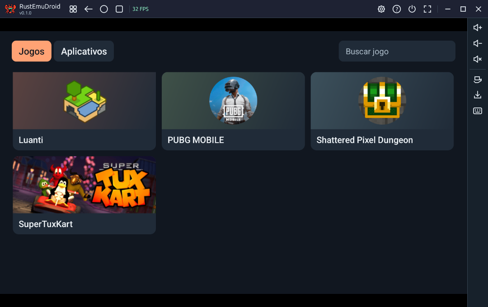
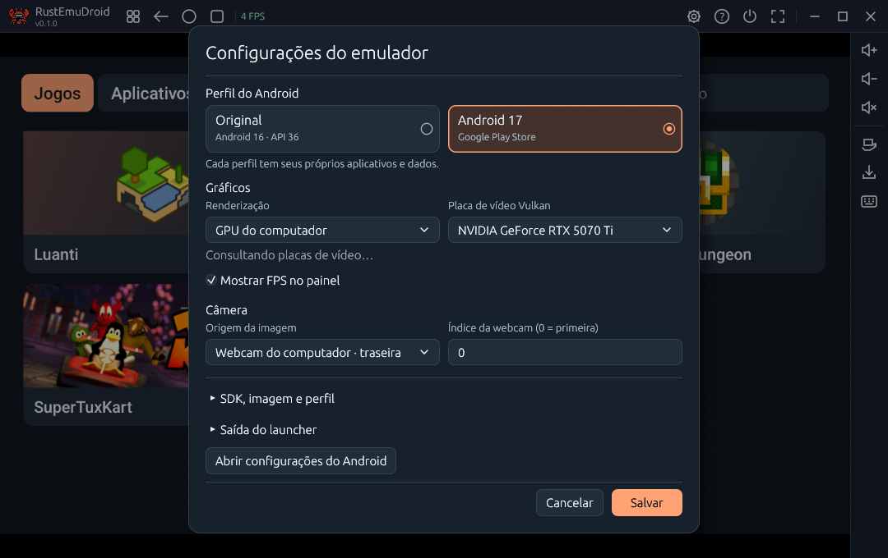
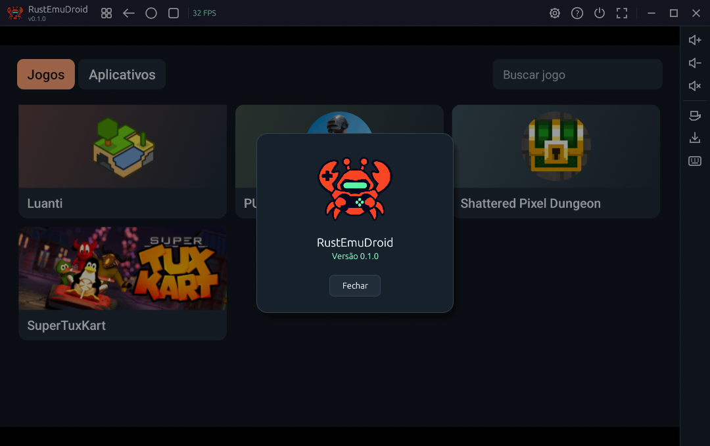
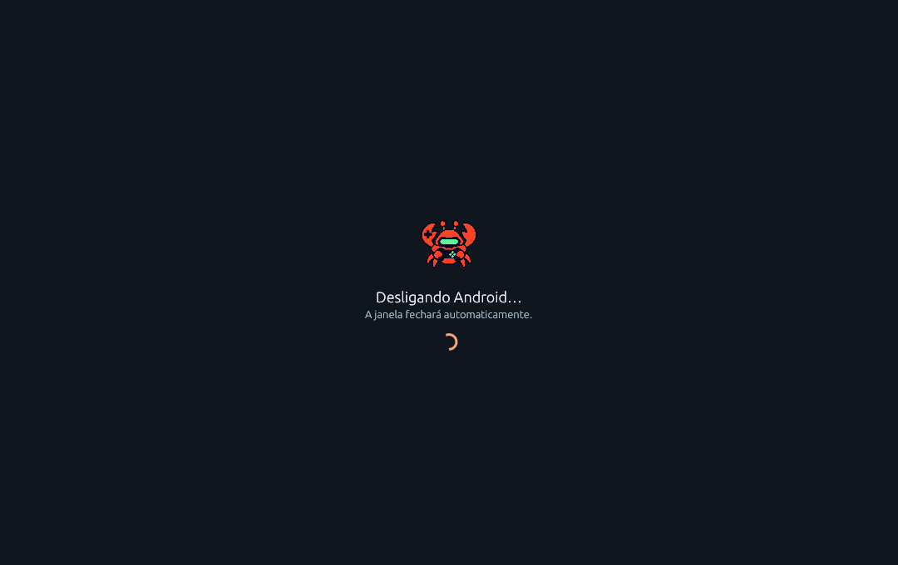

# RustEmuDroid

[English](README.md) · [Downloads para Windows e Linux](https://github.com/felipemarques/RustEmuDroid/actions/workflows/build.yml) · [Resultados de desempenho](benchmarks/stk-1.5/README.md)

O RustEmuDroid executa jogos e aplicativos Android em uma única janela no Windows e no Linux x86-64. O cliente em Rust inicia a máquina virtual, exibe a tela do Android e controla a entrada e a janela. Dentro da VM, a Home abre diretamente na biblioteca de jogos instalados. O painel e a Home são livres de anúncios. A interface do protótipo está em português brasileiro.



*Os jogos da captura foram instalados no perfil de teste. Um perfil novo começa com os aplicativos fornecidos pela imagem Android.*

## Executar uma versão compilada

1. Abra [Desktop builds](https://github.com/felipemarques/RustEmuDroid/actions/workflows/build.yml), escolha uma execução concluída com sucesso e localize **Artifacts**. Entre no GitHub para baixar o arquivo.
2. Baixe **RustEmuDroid-Windows-x86_64** ou **RustEmuDroid-Linux-x86_64** e extraia o ZIP em uma pasta com permissão de escrita. No Linux, execute também `tar -xzf rustemudroid-linux-x86_64.tar.gz` para preservar a permissão de execução do binário.
3. Instale o ambiente Android descrito abaixo. Abra o terminal na pasta do executável e use os comandos da sua plataforma.

| Ação | Windows PowerShell | Terminal Linux |
|---|---|---|
| Verificar SDK e virtualização | `.\rustemudroid.exe doctor` | `./rustemudroid doctor` |
| Abrir o painel | `.\rustemudroid.exe ui` | `./rustemudroid ui` |

O executável já inclui o APK da Home do RustEmuDroid. O SDK, as imagens Android, os jogos e os dados de usuário são instalados separadamente. Rust e Cargo só são necessários para compilar o projeto.

## Preparar o ambiente Android

| Requisito | Windows x86-64 | Linux x86-64 |
|---|---|---|
| Virtualização | Habilite Intel VT-x ou AMD-V no firmware e **Plataforma do Hipervisor do Windows** nos Recursos do Windows. | Habilite a virtualização e permita que seu usuário leia e escreva em `/dev/kvm`. Confira com `test -r /dev/kvm && test -w /dev/kvm`. |
| Vídeo e desktop | Instale o driver da placa de vídeo para usar aceleração da GPU. | Use uma sessão gráfica X11 ou Wayland com OpenGL. O seletor de APK depende do portal de arquivos do desktop. |
| Ferramentas Android | Instale Android Emulator, Platform-Tools e uma imagem de sistema x86-64 pelo SDK Manager do Android Studio ou pelas ferramentas de linha de comando. | Instale as versões Linux desses mesmos componentes, inclusive no WSL2. |

Com `sdkmanager` disponível no PATH, este comando instala as ferramentas e a imagem opcional do Google Play. Aceite as licenças do SDK quando forem apresentadas.

```sh
sdkmanager --install "emulator" "platform-tools" "system-images;android-37.0;google_apis_playstore;x86_64"
```

Outra imagem compatível é `system-images;android-35;google_apis;x86_64`. Consulte os pacotes disponíveis com `sdkmanager --list`. O launcher procura o SDK em `--sdk`, `ANDROID_HOME`, `ANDROID_SDK_ROOT` e, por último, no diretório padrão `%LOCALAPPDATA%\Android\Sdk` no Windows ou `~/Android/Sdk` no Linux. [SDK Manager](https://developer.android.com/tools/sdkmanager) · [Aceleração do Android Emulator](https://developer.android.com/studio/run/emulator-acceleration)

## Escolher um perfil

Abra a engrenagem na barra de título. Cada perfil tem seu próprio disco gravável, aplicativos, contas e progresso salvo. **Original** é o perfil padrão daquele diretório de trabalho. A versão do Android depende da imagem escolhida.

| Configuração | Motor e primeiro uso |
|---|---|
| Original com Kemu | No Windows, o RustEmuDroid pode usar a imagem Android 16 / API 36 e o motor QEMU/gfxstream da instalação do Kemu nos modos GPU do computador e Automática. A configuração testada usa ANGLE/Vulkan. Configure `RUSTEMUDROID_KEMU_ROOT` para instalações fora da pasta padrão. |
| Original com o SDK | No primeiro uso, o painel procura imagens instaladas na ordem Google Play API 37.0, Google APIs 36 e Google APIs 35. Use `init --image` para selecionar um pacote específico. |
| Android 17 com Google Play | Instale a imagem Google Play API 37.0, selecione **Android 17** na engrenagem e salve. A imagem do SDK fornece a Play Store e o Google Play Services. O cartão indica quando a imagem está ausente. |

A configuração de jogos solicita quatro vCPUs, 8 GiB de RAM para o Android e 1600 × 900 a 60 Hz. O perfil genérico do SDK solicita quatro vCPUs, 3 GiB e 1080 × 1920. O motor do Kemu no Windows usa um disco gravável separado na pasta `gaming/`.



## Usar os controles

| Ação | Como usar |
|---|---|
| Encontrar e instalar apps | Busque nas abas **Jogos** e **Aplicativos**. Pressione e segure um cartão para mudar sua categoria. O botão de instalação da barra direita aceita um APK e atualiza a biblioteca. |
| Navegar no Android | O botão de quatro quadrados abre Aplicativos. A barra superior também traz Voltar, Início e Recentes. Início retorna à aba Jogos. Clique para tocar e arraste para deslizar. |
| Mapear teclado ou controle | Abra o jogo e clique no ícone de teclado. Em **Botão**, clique no ponto de toque e pressione a tecla ou botão físico. Para usar WASD ou o analógico esquerdo, escolha **Direcional**, clique no centro do joystick virtual e ajuste o raio. Clique com o botão direito para remover uma marca. **Salvar** guarda as posições relativas para aquele pacote Android. No Windows, os controles usam XInput. |
| Ajustar mídia | A barra direita permite subir ou baixar o volume de mídia, silenciar, reativar e girar a tela. Segure um botão de volume para alterar vários níveis. |
| Usar uma webcam | Na engrenagem, selecione a webcam frontal ou traseira do computador. O índice 0 representa a primeira câmera. Salve e reinicie o Android para aplicar a mudança. Conceda a permissão dentro do aplicativo Android quando necessário. Também há uma câmera frontal simulada. |
| Tela cheia e versão | Pressione **F11**. Aproxime o ponteiro da borda superior ou direita para revelar os controles em tela cheia. A versão aparece na barra de título e na janela **?**. |



**Encerrar Android** desliga a VM e volta ao painel. Ao fechar a janela pelo **X** ou pelo atalho do sistema, o painel exibe **Desligando Android…**, continua respondendo e fecha automaticamente quando a VM termina. Isso também funciona durante a inicialização. Com o painel ocioso, a janela fecha imediatamente.



## Compilar o projeto

Instale o Rust estável atual com Cargo. No Windows, instale também as ferramentas de compilação de desktop C++ do Visual Studio e o Windows SDK. No Ubuntu 24.04, prepare as dependências nativas:

```sh
sudo apt-get update
sudo apt-get install -y build-essential pkg-config libudev-dev libwayland-dev libxkbcommon-dev libx11-dev libxi-dev libxrandr-dev libxcursor-dev libgl1-mesa-dev
```

```sh
git clone https://github.com/felipemarques/RustEmuDroid.git
cd RustEmuDroid
cargo build --locked --release --features ui
cargo run --locked --release --features ui -- ui
```

No Windows, [Abrir RustEmuDroid.cmd](Abrir%20RustEmuDroid.cmd) compila a versão de produção e abre a janela, ou traz a instância existente para frente. Para compilar apenas a ferramenta de linha de comando, omita `--features ui`.

## Linha de comando, dados e logs

```sh
cargo run --locked -- doctor
cargo run --locked -- init --image "system-images;android-35;google_apis;x86_64"
cargo run --locked -- boot --headless --check --gpu auto
cargo run --locked -- boot --help
```

Para usar a imagem do Kemu com dados separados no Windows:

```powershell
cargo run --locked -- --state-dir .rustemudroid/kemu init --system-dir "C:/Program Files/Kemu/system-img"
cargo run --locked --release --features ui -- --state-dir .rustemudroid/kemu ui
```

Use o mesmo `--state-dir` em `init`, `boot` e `ui`. O padrão é `.rustemudroid/windows/` ou `.rustemudroid/linux/` a partir do diretório de trabalho. O `launcher.json` guarda preferências. O perfil ativo contém o AVD e os arquivos `boot-*.log`. O comando `boot --check` aguarda `sys.boot_completed=1` e desliga a VM testada. `--timeout` ajusta o limite de boot em segundos. `--engine sdk` seleciona explicitamente o motor do SDK. O RustEmuDroid escolhe portas livres e verifica o caminho do AVD antes de pedir o desligamento.

## Desempenho e solução de problemas

- **FPS do painel.** A barra conta os quadros novos enviados para desenho no painel. Uma Home parada pode exibir um número baixo. Para comparar jogos, use o contador do próprio jogo ou o relatório de quadros do replay.
- **Exemplo medido.** No replay Black Forest do SuperTuxKart 1.5, o RustEmuDroid atingiu média de 59,93 FPS na qualidade original e 28,90 FPS na alta com Windows, RTX 5070 Ti, Android 16 e OpenGL ES. O relatório traz os parâmetros, os tempos por quadro e os resultados do Kemu e BlueStacks. [Método e medições](benchmarks/stk-1.5/README.md)
- **Tela preta ou vídeo lento.** Execute `doctor`, confira a placa Vulkan e teste GPU do computador ou Automática. Software/SwiftShader ajuda a isolar problemas de driver. No Linux, o motor do SDK usa um caminho de compatibilidade GLES para a imagem do Kemu.
- **Vários dispositivos ADB.** Liste-os com `adb devices -l` e direcione o diagnóstico com `adb -s <serial>`. O serial ativo aparece na saída do launcher.
- **PUBG travado na abertura com a imagem Android 16 do Kemu.** Na engrenagem, abra **Compatibilidade de jogos**, habilite **Tradução ARM leve para PUBG** e salve. O modo do tradutor Berberis afeta os apps ARM daquele perfil durante o boot e pode alterar o FPS. O teste local chegou à tela de login. A compatibilidade dos jogos depende também da arquitetura suportada e das restrições da publicadora.
- **Jogos ausentes depois de trocar o perfil.** Volte ao perfil onde os instalou. Instalações novas começam sem seus jogos ou contas.

## Arquitetura e testes

| Componente | Responsabilidade |
|---|---|
| [Interface desktop](src/ui.rs) | Rust, eframe/egui e Glow. Gerencia a janela, os controles, as configurações e a tela de encerramento. |
| [Ciclo de vida da VM](src/android.rs) | Localiza o SDK e as imagens, cria o AVD, inicia o motor escolhido e aguarda o fim do processo. |
| [Vídeo e entrada](src/display.rs) | Recebe quadros pelo gRPC local autenticado de `EmulatorController.streamScreenshot`, guarda o quadro RGBA pendente mais recente e encaminha eventos de toque e teclado. |
| [Home do Android](android/home) | Activity nativa que consulta o PackageManager e exibe banners ou ícones dos apps. O cliente instala o APK de desenvolvimento embutido via ADB. |

Execute `cargo test --locked --features ui` para rodar a suíte offline. O [workflow do GitHub Actions](.github/workflows/build.yml) testa e compila executáveis release para Windows e Ubuntu x86-64 em pushes, pull requests e execuções manuais. Os testes com Android real precisam de um AVD local. Para repetir o teste de fechamento da janela no Windows, aponte `RUSTEMUDROID_TEST_STATE` para o diretório absoluto de um perfil ocioso e execute `cargo test --locked --features ui real_window_paints_until_android_exits -- --ignored --nocapture`.

Para recompilar a Home, instale um JDK, o `android.jar` de uma plataforma e o Android Build-Tools. Use `python android/home/build.py <android.jar> <diretório-do-build-tools>`. O script usa `~/.android/debug.keystore` por padrão e aceita `--keystore` e `--alias`. Para atualizar uma instalação existente, mantenha a chave de assinatura e incremente o código da versão no manifesto e na [verificação de instalação](src/controls.rs).
