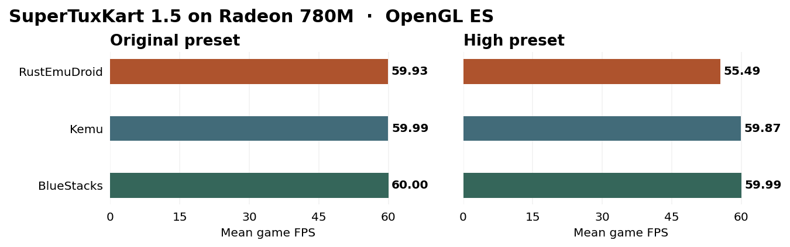

# SuperTuxKart 1.5 on AMD Radeon 780M integrated graphics

We ran the Black Forest replay on a Windows 11 PC with an AMD Ryzen 9 8945HS, Radeon 780M integrated graphics and 64 GiB of RAM. The NVIDIA adapters remained installed. Each session's renderer log identified the 780M as the active device. The numbers below come from the game's profiler.

## OpenGL ES comparison

Each emulator ran the same two graphics presets three times at 1600 × 900, 100% render scale and a 60 FPS cap. Only the emulator under test was running. The ranges show the lowest and highest whole-replay averages across the three runs.

| Emulator | Android / game ABI | Original, mean FPS (range) | High, mean FPS (range) | High, P95 main-loop time |
|---|---|---:|---:|---:|
| RustEmuDroid | Android 16 / `x86_64` | 59.93 (59.77–60.01) | 55.49 (55.26–55.90) | 22.54 ms |
| Kemu | Android 16 / `x86_64` | 59.99 (59.96–60.01) | 59.87 (59.67–59.98) | 18.54 ms |
| BlueStacks | Android 9 / `armeabi-v7a` | 60.00 (59.97–60.02) | 59.99 (59.97–60.02) | 17.45 ms |



At the original preset all three averaged within 0.1 FPS of the 60 FPS cap. High quality separated them. RustEmuDroid averaged 55.49 FPS and its P95 main-loop time reached 22.54 ms. Kemu and BlueStacks stayed within 0.2 FPS of the cap on average. The gaming workload includes the player, Android build, ABI and driver. These runs do not isolate the cause of the difference.

## RustEmuDroid with Android 17 and Google Play

The second RustEmuDroid profile uses Android Emulator 37.3.10 and a Google Play x86-64 system image. SuperTuxKart used its Vulkan renderer for this series. Switching profiles changes Android, the emulator engine, the guest graphics stack and the game API together.

| Game preset | Mean FPS | Run range (FPS) | P95 main-loop time |
|---|---:|---:|---:|
| Original | 59.94 | 59.87–60.05 | 19.08 ms |
| High | 59.71 | 59.64–59.84 | 19.25 ms |

The guest reported `Goldfish GFXStream (AMD Radeon 780M Graphics)` in every Vulkan run. On High, the game recorded 16× anisotropic filtering in Vulkan and 8× in OpenGL ES.

## Test conditions

- **Host.** Windows 11 Pro, build 26300. The Radeon 780M Windows driver was 32.0.32029.2010. The RustEmuDroid executable was built in release mode from [commit daf6b70](https://github.com/felipemarques/RustEmuDroid/commit/daf6b70294cddf28be33c73802fbf8af0abef790).
- **Virtual machines.** All four sessions requested four vCPUs and 8 GiB of guest RAM. RustEmuDroid Original and Kemu 0.7.1 used Android 16, the same Kemu QEMU/gfxstream engine and separate data disks. BlueStacks 5.22.166.1003 used its Pie 64-bit instance and the game's 32-bit ARM build. The RustEmuDroid and Kemu runs used the x86-64 game build.
- **GPU verification.** The Kemu-based engines logged the physical Vulkan device behind guest ANGLE. BlueStacks logged the host OpenGL renderer. Android 17 also recorded the Vulkan renderer in the game. The archive includes the selected-device lines for each session. A guest can report a virtual GPU name that differs from the host adapter.
- **Workload.** The original preset used 4× anisotropic filtering and disabled shadows, SSAO and bloom. High requested 1024-pixel shadows, SSAO, bloom, glow, light shafts, higher geometry and 8× anisotropic filtering. All three OpenGL ES engines reported the same 21 graphics parameters within each preset. The game reports contain the actual values for Vulkan as well.
- **Schedule.** We ran one session per engine/profile, in the order RustEmuDroid Original, Kemu, BlueStacks and RustEmuDroid Google Play. In each session, rounds one and three ran Original then High. Round two ran High then Original. The game was restarted for each replay and its configuration was restored byte-for-byte afterward. An earlier BlueStacks session was excluded in full after its high-preset frame file was read mid-write. The published session was rerun with the collector waiting for both profiler files.
- **Calculation.** Per-run FPS = 1,000 × rendered frames / game-reported duration in milliseconds. Each table reports the arithmetic mean of three run averages. P95 is the nearest-rank 95th percentile of positive main-loop times pooled across the three runs, converted from microseconds to milliseconds. It measures the game loop. Desktop presentation times, input latency, power draw and thermal state were not measured.

## Data and reproduction

- [Per-run frames, durations, FPS and P95 values](runs.csv)
- [Raw game reports, per-frame timings, guest renderers and physical GPU evidence](game-reports.zip)
- [Benchmark runner](../compare.py) and [earlier RTX 5070 Ti results](../README.md)

Install SuperTuxKart 1.5 in each target profile, open it once to initialize its configuration, then close the game. Select the Radeon 780M, boot only that emulator, verify the physical renderer in the session log and look up the serial with `adb devices -l`. For BlueStacks, use its local ADB setting and Windows per-app graphics preference. Use the serial reported by your installation.

To reproduce the preset order for one session from the root of the repository:

```sh
python benchmarks/stk-1.5/compare.py --rust emulator-5554 --rounds 1 --presets original high --output results/round-1
python benchmarks/stk-1.5/compare.py --rust emulator-5554 --rounds 1 --presets high original --output results/round-2
python benchmarks/stk-1.5/compare.py --rust emulator-5554 --rounds 1 --presets original high --output results/round-3
```

Use `--kemu` or `--bluestacks` with that instance's serial for the other players. For the Google Play session, substitute `vulkan` and `high-vulkan` for `original` and `high`. Use fresh output directories for every session. This comparison covers one replay on one PC. Near 60 FPS the frame cap limits how much separation the test can show.
