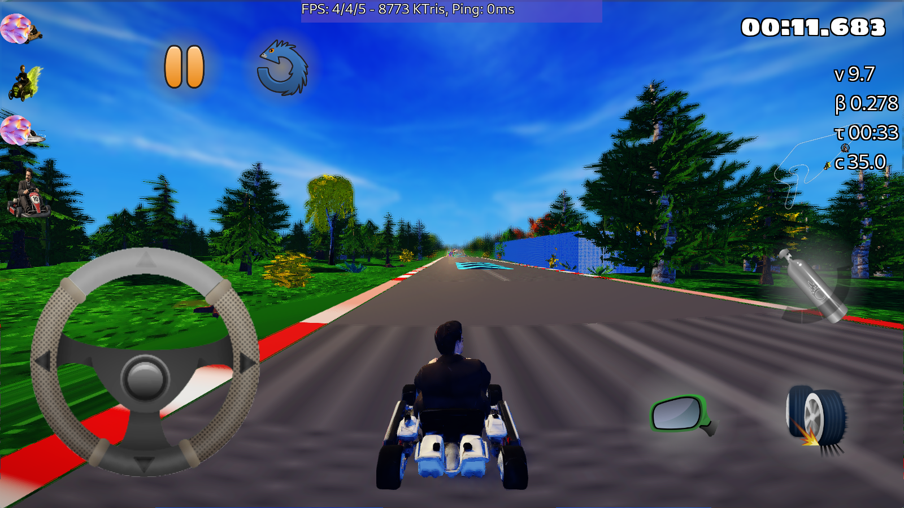
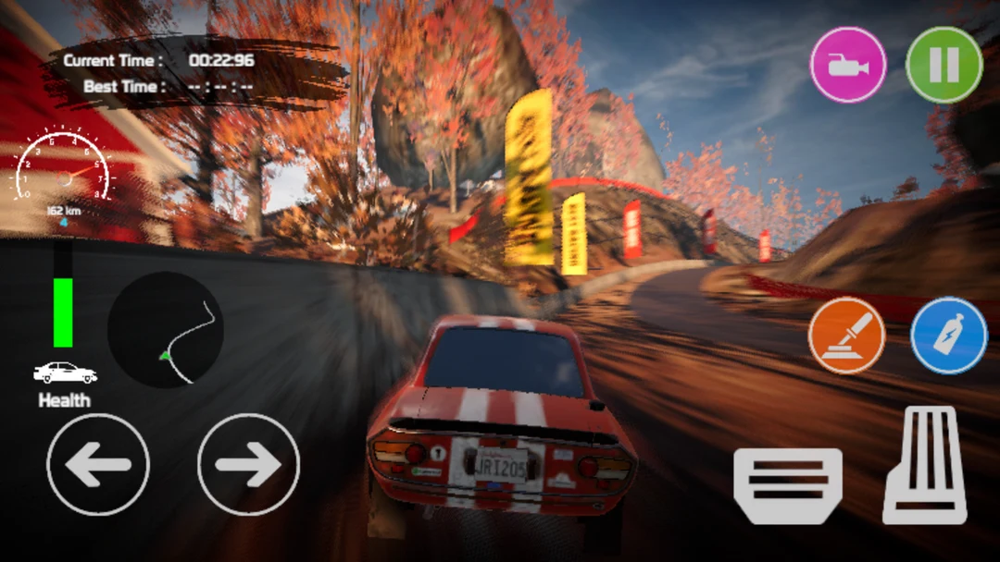
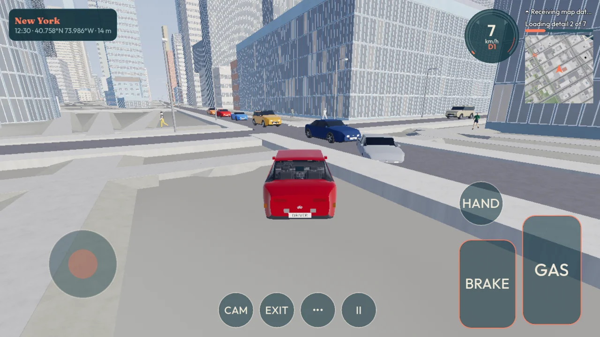

# Game smoke tests on Windows

The RustEmuDroid runs used Android Emulator 37.3.10 with the Android 17 Google Play x86-64 image, four guest vCPUs and 8 GiB of guest RAM. Unless a run specifies another setting, the guest display was 1600 × 900 and the active GPU was the GeForce RTX 5070 Ti.

## SuperTuxKart release comparison

SuperTuxKart 1.5 ran the Black Forest replay in the embedded Windows display. All five builds used the same Android 17 Google Play profile, native x86-64 game, direct Vulkan renderer and RTX 5070 Ti. The High preset ran at 1600 × 900, 100% render scale and a 60 FPS cap. All 21 game-reported graphics fields matched.

| Windows build | FPS, first replay | FPS, second replay | Mean game FPS | Main-loop P95, pooled |
|---|---:|---:|---:|---:|
| 0.2.4, published binary | 59.88 | 60.01 | 59.94 | 19.24 ms |
| 0.3.0, local release build | 60.08 | 59.93 | 60.01 | 19.12 ms |
| 0.4.0, local release build | 59.92 | 60.03 | 59.98 | 18.90 ms |
| 0.4.1, local release build | 60.08 | 59.96 | 60.02 | 19.08 ms |
| 0.7.0, published binary | 60.06 | 60.00 | 60.03 | 19.23 ms |

The game recorded 2,282–2,288 frames per run. FPS is the frame count divided by the game's replay duration. P95 uses the positive main-loop timings from its own profiler. The FPS ranges overlap at the frame cap, with no measurable loss in this replay. In 0.7.0, the keyboard hints for the steering wheel and five action buttons were visible at 65% opacity during the replay. No mapped control was held. Uncapped throughput and the cost of actively using the new controls remain unmeasured. [Game reports, renderer and per-frame timings for 0.7.0](../benchmarks/stk-1.5/v0.7.0-windows-rtx.zip)

To repeat, verify the AVD path and GPU for each desktop version, then run `python benchmarks/stk-1.5/compare.py --adb <adb> --rust <serial> --rounds 2 --presets high-vulkan --output <new-folder>` with one emulator open. The 0.2.4 and 0.3.0 runs took place in that order. The 0.4.0, 0.4.1 and 0.7.0 runs followed in separate sessions. The harness restored the game's configuration byte-for-byte after each run. [Replay harness](../benchmarks/stk-1.5/compare.py)

## PUBG MOBILE

The stationary test sampled the same Showroom view for about 18 seconds per run. Only guest display resolution changed between the three samples.

| Run | Guest display | Guest presentations per second | Median interval | P95 interval |
|---|---:|---:|---:|---:|
| A1 | 1600 × 900 | 29.30 | 33.37 ms | 49.57 ms |
| B | 1280 × 720 | 29.25 | 33.35 ms | 49.30 ms |
| A2 | 1600 × 900 | 29.34 | 33.33 ms | 48.94 ms |

For the navigation test, each approximately 23-second sample included three passes from Showroom through Settings and Graphics and back to Showroom. Balanced averaged 28.31 guest presentations per second, with intervals up to 284 ms. The tested Custom configuration averaged 27.80. Balanced at 1600 × 900 was restored after testing. **High** was the highest Lobby frame-rate option the game offered. The game controls which Showroom slots can be disabled. These menu samples cover presentation cadence during the named workloads. Match performance and the effect of changing Showroom slots were outside the test.

On this Android 17 image, `adb shell cmd game list-modes com.tencent.ig` reported Standard as active and offered Standard and Custom. `cmd game list-configs` found no package intervention. The image did not offer Android's Performance game mode for PUBG. On the BlueStacks Pie64 installation, PUBG opened and requested age verification before a comparative Showroom run could begin. [Android Game Mode API](https://developer.android.com/games/optimize/adpf/gamemode/gamemode-api)

### Where the inventory stalls occur

Two separate 24-second Perfetto captures compared a stationary lobby with repeated opening and closing of the inventory. The producer measurements count `onFrameAvailable` notifications on PUBG's `RHIThread` for its GameActivity SurfaceView. They measure when a new game buffer became available. SurfaceFlinger FrameTimeline measures the guest display compositor separately. [Perfetto FrameTimeline](https://perfetto.dev/docs/data-sources/frametimeline)

| Lobby workload | PUBG buffer notifications per second | Median interval | P95 interval | P99 interval | Longest interval |
|---|---:|---:|---:|---:|---:|
| Stationary | 29.07 | 34.00 ms | 38.85 ms | 43.21 ms | 141.79 ms |
| Inventory navigation | 23.68 | 34.02 ms | 43.51 ms | 248.21 ms | 2.169 s |

During the 2.169-second gap, PUBG's main game thread ran for 1.318 seconds and spent 59 ms runnable. The SurfaceFlinger main thread ran for about 3 ms. During another gap of 542 ms, the game thread ran for 488 ms and the compositor for 7 ms. The long pauses were already visible in the game's buffer cadence. This locates the stalls before composition without identifying which game operation caused them.

SurfaceFlinger classified 699 display frames in the stationary trace and 570 in the navigation trace. It attributed zero recorded misses to its CPU or GPU deadlines and classified one late navigation frame as a display HAL issue. Among known presentations, the compositor's P99 interval rose from 58.70 to 288.46 ms. Its longest interval rose from 164 ms to 2.175 seconds. The traces had no PUBG app-layer FrameTimeline rows, so they could not count the game's own deadline misses. Perfetto reported 10 and 22 FrameTimeline parse errors, respectively, and one discarded chunk during navigation. The counts refer to observed events.

### Memory and I/O during Inventory

A separate 55-second trace used RustEmuDroid 0.4.0 and PUBG MOBILE 4.7.0. The game's primary ABI was `arm64-v8a` and the x86-64 system image used `libndk_translation.so`. Android's GPU service recorded ANGLE, a GLES context and a hardware Vulkan device and swapchain for this package. The test kept the disk cache and relaunched the game before opening Inventory four times.

| Phase | PUBG buffer notifications/s | Longest buffer interval | Guest block reads |
|---|---:|---:|---:|
| Stationary lobby | 29.17 | 70 ms | 4 |
| First open | 22.93 | 794 ms | 133 |
| Second open | 27.11 | 418 ms | 0 |
| Third open | 26.73 | 398 ms | 2 |
| Fourth open | 25.86 | 372 ms | 0 |

The longest pause in the full trace began 54 ms after the first **close** tap. During that 1.674-second gap the main game thread ran for 1.293 s, waited runnable for 93 ms and spent 3.2 ms in uninterruptible sleep. The asynchronous loading thread ran for 166 ms. Across the four guest vCPUs, utilization during the gap was 36%. The guest read 360 KiB from block storage during this interval.

Available guest memory stayed between 3.91 and 4.00 GiB. Memory pressure-stall counters stayed flat and the PUBG process recorded no additional major page faults. The first open involved more storage reads and loader work. Subsequent opens still paused with little or no block I/O. This run provides no support for increasing guest RAM or vCPUs as a fix. It did not collect call stacks identifying the work inside the game. Guest counters were sampled every 250 ms. Perfetto reported 40 FrameTimeline parser errors and several skipped scheduler events.

On the stock Google Play image, the installed package advertised neither debuggable nor shell-profiling access. A package-scoped `simpleperf stat` request confirmed that Android declined profiling. Identifying the native function consuming that CPU time would require additional evidence, such as a publisher-provided trace or a shell-profileable build with matching native symbols. [Android profiling permissions](https://developer.android.com/guide/topics/manifest/profileable-element)

### Does the Lobby Smooth preset help with Inventory?

On RustEmuDroid 0.3.0, three game launches alternated the Custom Lobby graphics setting between Balanced, Smooth and Balanced. The Lobby frame-rate setting stayed on High. Each 48-second run opened Inventory at 0, 12, 24 and 36 seconds and returned to the lobby seven seconds after each open. The Download Center showed paused packs. The game retained its caches between launches.

| Run and Lobby setting | Guest presentations/s, whole route | First open, presentations/s | Three later opens, pooled presentations/s | P99 interval, whole route | Longest interval |
|---|---:|---:|---:|---:|---:|
| A1 (Balanced) | 25.04 | 22.57 | 26.67 | 136 ms | 1,716 ms |
| B (Smooth) | 25.06 | 20.43 | 27.14 | 227 ms | 1,098 ms |
| A2 (Balanced) | 24.67 | 21.71 | 25.48 | 284 ms | 1,099 ms |

The first Inventory open was slower than the pooled later opens in every run. Smooth still had a pause of about a second and its overall rate was within 0.4 presentations/s of both Balanced runs. This comparison did not establish a repeatable fix. The Showroom warning and the game's combat frame rate were outside this route.

The CSV gives each presentation's estimated time relative to the first scheduled Inventory tap, with one sample outside each boundary. Guest timestamps were aligned to the host clock using the smallest observed difference between a poll's completion and its newest guest presentation. Count timestamps inside each fixed window and divide by its length. For intervals, clip pairs that cross a window boundary. [Presentation timestamps](../benchmarks/pubg-mobile/inventory-presentations.csv)

On the Radeon 780M, RustEmuDroid 0.5.0 also opened the same Android 17 PUBG lobby with shared Vulkan memory enabled. One 48-second route with four Inventory opens and closes produced 1,194 guest presentations (24.88/s), a P95 interval of 49.76 ms and a longest gap of 1.72 s. This setting let the Unity game below enter its level. PUBG's long Inventory pause was still present. [Radeon Inventory timestamps](../benchmarks/pubg-mobile/radeon-780m-inventory.csv)

### Does disabling Adaptive Graphics help Inventory?

RustEmuDroid 0.7.0 ran PUBG MOBILE 4.7.0 on the RTX 5070 Ti at 1600 × 900. Under **Customize → Lobby**, the trials kept graphics on **Balanced**, the frame rate on **High** and Lobby Graphics Enhancement off. Only **Adaptive Graphics** changed. Each 48-second trial started from the lobby after a fresh game launch with the cache retained. Four cycles opened Inventory every 12 seconds and closed it seven seconds after opening.

| Adaptive Graphics | Guest presentations/s | Seconds with fewer than 15 presentations, out of 48 | Intervals over 250 ms | P99 interval | Longest pause after first close |
|---|---:|---:|---:|---:|---:|
| Enabled, A1 | 25.00 | 4 | 12 | 249 ms | 1,115 ms |
| Disabled, B | 24.65 | 5 | 14 | 263 ms | 1,150 ms |
| Enabled, A2 | 24.25 | 5 | 13 | 303 ms | 1,184 ms |

Disabling Adaptive Graphics still produced a pause longer than one second after closing Inventory. The B run's average fell between the two enabled runs. These runs give no reason to disable the option for this problem. The comparison covers lobby navigation on this profile. The Showroom slot limit and match FPS were outside this test.

The CSV contains deduplicated presentation times from the game's Android surface, relative to the first scheduled tap. For the rate, count timestamps in the half-open window from 0 to 48 seconds and divide by 48. The low-cadence column counts one-second bins aligned to the first tap. For intervals, include the portion that falls within the window. The first-close window starts at 7 seconds and ends at 12 seconds. P99 is the sorted interval at zero-based index `floor(0.99 × (n − 1))`. [Presentation timestamps for all three runs](../benchmarks/pubg-mobile/adaptive-graphics.csv)

### EGL shader cache and host GPU activity during Inventory

On Windows v0.8.0, PUBG MOBILE 4.7.0 reported ANGLE over Vulkan on the RTX 5070 Ti in every run. The Android 17 x86-64 Google Play profile kept the same 1600 × 900 display, Balanced Lobby graphics and High Lobby frame rate. ANGLE's startup log flagged the default EGL cache configuration. Android supports a temporary multifile EGL cache override. The exact ANGLE revision in this game log recommends a 128 MiB limit on Android 17. [Android EGL cache implementation](https://android.googlesource.com/platform/frameworks/native/+/master/opengl/libs/EGL/egl_cache.cpp) · [ANGLE's Android version and size checks](https://github.com/google/angle/blob/8d8796935e4faeaf19e67ac0a5949e71a5252e7f/src/libANGLE/renderer/vulkan/android/DisplayVkAndroid.cpp)

| Run, in order | EGL cache setting | Guest presentations/s | Seconds below 15 presentations, out of 48 | P99 interval | Longest first-close interval |
|---|---|---:|---:|---:|---:|
| A1 | Default | 25.19 | 4 | 233 ms | 1.099 s |
| B1 | Multifile | 25.06 | 4 | 184 ms | 1.151 s |
| B2 | Multifile, subsequent launch | 25.21 | 4 | 166 ms | 1.149 s |
| A2 | Default | 25.42 | 4 | 149 ms | 1.099 s |
| C1 | Multifile, 128 MiB | 22.54 | 9 | 299 ms | 2.084 s |
| A3 | Default | 25.35 | 5 | 150 ms | 1.038 s |

Each run relaunched the game, retained its caches and followed the same four timed opens and closes as the Adaptive Graphics test. The saved frames showed the lobby before and after the route and Inventory during the third open. The launch logs confirmed the multifile warning changed when `debug.egl.blobcache.multifile=true` and cleared when `debug.egl.blobcache.multifile_limit=134217728` was also set. Both debug properties originally read empty and were restored. The ANGLE driver preference remained in place. One preliminary launch with default settings exited with a native crash before the lobby. Another preflight saw a retained lobby image during the next launch and ended before timing. Only runs with confirmed gameplay surfaces and complete samples appear in the table. [Guest presentation timestamps](../benchmarks/pubg-mobile/egl-blobcache.csv)

The final two runs also sampled the Windows QEMU process. The host measurement uses the cumulative running time of its 3D engine on the selected RTX and the sum of the process's kernel and user CPU time.

| Run and window | Guest interval | Host intervals | Time covered | QEMU RTX 3D engine active | QEMU CPU, logical cores |
|---|---:|---:|---:|---:|---:|
| C1, stationary before first tap | 1.000 s | 12 | 0.900 s | 8.05% | 2.24 |
| C1, longest first-close gap | 2.084 s | 26 | 1.950 s | 0.70% | 4.14 |
| A3, stationary before first tap | 1.000 s | 12 | 0.900 s | 2.34% | 1.94 |
| A3, longest first-close gap | 1.038 s | 12 | 0.900 s | 0.00% | 1.53 |

The host sampler took 867 readings per run at 75 ms intervals. Both endpoints of each included counter interval fell within the named window. The guest clock was aligned to the host's monotonic clock using the minimum poll-completion offset. Both counters stayed valid and median collection cost was under 0.3 ms. The game surface presented 30 and 29 frames in the stationary seconds and produced zero new presentations strictly inside the first-close gaps. The measured RTX engine had spare capacity during both gaps. The 128 MiB run removed the ANGLE warning but still stalled, and a single run at that size cannot establish the cause of its longer pause. The counters cover QEMU and its selected 3D engine. They do not resolve individual game functions or other GPU engines. [Host timestamps and cumulative counters](../benchmarks/pubg-mobile/egl-blobcache-host.csv)

### Does the desktop frame copy affect the lobby?

A local instrumented desktop build alternated the existing allocation-and-copy path with direct RGBA image construction in the same stationary lobby and guest session. Each kept block was about 18 seconds after trimming a second from both ends. The host timing measures elapsed time on the desktop UI thread while it prepares and submits an image to the texture queue. Its block statistic is the median of the reported one-second P95s.

| Block | Desktop copy path | Guest presentations per second | Guest P95 interval | Desktop texture submission P95 |
|---|---|---:|---:|---:|
| A1 | Existing copy | 29.303 | 50.17 ms | 2.286 ms |
| B1 | Direct RGBA construction | 29.288 | 49.64 ms | 1.411 ms |
| A2 | Existing copy | 29.335 | 49.66 ms | 1.340 ms |
| B2 | Direct RGBA construction | 29.322 | 49.18 ms | 1.387 ms |

Guest cadence stayed within 29.288–29.335 presentations per second. The first baseline had higher desktop submission time. After switching back to the existing path, submission time was comparable to both direct-copy blocks. This run provides no repeatable gain from changing the desktop copy path.

A subsequent six-block test of direct OpenGL texture upload in the FPS WW2 URP trench measured desktop preparation, launcher CPU time and guest presentations separately. [Direct texture upload measurements](../benchmarks/desktop-texture-upload/README.md)

### Does streaming the display cause the Inventory pauses?

A private 0.4.0 Windows build could disconnect and reconnect its actual `streamScreenshot` subscription while keeping the Android VM, input connection and game running. When disconnected, the desktop retained its last image. ADB drove the four Inventory opens and closes in each fixed 48-second route. Each block relaunched the game with the same Balanced Lobby settings and retained cache. The first pair ran connected then disconnected. A second boot of the same AVD ran the reverse order. Android's game surface produced timestamps in both conditions. The disconnected condition is a diagnostic and cannot display live gameplay.

| Block | Video subscription | Guest presentations/s | P99 interval | Longest interval | Windows client CPU | Windows QEMU CPU |
|---|---|---:|---:|---:|---:|---:|
| A1 | Connected | 24.85 | 268 ms | 1,243 ms | 25.4% | 213.0% |
| B1 | Disconnected | 25.02 | 245 ms | 1,166 ms | 2.9% | 180.4% |
| B2 | Disconnected | 25.38 | 166 ms | 1,132 ms | 3.0% | 177.9% |
| A2 | Connected | 24.88 | 266 ms | 1,134 ms | 23.8% | 203.7% |

CPU percentages are process CPU seconds divided by elapsed wall time. One fully occupied logical processor is 100%. Disconnecting reduced combined CPU usage of these two Windows processes by about half a logical processor on average. Guest cadence increased by 0.34 presentations/s across the two pairs, and every run still paused for over a second. A more efficient visible display path could save host CPU. These runs give little support for changing the display transport as a remedy for the long Inventory pauses. [Guest presentation timestamps](../benchmarks/pubg-mobile/stream-presentations.csv)

### Windows process power policy

On the Ryzen 9 8945HS host, Windows used the Balanced power plan. A read of `GetProcessInformation(ProcessPowerThrottling)` on the QEMU child of the running 0.4.0 player returned version 1, control mask 1 and state mask 0. These values already select explicit HighQoS for execution speed. Forcing HighQoS would have duplicated the existing setting, so there is no separate frame-rate result for this comparison. [Microsoft's process power policy definitions](https://learn.microsoft.com/en-us/windows/win32/api/processthreadsapi/nf-processthreadsapi-setprocessinformation)

## BombSquad

The publisher’s Android Generic test APK, version 1.8.10 build 23095, matched SHA-256 `247ec801df3b4c569637c51388515e9b8c76ea74f478409034ad53a32ef121a4` and ran as native x86-64 in RustEmuDroid. One sample of the 30-second stress-test round with eight simulated players and the default random playlist recorded 1,092 guest presentations during an 18.21-second window, or 59.95 per second. The P95 interval was 18.57 ms. [Ballistica downloads](https://ballistica.net/downloads)

The RustEmuDroid CLI opened the same APK in BlueStacks 5.22.166.1003, instance Pie64. The player reported the same RTX 5070 Ti. Android reported a 1600 × 900 display, and the instance configuration specified four vCPUs and 8 GiB RAM. With the same stress-test settings, the BlueStacks guest presented 1,084 frames in 18.13 seconds, averaging 59.78 per second with a P95 interval of 16.67 ms. Both runs used the random playlist, so the scene and simulated player actions can differ. Each result represents a single short sample. [Windows CLI instructions](../README.md#open-an-installed-bluestacks-instance-on-windows)

## Minkowski Kart

The official ARM64 APK (`version_1.94-android`, version code 258) ran an offline Nürburgring GP race with three AI opponents in the Android 17 x86-64 profile. The game log identified the Vulkan renderer as Goldfish GFXStream with the GeForce RTX 5070 Ti. The Android release uses CPU mesh subdivision and applies relativistic vertex transformations. The workload includes ARM translation, simulation and rendering. [Developer's Android release](https://github.com/rchristie95/MinkowskiKart/releases/tag/version_1.94-android)

Both samples used the Minkowski kart, Intermediate difficulty, three laps, VSync and the game's Custom graphics preset. The Android display was 1600 × 900 on a local instrumented 0.2.4 desktop build. The game's internal resolution scale controls how many pixels it renders inside that display.

| Internal scale | Sampled scene | Presentations | Span | Presentations per second | Median interval | P95 interval |
|---|---|---:|---:|---:|---:|---:|
| 80% (original setting) | Opening sequence into the race | 73 | 17.65 s | 4.08 | 244.86 ms | 267.60 ms |
| 100% | Active race at the starting position, AI racers moving | 71 | 17.30 s | 4.05 | 247.52 ms | 267.77 ms |

At 100%, the game's own overlay read **4/5/5 FPS, 8,261 KTris** in the active race and **4/4/5 FPS, 8,773 KTris** while accelerating. The on-screen steering control accelerated the kart from rest. Race phases differed between samples, so the table does not isolate the effect of resolution. The in-game benchmark button was disabled in the tested configuration. Use **Singleplayer** for the playable test.

Each sample's timestamps in the CSV start at its first observed presentation. Divide the number of intervals by the final timestamp in seconds to reproduce the rates. [Android 17 presentation timestamps](../benchmarks/minkowski-kart-1.94/android-17-presentations.csv)

The same APK installed in BlueStacks 5.22.166.1003 Pie64 (Android 9). The RustEmuDroid 0.3.0 CLI opened the registered activity. Android recorded a native crash in the game process during SDL startup and returned to Home before the main menu. No comparable race measurement was available on that instance.

## Xtreme Rally URP

The developer's free Android demo from the Fab listing reached the timed **Sunset Dream** stage. The Android package is `com.aliyeredon.xeremeRallyURP`, version code 1. The game ran its ARM64 build through translation on the x86-64 guest. Android GPU diagnostics recorded a Vulkan device and swapchain for Unity. These runs used RustEmuDroid 0.3.0, Android 17 Google Play, 1600 × 900 and the RTX 5070 Ti. [Developer's demo and APK link](https://www.fab.com/listings/01d04da1-975f-45fd-a036-a3d43c1df79b)

| Sunset Dream scene | Presentations | Span | Guest presentations/s | P95 interval |
|---|---:|---:|---:|---:|
| Car stationary at the starting line, race clock running | 859 | 17.53 s | 48.94 | 34.37 ms |
| Accelerator held from the start, approaching a roadside barrier | 841 | 17.53 s | 47.91 | 34.47 ms |

With the accelerator held, the HUD speed rose from 0 to 162 and the car reached fourth gear. These are single short samples from the game's SurfaceView, with one fewer presentation interval than timestamps in each row. The game did not display its own FPS counter. The workload includes translation, physics and graphics. [Presentation timestamps](../benchmarks/xtreme-rally-urp/presentations.csv)

To repeat, choose **Start Race → Sunset**, keep the red car, press **Start** and skip the introduction. Select **Game Start → Start** and wait for the race clock. The accelerator is the upright pedal at the lower right. The tested APK's SHA-256 was `747ca0679bc24a2bd67a3067d5214d54fcbb60147311d7913402a81942a11c10`.

## Godot TPS Demo for Android

Sikgames' free Android port of the Godot third-person shooter demo launched as **GodotDemoLevel**. Choose it in **Games**, press **PLAY** on the main menu and hold the directional buttons at the lower left to move the character through the industrial level. The APK ran with the default game settings and requested no Android permissions. [Author's download page](https://sikgames.itch.io/godot-32-gles2-tps-demo-for-android)

RustEmuDroid 0.4.0 on Windows ran the ARM64 app in the Android 17 Google Play x86-64 profile at 1600 × 900. The Godot 3.2.1 log reported an OpenGL ES 2.0 renderer backed by the GeForce RTX 5070 Ti. The version 1.0 APK had SHA-256 `0882c6db431d8c259714af8cb439423515e6974074b2d09dd725aa09d00a4cf3`.

| Scene | Observed span | Guest presentations/s | P95 interval |
|---|---:|---:|---:|
| Character standing in the starting area | 17.55 s | 59.94 | 18.65 ms |
| Moving through the same level | 19.55 s | 59.85 | 18.53 ms |

The movement sequence held up for 4.8 s, right for 3.6 s, up for 4.0 s and left for 3.6 s. Each row is one short observation of the game's SurfaceView. Count the intervals between guest presentation timestamps and divide by the time between the first and last. The game did not expose an internal FPS counter during the test. [Presentation timestamps](../benchmarks/godot-tps-demo/presentations.csv)

After a fresh boot, Windows' `GPU Engine` counters recorded the time that QEMU's 3D engine was active on the RTX 5070 Ti. At the idle Android Home it ran for 10,805 of 150,598,774 ticks (0.01%). At the start of the level, with the character stationary, it ran for 6,572,755 of 150,579,188 ticks (4.36%). Both counters use 100 ns units. The engine was selected by process ID and the adapter LUID from Windows' DirectX registry. These short samples exclude other processes and GPU engines. The starting scene left considerable 3D engine capacity available on this card at 900p.

## Box3D for Godot

The developer's Android sample APK from release v0.6.0 ran as native x86-64. Its Godot 4.7.2 log identified Vulkan 1.3, the Forward Mobile renderer and the RTX 5070 Ti through gfxstream. The **Samples → Toys → Ball Flood** scene renders three streams of colored balls falling into a glass tank. **Pause Emitters** holds the body count steady while physics and rendering continue. [Android demo and release](https://github.com/Stink-O/box3d-godot/releases/tag/v0.6.0) · [Scene implementation](https://github.com/Stink-O/box3d-godot/blob/v0.6.0/godot/demo/samples/ball_flood.gd)

| Displayed body count | Sample duration | Guest presentations per second | P95 interval |
|---:|---:|---:|---:|
| 2,921 | 18.22 s | 59.89 | 18.46 ms |
| 10,220 | 18.33 s | 60.00 | 18.50 ms |

Both runs used the initial camera position and paused emitters. Resting bodies can sleep, so the displayed count includes bodies with little ongoing physics work. This scene exercises both rendering and physics. These samples do not establish peak GPU throughput.

## Wukong: King, Thief, Guardian

The developer's Android release includes a standalone ARM64 APK for an offline Unreal Engine game with three chapters. Version 1.0 (`com.megajam.monkeykingthreetowns`, SHA-256 `281a7395ecd53345ef60711328038ae93155c50e3bd833b10965fdb43ad936d8`) installed on the RustEmuDroid 0.4.0 Android 17 Google Play profile. On the RTX 5070 Ti the activity opened to a black screen, the QEMU process exited and the Android device disconnected. The native launcher remained open. The emulator log ended with `Failed to find ColorBuffer`. The failure occurred before any playable scene or frame-rate measurement. Its cause has not been isolated. [Developer's APK, control guide and requirements](https://pinaxxolada.itch.io/wukong-king-thief-guardian)

## War Thunder Mobile

The official War Thunder Mobile 1.27.0.114 APK (build 7444) contains ARM64 native code and requires Vulkan. The three runs used the same Android 17 Google Play x86-64 profile, installed game and downloaded data. The RTX and SwiftShader runs used RustEmuDroid 0.2.3. The Radeon run used 0.2.4. Each hardware run verified the active Vulkan adapter in the emulator log. [War Thunder Mobile system requirements](https://wtmobile.com/en/news/wtm-on-appgallery)

| Renderer | Last observed milestone |
|---|---|
| Host GPU, GeForce RTX 5070 Ti | Downloaded game assets. The emulator log recorded an invalid color buffer during Dagor Vulkan initialization. The Android shell and emulator console stopped responding as the game started. |
| SwiftShader Device (LLVM 10.0.0) | Android booted and the game opened a “Failed to initialize graphics subsystem” dialog. The guest shell and display remained responsive. |
| Host GPU, integrated Radeon 780M | Dagor created a Vulkan device. The emulator logged an invalid color buffer and the game displayed its own crash dialog. The guest shell and display remained responsive through the end of the 68-second observation. |

All three runs stopped before sign-in, so gameplay performance remains unknown.

## FPS WW2 URP

The Android demo of *Realistic FPS Game (WW2) for URP* appears under **Games → FPS WW2 URP**. Choose **Start Game → Level 1** to enter the trench. To see the game's own frame counter, turn on **Settings → Display FPS**. The touch stick at the bottom left moves the character. [Developer's Unity Asset Store page and mobile demo](https://assetstore.unity.com/packages/templates/packs/realistic-fps-game-ww2-for-urp-398678)

RustEmuDroid 0.5.0 on Windows ran the ARM64 Unity game through translation on Android 17 Google Play x86-64. The guest reported a Vulkan device and swapchain for this package. The game's settings identified the RTX 5070 Ti and 1600 × 900 display. Terrain quality was High, grass, shadows and real-time lights were enabled, depth of field was off, motion blur was 0.3 and the frame limit was 60.

| Level 1 scene | Quality | Antialiasing | Sample (s) | Android presentations/s | P95 interval (ms) | Host 3D engine active |
|---|---|---|---:|---:|---:|---:|
| Starting trench, fixed camera | Max | Off | 23.57 | 45.74 | 35.00 | 14.17% |
| Same camera | Low | Off | 23.53 | 45.68 | 35.39 | 13.68% |
| Same camera | Max | Very High | 23.57 | 46.29 | 35.32 | 14.52% |
| Moving from the trench as enemies engage | Max | Very High | 17.55 | 35.27 | 48.45 | 11.76% |

The game showed 45 FPS just after the first run and 40 FPS after the movement run. The table uses presentation timestamps from the game's Android surface. The three stationary samples showed little change across the selected settings. The movement sample included new scenery and enemy activity. Host percentages measure Windows' 3D engine for QEMU on the selected card over an overlapping 14–20 second interval. These figures alone do not identify the limiting stage. APK version 1.0, SHA-256 `36c63e71b86353f8e86e266ac0d59ab801ca4a0e0c0514cbec428c412d5674cd`. [Frame timestamps](../benchmarks/rustemudroid-0.5.0-games/presentations.csv) · [GPU counter deltas](../benchmarks/rustemudroid-0.5.0-games/gpu-engine.csv)

### Radeon 780M Vulkan compatibility

This follow-up used the Windows release of RustEmuDroid 0.5.0, Android Emulator 37.3.10 and the Android 17 Google Play x86-64 image at 1600 × 900. The RTX 5070 Ti reference and both Radeon Vulkan runs used the fixed Level 1 starting-trench view at **Max** quality with **Very High** antialiasing. These are separate comparison runs from the settings sweep above.

On the Radeon 780M with default Vulkan settings, the game failed to enter the level at Max with Very High antialiasing, at Max with antialiasing off, and at Low with terrain set to Low and grass, shadows and real-time lights disabled. The Unity log recorded `Vulkan - Out of memory! (allocating memory for buffer)`. Forcing OpenGL ES 3.0 for the app with `-force-gles30` and selecting ANGLE let the level open on Low, with parts of the ground missing. The game identified Vulkan through gfxstream as ANGLE's backend. A session override of the emulator's Vulkan memory policy (`-feature -VulkanAllocateDeviceMemoryOnly`) let the unchanged Vulkan game load the starting trench on Max with Very High antialiasing.

| Adapter and renderer | Quality / AA | Span (s) | Android presentations/s | P95 interval (ms) | Host 3D engine active |
|---|---|---:|---:|---:|---:|
| RTX 5070 Ti, default Vulkan reference | Max / Very High | 23.55 | 43.95 | 35.26 | 13.74% |
| Radeon 780M, GLES 3.0 via ANGLE, incomplete ground | Low / Off | 23.55 | 36.52 | 35.38 | 19.28% |
| Radeon 780M, Vulkan with override, run 1 | Max / Very High | 23.54 | 37.77 | 33.94 | 34.45% |
| Radeon 780M, Vulkan with override, run 2 | Max / Very High | 23.50 | 37.95 | 34.06 | 34.70% |
| Radeon 780M, v0.6.0 desktop setting enabled | Max / Very High | 23.55 | 34.87 | 37.11 | 35.00% |

On 0.6.0, enabling **Shared Vulkan memory (Radeon 780M)** in the Windows desktop settings and selecting **Save and restart Android** applied the flag to the new QEMU process. The guest reported the extra CPU-visible heap and the Vulkan game loaded Level 1 again.

The presentation samples use the game's SurfaceView. For each run, keep the second timestamp column, discard zero and pending values, and retain distinct timestamps newer than the last presentation recorded before timing began. Divide the interval count by the time between the first and last retained timestamps. Windows' 3D engine samples cover about 20 seconds of each run and measure active time for QEMU on the selected adapter. [Presentation intervals](../benchmarks/fps-ww2-urp-radeon-780m/presentations.csv) · [GPU counter deltas](../benchmarks/fps-ww2-urp-radeon-780m/gpu-engine.csv)

Native Windows Vulkan on the Radeon reported heaps of 31.72 GiB, 15.86 GiB and 256 MiB. The default guest reported the same heap sizes, with `HOST_VISIBLE` types referring only to the 256 MiB heap. With the session override, the guest also reported `HOST_VISIBLE` types referring to the 15.86 GiB heap. Neither observation showed a `HOST_VISIBLE` type on the 31.72 GiB heap. These are advertised heap sizes and type flags. The upstream AMD policy clears the flags of types without `DEVICE_LOCAL`, matching the default guest's results. The emulator source describes the policy as a driver workaround and enables it unless explicitly overridden. [Heap sizes](../benchmarks/fps-ww2-urp-radeon-780m/memory-heaps.csv) · [Memory type flags](../benchmarks/fps-ww2-urp-radeon-780m/memory-types.csv) · [gfxstream memory mapping](https://android.googlesource.com/platform/hardware/google/gfxstream/+/b09d20f9d591c7f8b3d4a0ea85e21c629ad7a89e/host/vulkan/VkDecoderGlobalState.cpp#1231) · [Emulator AMD feature selection](https://android.googlesource.com/platform/external/qemu/+/refs/heads/emu-master-dev/android/android-ui/modules/aemu-gl-init/src/android/opengl/emugl_config.cpp)

## World Driving

Version 1.10.2 appears under **Games → World Driving**. On first launch, choose **Arcade → Arcade → Somewhere famous → Manhattan**. The game downloads real-world map data and builds streets, traffic and buildings. The first visit took several minutes on this host. Hold **GAS** at the bottom right to accelerate. [Developer's Android download and driving controls](https://thordstudios.itch.io/world-driving)

RustEmuDroid 0.5.0 ran this ARM64 APK on the same Android 17 profile. Godot 4.7.2 identified its Forward Mobile renderer, Vulkan 1.3 and the RTX 5070 Ti. The first-visit samples used the starting graphics settings and a 1600 × 900 guest display. The game continued loading city detail during both observations.

| Manhattan scene | Sample (s) | Android presentations/s | P95 interval (ms) | Host 3D engine active |
|---|---:|---:|---:|---:|
| Car stationary, third-person view | 21.40 | 5.89 | 183.87 | 3.72% |
| Accelerator held, crossing an intersection | 19.30 | 5.65 | 234.39 | 4.20% |

The moving car and changing coordinates confirmed that the controls worked. Map streaming and world generation overlap with rendering on this route, so these results describe the first drive. A fully cached route would need a separate run. APK SHA-256 `d31eadc3042590f4b371a8fe2819199ae3fb31380396fd94d0fa67c57067022d`. [Frame timestamps](../benchmarks/rustemudroid-0.5.0-games/presentations.csv) · [GPU counter deltas](../benchmarks/rustemudroid-0.5.0-games/gpu-engine.csv)

## ANDAR

ANDAR 1.0.0 is an offline 3D horror adventure distributed as a single ARM64 APK by developer Karan Soni. The launcher lists it as **Games → andar** with the default Godot icon. In this build, **New Game** returned to the menu. **Continue → Begin → Skip** reached Day 1 and the objective **Find the key under the pot**. [Developer's Android download](https://karansoni2001.itch.io/andar)

RustEmuDroid 0.6.1 ran the ARM64 game through Android's translation on the Android 17 Google Play x86-64 profile at 1600 × 900. Godot 4.7.2 reported Forward Mobile and Vulkan 1.3 on both GPUs. The Radeon run used **Shared Vulkan memory (Radeon 780M)**. Each sample kept the player and camera stationary facing the gate in the rain, with the game's default settings. APK SHA-256 `d35b2b8be38880e9c259599da1614496ac565d3d95cbfea725d32e2b54f016cf`.

| Host GPU | Guest sample (s) | Android presentations/s | Median interval (ms) | P95 interval (ms) | Windows QEMU 3D engine active |
|---|---:|---:|---:|---:|---:|
| GeForce RTX 5070 Ti, A1 | 21.53 | 30.98 | 33.20 | 36.13 | 3.90% |
| Radeon 780M, B | 21.46 | 23.76 | 41.35 | 49.37 | 14.95% |
| GeForce RTX 5070 Ti, A2 | 21.53 | 31.49 | 33.19 | 36.26 | 3.89% |

Poll the game's SurfaceView latency about twice a second. Keep distinct positive presentation timestamps from the second column that are newer than the last presentation before timing began, and discard pending entries. Divide the number of consecutive intervals by the span between the first and last retained timestamps. The three samples yielded 667, 510 and 678 intervals. The host percentage divides the QEMU process's running time on the named adapter's 3D engine by elapsed time over an overlapping window of 18.05, 18.05 and 19.69 seconds, respectively. The results measure guest presentation cadence and one host engine during this particular scene. [Gate scene measurements](../benchmarks/andar/gate.csv)

### Instant replay during gameplay

The Windows v0.8.0 release build ran the same stationary gate view in the embedded window on the RTX 5070 Ti at 1600 × 900. The first and third samples used the default, with instant replay off. For the middle sample the sidebar indicated that the three-second buffer was ready. All three samples came from one uninterrupted game session. The encoder ran between the second and third samples when **Ctrl+Shift+H** saved an animated JPEG XL.

| Replay buffer | Guest presentations/s | P95 frame interval | Desktop CPU, logical cores | Desktop private memory at sample end |
|---|---:|---:|---:|---:|
| Off, first sample | 31.12 | 36.27 ms | 0.227 | 179.9 MiB |
| On | 30.79 | 35.89 ms | 0.263 | 204.2 MiB |
| Off, final sample | 32.00 | 36.14 ms | 0.217 | 180.5 MiB |

The game's Android SurfaceView supplied about 21.5 seconds of consecutive presentation intervals per sample. Windows process CPU time divided by the overlapping 22.3-second host interval gives the average number of logical cores used by the desktop client. Private memory is for the client process alone. The buffer used about 24 MiB more in this scene and the armed sample presented 0.33–1.21 fewer frames/s than the two disarmed samples. Three short runs at a fixed camera cannot establish the cost in other games or during encoding. A separate 0.7.0 session produced 29.44 presentations/s at this gate. [Measurements](../benchmarks/andar/instant-replay.csv)

The saved game clip decoded to 30 frames at 10 FPS and 720 × 405. A separate real-window test used Android Home, then Settings, pressed the save chord and opened Quick Settings immediately afterward. The decoded clip showed Home followed by Settings and ended before Quick Settings appeared. [Replay clip verification](../src/ui/rolling_replay_test.rs)

The same release build also ran four Black Forest replays in SuperTuxKart 1.5. The native x86-64 game used High graphics and direct Vulkan on the RTX 5070 Ti at 1600 × 900 with a 60 FPS limit. The game reported identical graphics settings in all four runs.

| Three-second buffer | Game FPS, first run | Game FPS, second run | Mean game FPS | Main-loop P95 |
|---|---:|---:|---:|---:|
| Off | 59.90 | 60.09 | 59.99 | 19.15 ms |
| On and ready | 59.80 | 60.03 | 59.91 | 19.28 ms |

The desktop client ran continuously through both pairs, with the off pair first. Each race lasted about 38 seconds. FPS comes from the game's frame count and replay duration. P95 uses the nearest rank across the positive main-loop times in each pair. The measured difference was 0.08 FPS at this frame cap. Encoding ran outside these races. [Game reports, renderer and frame timings](../benchmarks/stk-1.5/v0.8.0-instant-replay.zip)

## Repeat the measurements

1. Start one idle test profile and confirm the Android image, guest resolution and active renderer in the session diagnostics. Run `adb devices -l` and use the test guest’s serial for every command. Keep recording and screenshot capture idle during the sample.
2. For PUBG MOBILE, open the same Showroom view and sample it at 1600 × 900, 1280 × 720, then 1600 × 900 again. Keep the graphics preset, Lobby frame-rate setting, camera and displayed content fixed. For navigation, repeat the same Showroom → Settings → Graphics → Showroom route three times per approximately 23-second sample.
3. For BombSquad, open **Settings → Advanced → Benchmarks**, then select the stress test, eight simulated players and the default random playlist. Begin sampling during the active 30-second round and stop before the next menu or round. Keep extra participants out of the run.
4. Use `adb -s <serial> shell dumpsys SurfaceFlinger --list` to identify the game’s active surface. Query `dumpsys SurfaceFlinger --latency '<layer>'` through `adb -s <serial> shell` about twice a second during sampling. Collect the second timestamp column, discard zero and pending entries, and deduplicate timestamps across polls. If the surface changes, restart the sample. Divide the number of new presentation intervals by elapsed sampling time and compute frame intervals from consecutive timestamps. These are guest surface presentations. Use the game’s own profiler for claims about game FPS.
5. To repeat the PUBG lobby trace, collect `android.surfaceflinger.frametimeline` and Linux ftrace with `sched/sched_switch`, `sched/sched_waking` and the Android `gfx` and `view` categories. Run one stationary 24-second capture and one while closing and reopening the inventory at roughly 2.7-second intervals. In Trace Processor, group `actual_frame_timeline_slice` by process, layer and jank type. Use the start timestamps of the PUBG SurfaceView's `onFrameAvailable` spans on `RHIThread` for buffer cadence. Use `thread_state` to measure CPU and runnable time inside each gap, and check `stats` for trace loss and parser errors. [Perfetto Trace Processor](https://perfetto.dev/docs/analysis/trace-processor)
