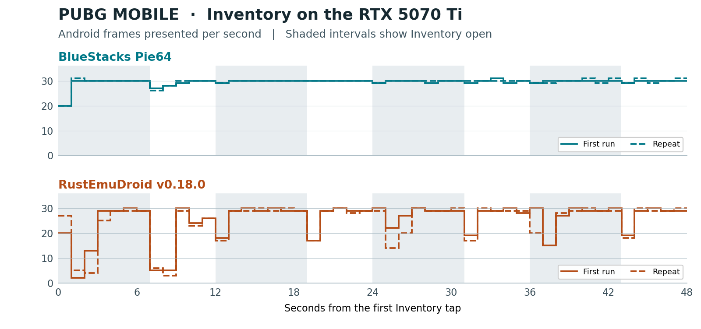
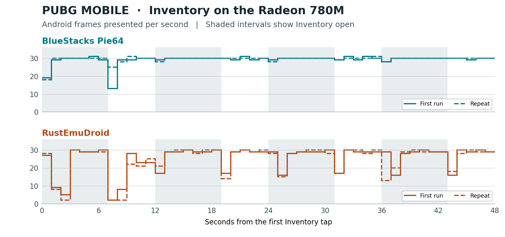
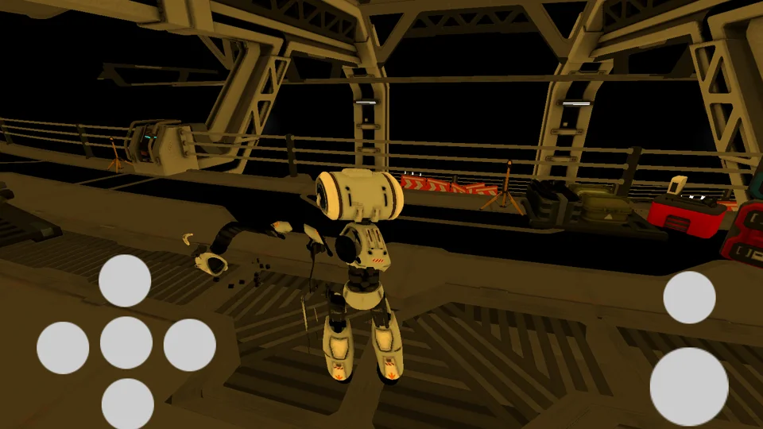
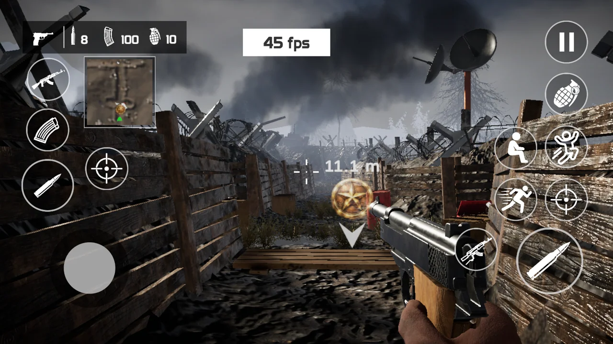
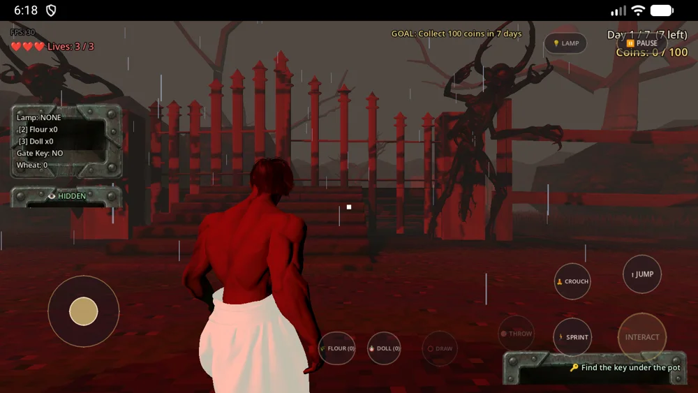
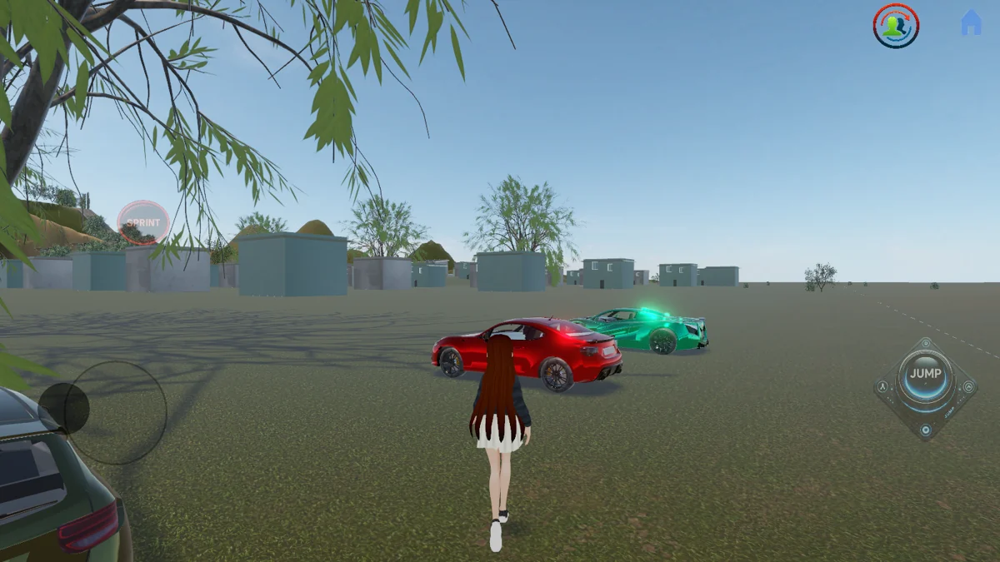

# Game smoke tests on Windows

The RustEmuDroid runs used Android Emulator 37.3.10 with the Android 17 Google Play x86-64 image, four guest vCPUs and 8 GiB of guest RAM. Unless a run specifies another setting, the guest display was 1600 × 900 and the active GPU was the GeForce RTX 5070 Ti.

## FPS comparisons on the Windows test PC

| Scene and setting | GPU | RustEmuDroid | BlueStacks Pie64 | Measurement |
|---|---|---:|---:|---|
| SuperTuxKart Black Forest, High, 90 Hz | RTX 5070 Ti | 82.40 FPS | 90.03 FPS | Game profiler, Vulkan on both. Two replays per player matched on all 21 graphics fields. [Replays and guest presentations](#bluestacks-and-rustemudroid-at-90-hz-on-the-rtx-5070-ti) |
| PUBG Lobby and Inventory, Balanced/High | RTX 5070 Ti | 25.20 FPS | 29.58 FPS | Android presentations. The first Inventory close paused for 1.60–1.68 s on v0.18.0 and 0.17 s on Pie64. [Retest and chart](#pubg-inventory-retest-with-rustemudroid-v0180) |
| PUBG Training Grounds, Smooth/High, camera pans | RTX 5070 Ti | 29.29 FPS | 29.98 FPS | Android presentations. The slowest 1% averaged 14.63 and 20.00 FPS, respectively. [Training route](#pubg-training-grounds-on-the-rtx-5070-ti) |
| PUBG Lobby and Inventory, Balanced/High | Integrated Radeon 780M | 25.11 FPS | 29.36 FPS | Android presentations. Two 48-second routes per player, with 27 and 4 pauses above 250 ms. [Integrated graphics results](#inventory-on-the-radeon-780m) |
| SuperTuxKart Black Forest, High, 60 FPS limit | Integrated Radeon 780M | 59.71 FPS | 59.99 FPS | Game profiler. Android 17 used Vulkan (16× anisotropic filtering), Pie64 used OpenGL ES (8×). [SuperTuxKart results, including Kemu](../benchmarks/stk-1.5/radeon-780m/README.md) |

In the same PUBG training scene, BlueStacks reached **59.89 FPS** when the game's Combat frame-rate option was set to Extreme. PUBG offered High as the highest option on the tested Android 17 installation, including with the display at 90 Hz. The table uses the shared High setting. [Frame-rate menu and raw timings](#pubg-training-grounds-on-the-rtx-5070-ti)

## SuperTuxKart release comparison

SuperTuxKart 1.5 ran the Black Forest replay in the embedded Windows display. All five builds used the same Android 17 Google Play profile, native x86-64 game, direct Vulkan renderer and RTX 5070 Ti. The High preset ran at 1600 × 900, 100% render scale and a 60 FPS cap. All 21 game-reported graphics fields matched.

| Windows build | FPS, first replay | FPS, second replay | Mean game FPS | Main-loop P95, pooled |
|---|---:|---:|---:|---:|
| 0.2.4, published binary | 59.88 | 60.01 | 59.94 | 19.24 ms |
| 0.3.0, local release build | 60.08 | 59.93 | 60.01 | 19.12 ms |
| 0.4.0, local release build | 59.92 | 60.03 | 59.98 | 18.90 ms |
| 0.4.1, local release build | 60.08 | 59.96 | 60.02 | 19.08 ms |
| 0.7.0, published binary | 60.06 | 60.00 | 60.03 | 19.23 ms |

The game recorded 2,282–2,288 frames per run. FPS is the frame count divided by the game's replay duration. P95 uses the positive main-loop timings from its own profiler. The FPS ranges overlap at the frame cap, with no measurable loss in this replay. In 0.7.0, the keyboard hints for the steering wheel and five action buttons were visible at 65% opacity during the replay. No mapped control was held. Uncapped throughput and the cost of actively using the new controls remain unmeasured. [Game reports, renderer and per-frame timings for 0.7.0](../benchmarks/stk-1.5/v0.7.0-windows-rtx.zip)

To repeat, verify the AVD path and GPU for each desktop version, then run `python benchmarks/stk-1.5/compare.py --adb <adb> --rust <serial> --rounds 2 --presets high-vulkan --output <new-folder>` with one emulator open. The 0.2.4 and 0.3.0 runs took place in that order. The 0.4.0, 0.4.1 and 0.7.0 runs followed in separate sessions. The harness restored the game's configuration byte-for-byte after each run. [Replay harness](../benchmarks/stk-1.5/compare.py)

### BlueStacks preview and SuperTuxKart replay FPS

On November 24, 2026, one BlueStacks 5.22.166.1003 Pie64 guest ran the SuperTuxKart 1.5 Black Forest replay on the GeForce RTX 5070 Ti. The High preset used OpenGL ES 3.2, 1600 x 900 at 100% render scale, four vCPUs, 8 GiB and a 60 FPS cap. All four reports gave the same graphics settings. The local RustEmuDroid 0.14.0 release build displayed the DWM preview in the same window throughout both On runs, with its control server active in that guest. The preview was visible while another desktop window retained focus. The test sent no game input.

| Lap | Preview | Game frames | Replay duration | Game FPS | Main-loop P95 |
|---|---|---:|---:|---:|---:|
| A1 | Off | 2,287 | 38.170 s | 59.916 | 17.846 ms |
| B1 | On | 2,287 | 38.122 s | 59.992 | 17.679 ms |
| B2 | On | 2,287 | 38.122 s | 59.992 | 17.888 ms |
| A2 | Off | 2,287 | 38.122 s | 59.992 | 17.771 ms |

Pooling frames and durations gave 59.954 game FPS with the preview closed and 59.992 with it open. The difference was smaller than the spread between the two closed-preview runs. The observed game FPS stayed near the 60 FPS cap. FPS is 1,000 times frames divided by the game-reported replay duration in milliseconds. Main-loop P95 uses the nearest-rank percentile of positive game profiler durations. The original game configuration was restored byte-for-byte and the preview left the BlueStacks source windows in place. [Per-run measurements](../benchmarks/stk-1.5/bluestacks-preview-abba.csv) · [Replay harness](../benchmarks/stk-1.5/compare.py)

### SuperTuxKart replay with the BlueStacks controls preview

Two local v0.17.0 candidates ran Black Forest replays on the same restored BlueStacks 5.22.166.1003 Pie64 Android 9 instance on Windows. SuperTuxKart 1.5 used its `armeabi-v7a` build, High graphics over OpenGL ES 3.2 on the RTX 5070 Ti, 1600 × 900 at 100% render scale, four vCPUs and 8 GiB. All 21 game-reported graphics fields matched. The player was set to 60 FPS with High FPS off. The replay harness wrote `max_fps=60` and left VSync on, then restored the original game configuration byte-for-byte after each lap. [Replay harness](../benchmarks/stk-1.5/compare.py)

The Rust preview had a live control server in the guest, and the editor stayed closed. The operator checked Windows foreground focus before and after every replay. The initial candidate received no input. In the optimized candidate, each lap received one preview click at the same location, with no game keys held. Foreground checks continued during polling. An earlier optimized B attempt lost focus and was discarded. For both completed B laps, the launcher's test state directory contained a SuperTuxKart profile with a D-pad and a Space binding. Whether the candidate binaries loaded the profile during the replays remains unverified. A separate instrumented build verified saved controls and simultaneous Android contacts during an interactive test. [Per-run measurements and executable SHA-256](../benchmarks/stk-1.5/bluestacks-controls-0170.csv)

| Candidate | Lap | Control profile file | Game frames | Replay duration | Game FPS | Main-loop P95 |
|---|---|---|---:|---:|---:|---:|
| Initial | A1 | Absent | 2,287 | 38.187 s | 59.889 | 17.592 ms |
| Initial | B | Present | 2,287 | 38.121 s | 59.993 | 17.780 ms |
| Initial | A2 | Absent | 2,289 | 38.138 s | 60.019 | 17.666 ms |
| Optimized | A1 | Absent | 2,287 | 38.122 s | 59.992 | 17.710 ms |
| Optimized | B | Present | 2,287 | 38.121 s | 59.993 | 17.888 ms |

FPS is 1,000 times the game frame count divided by its profiling duration in milliseconds. P95 is the nearest-rank percentile of positive main-loop profiler samples, converted from microseconds. In the initial series, the two laps without the file pooled to 59.954 FPS. B was 0.039 FPS higher, within the 0.129 FPS spread between A1 and A2. The optimized laps each recorded 2,287 frames and finished 1 ms apart. All five passes stayed near the configured 60 FPS player limit. Uncapped throughput and the cost of continuously using mapped controls remain unmeasured.

For the optimized A1 and B laps, the Rust preview process used 0.609 and 0.750 CPU seconds over 51.653 and 51.673 elapsed seconds, respectively. These are user and kernel CPU times for the Rust process, sampled from after the click through collection and game configuration restoration. The two windows include profiler polling and cleanup. BlueStacks, DWM and guest CPU time are outside that measurement.

We also attempted a 90 FPS player setting on the restored instance. Windows declined to activate both the running player window and its offline instance manager during automation. The instance retained its original 60 FPS cap with High FPS off and player VSync on. A matched 90 Hz BlueStacks game measurement remains open. [BlueStacks frame-rate settings](https://support.bluestacks.com/hc/en-us/articles/360058986331-Customize-FPS-on-BlueStacks-5) · [Per-instance settings](https://support.bluestacks.com/hc/en-us/articles/4422291276429-How-to-change-settings-in-the-Multi-instance-Manager-on-BlueStacks-5)

### Managed Windows runtime and Android refresh rate

The published v0.15.0 Windows ZIP booted a fresh, isolated Google Play Android 17 profile using the already installed managed Android runtime. Its launch environment had no separate Android SDK or Java on `PATH`. SuperTuxKart 1.5 ran the full Black Forest replay using native x86-64 and direct Vulkan on the RTX 5070 Ti. All ten reports matched the same 21 High-preset graphics fields at 1600 × 900 and 100% render scale. After the first replay, every run reused the same profile. The 90 Hz experiments used a local refresh prototype, followed by one replay with a locally built v0.16.0 product candidate. [Windows release](https://github.com/felipemarques/RustEmuDroid/releases/tag/v0.15.0) · [Recalculated results, executable identity and relative timestamps](../benchmarks/stk-1.5/managed-windows-refresh.json)

| Build and Android refresh request | Reported Android mode | Configured `max_fps` / VSync | Game FPS | Android presentations/s | Rust panel frames processed/s |
|---|---:|---|---:|---:|---:|
| v0.15.0 ZIP, default, first replay in a fresh profile | 60 Hz | 60 / on | 51.61 | — | — |
| v0.15.0 ZIP, default, subsequent replay | 60 Hz | 60 / on | 58.64 | — | — |
| v0.15.0 ZIP, default, subsequent replay | 60 Hz | 90 / on | 59.96 | 59.88 | — |
| Prototype, 90 Hz via emulator launch argument | 90 Hz | 90 / on | 45.00 | 45.01 | — |
| Prototype, 90 Hz via AVD configuration | 90 Hz | 90 / on | 45.00 | 45.01 | — |
| Prototype, 90 Hz via AVD configuration + Force Peak | 90 Hz | 90 / on | 45.00 | 45.09 | — |
| Prototype, 90 Hz via AVD configuration + Force Peak + game default rate disabled | 90 Hz | 90 / on | 82.45 | 81.20 | — |
| Prototype, 90 Hz via emulator launch argument + Force Peak + game default rate disabled | 90 Hz | 90 / on | 84.30 | 82.30 | 79.59 |
| v0.15.0 ZIP, restored default | 60 Hz | 90 / on | 59.95 | 59.94 | 60.00 |
| v0.16.0 candidate, 90 Hz selected in the Rust profile | 90 Hz | 90 / on | 83.98 | 81.96 | 78.82 |

In the last two rows, the median interval between consecutive Android presentations fell from **16.67 ms to 11.24 ms**. The slowest 1% began at **19.59 ms at 60 Hz** and **23.75 ms at 90 Hz**. Neither 20-second sample contained an interval longer than 33.33 ms. The faster mode delivered more frames overall, with more variation between frames. Each row represents one replay. [Presentation timestamps](../benchmarks/stk-1.5/managed-windows-refresh.json)

Both the emulator's `-vsync-rate 90` argument and `hw.lcd.vsync=90` in the AVD produced a reported 90 Hz mode. SuperTuxKart still ran at about 45 FPS with the default Android game frame-rate policy, including with **Force peak refresh rate** enabled. With Force Peak and the Android developer option **Disable default frame rate for games** enabled, SurfaceFlinger reported a change from 22.22 ms to 11.11 ms while the game was active. The two follow-up prototype replays reached 81.20 and 82.30 distinct Android presentations/s. Before the v0.15.0 return run, the original AVD configuration hash and the default Android developer and refresh settings were restored. The harness restored the game's XML byte-for-byte after each replay. [Android game refresh policy](https://developer.android.com/games/optimize/display-refresh-rate-change)

With the v0.16.0 candidate, changing only the Rust profile's **Android refresh rate** to 90 Hz applied a temporary minimum of 90 Hz and disabled the default game frame-rate policy for that session. Android developer options stayed at their prior setting. After a normal close and another boot using the profile default, Android reported 60 Hz and read back its previous refresh settings. The AVD configuration and game XML matched their original bytes at every checkpoint. [Recorded policy transitions](../benchmarks/stk-1.5/managed-windows-refresh.json)

Game FPS divides the profiler's frame count by its full replay duration. SurfaceFlinger counts distinct new presentation timestamps from the active game surface in a separate approximately 20-second sample. The optional desktop counter measures frames processed by the Rust panel over complete reporting intervals. Windows display scanout was outside the measurement. The configured `max_fps` and VSync entries describe the game XML used for each run. The SuperTuxKart 1.5 source bypasses its main-loop `max_fps` sleep in `--benchmark`, and that sleep also requires VSync to be off. [Replay harness](../benchmarks/stk-1.5/compare.py) · [SuperTuxKart 1.5 frame limiter](https://github.com/supertuxkart/stk-code/blob/1.5/src/main_loop.cpp#L711-L734)

During the SurfaceFlinger sample, QEMU used 2,236 CPU ms/s on the v0.15.0 return run at 60 Hz and 2,729 CPU ms/s on the v0.16.0 candidate at 90 Hz. The Rust launcher used 617 and 649 CPU ms/s, respectively. Dividing by the distinct Android presentations in those same windows gives 37.31 and 33.29 CPU ms/presentation for QEMU and 10.29 and 7.92 for the launcher. These counters sum CPU time across threads. Each quoted condition has one instrumented replay, and the two used different desktop builds. [Per-process aggregates](../benchmarks/stk-1.5/managed-windows-refresh.json)

### SuperTuxKart at 90 Hz with shared-memory video on Windows

An experimental RustEmuDroid 0.17.0 client switched between inline RGBA frames and Windows shared memory (MMAP) without rebooting its Android 17 Google Play VM. SuperTuxKart 1.5 ran the built-in Black Forest replay at High, 1600 × 900, using Vulkan on the RTX 5070 Ti. After one warm-up, each measured replay started a fresh game process. The Android display stayed at 90 Hz and the game's 21 graphics settings matched in all four passes.

| Pass and transport | Game frames / seconds | Game FPS | Android presentations/s | Frames processed by Rust panel/s | Rust process CPU ms/s |
|---|---:|---:|---:|---:|---:|
| A1 inline | 3,205 / 38.059 | 84.21 | 83.36 | 76.39 | 533 |
| B1 MMAP | 3,240 / 38.074 | 85.10 | 84.71 | 82.91 | 369 |
| B2 MMAP | 3,227 / 38.074 | 84.76 | 83.81 | 81.84 | 371 |
| A2 inline | 3,205 / 38.072 | 84.18 | 83.60 | 77.51 | 531 |

Pooling each pair by replay duration gives **84.20 FPS inline and 84.93 FPS with MMAP**. The larger difference was in the panel, which processed **76.95 and 82.37 frames/s**, respectively. Rust process CPU usage fell from 532 to 370 ms per second. Game FPS covers the full replay. Android presentations and host CPU cover an approximately 20-second segment, and the panel counts complete reporting intervals within that segment. Panel processing is distinct from monitor scanout. These four short replays on one PC establish the size of the observed difference. The [PUBG Inventory transport test](#does-shared-memory-video-improve-pubg-inventory-fps) used the same experimental client. [Per-replay results and counting rules](../benchmarks/stk-1.5/windows-mmap-replay.json) · [Transport integrity test and shared-buffer limitation](../benchmarks/desktop-texture-upload/README.md#windows-screenshot-transport-on-android-17)

### Serialized shared memory in the Windows game panel at 90 Hz

The private 0.18.0 client used a small framebuffer notification followed by a single full-resolution shared-memory screenshot. It copied each complete image before requesting the next. We tested this path on November 25, 2026, with the same launcher process and one managed Android 17 VM. SuperTuxKart 1.5 ran the Black Forest replay on the RTX 5070 Ti at High, native Vulkan and 1600 × 900. Android reported 90 Hz and the game's 21 reported graphics settings matched in every pass. We warmed up once and started the game afresh for each measured replay.

| Run | Video transport | Game FPS | Android presentations/s | Panel frames/s | Launcher CPU (ms/s) |
|---|---|---:|---:|---:|---:|
| A1 | Inline | 81.93 | 79.76 | 76.03 | 549 |
| B1 | Serialized shared memory | 82.51 | 81.40 | 77.83 | 343 |
| B2 | Serialized shared memory | 82.11 | 80.49 | 77.86 | 368 |
| A2 | Inline | 82.88 | 82.20 | 78.33 | 521 |

The full-replay game rate was **82.40 FPS inline and 82.31 with serialized shared memory**. The paired Android samples yielded 80.98 and 80.95 presentations/s. The panel processed 77.18 and 77.85 frames/s. The launcher used 535 and 355 CPU ms per wall second, a **33.6% reduction**. This experiment saved desktop CPU with essentially the same game FPS. It does not establish a shorter input-to-display latency. The game rate covers each full replay. Android, panel and CPU samples cover a roughly 20-second segment. The test restored the game's configuration and the normal 60 Hz Home session. [Per-replay counters](../benchmarks/stk-1.5/windows-serialized-mmap-replay.json) · [Screenshot latency and delayed-reader check](../benchmarks/desktop-texture-upload/README.md#serialized-full-frame-screenshots-with-a-small-change-notification)

### BlueStacks and RustEmuDroid at 90 Hz on the RTX 5070 Ti

We then ran the same Black Forest High replay in an installed BlueStacks 5.22.166.1003 Pie64 test instance. The player started at 60 Hz. For the 90 Hz passes we enabled High FPS on the test instance, raised its limit to 90 and turned off player VSync. SurfaceFlinger reported the requested period before, during and after each replay. The game's VSync and all 21 game-reported graphics settings matched across the four BlueStacks runs. Both players ran on the same Windows PC, one VM at a time.

| Player and guest refresh | Game renderer / filtering | Game FPS, pooled | Android presentations/s, pooled |
|---|---|---:|---:|
| RustEmuDroid Android 17, inline video, 90 Hz | Vulkan / 16× | 82.40 | 80.98 |
| BlueStacks Pie64, 90 Hz | Vulkan / 16× | 90.03 | 89.92 (second replay) |
| BlueStacks Pie64, 90 Hz | OpenGL ES / 8× | 84.07 | 82.98 |
| BlueStacks Pie64, 60 Hz | OpenGL ES / 8× | 59.89 | 59.82 |

Across the four Vulkan replays, both players reported the same 21 graphics settings and identified the RTX 5070 Ti. BlueStacks averaged **7.62 FPS** more over the full replay. Its two game readings were 90.04 and 90.01 FPS. BlueStacks used the 32-bit ARM game and Android 17 used x86-64. BlueStacks wrote its profiler and per-frame CSVs during the first Vulkan replay. We recovered them on the following boot and checked timestamps, hashes and the 3,432 frames over 38.116 seconds. Only the second Vulkan replay had a verified presentation window. Android presented 1,800 new game frames in 20.018 seconds (89.92/s), with a P99 interval of 11.11 ms. The game configuration was restored. The lab instance finished with its original 60 FPS limit, High FPS off and player VSync on. [BlueStacks per-replay data](../benchmarks/stk-1.5/windows-pie64-90hz.json) · [RustEmuDroid per-replay data](../benchmarks/stk-1.5/windows-serialized-mmap-replay.json)

The game profiler also breaks down elapsed time on the main thread. We compared the 13,138 rows with positive main-loop time from the four Vulkan replays. Weighted by frames, the scene's `drawAll` section averaged **7.29 ms on Android 17 and 3.77 ms on Pie64**. The rest of `IrrDriver update`, calculated on the same frame, averaged **3.28 and 6.14 ms**. The complete graphics update averaged 10.58 and 9.91 ms, respectively. The second region includes presentation work and possible waits. The scene marker alone therefore overstates the net difference between the two graphics paths. These are main-thread wall times. Separating scene preparation, command recording, GPU execution and presentation waits would require finer markers. [Per-replay means and percentiles](../benchmarks/stk-1.5/windows-vulkan-90hz-profiler.csv) · [SuperTuxKart scene markers](https://github.com/supertuxkart/stk-code/blob/1fb491f507216c5d181ccd85f29ff08eca003827/src/graphics/fixed_pipeline_renderer.cpp#L43-L112) · [SuperTuxKart Vulkan frame submission](https://github.com/supertuxkart/stk-code/blob/1fb491f507216c5d181ccd85f29ff08eca003827/lib/graphics_engine/src/ge_vulkan_driver.cpp#L1773-L1882)

## PUBG MOBILE

One Windows launch of PUBG MOBILE 4.7.0 (build 21718) on v0.15.0 exited before reaching the lobby. Android started the requested splash activity and the process initialized ANGLE over Vulkan on the RTX 5070 Ti. Android then recorded a native crash (SIGSEGV, SEGV_ACCERR) in that process. Three subsequent fresh processes on the same Android 17 installation reached the lobby and completed the Inventory route. The logs establish when the failure occurred. Its underlying cause remains unknown. [Inventory runs on this build](#does-lowering-the-android-display-resolution-help-pubg-inventory)

The stationary test sampled the same Showroom view for about 18 seconds per run. Only guest display resolution changed between the three samples.

| Run | Guest display | Guest presentations per second | Median interval | P95 interval |
|---|---:|---:|---:|---:|
| A1 | 1600 × 900 | 29.30 | 33.37 ms | 49.57 ms |
| B | 1280 × 720 | 29.25 | 33.35 ms | 49.30 ms |
| A2 | 1600 × 900 | 29.34 | 33.33 ms | 48.94 ms |

For the navigation test, each approximately 23-second sample included three passes from Showroom through Settings and Graphics and back to Showroom. Balanced averaged 28.31 guest presentations per second, with intervals up to 284 ms. The tested Custom configuration averaged 27.80. Balanced at 1600 × 900 was restored after testing. **High** was the highest Lobby frame-rate option the game offered. The game controls which Showroom slots can be disabled. These menu samples cover presentation cadence during the named workloads. Match performance and the effect of changing Showroom slots were outside the test.

On this Android 17 image, `adb shell cmd game list-modes com.tencent.ig` reported Standard as active and offered Standard and Custom. `cmd game list-configs` found no package intervention. The image did not offer Android's Performance game mode for PUBG. On the BlueStacks Pie64 installation, PUBG opened and requested age verification before a comparative Showroom run could begin. [Android Game Mode API](https://developer.android.com/games/optimize/adpf/gamemode/gamemode-api)

### PUBG Training Grounds on the RTX 5070 Ti

RustEmuDroid 0.14.0 and BlueStacks 5.22.166.1003 Pie64 ran PUBG MOBILE 4.7.0 (build 21718, ARM64) one emulator at a time on the same Windows PC. Both had four vCPUs, 8 GiB, 1600 × 900 and renderer evidence for the RTX 5070 Ti. PUBG used ANGLE over Vulkan on the RustEmuDroid Android 17 guest at 320 dpi. The BlueStacks Android 9 player identified the RTX as its host OpenGL renderer and used 240 dpi. Its player limit was 60 and the High FPS switch was off. Each installation used its own existing guest account and interface language.

Both measured Training Grounds with **Smooth/High** in the Combat settings. RustEmuDroid used its global Balanced preference, which selected Smooth/High for Combat on this guest. On BlueStacks, global Balanced selected Balanced/Extreme. We used Customize → Combat to match Smooth/High, with antialiasing and power saving disabled and Adaptive Graphics enabled. We disabled shadows on BlueStacks for the sample. The RustEmuDroid Combat summary omitted Shadows. Each lobby kept its original enhancement setting.

From the game's mode selector, open **Training Ground**. The official pack is available from Download Center. We measured in third person at the spawn between two rows of tables, facing the brick building at about 90°. For each camera sample, the character stayed put while we performed six alternating 600 ms horizontal swipes at nominal seconds 2, 5, 8, 11, 14 and 17. RustEmuDroid used (1000, 370) to (1200, 370) and BlueStacks used (920, 440) to (1530, 440). We calibrated the distances visually to turn toward the containers and return. One verification pair produced approximately 90° → 130° → 85° on RustEmuDroid and 90° → 135° → 85° on BlueStacks. Both measured High pan sequences drifted from about 85° at their first start to about 65° at their second finish. No public match was joined. [PUBG MOBILE Training Grounds guide](https://pubgmobile.helpshift.com/hc/en/3-pubg-mobile/faq/249-how-do-i-enter-the-training-grounds/)

| Player and scene | New presentations | Sample duration | Presentations/s | P99 interval | Longest interval |
|---|---:|---:|---:|---:|---:|
| RustEmuDroid, stationary lobby | 588 | 20.028 s | 29.36 | 51.88 ms | 74.97 ms |
| RustEmuDroid, still 1 | 581 | 20.022 s | 29.02 | 64.56 ms | 84.34 ms |
| RustEmuDroid, still 2 | 589 | 20.021 s | 29.42 | 51.45 ms | 102.57 ms |
| RustEmuDroid, camera pans 1 | 586 | 20.031 s | 29.26 | 65.62 ms | 82.26 ms |
| RustEmuDroid, camera pans 2 | 587 | 20.022 s | 29.32 | 65.45 ms | 68.99 ms |
| BlueStacks, still 1 | 601 | 20.017 s | 30.02 | 50.00 ms | 50.00 ms |
| BlueStacks, still 2 | 601 | 20.014 s | 30.03 | 33.33 ms | 66.67 ms |
| BlueStacks, camera pans 1 | 600 | 20.017 s | 29.97 | 50.00 ms | 50.00 ms |
| BlueStacks, camera pans 2 | 600 | 20.016 s | 29.98 | 33.33 ms | 50.00 ms |

All nine windows had zero gaps over 250 ms. The matched High windows were close to 30 presentations/s on both players. The collector deduplicates actual presentation timestamps newer than its first poll and divides that count by the elapsed host time. To reproduce the table, count each exported sample's timestamps and divide by its `duration_ns` in seconds. P99 uses sorted gaps between consecutive presentations at index `floor(0.99 × (N − 1))` for `N` gaps. This measures guest presentation cadence in a loaded scene. Training entry, movement across the map and match performance remain unmeasured. [Relative presentation timestamps](../benchmarks/pubg-mobile/training-grounds-rtx.json) · [SurfaceFlinger collector](../benchmarks/pubg-mobile/capture-presentations.py)

On the RustEmuDroid guest, the Combat menu offered Power Saving, Medium and High at both Smooth and Super Smooth. Android GameManager reported Standard and Custom with no interventions for the package. The preview of Super Smooth was reverted before applying the original global Balanced selection.

BlueStacks offered higher Combat frame-rate choices. In the same loaded scene and game process, we changed only Combat High to **Extreme**, kept Smooth, and repeated the calibrated camera pans with the player limit still at 60. The first Extreme pass started at about 80°. The two Extreme passes measured 59.88 and 59.90 presentations/s. The earlier High passes measured 29.97 and 29.98/s. This ordered check used two passes per setting. The player's original graphics preferences were restored after testing. [Relative presentation timestamps](../benchmarks/pubg-mobile/training-grounds-rtx.json)

| BlueStacks Combat | New presentations | Sample duration | Presentations/s | P99 interval | Longest interval |
|---|---:|---:|---:|---:|---:|
| Extreme, camera pans 1 | 1,199 | 20.024 s | 59.88 | 16.67 ms | 33.33 ms |
| Extreme, camera pans 2 | 1,199 | 20.015 s | 59.90 | 16.67 ms | 50.00 ms |

The two matched camera sweeps also show why similar average rates can feel different. We calculated a 1% low from the slowest presentation intervals. Each row pools the two passes for that player and setting.

| Player and Combat setting | Complete intervals in both sweeps | Average presentations/s | 1% low, presentations/s |
|---|---:|---:|---:|
| RustEmuDroid Android 17, High | 1,171 | 29.29 | 14.63 |
| BlueStacks Pie64, High | 1,198 | 29.98 | 20.00 |
| BlueStacks Pie64, Extreme | 2,396 | 59.89 | 51.43 |

For the average, divide all new presentations by the combined sampling duration. For the 1% low, take consecutive timestamps within each pass, pool their intervals, and divide one second by the mean duration of the slowest 1%, rounding the interval count up. This excludes the gap between passes. Every complete interval during these sweeps was under 100 ms. [Original timestamps for all six sweeps](../benchmarks/pubg-mobile/training-grounds-rtx.json)

BlueStacks documents Extreme as a PUBG Combat option targeting up to 60 FPS. The guide recommends four CPU cores and 4 GB of guest RAM. Both players in our test already had four cores and 8 GiB. Which additional device capabilities PUBG 4.7 checked before offering Extreme remains unknown. In a separate Radeon run, Android on Pie64 reported an Adreno 650 with OpenGL ES 3.2 while the Windows player identified the physical Radeon 780M. Those diagnostics identify different parts of the graphics stack. [BlueStacks PUBG guide](https://support.bluestacks.com/hc/en-us/articles/4405793595277-Recommended-settings-for-PUBG-Mobile-on-BlueStacks-5) · [Graphics-path comparison](#why-did-bluestacks-present-pubgs-inventory-more-consistently)

In a later display check, both the Android 17 guest and a separately restored BlueStacks Pie64 guest reported an active 1600 × 900 display at 60 Hz. SurfaceFlinger reported a 16,666,666 ns refresh period in both. These device-level readings were taken outside the matched PUBG runs. The Android 17 virtual display supports 60 Hz even though PUBG offered High as its highest Combat setting in the tested presets.

We reopened PUBG 4.7.0 (21718) on the RTX 5070 Ti using a local Windows release build of the final v0.16.0 code with Android set to **90 Hz**. With the game in the foreground, Android reported a 1600 × 900 display, 90 Hz active render rate and 11,111,111 ns refresh period. DisplayManager showed no per-UID frame-rate overrides. SurfaceFlinger listed no game-mode or game-default override and the activity's window requested no specific rate. In **Settings → Graphics → Customize → Combat → Smooth**, PUBG still offered **Power Saving**, **Medium** and **High**, with High selected. Raising the guest refresh rate alone did not unlock Extreme on this installation. We closed the settings preview without applying it. This check sampled the menu and did not measure gameplay FPS. [In-game settings screenshot](../benchmarks/pubg-mobile/android17-90hz-combat-menu.png) · [Menu and display readings](../benchmarks/pubg-mobile/android17-90hz-combat-menu.json)

### Where the inventory stalls occur

Two separate 24-second Perfetto captures compared a stationary lobby with repeated opening and closing of the inventory. The producer measurements count `onFrameAvailable` notifications on PUBG's `RHIThread` for its GameActivity SurfaceView. They measure when a new game buffer became available. SurfaceFlinger FrameTimeline measures the guest display compositor separately. [Perfetto FrameTimeline](https://perfetto.dev/docs/data-sources/frametimeline)

| Lobby workload | PUBG buffer notifications per second | Median interval | P95 interval | P99 interval | Longest interval |
|---|---:|---:|---:|---:|---:|
| Stationary | 29.07 | 34.00 ms | 38.85 ms | 43.21 ms | 141.79 ms |
| Inventory navigation | 23.68 | 34.02 ms | 43.51 ms | 248.21 ms | 2.169 s |

During the 2.169-second gap, PUBG's main game thread ran for 1.318 seconds and spent 59 ms runnable. The SurfaceFlinger main thread ran for about 3 ms. During another gap of 542 ms, the game thread ran for 488 ms and the compositor for 7 ms. The long pauses were already visible in the game's buffer cadence. This locates the stalls before composition without identifying which game operation caused them.

SurfaceFlinger classified 699 display frames in the stationary trace and 570 in the navigation trace. It attributed zero recorded misses to its CPU or GPU deadlines and classified one late navigation frame as a display HAL issue. Among known presentations, the compositor's P99 interval rose from 58.70 to 288.46 ms. Its longest interval rose from 164 ms to 2.175 seconds. The traces had no PUBG app-layer FrameTimeline rows, so they could not count the game's own deadline misses. Perfetto reported 10 and 22 FrameTimeline parse errors, respectively, and one discarded chunk during navigation. The counts refer to observed events.

### Memory and I/O during Inventory

A separate 55-second trace used RustEmuDroid 0.4.0 and PUBG MOBILE 4.7.0. The game's primary ABI was `arm64-v8a` and the x86-64 system image used `libndk_translation.so`. Android's GPU service recorded ANGLE, a GLES context and a hardware Vulkan device and swapchain for this package. The test kept the disk cache and relaunched the game before opening Inventory four times.

| Phase | PUBG buffer notifications/s | Longest buffer interval | Guest block reads |
|---|---:|---:|---:|
| Stationary lobby | 29.17 | 70 ms | 4 |
| First open | 22.93 | 794 ms | 133 |
| Second open | 27.11 | 418 ms | 0 |
| Third open | 26.73 | 398 ms | 2 |
| Fourth open | 25.86 | 372 ms | 0 |

The longest pause in the full trace began 54 ms after the first **close** tap. During that 1.674-second gap the main game thread ran for 1.293 s, waited runnable for 93 ms and spent 3.2 ms in uninterruptible sleep. The asynchronous loading thread ran for 166 ms. Across the four guest vCPUs, utilization during the gap was 36%. The guest read 360 KiB from block storage during this interval.

Two complete CPU accounting intervals inside that pause covered about one second. During those intervals the game thread ran for 900 ms, and the entire game process accumulated 260 ms of guest kernel CPU time. Even assigning all 260 ms to the game thread leaves roughly 640 ms consistent with work in guest userspace. The process counters have 10 ms granularity and the trace has no CPU call stacks to identify a function.

Available guest memory stayed between 3.91 and 4.00 GiB. Memory pressure-stall counters stayed flat and the PUBG process recorded no additional major page faults. The first open involved more storage reads and loader work. Subsequent opens still paused with little or no block I/O. This run provides no support for increasing guest RAM or vCPUs as a fix. It did not collect call stacks identifying the work inside the game. Guest counters were sampled every 250 ms. Perfetto reported 40 FrameTimeline parser errors and several skipped scheduler events.

On the stock Google Play image, the installed package advertised neither debuggable nor shell-profiling access. A package-scoped `simpleperf stat` request confirmed that Android declined profiling. Identifying the native function consuming that CPU time would require additional evidence, such as a publisher-provided trace or a shell-profileable build with matching native symbols. [Android profiling permissions](https://developer.android.com/guide/topics/manifest/profileable-element)

### Does the Lobby Smooth preset help with Inventory?

On RustEmuDroid 0.3.0, three game launches alternated the Custom Lobby graphics setting between Balanced, Smooth and Balanced. The Lobby frame-rate setting stayed on High. Each 48-second run opened Inventory at 0, 12, 24 and 36 seconds and returned to the lobby seven seconds after each open. The Download Center showed paused packs. The game retained its caches between launches.

| Run and Lobby setting | Guest presentations/s, whole route | First open, presentations/s | Three later opens, pooled presentations/s | P99 interval, whole route | Longest interval |
|---|---:|---:|---:|---:|---:|
| A1 (Balanced) | 25.04 | 22.57 | 26.67 | 136 ms | 1,716 ms |
| B (Smooth) | 25.06 | 20.43 | 27.14 | 227 ms | 1,098 ms |
| A2 (Balanced) | 24.67 | 21.71 | 25.48 | 284 ms | 1,099 ms |

The first Inventory open was slower than the pooled later opens in every run. Smooth still had a pause of about a second and its overall rate was within 0.4 presentations/s of both Balanced runs. This comparison did not establish a repeatable fix. The Showroom warning and the game's combat frame rate were outside this route.

The CSV gives each presentation's estimated time relative to the first scheduled Inventory tap, with one sample outside each boundary. Guest timestamps were aligned to the host clock using the smallest observed difference between a poll's completion and its newest guest presentation. Count timestamps inside each fixed window and divide by its length. For intervals, clip pairs that cross a window boundary. [Presentation timestamps](../benchmarks/pubg-mobile/inventory-presentations.csv)

On the Radeon 780M, RustEmuDroid 0.5.0 also opened the same Android 17 PUBG lobby with shared Vulkan memory enabled. One 48-second route with four Inventory opens and closes produced 1,194 guest presentations (24.88/s), a P95 interval of 49.76 ms and a longest gap of 1.72 s. This setting let the Unity game below enter its level. PUBG's long Inventory pause was still present. [Radeon Inventory timestamps](../benchmarks/pubg-mobile/radeon-780m-inventory.csv)

### PUBG Inventory on BlueStacks and RustEmuDroid

On November 24, 2026 we ran the same PUBG MOBILE 4.7.0 build (21718, ARM64) on a Windows 11 PC with a Ryzen 9 8945HS and an RTX 5070 Ti. Each emulator used four virtual CPUs, 8 GiB of guest RAM and a 1600 × 900 display. RustEmuDroid 0.13.0 used Android 17 Google Play with ANGLE and `libndk_translation`. BlueStacks 5.22.166.1003 used its Pie64 player with Android 9 and Houdini. We ran one VM at a time.

Each emulator ran **Balanced → Smooth → Balanced** under **Customize → Lobby**. Lobby frame rate was High, style was Classic, Adaptive Graphics was enabled, and Lobby Graphics Enhancement, anti-aliasing and power saving were disabled. Shadows were disabled wherever the preset exposed them. We started a fresh game process for each of these six runs and retained the game's caches. After reaching the lobby and waiting eight seconds, we opened Inventory at 0, 12, 24 and 36 seconds, then closed it seven seconds after each open.

| Lobby setting | RustEmuDroid presentations/s | BlueStacks presentations/s | RustEmuDroid P99 | BlueStacks P99 | Longest gap, RustEmuDroid / BlueStacks | Gaps over 250 ms, RustEmuDroid / BlueStacks |
|---|---:|---:|---:|---:|---:|---:|
| Balanced, first | 25.10 | 29.52 | 218 ms | 67 ms | 1,097 / 333 ms | 12 / 1 |
| Smooth | 25.29 | 29.54 | 147 ms | 67 ms | 1,333 / 300 ms | 11 / 1 |
| Balanced, repeat | 25.19 | 29.48 | 246 ms | 67 ms | 1,081 / 317 ms | 12 / 1 |

Pooling the two Balanced runs for each emulator gives **29.50 presentations/s on BlueStacks and 25.15 on RustEmuDroid**, a difference of 4.35/s (17.3% relative to RustEmuDroid). Over the same 96 seconds, BlueStacks had 2 intervals above 250 ms and RustEmuDroid had 24. On the first return from Inventory, the two Balanced runs paused for 1.097 s and 1.081 s on RustEmuDroid, compared with 183 ms and 167 ms on BlueStacks. BlueStacks recorded its longest gap during the first Inventory opening on all three custom runs.

To quantify the visible drops, we divided the two Balanced routes into 96 consecutive one-second windows per emulator, aligned to the start of each route. RustEmuDroid delivered fewer than 15 presentations in eight windows and fewer than 20 in 19 windows. BlueStacks delivered fewer than 15 in zero windows and fewer than 20 in two windows. The slowest one-second window contained one presentation on RustEmuDroid and 19 on BlueStacks.

We measured distinct presentations on PUBG's Android SurfaceView using column two of `dumpsys SurfaceFlinger --latency`. The 48-second window includes the menu transitions. BlueStacks' presentation times fell on multiples of a 16.67 ms display refresh. Its frame-ready timestamps advanced independently. The game accounts and languages differed. The private mid-run captures confirm Inventory in each run, with differences in the visible clothing panel. These runs measure the lobby and Inventory on this PC. Combat FPS and the game's internal render rate require separate measurements. [Relative timestamps for all seven routes](../benchmarks/pubg-mobile/bluestacks-pie64-inventory.csv)

One additional BlueStacks pass kept its original global Balanced preference, HD lobby and Lobby Graphics Enhancement enabled. It returned 29.85 presentations/s with a 117 ms maximum gap. This warm pass included an Inventory check before the run. The averages in the table use only the matched custom runs.

### PUBG Inventory retest with RustEmuDroid v0.18.0

On November 25, 2026 we repeated the four-visit Lobby route on the Windows RTX 5070 Ti. The local Windows release build reported v0.18.0. PUBG MOBILE 4.7.0 (21718, ARM64) ran at 1600 × 900 and 60 Hz with four vCPUs and 8 GiB of guest RAM. Each measured pass started a fresh game process and retained the existing caches. The collector counted distinct Android SurfaceFlinger presentations on the foreground game layer. The launcher's saved FPS preference stayed in place.

| Runtime and pass | Frames in 48 s | FPS | P99 interval | Pause on first close | Intervals over 250 ms |
|---|---:|---:|---:|---:|---:|
| RustEmuDroid v0.18.0, first | 1,227 | 25.56 | 131.49 ms | 1,600 ms | 12 |
| RustEmuDroid v0.18.0, second | 1,192 | 24.83 | 249.47 ms | 1,681 ms | 12 |
| BlueStacks 5.22.166.1003 Pie64, first | 1,418 | 29.54 | 66.67 ms | 167 ms | 1 |
| BlueStacks 5.22.166.1003 Pie64, second | 1,422 | 29.63 | 50.00 ms | 167 ms | 1 |

Across 96 seconds per player, RustEmuDroid presented **25.20 FPS** and BlueStacks **29.58 FPS**. Nine one-second windows on RustEmuDroid contained fewer than 15 new frames. Every BlueStacks window contained at least 20. At the first close, the Android 17 game buffers became ready 1.600 and 1.682 seconds apart. The corresponding gaps on Pie64 were 166 and 167 ms. The long native stalls were visible before the Rust window displayed those frames. [All relative frame times](../benchmarks/pubg-mobile/v0.18.0-rtx-inventory.csv) · [Settings, per-pass results and exclusions](../benchmarks/pubg-mobile/v0.18.0-rtx-inventory.json)



The Android 17 guest used ANGLE/Vulkan at 320 dpi. The official Android 9 Pie64 instance used the host OpenGL renderer at 240 dpi. The existing accounts, inventory contents, language and time spent in the lobby could differ. Before the second BlueStacks run, we followed the lobby-switch hint and returned to the original PUBG tab. The route began about 44 seconds after the gesture. Run `python benchmarks/pubg-mobile/plot-inventory.py --rtx` to reproduce the chart.

Two additional native attempts stopped before the fourth visit. The screenshot check expected the outfit tabs to have loaded two seconds into the third visit. The captured images showed the Inventory panel with its contents still loading. We retained the incomplete attempts in the private log. In later passes the visual check ran 3.7 seconds into that visit, with the same scheduled tap times. The averages include complete 48-second routes only.

#### What the game thread did during the first Inventory close

In a new v0.18.0 run on the same RTX 5070 Ti and Android 17 guest, the stationary lobby presented **29.30 FPS** over 5.73 seconds. The following 48-second Inventory route presented **25.40 FPS** and had 12 gaps over 250 ms. An ordinary Android shell sampled Linux process and thread counters about every 200 ms. We aligned complete samples to the time when each new game buffer became ready. The Android presentation and buffer-ready timestamps came from the same foreground SurfaceView throughout.

| Inventory close | Gap between presentations (ms) | Gap between ready buffers (ms) | Ready gap covered by counters | Minor faults on the active game thread | Game-thread CPU in the covered interval (ms) |
|---|---:|---:|---:|---:|---:|
| First | 1,587.57 | 1,583.82 | 89% | 62,293 | 1,090 |
| Second | 477.64 | 483.81 | 42% | 0 | 200 |
| Third | 469.94 | 467.45 | 86% | 279 | 380 |
| Fourth | 432.13 | 432.76 | 47% | 0 | 200 |

During the measured 1.411 seconds inside the first close, that thread accounted for 62,293 of the process's 62,524 minor page faults and 1.09 of its 1.35 CPU seconds. Its CPU counters advanced by 910 ms in userspace and 180 ms in the guest kernel. It had recorded just three minor faults during 5.446 sampled seconds in the stationary lobby. The process recorded zero major faults in these intervals. A minor fault is one that the kernel resolves without reading the page from disk. These counters locate the activity on a thread and in time. They cannot identify the allocation, mapped file, or executing function. The later closes still paused for more than 400 ms and showed much less of that activity in the portions sampled. [Relative timings, counters and sampling coverage](../benchmarks/pubg-mobile/v0.18.0-android17-thread-counters.json) · [Reproduce the observer](../benchmarks/pubg-mobile/thread-counters/README.md) · [Linux process counter definitions](https://man7.org/linux/man-pages/man5/proc_pid_stat.5.html)

We repeated the route on the restored Pie64 instance using a 25 ms observer interval. The stationary lobby presented 30.00 FPS and the 48-second route presented 29.52 FPS. At the first close, the presentation gap was 183.33 ms and the paired ready gap was 174.03 ms. Complete counter intervals covered 152.05 ms inside both gaps. The active game thread used 100 ms of CPU and recorded 133 minor page faults. The whole process used 180 ms and recorded 2,255 minor faults and zero major faults. An unrelated presentation in the capture had two different ready values. Both endpoints of the first close had unique ready values. Different window durations and sampling intervals limit comparisons of absolute counts. The result establishes that the much larger burst of minor faults coincided with the longer first close on Android 17. A second Android 17 attempt at 25 ms recorded 29.40 FPS in the stationary lobby. We excluded its Inventory route after a screenshot showed an exit confirmation during the third visit. [Pie64 counters and all four closing intervals](../benchmarks/pubg-mobile/v0.18.0-pie64-thread-counters.json)

### Why did BlueStacks present PUBG's Inventory more consistently?

Both players ran a hardware-accelerated Android VM. On this Windows host, the BlueStacks Pie64 player log identified Microsoft Hyper-V as its selected hypervisor and the RTX 5070 Ti as its host OpenGL renderer. RustEmuDroid used QEMU with Windows Hypervisor Platform. Both guests ran the ARM64 build of PUBG on an x86-64 CPU. BlueStacks' `libnb.so` log recorded successful initialization of Houdini 9.0.7a. The Google Play Android 17 guest used `libndk_translation.so`, and PUBG created an ANGLE Vulkan instance. These are different translation and graphics paths. Their individual contributions to FPS have not been isolated.

The BlueStacks player had its high-frame-rate switch off and its limit set to 60. Inside PUBG, the Lobby setting for the comparison was High. These controls can be set separately. [BlueStacks frame-rate controls](https://support.bluestacks.com/hc/en-us/articles/360058986331-Customize-FPS-on-BlueStacks-5) · [BlueStacks settings for PUBG MOBILE](https://support.bluestacks.com/hc/en-us/articles/37159226387213-PUBG-Mobile-on-PC-with-BlueStacks-5)

BlueStacks’ PUBG guide pairs the in-game Combat tab’s Extreme setting with a target of up to 60 FPS. Its graphics guide also lists games for which the player prompts the user to switch renderers. [PUBG settings](https://support.bluestacks.com/hc/en-us/articles/4405793595277-Recommended-settings-for-PUBG-Mobile-on-BlueStacks-5) · [Renderer selection by game](https://support.bluestacks.com/hc/en-us/articles/360059893151-How-to-use-a-graphics-renderer-on-BlueStacks-5)

BlueStacks exposed an Adreno 650 name to its Android guest even when the Windows player log identified the Radeon 780M as the active OpenGL renderer. Both Android displays had a resolution of 1600 × 900. Android reported a density of 240 dpi on BlueStacks and 320 dpi on RustEmuDroid. The comparison therefore includes differences in the device configuration seen by the game.

#### What REA and the running player show about the graphics path

REA inspected the installed BlueStacks 5.22.166.1003 binaries on this Windows PC. The player executable imports Direct3D 11 device creation and DXGI. The renderer library exports GLES translation, renderer selection and synchronization fences. The native OpenGL library imports an ASTC texture decoder and its worker-thread launcher. These declarations identify capabilities of those specific builds. Their SHA-256 hashes, REA evidence IDs and selected symbols are available with the measurements. [Renderer evidence](../benchmarks/pubg-mobile/renderer-evidence.json)

The Pie64 player log identified **Direct3D 11 for the Qt interface**, **OpenGL ES 3.0 backed by NVIDIA for the Android graphics renderer**, and **Hyper-V for CPU virtualization**. It also reported SSE4.1 and AVX support during ASTC initialization. REA independently read a 1600 × 900 Android display at 240 dpi. On the RustEmuDroid Android 17 run, PUBG reported ANGLE over Vulkan on the same RTX. Its emulator explicitly logged ASTC emulation enabled with CPU decoding off for PUBG. The Windows process inventory did not return a full loaded-module list for BlueStacks. These records do not measure whether a particular PUBG texture used ASTC or how much frame time a decoder, graphics API or ARM translator consumed.

#### When the game's next frame is ready

The size of BlueStacks' advantage depends on the game and graphics path. On the same Radeon 780M, SuperTuxKart's own Black Forest replay at High averaged 59.99 FPS on BlueStacks Pie64 (OpenGL ES) and 59.71 FPS on RustEmuDroid Android 17 (Vulkan). Both were close to the game's 60 FPS limit. PUBG's Inventory produced a different result on that GPU. Its Android surface supplied new frames irregularly during menu transitions, even with the same 1600 × 900 resolution and matched in-game rate setting. [SuperTuxKart game reports and API settings](../benchmarks/stk-1.5/radeon-780m/README.md)

We matched Android's buffer-ready and actual presentation timestamps for the same two frames around the longest gap after the first Inventory close. These are timestamps reported by the Android compositor for PUBG's SurfaceView. The RustEmuDroid tests cover two GPU configurations. Both used the Radeon for the game's Vulkan device. The Android compositor used RTX GLES for the mixed tests and Radeon GLES for the tests with both Android graphics paths on the integrated GPU. The desktop window's final Windows composition is outside this measurement.

| Configuration | Run | Gap between ready frames | Gap between presentations |
|---|---|---:|---:|
| BlueStacks Pie64, RTX | First | 174.26 ms | 183.33 ms |
| BlueStacks Pie64, RTX | Repeat | 174.93 ms | 166.67 ms |
| BlueStacks Pie64, Radeon | First | Two reported values, see below | 450.00 ms |
| BlueStacks Pie64, Radeon | Repeat | 183.05 ms | 183.33 ms |
| RustEmuDroid 0.13.3, Radeon game Vulkan / RTX compositor GLES | First | 1,551.55 ms | 1,555.01 ms |
| RustEmuDroid 0.13.3, Radeon game Vulkan / RTX compositor GLES | Repeat | 1,615.49 ms | 1,615.42 ms |
| RustEmuDroid, Radeon game Vulkan and compositor GLES | First | 1,631.27 ms | 1,631.25 ms |
| RustEmuDroid, Radeon game Vulkan and compositor GLES | Repeat | 1,649.11 ms | 1,650.07 ms |

The long gaps in those RustEmuDroid runs were already present when the next game buffer became ready. In an independent RTX trace, the game's main thread ran for 1.32 seconds during a 2.17-second producer gap. In the display streaming experiment below, the guest still paused for over a second with the desktop stream disconnected. Together these observations point to work upstream of the Rust window. Game code, ARM translation, loading and GPU completion can all contribute at that point. [Relative buffer-ready and presentation timestamps](../benchmarks/pubg-mobile/inventory-ready-timing.csv) · [Android FrameTracker column definitions](https://android.googlesource.com/platform/frameworks/native/+/master/services/surfaceflinger/FrameTracker.cpp)

To reproduce a rate from the CSV, count distinct presentation times from 0 inclusive to 48 seconds exclusive for the chosen run, then divide by 48. Timestamps are relative to the first scheduled Inventory tap. For the first close, select consecutive presentations within seconds 7–12 and find their longest interval. Compare the ready timestamps attached to those same presentations. The CSV preserves both ready values whenever the compositor associates two buffers with one presentation. The mixed-GPU repeat included an extra diagnostic screenshot near the start of its first Inventory open.

#### Inventory on the Radeon 780M

Selecting the Radeon for Vulkan in RustEmuDroid initially left Android's GLES compositor on the RTX. A temporary Windows graphics preference on the specific SDK `qemu-system-x86_64.exe` executable placed both on the Radeon. Before measuring, we verified the Android compositor renderer and the game's own ANGLE renderer string from the newly launched PUBG process. BlueStacks' player log independently identified the Radeon as its physical OpenGL renderer. [Windows per-application graphics preferences](https://support.microsoft.com/en-au/windows/hardware/display-graphics/optimizations-for-windowed-games-in-windows-11)

| Android player on the Radeon | Presentations/s, first / repeat | Pooled presentations/s | P99 interval, first / repeat | Gaps over 250 ms per 96 s | One-second windows below 15 presentations |
|---|---:|---:|---:|---:|---:|
| BlueStacks Pie64 | 29.23 / 29.50 | **29.36** | 66.67 / 66.67 ms | 4 | 1 |
| RustEmuDroid 0.13.3, Android 17 | 25.38 / 24.85 | **25.11** | 251.30 / 250.10 ms | 27 | 10 |



The shaded spans start at each scheduled open tap and end at the close tap. Each step counts distinct Android presentation times in a one-second window. Run `python benchmarks/pubg-mobile/plot-inventory.py` with Matplotlib installed to regenerate the figure from the published CSV.

Each primary run started a fresh game process with disk caches retained and used the same 48-second Balanced/High route as the RTX comparison above. BlueStacks delivered 2,819 presentations to RustEmuDroid's 2,411 in 96 seconds, a difference of 4.25/s (16.9% relative to RustEmuDroid). The slowest one-second window contained 13 presentations on BlueStacks and two on RustEmuDroid. On RustEmuDroid the ready-to-ready gaps were within 1 ms of the presentation gaps in both first closes. Using the same adapter for game Vulkan and compositor GLES therefore still produced the long pause on this host. The game accounts, displayed inventory and Android density differed between players.

The second presentation of the 450 ms BlueStacks gap in the first pass had two ready timestamps. They imply ready-to-ready intervals of 4.12 or 14.77 ms for those same endpoints. The following presentation had a ready time more than 450 ms later than either value. The timestamps support a disruption around this transition, with some uncertainty about the individual buffers. A separate diagnostic pass with tracing on and Inventory already visited presented 1,432 frames in 48 seconds (29.83/s). The diagnostic pass is excluded from the primary rates. [Relative frame timestamps for both GPUs](../benchmarks/pubg-mobile/inventory-ready-timing.csv)

Both primary BlueStacks Radeon passes and the mixed-GPU RustEmuDroid repeat restarted the game and retained its disk caches. The first mixed-GPU RustEmuDroid pass followed a fresh launch and in-game preset selection. Its collection restarted in the same game process after a surface-selection error, before the first Inventory tap.

#### How much of the difference occurs around the Inventory taps?

We counted the frames in the two seconds after each scheduled open and close. Each player ran the 48-second Balanced/High route twice per GPU. This gives 16 seconds after opens, 16 seconds after closes and 64 seconds elsewhere for each player and GPU. The numbers in each player column are Android presentations per second.

| GPU | Part of route | BlueStacks Pie64 | RustEmuDroid Android 17 | Extra presentations on BlueStacks |
|---|---|---:|---:|---:|
| Radeon 780M | First 2 s after opening | 27.88 | 20.88 | 112 |
| Radeon 780M | First 2 s after closing | 28.31 | 18.06 | 164 |
| Radeon 780M | Rest of the route | 30.00 | 27.94 | 132 |
| RTX 5070 Ti | First 2 s after opening | 28.13 | 19.00 | 146 |
| RTX 5070 Ti | First 2 s after closing | 29.00 | 20.31 | 139 |
| RTX 5070 Ti | Rest of the route | 29.97 | 27.89 | 133 |

The first two seconds after the taps occupied one third of the route and accounted for 276 of 408 extra presentations on the Radeon (67.6%) and 285 of 418 on the RTX (68.2%). With a three-second window, these shares rose to 85.3% and 83.5%. Across the remaining 48 seconds, BlueStacks and RustEmuDroid respectively presented 30.02/s and 28.77/s on the Radeon, and 30.00/s and 28.56/s on the RTX. The frame deficit was concentrated around menu transitions on both cards.

On the Radeon, the first close after each game launch accounted for 81 of the 164 extra presentations across all closes. The first two-second window contained 42 versus 10 presentations in the first run, then 53 versus four in the repeat (BlueStacks versus RustEmuDroid). This makes the first close a short, reproducible target for evaluating changes to the runtime.

The windows use the collector's scheduled times, with the first open at 0 s and the first close at 7 s. The actual time the game consumed each tap was unavailable. As a timing check, anchoring each Radeon window at the midpoint of the corresponding ADB tap request put 280 of the 408 extra presentations in the two-second windows (68.6%). The same comparator counts distinct presentations in `[0, 48)` from each run and excludes the surrounding boundary samples. To reproduce the scheduled-window counts, run `python benchmarks/pubg-mobile/inventory-phases.py --seconds 2` with a width of 1, 2 or 3. [Counting script](../benchmarks/pubg-mobile/inventory-phases.py) · [Radeon frame times](../benchmarks/pubg-mobile/inventory-ready-timing.csv) · [RTX frame times](../benchmarks/pubg-mobile/bluestacks-pie64-inventory.csv)

#### Does matching the BlueStacks display density help?

We kept the RustEmuDroid 0.13.4 Android 17 guest at 1600 × 900 and changed only its logical display density from the original 320 dpi to 240 dpi, then back to 320. The RTX 5070 Ti rendered both the game through ANGLE/Vulkan and the compositor through GLES. The same account, Balanced/High Lobby preset, game build, VM and cached files were used throughout. Each of the first three runs started a fresh PUBG process. We verified the visible Inventory and close button after the density change. The same eight taps worked at both densities.

| Density and game process | Android presentations/s | P99 interval | Gaps over 250 ms | First close, ready-to-ready | First close, presentation-to-presentation |
|---|---:|---:|---:|---:|---:|
| 320 dpi, fresh (A1) | 25.15 | 232.77 ms | 11 | 1,584.44 ms | 1,585.23 ms |
| 240 dpi, fresh (B) | 25.31 | 201.42 ms | 10 | 1,650.30 ms | 1,651.28 ms |
| 320 dpi, fresh (A2) | 25.38 | 233.24 ms | 12 | 1,582.54 ms | 1,590.50 ms |
| 320 dpi, repeat in the A2 process | 26.67 | 234.92 ms | 10 | 432.15 ms | 432.47 ms |

At 240 dpi, mean cadence fell between the two 320 dpi results. The first close paused for about 61–66 ms longer. We retained the original density. The last row repeats the route in the same process after four Inventory visits. Its first close took 73% less time than A2's, and the longest pause in the full route fell to 511 ms. Ten intervals still exceeded 250 ms. This establishes a benefit from revisiting Inventory in that session. The test does not distinguish which resources or translation work the first visits warmed up. The published CSV contains relative ready and presentation times for all four 48-second routes. [Density and warm-process timestamps](../benchmarks/pubg-mobile/rtx-density-inventory.csv)

#### Higher Lobby frame rate on BlueStacks Pie64

A follow-up on the RTX 5070 Ti used BlueStacks 5.22.166.1003, Android 9 Pie64 and PUBG MOBILE 4.7.0 (21718). The guest stayed at 1600 x 900 and 240 dpi. BlueStacks kept its 60 FPS limit and its High FPS switch stayed off. The Lobby used Balanced graphics, Classic style and Adaptive Graphics enabled. Enhancement, shadows, antialiasing and power saving were off.

| Verified Lobby setting | Stable sample | Inventory route | Route P99 | First close, ready / presented |
| --- | ---: | ---: | ---: | ---: |
| High | 300 presentations in 10 s (30.00/s) | 1,418 in 48 s (29.54/s) | 66.67 ms | 166.69 / 166.67 ms |

The stable sample had a median interval of 33.33 ms. SurfaceFlinger reported a refresh period of 16.67 ms. The measured High run used a fresh game process with its on-disk caches retained, after an earlier launch stayed on a dark splash screen. [High sample summary](../benchmarks/pubg-mobile/pie64-lobby-frame-rate.csv)

The timestamp CSV gives presentations and buffer-ready times in relative nanoseconds, with a separate zero for the stable sample and the first scheduled Inventory tap. Count distinct presentation timestamps in `[0, 10)` s for the stable sample and `[0, 48)` s for the route, then divide by the window length. The export includes a presentation on either side of each window. For interval statistics, clip consecutive distinct presentations to the window and keep positive durations. Sort the resulting intervals and take zero-based index `floor(p * (n - 1))` for percentile fraction `p`. Count intervals strictly above 250 ms for the long-gap total. For the first close, find the longest gap between consecutive presentations with both endpoints in `[7, 12)` s and subtract the ready times of those same two frames. The second close uses `[19, 24)` s. Preserve distinct ready values if two buffers share a presentation timestamp. [High sample timestamps](../benchmarks/pubg-mobile/pie64-lobby-frame-rate-timestamps.csv)

The game showed an applied-settings message after selecting Extreme with Balanced graphics. The process exited shortly afterward. One subsequent process logged `SIGSEGV` during startup. A separate retry reached the Lobby and showed Extreme still selected in its settings, then logged `SIGSEGV` before a verified stable sample or Inventory route. Only the High run supplied a cadence measurement. The causes of the exits remain undetermined. We restored both original Lobby presets through the game menus.

#### How CPU time was spent during a warm BlueStacks transition

In the separate BlueStacks Radeon diagnostic pass, the game's render hardware interface thread queued two buffers 69.846 ms apart during the first close. Their ready times in SurfaceFlinger differed by 69.847 ms and their presentations by 83.333 ms. Across the retained trace, 1,305 of 1,312 ready timestamps matched a queue event within 20 microseconds. During the 69.846 ms interval, the Unreal game thread ran for 45.114 ms, the rendering thread for 2.342 ms, the render hardware interface thread for 2.314 ms, and the SurfaceFlinger main thread for 0.543 ms. These intervals can overlap across the four virtual CPUs. The trace buffer lost its oldest events but retained these two endpoints. This pass describes a warm transition. The larger 450 ms and 183 ms stalls in the two primary Radeon passes were recorded without CPU tracing.

The raw BlueStacks scheduler events show the render hardware interface thread spending 61.3 ms runnable during that ready-to-ready interval. In the earlier RustEmuDroid 0.4.0 RTX recording with a first-close marker, the 1,674 ms producer gap included 1,293 ms of game-thread CPU, 93 ms of game-thread runnable wait and 4.8 ms of SurfaceFlinger main-thread CPU. These recordings cover different configurations and process warm-up states. They identify where time accumulated within each transition. A controlled trial changing just the ARM translator, game driver or Android image would be needed to assign a speed difference to that component.

#### Android native-bridge CPU probe

On the same Ryzen 9 8945HS and RTX 5070 Ti host, a separate JNI fixture ran on BlueStacks Pie64 Android 9 and RustEmuDroid 0.13.5 Android 17 Google Play with four vCPUs and 8 GiB each. Each guest ran x86-64, ARM64, ARM64 and x86-64 in fresh processes. The ARM64/x86-64 ratios of adjacent process medians for arithmetic thread CPU time averaged 0.956 in Pie64 and 0.999 in Android 17, using the geometric mean. The corresponding indexed-memory ratios were 0.972 and 1.000, with individual memory pairs ranging from 0.808 to 1.237 across the two guests.

The fixture measures two warmed loops. It leaves first-use translation, rendering and game behavior outside its timing window, so assigning the PUBG Inventory pause to the native bridge still requires a workload that exercises that transition. [Benchmark method and results](../benchmarks/native-bridge/README.md#windows-results) · [Per-sample timings](../benchmarks/native-bridge/results.csv)

The follow-up fixture timed the first visit to groups of 1,024 functions and their immediate repeats on v0.18.0. With ARM64 code, a first visit took 1.464 ms on Android 17 and 0.345 ms on Pie64. Repeats took 0.033 and 0.113 ms, respectively. This gives us a reproducible example of slower first execution on Android 17 alongside faster repeated execution. The time attributable to code translation during the actual Inventory transition remains unknown. [Results, method and per-visit timings](../benchmarks/native-bridge/README.md#first-use-of-arm64-code-on-windows)

### PUBG startup on Kemu Android 16

REA identified Berberis in the Android 17 Google Play build `16418371`. Its ARM64 translator defaults to `two-gear` and also recognizes the lightweight mode used on the Kemu Android 16 image. On the stock Google Play image, Android classifies the mode property as `default_prop`, which only `init` may set. The emulator's supported boot property option requires a QEMU-labeled property. The Windows launcher therefore has no verified setting for switching the translator in an installed PUBG process on this image. [Android property policy](https://android.googlesource.com/platform/system/sepolicy/+/refs/heads/main/private/property.te#800) · [Emulator boot options](https://developer.android.com/studio/run/emulator-commandline)

We tested the existing Original profile in RustEmuDroid 0.13.3 on Windows with Kemu Android 16, the RTX 5070 Ti, 1600 × 900 and the same ARM64 PUBG build 4.7.0 (21718). Each test had its own VM boot. We verified the selected GPU, game version, AVD and Berberis translation mode on each launch.

| Berberis mode | Last observed screen |
|---|---|
| Default, first boot | The game's initial studio logos were still visible at 276 seconds. |
| Lightweight ARM translation | A 3.89 MB update prompt was visible by 56 seconds. After the download, the welcome screen offered Battle or Train by 137 seconds. |
| Default, after the game update | The same studio logos were still visible at 183 seconds. |

The two default runs showed identical splash captures at multiple points, including their final samples. We stopped at the welcome screen to preserve the player's choice of Battle or Train. This profile did not reach the Inventory benchmark route, so it has no comparable FPS result. The observed timings are measured from the game launch request to the screen capture.

#### Character preview on Android 16

In RustEmuDroid 0.17.0 the same Original Android 16 profile completed boot in 17.7 seconds with lightweight Berberis, WHPX and the RTX 5070 Ti. PUBG 4.7.0 (21718, ARM64) offered **Battle** and **Train**. Selecting **Train** led through a loading screen and an age prompt to the character creation screen. We stopped before creating a character. The game's ANGLE log reported Vulkan and a virtual Adreno 830. The host emulator log identified the physical RTX 5070 Ti.

During one hands-off sample of the 3D character preview, Android presented **589 new frames in 20.018 s (29.42/s)**. Across the 588 complete intervals, P99 was **51.47 ms** and the longest was **55.72 ms**. The Combat and Lobby settings were inaccessible at this stage. A comparison with Training Grounds or Inventory needs an Android 16 profile that can enter those scenes. [Relative presentation timestamps](../benchmarks/pubg-mobile/android16-character-preview.json)

### Does disabling Adaptive Graphics help Inventory?

RustEmuDroid 0.7.0 ran PUBG MOBILE 4.7.0 on the RTX 5070 Ti at 1600 × 900. Under **Customize → Lobby**, the trials kept graphics on **Balanced**, the frame rate on **High** and Lobby Graphics Enhancement off. Only **Adaptive Graphics** changed. Each 48-second trial started from the lobby after a fresh game launch with the cache retained. Four cycles opened Inventory every 12 seconds and closed it seven seconds after opening.

| Adaptive Graphics | Guest presentations/s | Seconds with fewer than 15 presentations, out of 48 | Intervals over 250 ms | P99 interval | Longest pause after first close |
|---|---:|---:|---:|---:|---:|
| Enabled, A1 | 25.00 | 4 | 12 | 249 ms | 1,115 ms |
| Disabled, B | 24.65 | 5 | 14 | 263 ms | 1,150 ms |
| Enabled, A2 | 24.25 | 5 | 13 | 303 ms | 1,184 ms |

Disabling Adaptive Graphics still produced a pause longer than one second after closing Inventory. The B run's average fell between the two enabled runs. These runs give no reason to disable the option for this problem. The comparison covers lobby navigation on this profile. The Showroom slot limit and match FPS were outside this test.

The CSV contains deduplicated presentation times from the game's Android surface, relative to the first scheduled tap. For the rate, count timestamps in the half-open window from 0 to 48 seconds and divide by 48. The low-cadence column counts one-second bins aligned to the first tap. For intervals, include the portion that falls within the window. The first-close window starts at 7 seconds and ends at 12 seconds. P99 is the sorted interval at zero-based index `floor(0.99 × (n − 1))`. [Presentation timestamps for all three runs](../benchmarks/pubg-mobile/adaptive-graphics.csv)

### EGL shader cache and host GPU activity during Inventory

On Windows v0.8.0, PUBG MOBILE 4.7.0 reported ANGLE over Vulkan on the RTX 5070 Ti in every run. The Android 17 x86-64 Google Play profile kept the same 1600 × 900 display, Balanced Lobby graphics and High Lobby frame rate. ANGLE's startup log flagged the default EGL cache configuration. Android supports a temporary multifile EGL cache override. The exact ANGLE revision in this game log recommends a 128 MiB limit on Android 17. [Android EGL cache implementation](https://android.googlesource.com/platform/frameworks/native/+/master/opengl/libs/EGL/egl_cache.cpp) · [ANGLE's Android version and size checks](https://github.com/google/angle/blob/8d8796935e4faeaf19e67ac0a5949e71a5252e7f/src/libANGLE/renderer/vulkan/android/DisplayVkAndroid.cpp)

| Run, in order | EGL cache setting | Guest presentations/s | Seconds below 15 presentations, out of 48 | P99 interval | Longest first-close interval |
|---|---|---:|---:|---:|---:|
| A1 | Default | 25.19 | 4 | 233 ms | 1.099 s |
| B1 | Multifile | 25.06 | 4 | 184 ms | 1.151 s |
| B2 | Multifile, subsequent launch | 25.21 | 4 | 166 ms | 1.149 s |
| A2 | Default | 25.42 | 4 | 149 ms | 1.099 s |
| C1 | Multifile, 128 MiB | 22.54 | 9 | 299 ms | 2.084 s |
| A3 | Default | 25.35 | 5 | 150 ms | 1.038 s |

Each run relaunched the game, retained its caches and followed the same four timed opens and closes as the Adaptive Graphics test. The saved frames showed the lobby before and after the route and Inventory during the third open. The launch logs confirmed the multifile warning changed when `debug.egl.blobcache.multifile=true` and cleared when `debug.egl.blobcache.multifile_limit=134217728` was also set. Both debug properties originally read empty and were restored. The ANGLE driver preference remained in place. One preliminary launch with default settings exited with a native crash before the lobby. Another preflight saw a retained lobby image during the next launch and ended before timing. Only runs with confirmed gameplay surfaces and complete samples appear in the table. [Guest presentation timestamps](../benchmarks/pubg-mobile/egl-blobcache.csv)

The final two runs also sampled the Windows QEMU process. The host measurement uses the cumulative running time of its 3D engine on the selected RTX and the sum of the process's kernel and user CPU time.

| Run and window | Guest interval | Host intervals | Time covered | QEMU RTX 3D engine active | QEMU CPU, logical cores |
|---|---:|---:|---:|---:|---:|
| C1, stationary before first tap | 1.000 s | 12 | 0.900 s | 8.05% | 2.24 |
| C1, longest first-close gap | 2.084 s | 26 | 1.950 s | 0.70% | 4.14 |
| A3, stationary before first tap | 1.000 s | 12 | 0.900 s | 2.34% | 1.94 |
| A3, longest first-close gap | 1.038 s | 12 | 0.900 s | 0.00% | 1.53 |

The host sampler took 867 readings per run at 75 ms intervals. Both endpoints of each included counter interval fell within the named window. The guest clock was aligned to the host's monotonic clock using the minimum poll-completion offset. Both counters stayed valid and median collection cost was under 0.3 ms. The game surface presented 30 and 29 frames in the stationary seconds and produced zero new presentations strictly inside the first-close gaps. The measured RTX engine had spare capacity during both gaps. The 128 MiB run removed the ANGLE warning but still stalled, and a single run at that size cannot establish the cause of its longer pause. The counters cover QEMU and its selected 3D engine. They do not resolve individual game functions or other GPU engines. [Host timestamps and cumulative counters](../benchmarks/pubg-mobile/egl-blobcache-host.csv)

### Guest CPU scheduling during Inventory

An offline analysis of the existing Android Perfetto traces compared the two longest gaps between SurfaceView producer notifications with regular 20–50 ms intervals on the same route and in the static lobby. The guest had four vCPUs. Runnable wait is time when `UEGameThread` was ready to run and waiting for a vCPU.

| Producer gap | `UEGameThread` executing | Runnable wait | Runnable wait with a guest vCPU idle | Time all four guest vCPUs were busy |
|---|---:|---:|---:|---:|
| 2,168.6 ms | 1,317.9 ms | 58.8 ms | 46.0 ms | 6.95% |
| 541.6 ms | 488.2 ms | 25.4 ms | 24.4 ms | 1.29% |

The longest continuous runnable wait in either gap was 1.68 ms. Regular intervals included waits up to 6.02 ms in the static lobby and 10.13 ms on the route. These measurements give little reason to increase the vCPU count for this symptom. Windows processor affinity, host scheduling delays and CPU frequencies were outside the trace. Android also reported a dropped trace chunk. The remaining question is what work the game thread executed during the first Inventory close.

### What wakes the render threads during the Inventory pauses?

An offline comparison of the existing 55-second and 24-second traces followed scheduler wakeups through each recording's longest gap between PUBG buffer notifications. The 55-second trace identifies the first Inventory close from its tap marker. The 24-second trace records the navigation route without that marker.

| Measurement within the longest producer gap | 55-second trace | 24-second trace |
|---|---:|---:|
| Producer gap | 1,674.2 ms | 2,168.6 ms |
| RHI interruptible sleep ended by the render thread, total | 1,644.8 ms (98.2%) | 1,523.0 ms (70.2%) |
| Render interruptible sleep ended by the async loader | 480.5 ms | 428.0 ms |
| Game thread CPU during that render sleep | 407.4 ms | 380.5 ms |
| Async loader CPU during that render sleep | 42.1 ms | 39.3 ms |
| Recorded RHI time in `eglSwapBuffers` within the gap | 2.30 ms | 2.64 ms |

In both gaps, `UEGameThread`, `FAsyncLoading`, then `UEGameThread` woke `RenderThread 1` from successive long sleeps while `RHIThread` remained asleep. In the 24-second recording, a later 599.9 ms render sleep ended with an RHI wake. The RHI and async loader used 483.2 and 499.5 ms of guest CPU, respectively, during that sleep. Those CPU times can overlap.

Scheduler wakeups identify which thread made another runnable. The trace does not identify the operation behind the wait or establish which thread caused the entire pause. Recorded swap spans occurred at the edges of both producer gaps and measure time inside the instrumented API, with GPU execution outside their scope. The later render sleep had no recorded swap, present, buffer queue or image-acquire span on the RHI thread. Locating the work during these intervals requires an authorized profile with native stacks or publisher instrumentation. For measurements with the game's Combat preset in a loaded scene, see the [Training Grounds comparison](#pubg-training-grounds-on-the-rtx-5070-ti).

To reproduce, use Perfetto Trace Processor 59.1 with either original trace and run `trace_processor query <trace.pftrace> -f benchmarks/pubg-mobile/inventory-wake-timing.sql`. For a new recording, use the PUBG lobby trace setup below. The query selects the most active thread for each engine thread name, clips each sleep to the longest producer gap and uses scheduler wakeups at the end of the sleep. It lists render sleeps of at least 50 ms, sums guest CPU by thread over those windows and lists the recorded API spans individually. [Perfetto SQL](../benchmarks/pubg-mobile/inventory-wake-timing.sql)

### Does lowering the Android display resolution help PUBG Inventory?

On Windows with RustEmuDroid 0.15.0, we ran the same 48-second Inventory route at 900p, then 720p, then 900p again. PUBG MOBILE 4.7.0 (build 21718, ARM64) ran on Android 17 Google Play with ANGLE over Vulkan on the RTX 5070 Ti. Each pass started a new game process and retained its caches. Density stayed at 320 dpi and the Lobby stayed on Balanced/High. The game surface followed the requested resolution. PUBG's internal rendering resolution was unavailable.

| Android display, in run order | New presentations in 48 s | Presentations/s | P99 interval | Intervals over 250 ms | First close, gap between ready buffers | First close, presentation gap |
|---|---:|---:|---:|---:|---:|---:|
| 1600 × 900 | 1,211 | 25.23 | 150.75 ms | 11 | 1,549.52 ms | 1,550.47 ms |
| 1280 × 720 | 1,202 | 25.04 | 165.96 ms | 13 | 1,565.54 ms | 1,566.27 ms |
| 1600 × 900 | 1,199 | 24.98 | 250.61 ms | 14 | 1,583.36 ms | 1,583.04 ms |

Reducing the display pixel count by 36% left the first-close pause between the two 900p results. In all three runs the gap was present by the time the next game buffer was ready. We kept the original 1600 × 900 resolution. The comparison covers this menu transition on this PC. [Relative frame timestamps for all three runs](../benchmarks/pubg-mobile/rtx-resolution-inventory.csv)

The route opened Inventory at seconds 0, 12, 24 and 36 and closed it seven seconds after each open. Counts use the 48-second window, excluding its right endpoint. For the first close we took the largest interval whose two presentations fell between seconds 7 (inclusive) and 12 (exclusive), then compared readiness for those same buffers. The CSV includes one extra sample on each side of every run. The collector checked the foreground app and surface, and screenshots confirmed Lobby and Inventory. A native game crash before reaching the lobby and startup promotions before the first Inventory tap produced no timed samples. All rows above are complete routes.

### Does shared-memory video improve PUBG Inventory FPS?

We repeated the same 48-second route four times on Android 17 with the RTX 5070 Ti at 1600 × 900, 320 dpi and 60 Hz. The same experimental v0.17.0 client and VM stayed open. Each pass started a fresh PUBG MOBILE 4.7.0 process with the Lobby preset at Balanced/High. We opened Inventory at 0, 12, 24 and 36 seconds and closed it seven seconds after each opening. Android FPS below counts new presentations of the game's SurfaceView.

| Pass | Video transport | Android frames in 48 s | P99 frame interval | Pause on first close | Intervals over 250 ms |
|---|---|---:|---:|---:|---:|
| A1 | Inline | 1,213 | 231.66 ms | 1.777 s | 12 |
| B1 | Shared memory | 1,213 | 232.51 ms | 1.734 s | 12 |
| B2 | Shared memory | 1,209 | 233.32 ms | 1.573 s | 12 |
| A2 | Inline | 1,216 | 234.88 ms | 1.650 s | 12 |

Across 96 seconds per transport, Android presented **25.30 FPS inline and 25.23 FPS through shared memory**. The panel processed 25.21 and 25.30 frames/s during its reporting intervals. The Rust process used 275 and 236 ms of CPU per second, respectively, a 14% reduction. On all four first closes, the gap in buffer-ready timestamps was within 11 ms of the presentation gap. The long pause was already visible on the Android side. Changing the desktop transport conserved CPU without resolving that pause. [Per-pass results and counting method](../benchmarks/pubg-mobile/windows-mmap-inventory.json) · [Relative presentation and ready timestamps](../benchmarks/pubg-mobile/windows-mmap-inventory.csv)

### Does the desktop frame copy affect the lobby?

A local instrumented desktop build alternated the existing allocation-and-copy path with direct RGBA image construction in the same stationary lobby and guest session. Each kept block was about 18 seconds after trimming a second from both ends. The host timing measures elapsed time on the desktop UI thread while it prepares and submits an image to the texture queue. Its block statistic is the median of the reported one-second P95s.

| Block | Desktop copy path | Guest presentations per second | Guest P95 interval | Desktop texture submission P95 |
|---|---|---:|---:|---:|
| A1 | Existing copy | 29.303 | 50.17 ms | 2.286 ms |
| B1 | Direct RGBA construction | 29.288 | 49.64 ms | 1.411 ms |
| A2 | Existing copy | 29.335 | 49.66 ms | 1.340 ms |
| B2 | Direct RGBA construction | 29.322 | 49.18 ms | 1.387 ms |

Guest cadence stayed within 29.288–29.335 presentations per second. The first baseline had higher desktop submission time. After switching back to the existing path, submission time was comparable to both direct-copy blocks. This run provides no repeatable gain from changing the desktop copy path.

A subsequent six-block test of direct OpenGL texture upload in the FPS WW2 URP trench measured desktop preparation, launcher CPU time and guest presentations separately. [Direct texture upload measurements](../benchmarks/desktop-texture-upload/README.md)

### Does streaming the display cause the Inventory pauses?

A private 0.4.0 Windows build could disconnect and reconnect its actual `streamScreenshot` subscription while keeping the Android VM, input connection and game running. When disconnected, the desktop retained its last image. ADB drove the four Inventory opens and closes in each fixed 48-second route. Each block relaunched the game with the same Balanced Lobby settings and retained cache. The first pair ran connected then disconnected. A second boot of the same AVD ran the reverse order. Android's game surface produced timestamps in both conditions. The disconnected condition is a diagnostic and cannot display live gameplay.

| Block | Video subscription | Guest presentations/s | P99 interval | Longest interval | Windows client CPU | Windows QEMU CPU |
|---|---|---:|---:|---:|---:|---:|
| A1 | Connected | 24.85 | 268 ms | 1,243 ms | 25.4% | 213.0% |
| B1 | Disconnected | 25.02 | 245 ms | 1,166 ms | 2.9% | 180.4% |
| B2 | Disconnected | 25.38 | 166 ms | 1,132 ms | 3.0% | 177.9% |
| A2 | Connected | 24.88 | 266 ms | 1,134 ms | 23.8% | 203.7% |

CPU percentages are process CPU seconds divided by elapsed wall time. One fully occupied logical processor is 100%. Disconnecting reduced combined CPU usage of these two Windows processes by about half a logical processor on average. Guest cadence increased by 0.34 presentations/s across the two pairs, and every run still paused for over a second. A more efficient visible display path could save host CPU. These runs give little support for changing the display transport as a remedy for the long Inventory pauses. [Guest presentation timestamps](../benchmarks/pubg-mobile/stream-presentations.csv)

### Windows process power policy

On the Ryzen 9 8945HS host, Windows used the Balanced power plan. A read of `GetProcessInformation(ProcessPowerThrottling)` on the QEMU child of the running 0.4.0 player returned version 1, control mask 1 and state mask 0. These values already select explicit HighQoS for execution speed. Forcing HighQoS would have duplicated the existing setting, so there is no separate frame-rate result for this comparison. [Microsoft's process power policy definitions](https://learn.microsoft.com/en-us/windows/win32/api/processthreadsapi/nf-processthreadsapi-setprocessinformation)

## BombSquad

The publisher’s Android Generic test APK, version 1.8.10 build 23095, matched SHA-256 `247ec801df3b4c569637c51388515e9b8c76ea74f478409034ad53a32ef121a4` and ran as native x86-64 in RustEmuDroid. One sample of the 30-second stress-test round with eight simulated players and the default random playlist recorded 1,092 guest presentations during an 18.21-second window, or 59.95 per second. The P95 interval was 18.57 ms. [Ballistica downloads](https://ballistica.net/downloads)

The RustEmuDroid CLI opened the same APK in BlueStacks 5.22.166.1003, instance Pie64. The player reported the same RTX 5070 Ti. Android reported a 1600 × 900 display, and the instance configuration specified four vCPUs and 8 GiB RAM. With the same stress-test settings, the BlueStacks guest presented 1,084 frames in 18.13 seconds, averaging 59.78 per second with a P95 interval of 16.67 ms. Both runs used the random playlist, so the scene and simulated player actions can differ. Each result represents a single short sample. [Windows CLI instructions](../README.md#open-an-installed-bluestacks-instance-on-windows)

## Minkowski Kart

The official ARM64 APK (`version_1.94-android`, version code 258) ran an offline Nürburgring GP race with three AI opponents in the Android 17 x86-64 profile. The game log identified the Vulkan renderer as Goldfish GFXStream with the GeForce RTX 5070 Ti. The Android release uses CPU mesh subdivision and applies relativistic vertex transformations. The workload includes ARM translation, simulation and rendering. [Developer's Android release](https://github.com/rchristie95/MinkowskiKart/releases/tag/version_1.94-android)

Both samples used the Minkowski kart, Intermediate difficulty, three laps, VSync and the game's Custom graphics preset. The Android display was 1600 × 900 on a local instrumented 0.2.4 desktop build. The game's internal resolution scale controls how many pixels it renders inside that display.

| Internal scale | Sampled scene | Presentations | Span | Presentations per second | Median interval | P95 interval |
|---|---|---:|---:|---:|---:|---:|
| 80% (original setting) | Opening sequence into the race | 73 | 17.65 s | 4.08 | 244.86 ms | 267.60 ms |
| 100% | Active race at the starting position, AI racers moving | 71 | 17.30 s | 4.05 | 247.52 ms | 267.77 ms |

At 100%, the game's own overlay read **4/5/5 FPS, 8,261 KTris** in the active race and **4/4/5 FPS, 8,773 KTris** while accelerating. The on-screen steering control accelerated the kart from rest. Race phases differed between samples, so the table does not isolate the effect of resolution. The in-game benchmark button was disabled in the tested configuration. Use **Singleplayer** for the playable test.

Each sample's timestamps in the CSV start at its first observed presentation. Divide the number of intervals by the final timestamp in seconds to reproduce the rates. [Android 17 presentation timestamps](../benchmarks/minkowski-kart-1.94/android-17-presentations.csv)

The same APK installed in BlueStacks 5.22.166.1003 Pie64 (Android 9). The RustEmuDroid 0.3.0 CLI opened the registered activity. Android recorded a native crash in the game process during SDL startup and returned to Home before the main menu. No comparable race measurement was available on that instance.


## Xtreme Rally URP

The developer's free Android demo from the Fab listing reached the timed **Sunset Dream** stage. The Android package is `com.aliyeredon.xeremeRallyURP`, version code 1. The game ran its ARM64 build through translation on the x86-64 guest. Android GPU diagnostics recorded a Vulkan device and swapchain for Unity. These runs used RustEmuDroid 0.3.0, Android 17 Google Play, 1600 × 900 and the RTX 5070 Ti. [Developer's demo and APK link](https://www.fab.com/listings/01d04da1-975f-45fd-a036-a3d43c1df79b)

| Sunset Dream scene | Presentations | Span | Guest presentations/s | P95 interval |
|---|---:|---:|---:|---:|
| Car stationary at the starting line, race clock running | 859 | 17.53 s | 48.94 | 34.37 ms |
| Accelerator held from the start, approaching a roadside barrier | 841 | 17.53 s | 47.91 | 34.47 ms |

With the accelerator held, the HUD speed rose from 0 to 162 and the car reached fourth gear. These are single short samples from the game's SurfaceView, with one fewer presentation interval than timestamps in each row. The game did not display its own FPS counter. The workload includes translation, physics and graphics. [Presentation timestamps](../benchmarks/xtreme-rally-urp/presentations.csv)

To repeat, choose **Start Race → Sunset**, keep the red car, press **Start** and skip the introduction. Select **Game Start → Start** and wait for the race clock. The accelerator is the upright pedal at the lower right. The tested APK's SHA-256 was `747ca0679bc24a2bd67a3067d5214d54fcbb60147311d7913402a81942a11c10`.


## Godot TPS Demo for Android

Sikgames' free Android port of the Godot third-person shooter demo launched as **GodotDemoLevel**. Choose it in **Games**, press **PLAY** on the main menu and hold the directional buttons at the lower left to move the character through the industrial level. The APK ran with the default game settings and requested no Android permissions. [Author's download page](https://sikgames.itch.io/godot-32-gles2-tps-demo-for-android)

RustEmuDroid 0.4.0 on Windows ran the ARM64 app in the Android 17 Google Play x86-64 profile at 1600 × 900. The Godot 3.2.1 log reported an OpenGL ES 2.0 renderer backed by the GeForce RTX 5070 Ti. The version 1.0 APK had SHA-256 `0882c6db431d8c259714af8cb439423515e6974074b2d09dd725aa09d00a4cf3`.

| Scene | Observed span | Guest presentations/s | P95 interval |
|---|---:|---:|---:|
| Character standing in the starting area | 17.55 s | 59.94 | 18.65 ms |
| Moving through the same level | 19.55 s | 59.85 | 18.53 ms |

The movement sequence held up for 4.8 s, right for 3.6 s, up for 4.0 s and left for 3.6 s. Each row is one short observation of the game's SurfaceView. Count the intervals between guest presentation timestamps and divide by the time between the first and last. The game did not expose an internal FPS counter during the test. [Presentation timestamps](../benchmarks/godot-tps-demo/presentations.csv)

After a fresh boot, Windows' `GPU Engine` counters recorded the time that QEMU's 3D engine was active on the RTX 5070 Ti. At the idle Android Home it ran for 10,805 of 150,598,774 ticks (0.01%). At the start of the level, with the character stationary, it ran for 6,572,755 of 150,579,188 ticks (4.36%). Both counters use 100 ns units. The engine was selected by process ID and the adapter LUID from Windows' DirectX registry. These short samples exclude other processes and GPU engines. The starting scene left considerable 3D engine capacity available on this card at 900p.



## Box3D for Godot

The developer's Android sample APK from release v0.6.0 ran as native x86-64. Its Godot 4.7.2 log identified Vulkan 1.3, the Forward Mobile renderer and the RTX 5070 Ti through gfxstream. The **Samples → Toys → Ball Flood** scene renders three streams of colored balls falling into a glass tank. **Pause Emitters** holds the body count steady while physics and rendering continue. [Android demo and release](https://github.com/Stink-O/box3d-godot/releases/tag/v0.6.0) · [Scene implementation](https://github.com/Stink-O/box3d-godot/blob/v0.6.0/godot/demo/samples/ball_flood.gd)

| Displayed body count | Sample duration | Guest presentations per second | P95 interval |
|---:|---:|---:|---:|
| 2,921 | 18.22 s | 59.89 | 18.46 ms |
| 10,220 | 18.33 s | 60.00 | 18.50 ms |

Both runs used the initial camera position and paused emitters. Resting bodies can sleep, so the displayed count includes bodies with little ongoing physics work. This scene exercises both rendering and physics. These samples do not establish peak GPU throughput.

## Wukong: King, Thief, Guardian

The developer's Android release includes a standalone ARM64 APK for an offline Unreal Engine game with three chapters. Version 1.0 (`com.megajam.monkeykingthreetowns`, SHA-256 `281a7395ecd53345ef60711328038ae93155c50e3bd833b10965fdb43ad936d8`) installed on the RustEmuDroid 0.4.0 Android 17 Google Play profile. On the RTX 5070 Ti the activity opened to a black screen, the QEMU process exited and the Android device disconnected. The native launcher remained open. The emulator log ended with `Failed to find ColorBuffer`. The failure occurred before any playable scene or frame-rate measurement. Its cause has not been isolated. [Developer's APK, control guide and requirements](https://pinaxxolada.itch.io/wukong-king-thief-guardian)

## War Thunder Mobile

The official War Thunder Mobile 1.27.0.114 APK (build 7444) contains ARM64 native code and requires Vulkan. The three runs used the same Android 17 Google Play x86-64 profile, installed game and downloaded data. The RTX and SwiftShader runs used RustEmuDroid 0.2.3. The Radeon run used 0.2.4. Each hardware run verified the active Vulkan adapter in the emulator log. [War Thunder Mobile system requirements](https://wtmobile.com/en/news/wtm-on-appgallery)

| Renderer | Last observed milestone |
|---|---|
| Host GPU, GeForce RTX 5070 Ti | Downloaded game assets. The emulator log recorded an invalid color buffer during Dagor Vulkan initialization. The Android shell and emulator console stopped responding as the game started. |
| SwiftShader Device (LLVM 10.0.0) | Android booted and the game opened a “Failed to initialize graphics subsystem” dialog. The guest shell and display remained responsive. |
| Host GPU, integrated Radeon 780M | Dagor created a Vulkan device. The emulator logged an invalid color buffer and the game displayed its own crash dialog. The guest shell and display remained responsive through the end of the 68-second observation. |

All three runs stopped before sign-in, so gameplay performance remains unknown.

## FPS WW2 URP

The Android demo of *Realistic FPS Game (WW2) for URP* appears under **Games → FPS WW2 URP**. Choose **Start Game → Level 1** to enter the trench. To see the game's own frame counter, turn on **Settings → Display FPS**. The touch stick at the bottom left moves the character. [Developer's Unity Asset Store page and mobile demo](https://assetstore.unity.com/packages/templates/packs/realistic-fps-game-ww2-for-urp-398678)

RustEmuDroid 0.5.0 on Windows ran the ARM64 Unity game through translation on Android 17 Google Play x86-64. The guest reported a Vulkan device and swapchain for this package. The game's settings identified the RTX 5070 Ti and 1600 × 900 display. Terrain quality was High, grass, shadows and real-time lights were enabled, depth of field was off, motion blur was 0.3 and the frame limit was 60.

| Level 1 scene | Quality | Antialiasing | Sample (s) | Android presentations/s | P95 interval (ms) | Host 3D engine active |
|---|---|---|---:|---:|---:|---:|
| Starting trench, fixed camera | Max | Off | 23.57 | 45.74 | 35.00 | 14.17% |
| Same camera | Low | Off | 23.53 | 45.68 | 35.39 | 13.68% |
| Same camera | Max | Very High | 23.57 | 46.29 | 35.32 | 14.52% |
| Moving from the trench as enemies engage | Max | Very High | 17.55 | 35.27 | 48.45 | 11.76% |

The game showed 45 FPS just after the first run and 40 FPS after the movement run. The table uses presentation timestamps from the game's Android surface. The three stationary samples showed little change across the selected settings. The movement sample included new scenery and enemy activity. Host percentages measure Windows' 3D engine for QEMU on the selected card over an overlapping 14–20 second interval. These figures alone do not identify the limiting stage. APK version 1.0, SHA-256 `36c63e71b86353f8e86e266ac0d59ab801ca4a0e0c0514cbec428c412d5674cd`. [Frame timestamps](../benchmarks/rustemudroid-0.5.0-games/presentations.csv) · [GPU counter deltas](../benchmarks/rustemudroid-0.5.0-games/gpu-engine.csv)



### Radeon 780M Vulkan compatibility

This follow-up used the Windows release of RustEmuDroid 0.5.0, Android Emulator 37.3.10 and the Android 17 Google Play x86-64 image at 1600 × 900. The RTX 5070 Ti reference and both Radeon Vulkan runs used the fixed Level 1 starting-trench view at **Max** quality with **Very High** antialiasing. These are separate comparison runs from the settings sweep above.

On the Radeon 780M with default Vulkan settings, the game failed to enter the level at Max with Very High antialiasing, at Max with antialiasing off, and at Low with terrain set to Low and grass, shadows and real-time lights disabled. The Unity log recorded `Vulkan - Out of memory! (allocating memory for buffer)`. Forcing OpenGL ES 3.0 for the app with `-force-gles30` and selecting ANGLE let the level open on Low, with parts of the ground missing. The game identified Vulkan through gfxstream as ANGLE's backend. A session override of the emulator's Vulkan memory policy (`-feature -VulkanAllocateDeviceMemoryOnly`) let the unchanged Vulkan game load the starting trench on Max with Very High antialiasing.

| Adapter and renderer | Quality / AA | Span (s) | Android presentations/s | P95 interval (ms) | Host 3D engine active |
|---|---|---:|---:|---:|---:|
| RTX 5070 Ti, default Vulkan reference | Max / Very High | 23.55 | 43.95 | 35.26 | 13.74% |
| Radeon 780M, GLES 3.0 via ANGLE, incomplete ground | Low / Off | 23.55 | 36.52 | 35.38 | 19.28% |
| Radeon 780M, Vulkan with override, run 1 | Max / Very High | 23.54 | 37.77 | 33.94 | 34.45% |
| Radeon 780M, Vulkan with override, run 2 | Max / Very High | 23.50 | 37.95 | 34.06 | 34.70% |
| Radeon 780M, v0.6.0 desktop setting enabled | Max / Very High | 23.55 | 34.87 | 37.11 | 35.00% |

On 0.6.0, enabling **Shared Vulkan memory (Radeon 780M)** in the Windows desktop settings and selecting **Save and restart Android** applied the flag to the new QEMU process. The guest reported the extra CPU-visible heap and the Vulkan game loaded Level 1 again.

The presentation samples use the game's SurfaceView. For each run, keep the second timestamp column, discard zero and pending values, and retain distinct timestamps newer than the last presentation recorded before timing began. Divide the interval count by the time between the first and last retained timestamps. Windows' 3D engine samples cover about 20 seconds of each run and measure active time for QEMU on the selected adapter. [Presentation intervals](../benchmarks/fps-ww2-urp-radeon-780m/presentations.csv) · [GPU counter deltas](../benchmarks/fps-ww2-urp-radeon-780m/gpu-engine.csv)

Native Windows Vulkan on the Radeon reported heaps of 31.72 GiB, 15.86 GiB and 256 MiB. The default guest reported the same heap sizes, with `HOST_VISIBLE` types referring only to the 256 MiB heap. With the session override, the guest also reported `HOST_VISIBLE` types referring to the 15.86 GiB heap. Neither observation showed a `HOST_VISIBLE` type on the 31.72 GiB heap. These are advertised heap sizes and type flags. The upstream AMD policy clears the flags of types without `DEVICE_LOCAL`, matching the default guest's results. The emulator source describes the policy as a driver workaround and enables it unless explicitly overridden. [Heap sizes](../benchmarks/fps-ww2-urp-radeon-780m/memory-heaps.csv) · [Memory type flags](../benchmarks/fps-ww2-urp-radeon-780m/memory-types.csv) · [gfxstream memory mapping](https://android.googlesource.com/platform/hardware/google/gfxstream/+/b09d20f9d591c7f8b3d4a0ea85e21c629ad7a89e/host/vulkan/VkDecoderGlobalState.cpp#1231) · [Emulator AMD feature selection](https://android.googlesource.com/platform/external/qemu/+/refs/heads/emu-master-dev/android/android-ui/modules/aemu-gl-init/src/android/opengl/emugl_config.cpp)

## World Driving

During a later session on RustEmuDroid 0.14.1, World Driving's foreground SurfaceView presented 1,108 new frames in 20.03 seconds (55.31/s) on Android 17 at 1600 × 900. Its P99 frame interval was 34.74 ms and three intervals exceeded 250 ms. The collector sent no game input. The location, camera and loading state were unknown, so the first-visit Manhattan runs below cover a different workload. [Foreground observation and timestamps](../benchmarks/world-driving/foreground-observation.json)

Version 1.10.2 appears under **Games → World Driving**. On first launch, choose **Arcade → Arcade → Somewhere famous → Manhattan**. The game downloads real-world map data and builds streets, traffic and buildings. The first visit took several minutes on this host. Hold **GAS** at the bottom right to accelerate. [Developer's Android download and driving controls](https://thordstudios.itch.io/world-driving)

RustEmuDroid 0.5.0 ran this ARM64 APK on the same Android 17 profile. Godot 4.7.2 identified its Forward Mobile renderer, Vulkan 1.3 and the RTX 5070 Ti. The first-visit samples used the starting graphics settings and a 1600 × 900 guest display. The game continued loading city detail during both observations.

| Manhattan scene | Sample (s) | Android presentations/s | P95 interval (ms) | Host 3D engine active |
|---|---:|---:|---:|---:|
| Car stationary, third-person view | 21.40 | 5.89 | 183.87 | 3.72% |
| Accelerator held, crossing an intersection | 19.30 | 5.65 | 234.39 | 4.20% |

The moving car and changing coordinates confirmed that the controls worked. Map streaming and world generation overlap with rendering on this route, so these results describe the first drive. A fully cached route would need a separate run. APK SHA-256 `d31eadc3042590f4b371a8fe2819199ae3fb31380396fd94d0fa67c57067022d`. [Frame timestamps](../benchmarks/rustemudroid-0.5.0-games/presentations.csv) · [GPU counter deltas](../benchmarks/rustemudroid-0.5.0-games/gpu-engine.csv)


## ANDAR

ANDAR 1.0.0 is an offline 3D horror adventure distributed as a single ARM64 APK by developer Karan Soni. The launcher lists it as **Games → andar** with the default Godot icon. In this build, **New Game** returned to the menu. **Continue → Begin → Skip** reached Day 1 and the objective **Find the key under the pot**. [Developer's Android download](https://karansoni2001.itch.io/andar)

RustEmuDroid 0.6.1 ran the ARM64 game through Android's translation on the Android 17 Google Play x86-64 profile at 1600 × 900. Godot 4.7.2 reported Forward Mobile and Vulkan 1.3 on both GPUs. The Radeon run used **Shared Vulkan memory (Radeon 780M)**. Each sample kept the player and camera stationary facing the gate in the rain, with the game's default settings. APK SHA-256 `d35b2b8be38880e9c259599da1614496ac565d3d95cbfea725d32e2b54f016cf`.

| Host GPU | Guest sample (s) | Android presentations/s | Median interval (ms) | P95 interval (ms) | Windows QEMU 3D engine active |
|---|---:|---:|---:|---:|---:|
| GeForce RTX 5070 Ti, A1 | 21.53 | 30.98 | 33.20 | 36.13 | 3.90% |
| Radeon 780M, B | 21.46 | 23.76 | 41.35 | 49.37 | 14.95% |
| GeForce RTX 5070 Ti, A2 | 21.53 | 31.49 | 33.19 | 36.26 | 3.89% |

Poll the game's SurfaceView latency about twice a second. Keep distinct positive presentation timestamps from the second column that are newer than the last presentation before timing began, and discard pending entries. Divide the number of consecutive intervals by the span between the first and last retained timestamps. The three samples yielded 667, 510 and 678 intervals. The host percentage divides the QEMU process's running time on the named adapter's 3D engine by elapsed time over an overlapping window of 18.05, 18.05 and 19.69 seconds, respectively. The results measure guest presentation cadence and one host engine during this particular scene. [Gate scene measurements](../benchmarks/andar/gate.csv)



### Instant replay during gameplay

The Windows v0.8.0 release build ran the same stationary gate view in the embedded window on the RTX 5070 Ti at 1600 × 900. The first and third samples used the default, with instant replay off. For the middle sample the sidebar indicated that the three-second buffer was ready. All three samples came from one uninterrupted game session. The encoder ran between the second and third samples when **Ctrl+Shift+H** saved an animated JPEG XL.

| Replay buffer | Guest presentations/s | P95 frame interval | Desktop CPU, logical cores | Desktop private memory at sample end |
|---|---:|---:|---:|---:|
| Off, first sample | 31.12 | 36.27 ms | 0.227 | 179.9 MiB |
| On | 30.79 | 35.89 ms | 0.263 | 204.2 MiB |
| Off, final sample | 32.00 | 36.14 ms | 0.217 | 180.5 MiB |

The game's Android SurfaceView supplied about 21.5 seconds of consecutive presentation intervals per sample. Windows process CPU time divided by the overlapping 22.3-second host interval gives the average number of logical cores used by the desktop client. Private memory is for the client process alone. The buffer used about 24 MiB more in this scene and the armed sample presented 0.33–1.21 fewer frames/s than the two disarmed samples. Three short runs at a fixed camera cannot establish the cost in other games or during encoding. A separate 0.7.0 session produced 29.44 presentations/s at this gate. [Measurements](../benchmarks/andar/instant-replay.csv)

The saved game clip decoded to 30 frames at 10 FPS and 720 × 405. A separate real-window test used Android Home, then Settings, pressed the save chord and opened Quick Settings immediately afterward. The decoded clip showed Home followed by Settings and ended before Quick Settings appeared. [Replay clip verification](../src/ui/rolling_replay_test.rs)

The same release build also ran four Black Forest replays in SuperTuxKart 1.5. The native x86-64 game used High graphics and direct Vulkan on the RTX 5070 Ti at 1600 × 900 with a 60 FPS limit. The game reported identical graphics settings in all four runs.

| Three-second buffer | Game FPS, first run | Game FPS, second run | Mean game FPS | Main-loop P95 |
|---|---:|---:|---:|---:|
| Off | 59.90 | 60.09 | 59.99 | 19.15 ms |
| On and ready | 59.80 | 60.03 | 59.91 | 19.28 ms |

The desktop client ran continuously through both pairs, with the off pair first. Each race lasted about 38 seconds. FPS comes from the game's frame count and replay duration. P95 uses the nearest rank across the positive main-loop times in each pair. The measured difference was 0.08 FPS at this frame cap. Encoding ran outside these races. [Game reports, renderer and frame timings](../benchmarks/stk-1.5/v0.8.0-instant-replay.zip)

## The Real Wonder Demo

The developer calls this Unity demo **The Real Wonder**. Its Android launcher label is **THE REAL WORLD (TRW)**. Open it from **Games**, choose **Play**, and use the bottom-left stick to walk between the cars. The ARM64 build (version 1.0.2, code 1) includes the map in the APK. [Developer's download](https://kanhashivansh.itch.io/trw-demo)

RustEmuDroid v0.8.0 ran the demo in the embedded Windows client on the Android 17 Google Play x86-64 profile at 1600 × 900, with the game's initial graphics settings. The SDK logged creation of the Unity game's Vulkan device. The first sample kept the character stationary at the spawn point. The second applied the touch stick continuously and the character moved through the starting area.

| GPU | Scene | Android presentations/s | P95 frame interval | QEMU 3D engine active |
|---|---|---:|---:|---:|
| RTX 5070 Ti | Standing between the cars | 29.86 | 37.97 ms | 20.89% |
| RTX 5070 Ti | Walking | 29.92 | 36.32 ms | 9.21% |
| Radeon 780M | Standing between the cars | 29.91 | 40.93 ms | 26.48% |
| Radeon 780M | Walking | 29.26 | 42.27 ms | 19.12% |

The RTX ran the game's default Vulkan renderer. On the Radeon 780M, with **Shared Vulkan memory** enabled, two default launches exited before reaching the map. The guest recorded a native crash in the Vulkan graphics driver. Starting Unity with `-force-gles30` and selecting ANGLE for this app let the same APK load the map. ANGLE identified Vulkan 1.3 on the Radeon as its backend. The two adapters therefore used different rendering paths.

The two stationary samples used the same view. The walking samples used the same stick input from spawn, but the camera faced different scenery partway through each run. The Android figures use distinct positive presentation timestamps from the game's SurfaceView. The host column measures the QEMU process's running time on the named adapter's 3D engine over an overlapping window. These short runs clustered around 30 presentations per second and left 3D-engine headroom on both adapters. APK SHA-256 `2f686f28fd389ddc10162ae6042e1f4b9197c88ec36d644307c473d6464f58cd`. [Measurement intervals and GPU counters](../benchmarks/trw-demo/frame-timing.csv)



## Racing League Mobile

On Windows v0.8.0, the Android 17 Google Play profile installed Racing League Mobile 2.5 (build 8, ARM64) from the developer's APK. The car, garage and controls rendered in the vehicle selector. After the race started, the timer, minimap and pedals remained visible over a black scene. [Developer's download](https://nirvana-studio.itch.io/racingleague)

| Class and track | Quality | Guest graphics path | Race scene |
|---|---|---|---|
| Open Wheels, Imola, Hass | High | Default emulator GLES driver | Black, including after switching cameras |
| Open Wheels, Imola, Hass | High | ANGLE over Vulkan on the RTX 5070 Ti | Black |
| JDM, Silverston, AE87 | Low | Same ANGLE driver | Black |

The guest display was 1600 × 900 and AI opponents were enabled. We excluded these races from the FPS comparison because the game only drew the HUD. After testing, we restored the previous per-app driver settings. APK SHA-256 `0585742c414056e833116155ad85a599bead7e9fdefbc32166f8a80af9f21733`.

## Repeat the measurements

1. Start one idle test profile and confirm the Android image, guest resolution and active renderer in the session diagnostics. Run `adb devices -l` and use the test guest’s serial for every command. Keep recording and screenshot capture idle during the sample.
2. For PUBG MOBILE, open the same Showroom view and sample it at 1600 × 900, 1280 × 720, then 1600 × 900 again. Keep the graphics preset, Lobby frame-rate setting, camera and displayed content fixed. For navigation, repeat the same Showroom → Settings → Graphics → Showroom route three times per approximately 23-second sample.
3. For BombSquad, open **Settings → Advanced → Benchmarks**, then select the stress test, eight simulated players and the default random playlist. Begin sampling during the active 30-second round and stop before the next menu or round. Keep extra participants out of the run.
4. Use `adb -s <serial> shell dumpsys SurfaceFlinger --list` to identify the game’s active surface. Query `dumpsys SurfaceFlinger --latency '<layer>'` through `adb -s <serial> shell` about twice a second during sampling. Collect the second timestamp column, discard zero and pending entries, and deduplicate timestamps across polls. If the surface changes, restart the sample. Divide the number of new presentation intervals by elapsed sampling time and compute frame intervals from consecutive timestamps. These are guest surface presentations. Use the game’s own profiler for claims about game FPS.
5. To repeat the PUBG lobby trace, collect `android.surfaceflinger.frametimeline` and Linux ftrace with `sched/sched_switch`, `sched/sched_waking` and the Android `gfx` and `view` categories. Run one stationary 24-second capture and one while closing and reopening the inventory at roughly 2.7-second intervals. In Trace Processor, group `actual_frame_timeline_slice` by process, layer and jank type. Use the start timestamps of the PUBG SurfaceView's `onFrameAvailable` spans on `RHIThread` for buffer cadence. Use `thread_state` to measure CPU and runnable time inside each gap, and check `stats` for trace loss and parser errors. [Perfetto Trace Processor](https://perfetto.dev/docs/analysis/trace-processor)

### Record a game scene on your own PC

With PUBG open, you can collect the frame cadence of its Android surface while you play. From a source checkout, run the following in PowerShell with Python 3.8 or newer. The first command selects ADB from RustEmuDroid's managed runtime. If you selected an existing SDK, use its `platform-tools\adb.exe` instead. The same Python script works on Linux.

```powershell
$adb = Join-Path $env:LOCALAPPDATA 'RustEmuDroid\runtime\platform-tools\adb.exe'
& $adb devices -l
python benchmarks/pubg-mobile/capture-presentations.py --adb "$adb" --serial emulator-5554 --seconds 48 --output rust-lobby.json
```

Substitute the actual serial from `devices -l`. For BlueStacks, enable Android Debug Bridge in its advanced settings and connect ADB to the address shown there. Repeat with its serial and a fresh output filename. Use the same game build, scene, graphics preset, GPU and duration on both players. Keep one VM running at a time. The collector sends no game input. For another game that draws into a SurfaceView, pass its Android package with `--package`.

On Windows, append `--windows-process qemu=<PID> --windows-process launcher=<PID>` using the PIDs of your RustEmuDroid session, or `--windows-process player=<PID>` for BlueStacks. The extra JSON reports CPU milliseconds per second and per new Android presentation for those processes over the same sample window.

The result includes distinct new presentations per second, P99 and maximum frame interval, the number of intervals over 250 ms, and timestamps relative to the first new frame. The rate includes idle time. Its denominator is the host time between the midpoints of the first and last ADB queries. Each boundary has polling uncertainty. The JSON also records those two query round-trip times. Interval statistics use pairs of new frames, so a pause already in progress at the first frame or still in progress at the last frame can extend beyond the reported maximum. The collector checks the foreground app at the beginning and end and rejects discontinuous frame history. Keep the scene visible throughout. The game's internal render rate and the desktop's final presentation rate need their own counters. [Collector](../benchmarks/pubg-mobile/capture-presentations.py) · [Android frame timestamp definitions](https://android.googlesource.com/platform/frameworks/native/+/master/services/surfaceflinger/FrameTracker.cpp)
