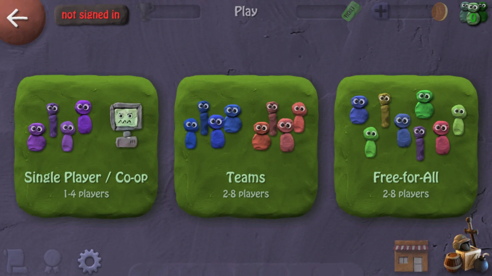

# Android 17 Google Play on Linux

The Linux x86-64 executable from the [v0.7.0 release](https://github.com/felipemarques/RustEmuDroid/releases/tag/v0.7.0) booted the Android 17 Google Play image in the integrated desktop window on Ubuntu 24.04 under WSL2 and WSLg. The test used the Linux Android Emulator 37.3.10, KVM and a dedicated AVD. Android reported version 17, API 37 and the `x86_64` ABI. The package manager found Google Play services (`com.google.android.gms`) and the Play Store (`com.android.vending`). The test used no Google account.

| Startup | Time reported by RustEmuDroid to `sys.boot_completed=1` |
|---|---:|
| First boot of the new AVD | 166.8 s |
| Next startup of the same AVD | 29.4 s |

Both times precede any check that a game can draw or respond to input. This setup stored the AVD on a Windows volume mounted in WSL. Each time represents a single observation on that configuration.

These two boots used Google's SwiftShader software renderer. The Ubuntu Vulkan loader exposed only the CPU device `llvmpipe (LLVM 20.1.2, 256 bits)`. A separate run on the same machine exercised hardware OpenGL through WSLg as described below. Bare-metal Linux remains untested on this host.

## Home and game input

Pressing Android Home brought the bundled RustEmuDroid Home to the foreground. Android also resolved the default Home action to `org.rustemudroid.home/.HomeActivity`. The Games tab showed BombSquad after installation.

BombSquad 1.8.10 (build 23095, x86-64) displayed its main menu at 1600 × 900. A touch sent through ADB to **Play** opened the three game modes pictured below. The test ended at mode selection. It did not measure a match or the desktop input latency. [Test APK from the publisher](https://ballistica.net/downloads)



## Select the Radeon 780M for OpenGL ES in WSLg

On this Ubuntu installation, a default X11 EGL context selected llvmpipe. With the Mesa D3D12 driver selected explicitly, the same probe reported `D3D12 (AMD Radeon 780M Graphics)` or `D3D12 (NVIDIA GeForce RTX 5070 Ti)`, depending on the adapter name. The Android test used the Radeon. The installed Mesa version was 25.2.8. [Microsoft WSLg graphics support](https://github.com/microsoft/wslg#opengl-accelerated-rendering-in-wslg) · [Mesa D3D12 driver](https://docs.mesa3d.org/drivers/d3d12.html)

After initializing the profile under **Repeat the boot**, close the current emulator and run this command from the same Linux shell. The three environment variables apply to this launch and its children.

```sh
MESA_LOADER_DRIVER_OVERRIDE=d3d12 GALLIUM_DRIVER=d3d12 \
MESA_D3D12_DEFAULT_ADAPTER_NAME='Radeon 780M' \
./rustemudroid --sdk "$sdk" --state-dir "$state" --lang en-US ui --gpu host
```

The existing Android 17 AVD reached `sys.boot_completed=1` in 23.1 s on one startup. The emulator log and Android's `dumpsys SurfaceFlinger` both identified the OpenGL ES translator on the Radeon through D3D12. With BombSquad in the foreground, Android reported OpenGL ES 3.1. For Vulkan, the same emulator log identified a CPU device and the guest's `cmd gpu vkjson` listed only `Goldfish GFXStream (llvmpipe (LLVM 21.1.8, 256 bits))`. Vulkan games and games using ANGLE over Vulkan in this configuration still use a software Vulkan backend. Both API readings matter when interpreting a benchmark.

### BombSquad in an active round

In BombSquad 1.8.10, open **Settings → Advanced → Benchmarks**, then scroll to **Stress Test**. Both trials used the default random playlist, eight simulated players in the test settings, a 30-second round setting and a 1600 × 900 display. Screenshots taken before and after each sample showed play continuing in the same round. Samples crossing a scene transition were excluded.

| Game surface | Presentations | Span | Presentations/s | Median frame interval | P95 frame interval |
|---|---:|---:|---:|---:|---:|
| King of the Hill, app using ANGLE over CPU Vulkan | 529 | 17.71 s | 29.81 | 32.40 ms | 41.51 ms |
| Death Match, app using native GLES on the Radeon 780M | 1,057 | 17.60 s | 60.00 | 16.65 ms | 17.55 ms |

On the default path, the game's GPU statistics showed `angleInUse=1`, a GLES context, a Vulkan device and a Vulkan swapchain. Only the compositor used the Radeon on this path. With the Android driver preference set to `native` for `net.froemling.bombsquad`, the new game process reported `angleInUse=0`, a GLES context and no Vulkan device or swapchain. The emulator identified its native GLES translator as D3D12 on the Radeon. The two samples used different game modes and maps, so they cannot quantify the gain from changing the driver alone.

Poll the game's SurfaceView using `dumpsys SurfaceFlinger --latency` about every 0.4 s. Keep distinct, completed timestamps from column two after the pre-sample baseline. Divide the number of consecutive intervals by their total duration. P95 uses the exclusive percentile of those intervals. [King of the Hill timestamps](../benchmarks/bombsquad/linux-wslg-angle-llvmpipe.csv) · [Death Match timestamps](../benchmarks/bombsquad/linux-wslg-native-radeon-780m.csv)


### Reproduce the per-game driver selection

Use the `adb`, `serial` and AVD path check in **Repeat the boot** below. Read the two Android settings before changing them. Package names and driver values line up by position. Record the original values, including absent keys, and preserve other packages when adding a trial entry. Android reads these preferences when the game process starts. [Android per-app ANGLE settings](https://android.googlesource.com/platform/packages/modules/ANGLE/)

```sh
"$adb" -s "$serial" shell settings get global angle_gl_driver_selection_pkgs
"$adb" -s "$serial" shell settings get global angle_gl_driver_selection_values
```

| Global setting | Original in the Linux test profile | During the native GLES trial |
|---|---|---|
| `angle_gl_driver_selection_pkgs` | `com.tencent.ig` | `com.tencent.ig,net.froemling.bombsquad` |
| `angle_gl_driver_selection_values` | `angle` | `angle,native` |

On an idle test profile, write each resulting list using `"$adb" -s "$serial" shell settings put global KEY VALUE` and read both back before reopening BombSquad. Force-stop only BombSquad from its Android app info, reopen it and check the `net.froemling.bombsquad` entry in `"$adb" -s "$serial" shell dumpsys gpu --gpustats --app` after gameplay. To finish the trial, restore both original values, using `settings delete global KEY` for any originally absent key, verify them and restart the game. Both original settings in the table were restored after this test.

## Boot with a runtime beside the executable

The packaged v0.9.0 Linux client found Android Emulator, ADB and the Android 15 x86-64 AOSP image in a `runtime/` directory beside the executable. The hosted Ubuntu 24.04 test started from an empty profile with the SDK environment variables unset, observed `sys.boot_completed=1` under KVM with SwiftShader, then verified the serial disappeared from ADB after shutdown. [Boot job and logs](https://github.com/felipemarques/RustEmuDroid/actions/runs/45401096585/job/138472366178) · [Portable directory layout](../README.md#prepare-the-android-runtime)

## Repeat the boot

Extract the Linux release, install the Linux Android SDK components shown in the [setup guide](../README.md#prepare-the-android-runtime), and verify that your Linux user can access `/dev/kvm`. From the directory containing the extracted executable, run the following commands. Set `sdk` to your Linux SDK path and choose an unused directory for `state` for a fresh boot.

```sh
sdk="$HOME/Android/Sdk"
state="$HOME/rustemudroid-play17-test"
./rustemudroid --sdk "$sdk" --state-dir "$state" --lang en-US init --image 'system-images;android-37.0;google_apis_playstore;x86_64'
./rustemudroid --sdk "$sdk" --state-dir "$state" --lang en-US ui --gpu swiftshader
```

Use the serial shown in the boot output with the `adb` from that SDK. `emu avd path` identifies the running profile before the remaining commands query it.

```sh
serial=emulator-5554  # Replace with your session's serial.
adb="$sdk/platform-tools/adb"
"$adb" -s "$serial" emu avd path
"$adb" -s "$serial" shell getprop sys.boot_completed
"$adb" -s "$serial" shell getprop ro.build.version.sdk
"$adb" -s "$serial" shell pm path com.google.android.gms
"$adb" -s "$serial" shell pm path com.android.vending
"$adb" -s "$serial" shell dumpsys SurfaceFlinger | grep 'GLES:'
```
