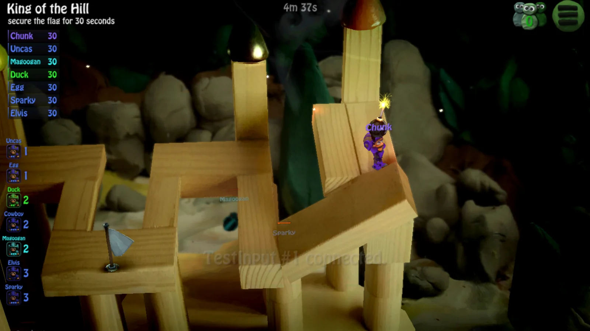
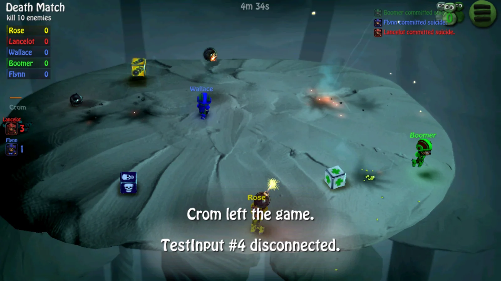

# Android 17 Google Play on Linux

The Linux x86-64 executable from the [v0.7.0 release](https://github.com/felipemarques/RustEmuDroid/releases/tag/v0.7.0) booted the Android 17 Google Play image in the integrated desktop window on Ubuntu 24.04 under WSL2 and WSLg. The test used the Linux Android Emulator 37.3.10, KVM and a dedicated AVD. Android reported version 17, API 37 and the `x86_64` ABI. The package manager found Google Play services (`com.google.android.gms`) and the Play Store (`com.android.vending`). The test used no Google account.

| Startup | Time reported by RustEmuDroid to `sys.boot_completed=1` |
|---|---:|
| First boot of the new AVD | 166.8 s |
| Next startup of the same AVD | 29.4 s |

Both times precede any check that a game can draw or respond to input. This setup stored the AVD on a Windows volume mounted in WSL. Each time represents a single observation on that configuration.

These two boots used Google's SwiftShader software renderer. The Ubuntu Vulkan loader exposed only the CPU device `llvmpipe (LLVM 20.1.2, 256 bits)`. A separate run on the same machine exercised hardware OpenGL through WSLg as described below. Bare-metal Linux remains untested on this host.

## Home and game input

Pressing Android Home brought the bundled RustEmuDroid Home to the foreground. Android also resolved the default Home action to `org.rustemudroid.home/.HomeActivity`. The Games tab showed BombSquad after installation.

BombSquad 1.8.10 (build 23095, x86-64) displayed its main menu at 1600 × 900. A touch sent through ADB to **Play** opened the three game modes pictured below. The test ended at mode selection. It did not measure a match or the desktop input latency. [Test APK from the publisher](https://ballistica.net/downloads)


## Select the Radeon 780M for OpenGL ES in WSLg

On this Ubuntu installation, a default X11 EGL context selected llvmpipe. With the Mesa D3D12 driver selected explicitly, the same probe reported `D3D12 (AMD Radeon 780M Graphics)` or `D3D12 (NVIDIA GeForce RTX 5070 Ti)`, depending on the adapter name. The Android test used the Radeon. The installed Mesa version was 25.2.8. [Microsoft WSLg graphics support](https://github.com/microsoft/wslg#opengl-accelerated-rendering-in-wslg) · [Mesa D3D12 driver](https://docs.mesa3d.org/drivers/d3d12.html)

After initializing the profile under **Repeat the boot**, close the current emulator and run this command from the same Linux shell. The three environment variables apply to this launch and its children.

```sh
MESA_LOADER_DRIVER_OVERRIDE=d3d12 GALLIUM_DRIVER=d3d12 \
MESA_D3D12_DEFAULT_ADAPTER_NAME='Radeon 780M' \
./rustemudroid --sdk "$sdk" --state-dir "$state" --lang en-US ui --gpu host
```

The existing Android 17 AVD reached `sys.boot_completed=1` in 23.1 s on one startup. The emulator log and Android's `dumpsys SurfaceFlinger` both identified the OpenGL ES translator on the Radeon through D3D12. With BombSquad in the foreground, Android reported OpenGL ES 3.1. For Vulkan, the same emulator log identified a CPU device and the guest's `cmd gpu vkjson` listed only `Goldfish GFXStream (llvmpipe (LLVM 21.1.8, 256 bits))`. Vulkan games and games using ANGLE over Vulkan in this configuration still use a software Vulkan backend. Both API readings matter when interpreting a benchmark.

Starting in v0.13.3, the Linux launcher skips adding the automatic ANGLE preference for PUBG MOBILE when the boot log identifies the selected Vulkan device as a CPU renderer. For existing profiles, read the per-app preferences below to verify which driver Android will use. Match the name on `Selecting Vulkan device` to its reported physical device type. The GLES renderer can use a different adapter.

### BombSquad in an active round

In BombSquad 1.8.10, open **Settings → Advanced → Benchmarks**, then scroll to **Stress Test**. Both trials used the default random playlist, eight simulated players in the test settings, a 30-second round setting and a 1600 × 900 display. Screenshots taken before and after each sample showed play continuing in the same round. Samples crossing a scene transition were excluded.

| Game surface | Presentations | Span | Presentations/s | Median frame interval | P95 frame interval |
|---|---:|---:|---:|---:|---:|
| King of the Hill, app using ANGLE over CPU Vulkan | 529 | 17.71 s | 29.81 | 32.40 ms | 41.51 ms |
| Death Match, app using native GLES on the Radeon 780M | 1,057 | 17.60 s | 60.00 | 16.65 ms | 17.55 ms |

On the default path, the game's GPU statistics showed `angleInUse=1`, a GLES context, a Vulkan device and a Vulkan swapchain. Only the compositor used the Radeon on this path. With the Android driver preference set to `native` for `net.froemling.bombsquad`, the new game process reported `angleInUse=0`, a GLES context and no Vulkan device or swapchain. The emulator identified its native GLES translator as D3D12 on the Radeon. The two samples used different game modes and maps, so they cannot quantify the gain from changing the driver alone.

Poll the game's SurfaceView using `dumpsys SurfaceFlinger --latency` about every 0.4 s. Keep distinct, completed timestamps from column two after the pre-sample baseline. Divide the number of consecutive intervals by their total duration. P95 uses the exclusive percentile of those intervals. [King of the Hill timestamps](../benchmarks/bombsquad/linux-wslg-angle-llvmpipe.csv) · [Death Match timestamps](../benchmarks/bombsquad/linux-wslg-native-radeon-780m.csv)





### Reproduce the per-game driver selection

Use the `adb`, `serial` and AVD path check in **Repeat the boot** below. Read the two Android settings before changing them. Package names and driver values line up by position. Record the original values, including absent keys, and preserve other packages when adding a trial entry. Android reads these preferences when the game process starts. [Android per-app ANGLE settings](https://android.googlesource.com/platform/packages/modules/ANGLE/)

```sh
"$adb" -s "$serial" shell settings get global angle_gl_driver_selection_pkgs
"$adb" -s "$serial" shell settings get global angle_gl_driver_selection_values
```

| Global setting | Original in the Linux test profile | During the native GLES trial |
|---|---|---|
| `angle_gl_driver_selection_pkgs` | `com.tencent.ig` | `com.tencent.ig,net.froemling.bombsquad` |
| `angle_gl_driver_selection_values` | `angle` | `angle,native` |

On an idle test profile, write each resulting list using `"$adb" -s "$serial" shell settings put global KEY VALUE` and read both back before reopening BombSquad. Force-stop only BombSquad from its Android app info, reopen it and check the `net.froemling.bombsquad` entry in `"$adb" -s "$serial" shell dumpsys gpu --gpustats --app` after gameplay. To finish the trial, restore both original values, using `settings delete global KEY` for any originally absent key, verify them and restart the game. Both original settings in the table were restored after this test.

## AMD graphics on bare-metal Linux

Starting in v0.24.1, the Linux client handles two memory features that the stock Android Emulator turns on by itself when the host Vulkan device is from AMD (the amdgpu driver with RADV). It prepares this for the Host GPU and Automatic modes, when `/sys/class/drm` lists an AMD card and the selected Vulkan adapter does not name another vendor.

On Linux the Automatic GPU mode currently ends in the emulator's software renderer, because the client starts the engine with `-no-window` (the engine log shows `emuglConfig_init: vulkan_mode_selected:lavapipe`). The AMD handling matters with the Host GPU mode.

| Emulator feature | Effect on an AMD card | What the client does |
|---|---|---|
| `VulkanAllocateHostMemory` | The driver receives ordinary process memory. When the engine starts a helper program (adb, `chattr`), the driver can not get that memory back within one second, rejects the next commands (`The CS has been rejected … (-16)`) and the engine aborts with `Encountered device lost.` The same rejection was seen once with no helper program involved. | Leaves the feature on and adds a small library to the engine's `LD_PRELOAD` with the two defences below. [Library source](../native/linux/userptr_guard.c) |
| `VulkanAllocateDeviceMemoryOnly` | Android sees only the video memory the processor can reach. With "Above 4G Decoding" / "Resizable BAR" off in the firmware that window is 256 MB, and Unity games stop with `Vulkan - Out of memory!`. | Chooses a memory mode, below. |

The library defends the memory the driver received in two ways:

1. It keeps that memory out of the start of the engine's helper programs, so starting one no longer takes it away from the driver.
2. When the driver still rejects a submission of drawing commands because it could not get that memory within its one-second limit, the library makes the memory present and writable again, which has no time limit outside the driver, and sends the same submission again with a short, growing pause, for at most 30 seconds. A rejected submission was not submitted at all, so sending it again repeats nothing. The graphics stack already resends a submission this way when the driver answers EAGAIN.

If the driver keeps rejecting for 30 seconds, the engine still ends as before, and the client then says that the graphics driver lost the device.

| Memory mode | When the client uses it | What it does |
|---|---|---|
| Full size | The window is smaller than the video memory (`mem_info_vis_vram_total` below `mem_info_vram_total`), whatever the kernel | Leaves the emulator's options alone and starts the library with `RUSTEMUDROID_AMD_VISIBLE_VRAM=all`. The driver's memory query then reports the whole video memory as processor visible, so the memory Android can map has its real size. |
| Stock | The window covers the video memory, or the sizes can not be read | Leaves the emulator's options alone. |
| All types | Only with `RUSTEMUDROID_AMD_LINUX=all-types` | Passes `-feature -VulkanAllocateDeviceMemoryOnly`, which also gives Android the memory types outside the card. |

The library is added in all three modes. A default only uses a mode that was measured, and all types froze Android on the one kernel it was measured on.

### Measured on a Radeon RX 580 with Linux 6.8

Everything below comes from one PC and one kernel: a Radeon RX 580 8 GB with a 256 MB window, RADV / Mesa 25.2.8, Linux 6.8, Android Emulator 37.3.10 and the official Android 17 Google Play image.

The first two tables come from a disposable profile, with the library and the options applied by hand around the stock engine. Without the library, Xtreme Rally gave these results:

| `VulkanAllocateDeviceMemoryOnly` | `VulkanAllocateHostMemory` | Result |
|---|---|---|
| on (emulator's choice) | on (emulator's choice) | Game out of memory, 5 of 5 |
| on | off | Game out of memory |
| off (all types) | on | Graphics device lost and engine abort 13–14 s into the race, 2 of 2 |
| off | off | `error: kvm run failed Bad address`, Android frozen |

With the library loaded, when it had only its first defence:

| Game | Stock | All types | Full size |
|---|---|---|---|
| Xtreme Rally (Unity 6 URP) | Out of memory | Works, 10 minute race | Works, 10 minute race, peak video memory 3980 MB |
| FPS WW2 (Unity URP) | Out of memory | Works | Works |
| Godot third-person demo | Works | Works | Works |
| Godot 4.7 game | Menu for 150 s without a freeze, not played further | Android frozen after 5 s, `kvm run failed Bad address` | Android frozen after 20 s |
| Unreal Engine 5 game | The game closes itself (engine assertion), Android keeps running | Android frozen after 18 s | The game closes itself, Android keeps running |

None of these hand-applied runs lost the graphics device. In full size, the sequence that first showed the fault (the Unreal Engine game twice, then a 240 s race) and a 600 s race both ran without a graphics error.

### One lost device through the client, and the second defence

The first run through the client lost the graphics device once: 87 s into a race, in full size with the Host GPU mode, with the library active and only its first defence (`radv/amdgpu: The CS has been rejected (-16)`, then `Encountered device lost`). The client showed its "graphics driver lost the device" message.

The cause of that one event was not identified. On this path (`-no-window`, the headless engine binary) the engine starts its helper programs only during boot, before the driver has received any of that memory, so it was not a helper program. The engine had only 5 to 7 such buffers of 16 MiB each. The PC was under heavy memory activity at the time: another program on it was being restarted every 22 s and the kernel was compacting memory, moving up to 340 thousand pages per second. The event came about one second after that program exited. That is a coincidence in time, not a proof. Two later runs on the same path, of 420 s and 900 s, did not repeat it.

What the Linux 6.8 driver does, going by its source: for each submission it must get the pages of every such buffer again, and when it can not within about one second it answers the submission with EBUSY. RADV then prints `The CS has been rejected (-16)` and reports the device as lost. Nothing was submitted at that point, which is what makes sending the submission again safe. The second defence was added after this event.

With the final library:

| Run | Result |
|---|---|
| Rejections provoked on purpose: stock engine started with `-qt-hide-window`, all types, the test switch below | The driver rejected 8 submissions in a 150 s race. Every one was accepted when sent again: six after one more attempt in 9–33 ms, two after two more attempts in about 1050 ms. No device lost. |
| The same configuration without the library | Device lost 13–14 s into the race, 2 of 2 |
| Final client, `boot --headless --gpu host`, lab profile | 300 s race without a graphics error. Library installed under the user data folder, the preload and the variable present in the engine process, nothing had to be sent again. A 30 minute race then ran to the end without a graphics error; during it the driver rejected two submissions with no helper program involved, and both were accepted on the first resend, 5 ms later. That is the event the first run through the client died of. |
| Final client, all types forced, Godot 4.7 game | `kvm run failed Bad address` 9 s after the game started. The client stopped the VM and showed its explanation with "256 MB of 8192 MB, kernel 6.8". |
| Linux build of the final tree | `cargo fmt` clean, release build with `--features ui`, 157 tests passed, 12 ignored |

### Expected, not measured

On Linux 6.8, KVM can not map the driver's system-memory pages into the guest. A game that needs them freezes Android with `error: kvm run failed Bad address`, as the Godot 4.7 game still does in full size. The client stops that VM and reports the cause.

Going by the kernel and driver sources, two things should remove these freezes: enabling **Above 4G Decoding** and **Resizable BAR** in the firmware (BIOS/UEFI), which should make the window as large as the video memory, and Linux 6.13 or newer, whose KVM should map those pages. All types should then also work on Linux 6.13 or newer. Nobody has run any of this. The client's failure message and `doctor` suggest both remedies as something that should help, and the client does not choose all types by itself on any kernel.

Other AMD cards, integrated AMD graphics and computers with two AMD cards were not tested.

### What you see

**Technical details** on the start screen shows what the client prepared before the engine started, for example `AMD graphics on Linux: video memory protection prepared; with the host GPU, Android sees the whole 8192 MB instead of the 256 MB window.` It does not say which renderer the engine then chose. With the Host GPU mode the engine log has these lines from the library:

- `RustEmuDroid: userptr guard active`, once the driver registers its first buffer.
- `RustEmuDroid: userptr guard reports all 8192 MiB of video memory as CPU visible (the window is 256 MiB)`, in full size.
- `RustEmuDroid: userptr guard: the driver rejected a submission (busy pages); accepted after N more attempts in M ms (K so far)`, when a submission had to be sent again. The first eight are printed and then every power of two. `still rejected` in place of `accepted` means the 30 seconds ran out; the engine then ends and the client reports the lost device.

The library is written to `${XDG_DATA_HOME:-$HOME/.local/share}/RustEmuDroid/lib/`. An existing `LD_PRELOAD` is kept.

To diagnose, set `RUSTEMUDROID_AMD_LINUX` before starting the client. `off` starts the engine as before. `stock`, `full-size` and `all-types` add the library and force that memory mode. For testing only, `RUSTEMUDROID_USERPTR_GUARD_TEST=allow-fork` makes the library leave the driver's buffers visible to the start of helper programs, which brings back the original rejection on purpose so the second defence can be watched in the engine log. Do not use it for playing.

## Boot with a runtime beside the executable

The packaged v0.9.0 Linux client found Android Emulator, ADB and the Android 15 x86-64 AOSP image in a `runtime/` directory beside the executable. The hosted Ubuntu 24.04 test started from an empty profile with the SDK environment variables unset, observed `sys.boot_completed=1` under KVM with SwiftShader, then verified the serial disappeared from ADB after shutdown. [Boot job and logs](https://github.com/felipemarques/RustEmuDroid/actions/runs/45401096585/job/138472366178) · [Portable directory layout](../README.md#prepare-the-android-runtime)

## Repeat the boot

Extract the Linux release and check that your user can read and write `/dev/kvm`. For a first installation, run the following command from the extracted directory to review the Google Play runtime download and terms.

```sh
./rustemudroid runtime-setup --image google-play
```

If you accept the terms, repeat the command with `--accept-license`. You can also review and install the same runtime in the desktop setup dialog. RustEmuDroid installs the emulator, ADB and the Android image together. [First-time setup](../README.md#first-time-setup-in-rustemudroid)

The following commands use the managed Linux runtime and an unused state directory for the fresh Google Play boot. For a portable runtime beside the executable, set `sdk="$PWD/runtime"`. For an existing Linux SDK, set `sdk` to its installed root. SwiftShader reproduces the software-rendered boot described above.

```sh
sdk="${XDG_DATA_HOME:-$HOME/.local/share}/RustEmuDroid/runtime"
state="$HOME/rustemudroid-play17-test"
./rustemudroid --sdk "$sdk" --state-dir "$state" --lang en-US init --image 'system-images;android-37.0;google_apis_playstore;x86_64'
./rustemudroid --sdk "$sdk" --state-dir "$state" --lang en-US ui --gpu swiftshader
```

Use the serial shown in the boot output with the `adb` from the selected runtime. `emu avd path` identifies the running profile before the remaining commands query it.

```sh
serial=emulator-5554  # Replace with your session's serial.
adb="$sdk/platform-tools/adb"
"$adb" -s "$serial" emu avd path
"$adb" -s "$serial" shell getprop sys.boot_completed
"$adb" -s "$serial" shell getprop ro.build.version.sdk
"$adb" -s "$serial" shell pm path com.google.android.gms
"$adb" -s "$serial" shell pm path com.android.vending
"$adb" -s "$serial" shell dumpsys SurfaceFlinger | grep 'GLES:'
```
