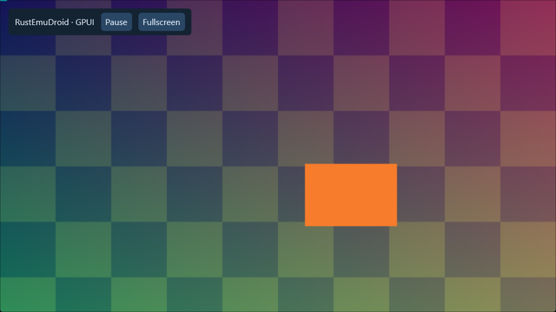

# GPU viewer comparison

This lab compares two ways of drawing Android frames in a Rust desktop window. The Glow viewer uses the same OpenGL texture uploader as RustEmuDroid. The GPUI viewer uses Direct3D 11 on Windows. Both accept the same RGBA frames, keep at most one pending frame and fit the image to the window. You can run the comparison without starting an emulator. [GPUI](https://www.gpui.rs/) · [Glow uploader](../src/display/native_texture.rs)

To try a prebuilt package, extract the archive, open a terminal in the extracted folder and run `.\gpui-viewer.exe --demo` on Windows or `./gpui-viewer --demo` on Linux. Both release archives contain the two viewers and the optional Python tools. Windows received an interactive desktop test. Linux received build, test and CLI checks on Ubuntu 24.04. [Download lab v0.1.1 for Windows or Linux](https://github.com/felipemarques/RustEmuDroid/releases/tag/gpui-lab-v0.1.1)

## Try the viewers on Windows

From the repository root, build the two independent executables with stable Rust, the Visual Studio C++ tools and the Windows SDK. The first GPUI build also compiles its graphics dependencies. Run these commands in PowerShell.

```powershell
cargo build --locked --release --manifest-path experiments/gpui-viewer/Cargo.toml --jobs 3
cargo build --locked --release --manifest-path experiments/glow-baseline/Cargo.toml --jobs 3
$gpui = (Resolve-Path experiments/gpui-viewer/target/release/gpui-viewer.exe).Path
$glow = (Resolve-Path experiments/glow-baseline/target/release/glow-baseline.exe).Path
& $gpui --width 1600 --height 900 --fps 90 --seconds 12
```

Open the interactive prototype with `& $gpui --demo`. Use the floating controls to pause the local picture or enter fullscreen. The default interface is Brazilian Portuguese. Set `--lang en-US` or `--lang es-ES` to switch. Pass the same `--raw` file and dimensions to try the controls over your own gameplay.



The last command opens a window with a moving pattern and prints a JSON result when the test ends. To play a saved Android recording, add `--raw .\race.rgba --width 640 --height 360` using the actual width and height of that recording. On Linux use the same Cargo commands and omit the `.exe` suffix. Open a graphical desktop session to run either viewer. [GPUI build instructions](gpui-viewer/README.md) · [Glow build instructions](glow-baseline/README.md)

## Compare both renderers

Use Python 3.11 or later. Keep the windows visible on the same monitor and leave the desktop idle. From the same PowerShell session, run the pair in Glow → GPUI → GPUI → Glow order.

```powershell
python -m pip install psutil
python experiments/compare.py --glow "$glow" --gpui "$gpui" --seconds 12 --output synthetic-abba.json
python experiments/compare.py --glow "$glow" --gpui "$gpui" --seconds 12 --raw .\race.rgba --width 640 --height 360 --output race-abba.json
```

The second command using `race.rgba` needs a recording from the next section. Use a new output filename on each run. Both viewers receive the same deadlines, warm-up, dimensions and playback rate. Check the GPU name in every run, especially on multi-GPU systems. The reports count distinct frames reaching each viewer's paint callback. They also include dropped pending frames, time to the callback, process CPU time and peak sampled resident memory. The controlled replay isolates the cost of the panel from rendering the game inside Android.

## View or record your running Android session

Start the regular RustEmuDroid native player once and open a game. Use the ADB executable for that runtime to identify the selected emulator and its AVD path. For example, if `adb devices` shows `emulator-5554`, run `adb -s emulator-5554 emu avd path`. Substitute the printed directory below. The bridge matches the console port and AVD directory together, reads its registration and opens an authenticated screenshot stream on loopback. It can feed a viewer while the original VM continues running.

```powershell
python -m pip install -r experiments/android-stream/requirements.txt
$avd = 'D:\path\printed\by\adb\RustEmuDroid.avd'
python experiments/android-stream/capture.py --avd "$avd" --console 5554 --width 640 --height 360 --viewer "$gpui" --seconds 20
python experiments/android-stream/capture.py --avd "$avd" --console 5554 --width 640 --height 360 --viewer "$gpui" --demo
python experiments/android-stream/capture.py --avd "$avd" --console 5554 --width 640 --height 360 --output .\race.rgba --frames 120
```

Choose dimensions with the current Android display's aspect ratio. A 120-frame 640 × 360 recording uses approximately 105.5 MiB. The files contain your screen pixels. For the comparison, use the same local file for both renderers. The live bridge is a read-only viewer of the existing guest. A stationary scene can deliver repeated pixels, which both renderers discard when counting new frames.

## Windows measurements

Two 12-second samples per viewer and workload on the Radeon 780M, with a 1040 × 585 physical client area and input scheduled at 90 frames/s. Each run had two seconds of warm-up. The kart input was a loop of 120 distinct frames captured from the Android 16 SuperTuxKart Black Forest replay at 640 × 360. The synthetic input was generated at 1600 × 900. CPU is process CPU time divided by elapsed time with one logical core equal to 100%. Memory is the largest sampled working set across the two runs.

| Input | Viewer | Run 1 / run 2, frames/s | Pooled frames/s | Average CPU, one core | Peak working set |
| --- | --- | ---: | ---: | ---: | ---: |
| SuperTuxKart replay | Glow | 88.00 / 86.92 | 87.46 | 19.2% | 112.4 MiB |
| SuperTuxKart replay | GPUI | 86.67 / 88.42 | 87.54 | 14.9% | 57.6 MiB |
| Synthetic 900p | Glow | 85.33 / 88.00 | 86.67 | 29.8% | 189.9 MiB |
| Synthetic 900p | GPUI | 86.50 / 85.92 | 86.21 | 28.4% | 92.4 MiB |

On the kart input the mean difference was 0.08 frames/s, smaller than the spread between runs of either viewer. GPUI used less CPU and memory for that workload. Neither workload demonstrates a consistent throughput advantage. These are single-layer panel tests on one Windows system. Game FPS is measured separately with the game's benchmark. [Kart run data](results/windows-radeon780m-stk.json) · [Synthetic run data](results/windows-radeon780m-synthetic.json) · [In-game results for RustEmuDroid, Kemu and BlueStacks](../benchmarks/stk-1.5/vulkan-end-scene.md#how-the-kemu-and-rust-windows-receive-game-frames)

We repeated both comparisons with the release-mode binaries that include the interactive demo and physical-pixel sizing. The timing mode kept the overlay closed. On the kart clip GPUI processed **86.75 frames/s** and Glow **85.17**. On the 900p input the order reversed, with **85.96** for GPUI and **87.71** for Glow. Peak process working sets for the kart clip were 57.5 and 112.4 MiB, respectively. Each JSON includes the executable hashes and individual passes. [Kart repeat](results/windows-radeon780m-stk-release.json) · [900p repeat](results/windows-radeon780m-synthetic-release.json)

A separate four-pass PresentMon run on the 100 Hz display recorded a larger difference later in the pipeline. With the kart clip, Windows attributed **70.55 presentation events/s to GPUI** and **83.45 to Glow**. Their paint callbacks had both accepted about 85.4 different source frames/s over the longer observation window. ETW identifies submissions and display timings; it cannot associate each event with a particular source image. The GPU, client area, monitor and process attribution were verified for every pass. [Windows presentation measurements](results/windows-viewers-stk-presentmon.md)

We then repeated the trace with both executables extracted from the published **v0.1.1 Windows ZIP**. GPUI and Glow accepted **87.81 and 87.44 different source frames/s**, respectively. Windows recorded **71.18 GPUI and 82.50 Glow presentation events/s**. These measurements reproduce the direction of the first trace using the binaries available for download. [Release trace and archive hash](results/windows-viewers-stk-presentmon-release.json)

The remaining transport question is how much the native rendering surface costs to show directly in the desktop window. Kemu already creates a child Vulkan surface in its Qt window. Both lab viewers still receive CPU-visible RGBA and upload it to their GPU. The measurements favour testing that handoff before migrating desktop frameworks. [Kemu and Rust rendering paths](../benchmarks/stk-1.5/vulkan-end-scene.md#how-the-kemu-and-rust-windows-receive-game-frames)
